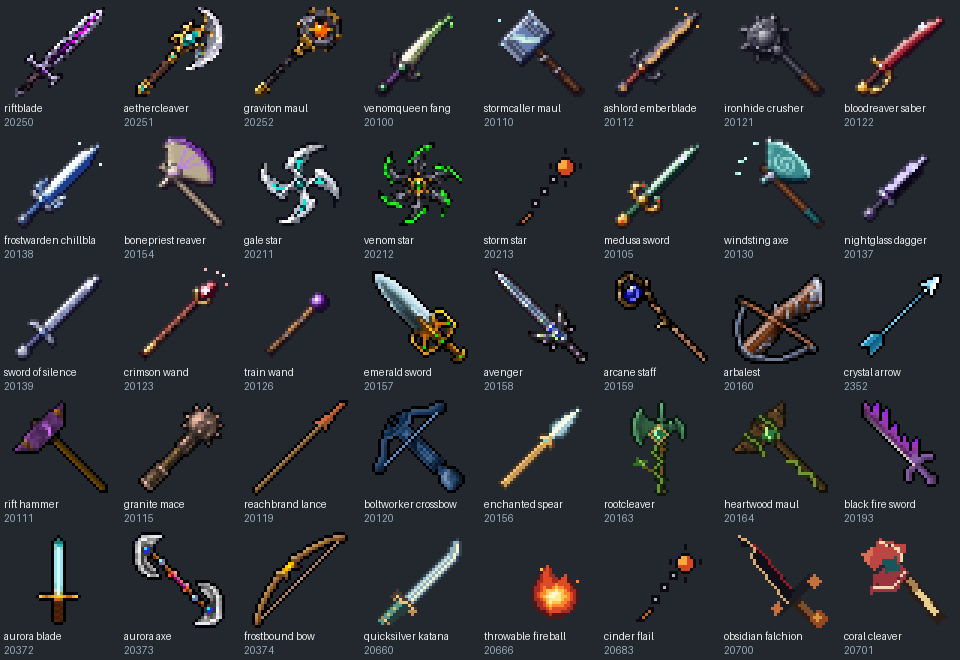

# Armas propias

> Generado con `python3.11 scripts/items/weapon-catalog.py --write`: **no editar a mano**. Al crear un arma,
> agregar su fila en `NOTES` del script (grupo, efecto, fuente y doc) y volver a correrlo. El tipo, ataque y
> defensa salen del OTB (`items-zagan-test.otb`); el loot, de los XML de monstruos (sin variantes rage, que
> suelen tener la misma chance o más).

40 armas propias (sin contar escudos ni las armas comunes de 7.6). GM: `/i ID 1` o `/i nombre`.
Para crear una: [IMPORTAR_ITEM_DESDE_IMAGEN.md](../items-and-map/IMPORTAR_ITEM_DESDE_IMAGEN.md),
[IMPORTAR_ITEM_DE_OTRA_VERSION.md](../items-and-map/IMPORTAR_ITEM_DE_OTRA_VERSION.md); gameplay en C++: `AGENTS.md` §8.

## Melee Relics

| Arma | ID | Tipo | Atq / def | Qué hace | Dónde sale | Doc |
|---|---:|---|---|---|---|---|
| **riftblade** | `20250` | espada | 46 / 28 | 1200 ms. Cada 3er golpe al mismo blanco suma 22–34 de energía (mitad en PvP); grieta violeta | Warlock 0.3% | [MELEE_RELICS](MELEE_RELICS.md) |
| **aethercleaver** | `20251` | hacha | 48 / 26 | 1333 ms. Devuelve 12% del daño a vida como maná (máx. 10 por golpe, 5 en PvP); espirales turquesa | Root Colossus 0.35% | [MELEE_RELICS](MELEE_RELICS.md) |
| **graviton maul** | `20252` | maza | 55 / 22 | 2 manos, 1600 ms. 25%: suma 12 + armadura/2 (máx. 42) de daño físico; anillo ámbar | Worker Golem 0.4% | [MELEE_RELICS](MELEE_RELICS.md) |

## El Crisol

| Arma | ID | Tipo | Atq / def | Qué hace | Dónde sale | Doc |
|---|---:|---|---|---|---|---|
| **venomqueen fang** | `20100` | espada | 39 / 22 | 950 ms. 25% veneno | Crucible Venomqueen 4.5% | [CRUCIBLE](CRUCIBLE.md) |
| **stormcaller maul** | `20110` | maza | 46 / 14 | 1000 ms. Estela de energía; 20% estallido | Crucible Stormcaller 4.5% | [CRUCIBLE](CRUCIBLE.md) |
| **ashlord emberblade** | `20112` | espada | 44 / 28 | 1100 ms. Estela de fuego; 20% quemadura | Crucible Ashlord 4.5% | [CRUCIBLE](CRUCIBLE.md) |
| **ironhide crusher** | `20121` | maza | 50 / 16 | 1700 ms. 22% raíz 2,5 s en PvP | Crucible Ironhide 4.5% | [CRUCIBLE](CRUCIBLE.md) |
| **bloodreaver saber** | `20122` | espada | 46 / 28 | 1200 ms. 30%: roba vida (25% del daño) | Crucible Bloodreaver 4.5% | [CRUCIBLE](CRUCIBLE.md) |
| **frostwarden chillblade** | `20138` | espada | 42 / 34 | 1200 ms. 18% frío (lentitud 4 s en PvP) | Crucible Frostwarden 4.5% | [CRUCIBLE](CRUCIBLE.md) |
| **bonepriest reaver** | `20154` | hacha | 43 / 24 | 15% drena maná | Crucible Bonepriest 4.5% | [CRUCIBLE](CRUCIBLE.md) |

## Paladin Stars

| Arma | ID | Tipo | Atq / def | Qué hace | Dónde sale | Doc |
|---|---:|---|---|---|---|---|
| **gale star** | `20211` | distancia | 30 | Reutilizable, 85% hit, 900 ms; estela de viento | Furious Amazon 0.3% | [PALADIN_STARS](PALADIN_STARS.md) |
| **venom star** | `20212` | distancia | 38 | Reutilizable, 85% hit; veneno | Serpent Spawn 0.4% | [PALADIN_STARS](PALADIN_STARS.md) |
| **storm star** | `20213` | distancia | 40 | Reutilizable, 85% hit; descarga de energía | Black Dragon 0.4% | [PALADIN_STARS](PALADIN_STARS.md) |

## Armas PvP

| Arma | ID | Tipo | Atq / def | Qué hace | Dónde sale | Doc |
|---|---:|---|---|---|---|---|
| **medusa sword** | `20105` | espada | 42 / 23 | Paraliza en PvP al golpear | Angry Demon 0.25%, Enraged Demon 0.55%, Furious Demon 0.4% | [ZAGAN_TEST_ITEMS](../items-and-map/ZAGAN_TEST_ITEMS.md) |
| **windsting axe** | `20130` | hacha | 43 / 22 | 20%: emborracha 6 s en PvP | Enraged Behemoth 0.4%, Enraged Black Knight 0.4%, Enraged Dwarf Guard 0.4%, Enraged Orc Berserker 0.4% | [ZAGAN_TEST_ITEMS](../items-and-map/ZAGAN_TEST_ITEMS.md) |
| **nightglass dagger** | `20137` | espada | 24 / 21 | Ataque más rápido; proyectil de fuego al pegar | Serpent Spawn 0.45% | [ZAGAN_TEST_ITEMS](../items-and-map/ZAGAN_TEST_ITEMS.md) |
| **sword of silence** | `20139` | espada | 42 / 30 | 10%: silencio PvP 2–3 s (solo hechizos hablados); 12 s por blanco | Fury 0.4%, Wrath 0.55% | [ZAGAN_TEST_ITEMS](../items-and-map/ZAGAN_TEST_ITEMS.md) |

## Wands

| Arma | ID | Tipo | Atq / def | Qué hace | Dónde sale | Doc |
|---|---:|---|---|---|---|---|
| **crimson wand** | `20123` | wand | 55–65 | Sorcerer/Druid nivel 33+: 13 maná, rango 5, 667 ms; imbue de ML hasta +4 | Quest Isla del Hielo: guarida | [WANDS](WANDS.md) |
| **train wand** | `20126` | wand | 1 | Solo contra trainers: 0 maná, entrena magic level | Hoy no se consigue (solo `/i`) | [WANDS](WANDS.md) |

## Armas de 8.x

| Arma | ID | Tipo | Atq / def | Qué hace | Dónde sale | Doc |
|---|---:|---|---|---|---|---|
| **emerald sword** | `20157` | espada | 49 / 33 | Sprite de 8.x | Cámara de las Armas (Pozos del Infierno, elegir una) | [IMPORTAR_ITEM_DE_OTRA_VERSION](../items-and-map/IMPORTAR_ITEM_DE_OTRA_VERSION.md) |
| **avenger** | `20158` | espada | 50 / 38 | Sprite de 8.x | Cámara de las Armas (Pozos del Infierno, elegir una) | [IMPORTAR_ITEM_DE_OTRA_VERSION](../items-and-map/IMPORTAR_ITEM_DE_OTRA_VERSION.md) |
| **arcane staff** | `20159` | maza | 50 / 30 | Sprite de 8.x, 2 manos | Cámara de las Armas (Pozos del Infierno, elegir una) | [IMPORTAR_ITEM_DE_OTRA_VERSION](../items-and-map/IMPORTAR_ITEM_DE_OTRA_VERSION.md) |
| **arbalest** | `20160` | distancia | 2 | Ballesta; el ataque lo da el bolt | Cámara de las Armas (Pozos del Infierno, elegir una) | [IMPORTAR_ITEM_DE_OTRA_VERSION](../items-and-map/IMPORTAR_ITEM_DE_OTRA_VERSION.md) |

## Otras

| Arma | ID | Tipo | Atq / def | Qué hace | Dónde sale | Doc |
|---|---:|---|---|---|---|---|
| **crystal arrow** | `2352` | distancia | 35 | Se tira como una spear, 85% hit, no se gasta; Blue Gem: hasta +25% de velocidad | Elven Archmage 0.8%, Elvenbane Ranger 3%, Lord of Elvenbane 1.5%, Orc Warlord 0.35%, Enraged Hero 0.45%, Furious Amazon 0.3% | [CRYSTAL_ARROW](CRYSTAL_ARROW.md) |
| **rift hammer** | `20111` | maza | 45 / 10 | Sin efecto | Crucible Stormcaller 5% | [ZAGAN_TEST_ITEMS](../items-and-map/ZAGAN_TEST_ITEMS.md) |
| **granite mace** | `20115` | maza | 16 / 11 | Sin efecto | Stone Golem 1.5% | [ZAGAN_TEST_ITEMS](../items-and-map/ZAGAN_TEST_ITEMS.md) |
| **reachbrand lance** | `20119` | hacha | 47 / 16 | Sin efecto | Imperial Hero 0.4% | [ZAGAN_TEST_ITEMS](../items-and-map/ZAGAN_TEST_ITEMS.md) |
| **boltworker crossbow** | `20120` | distancia | 1 | Sin efecto | Imperial Hero 0.45%, Worker Golem 0.35%, Wyrm 0.35% | [ZAGAN_TEST_ITEMS](../items-and-map/ZAGAN_TEST_ITEMS.md) |
| **enchanted spear** | `20156` | distancia | 36 | Lanza que vuelve; proyectil propio | Imperial Hero 0.55%, Serpent Spawn 0.5%, Wyrm 0.5% | [ENCHANTED_SPEAR](ENCHANTED_SPEAR.md) |
| **rootcleaver** | `20163` | hacha | 49 / 31 | Sin efecto | Root Colossus 0.6% | [ROOT_COLOSSUS](ROOT_COLOSSUS.md) |
| **heartwood maul** | `20164` | maza | 52 / 28 | 2 manos, sin efecto | Root Colossus 0.5% | [ROOT_COLOSSUS](ROOT_COLOSSUS.md) |
| **black fire sword** | `20193` | espada | 35 / 22 | Fire sword de fuego negro, sin efecto; luz violeta | Dark Hydra 0.6% | [ZAGAN_TEST_ITEMS](../items-and-map/ZAGAN_TEST_ITEMS.md) |
| **aurora blade** | `20372` | espada | 36 / 30 | — | Frost Dragon 0.45%, Ice Spider 0.35% | — |
| **aurora axe** | `20373` | hacha | 34 / 22 | — | Crystal Spider 0.25%, Frost Dragon 0.45%, Ice Monk 0.3% | — |
| **frostbound bow** | `20374` | distancia | 1 | — | Crystal Spider 0.25%, Elvenbane Ranger 0.8%, Frost Dragon 0.4% | — |
| **quicksilver katana** | `20660` | espada | 32 / 16 | Cortes cada 650 ms | GM: `/i 20660 1` | [QUICKSILVER_KATANA](QUICKSILVER_KATANA.md) |
| **throwable fireball** | `20666` | distancia | 22 | Arrojadiza apilable y reutilizable; proyectil de fuego | Fire Elemental 12% | [THROWING_FIREBALL](THROWING_FIREBALL.md) |
| **cinder flail** | `20683` | maza | 32 / 16 | Maza 1 mano, silueta propia, sin efecto | — | [ZAGAN_TEST_ITEMS](../items-and-map/ZAGAN_TEST_ITEMS.md) |
| **obsidian falchion** | `20700` | espada | 44 / 26 | Espada 1 mano, silueta propia, sin efecto | — | [ZAGAN_TEST_ITEMS](../items-and-map/ZAGAN_TEST_ITEMS.md) |
| **coral cleaver** | `20701` | hacha | 42 / 23 | Hacha 1 mano, silueta propia, sin efecto | — | [ZAGAN_TEST_ITEMS](../items-and-map/ZAGAN_TEST_ITEMS.md) |
