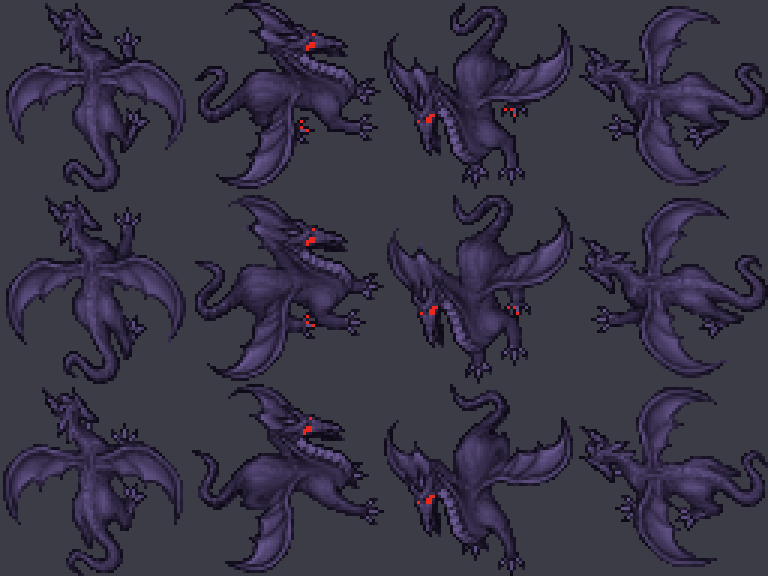

# Black Dragon

Dragón oscuro, un escalón por encima del Dragon Lord. En vez de fuego, su aliento drena vida.



## Antes de ponerlo en el mapa: el cliente

**El Black Dragon usa el looktype 230, que es un sprite nuevo.** Si un jugador con el cliente viejo ve un Black Dragon, el looktype 230 está vacío en su `Tibia.dat` y el monstruo sale invisible (o el cliente puede fallar). Por eso:

1. Primero se actualizan los `Tibia.dat`/`Tibia.spr` de los jugadores (updater o descarga).
2. Recién después se agrega el Black Dragon a `test-spawn.xml` y se despliega.

Hoy no está en ningún spawn.

En el protocolo 7.6 el looktype viaja en **1 byte** (máximo 255). El 230 era uno de los slots vacíos del cliente 7.6 base (vacíos: 161–200, 229–254, entre otros).

## Archivos

| Pieza | Archivo |
|-------|---------|
| Definición | `server/YurOTS/ots/data/monster/black dragon.xml` |
| Registro | `server/YurOTS/ots/data/monster/monsters.xml` |
| Aliento oscuro | `server/YurOTS/ots/data/spells/instant/blackdragon_darkwave.lua` + entrada en `spells.xml` |
| RME | `rme-extensions/yurots-creatures.xml` (tileset "YurOTS Custom") y `devtools/rme/rme-client-760/Tibia.{dat,spr}` |
| Sprite | `scripts/client-rme/add_black_dragon_look.py` |

## Stats

Comparado con Dragon Lord (1900 de vida, 2100 de experiencia):

| | Black Dragon |
|---|---|
| Vida | 2600 |
| Experiencia | 2900 |
| Velocidad | 210 |
| Armor / defense | 34 / 36 |
| Melee | 80–240 |
| `blackdragon_darkwave` | Abanico (misma forma que el aliento del Dragon Lord), lifedrain 170–290, cada 6 s, probabilidad 80 |
| `necro_lifedrain` | Drenaje alrededor, 45–90 |
| `dragonlord_firebomb` | Ocasional (probabilidad 25) |
| `exura` | Autocura |
| Inmune a | fire, poison, invisible, drunk |
| Loot | Similar al Dragon Lord, un poco más de oro y platinum, más small diamonds |

Este motor no reconoce `immunity="lifedrain"` (solo energy, burst, fire, physical, poison, paralyze, drunk, invisible), así que no se usa.

## Sprite

El sprite sale del Dragon (looktype 34) recoloreado píxel a píxel: negro con brillo violeta azulado y ojos rojos. Conserva exacto el pixel art (2x2 tiles, 4 direcciones, 3 cuadros = 48 sprites nuevos al final de `Tibia.spr`).

```bash
# RME (ya aplicado en git)
python3 scripts/client-rme/add_black_dragon_look.py devtools/rme/rme-client-760 --preview docs/gameplay/img/black-dragon.png

# Base del cliente de jugadores, en la Mac de desarrollo, antes de build_zagan_test_assets.py
python3 scripts/client-rme/add_black_dragon_look.py client-local/data/things/760
python3 scripts/client-rme/build_zagan_test_assets.py
```

El script es idempotente (si el 230 ya tiene sprites, no hace nada) y deja una copia `.bak-blackdragon`. `build_zagan_test_assets.py` copia los looktypes de la base sin tocarlos, así que el Black Dragon llega a `zagan-test/client-things/760` y desde ahí al updater (`docs/CLIENT_UPDATER_RETRO76.md`).

## Checklist de salida

```text
[ ] Aplicar el script a client-local/data/things/760 y regenerar el pack Zagan
[ ] Publicar Tibia.dat/.spr nuevos en el updater y confirmar que un cliente actualizado ve el look 230
[ ] Boot local: docker logs sin errores de black dragon.xml ni de blackdragon_darkwave; ot-probe OK
[ ] Agregar spawn en test-spawn.xml (o desde RME)
[ ] Deploy al VPS solo con OK de Gonzalo (DEPLOY_I_READ_README=yes ./scripts/deploy-vps.sh)
```
