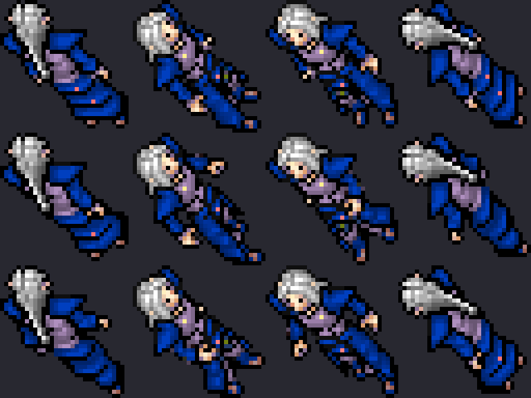

# Blue Elf Arcanist

Variante **cosmética azul** del Elf Arcanist. Usa el mismo outfit (`looktype 63`), los mismos
stats, ataques e inmunidades, y el mismo loot. La única diferencia es la paleta de colores.

**No requiere looktype nuevo ni actualizar el cliente:** el looktype 63 ya existe en todos los
clientes 7.6. Solo cambia el XML del monstruo. Se puede spawnear cuando se quiera.

Proceso general: [`CUSTOM_MONSTER_WORKFLOW.md`](CUSTOM_MONSTER_WORKFLOW.md).



## Stats

| Vida | Exp | Speed | Armor | Def | Maglevel | Huye con | Look |
|-----:|----:|------:|------:|----:|---------:|---------:|-----:|
| 220 | 174 | 220 | 16 | 13 | 40 | 50 HP | 63 |

Mismos ataques que el Elf Arcanist: HMM, arca sudden death, exura vita y flechas. Inmune a
invisible, fire, poison y energy. Loot idéntico (oro, blank rune, comida, bag con arrows/bow, etc.).

## Paleta

| Slot | Índice | Hex | Rol |
|------|-------:|-----|-----|
| `head` | 33 | `AF8FBF` | Violeta apagado: acento mágico en el trim/borde |
| `body` | 106 | `003FBF` | Azul real profundo: túnica principal |
| `legs` | 68 | `3F6ABF` | Azul acero desaturado: piernas |
| `feet` | 124 | `00547F` | Azul verdoso oscuro: botas/ruedo |

Comparación con el Elf Arcanist original:

| Slot | Original | Blue Elf Arcanist |
|------|---------:|------------------:|
| `head` | 20 (`BF9F8F` beige) | **33** (`AF8FBF` violeta) |
| `body` | 30 (`8F9FBF` azul gris) | **106** (`003FBF` azul profundo) |
| `legs` | 40 (`BFAF8F` beige dorado) | **68** (`3F6ABF` azul acero) |
| `feet` | 50 (`5F5FBF` azul violeta) | **124** (`00547F` azul verdoso) |

**Por qué esta paleta:** el azul `0055FF` (índice 87) se veía neón y plano a 32×32; el cuerpo
`003FBF` conserva mejor las sombras y deja jerarquía para el trim. El acento violeta del `head`
diferencia al arcanista de un simple “elfo azul” y lo separa del Elf Arcanist original, que es
azul grisáceo apagado. Las botas `00547F` evitan que el tercio inferior se funda con la túnica.

La revisión visual se hizo con un modelo DeepSeek con visión sobre las vistas previas de las
paletas candidatas; recomendó mantener el cuerpo profundo, subir el croma del `head` a violeta y
aclarar un paso las botas.

## Vista previa

El renderer aproxima la colorización de outfits 7.6 leyendo `Tibia.dat`/`Tibia.spr` y aplicando
la paleta clásica de 133 colores. No modifica los binarios.

```bash
python3 scripts/client-rme/render_outfit_colors.py \
  --looktype 63 --colors 33,106,68,124 \
  --preview docs/gameplay/img/blue-elf-arcanist.png
```

## Archivos

| Pieza | Archivo |
|-------|---------|
| Definición | `server/YurOTS/ots/data/monster/blue elf arcanist.xml` |
| Registro | `server/YurOTS/ots/data/monster/monsters.xml` |
| RME | `devtools/rme/rme-extensions/yurots-creatures.xml` |
| Preview | `docs/gameplay/img/blue-elf-arcanist.png` |
| Renderer | `scripts/client-rme/render_outfit_colors.py` |

## Pendiente

- **Spawn:** no está en `test-spawn.xml` ni en el mapa. Agregarlo cuando se decida la zona.
- **Prueba in-game:** falta verlo con el cliente real; el preview es una aproximación de la
  colorización. Si el cliente aplica la paleta con otro mapeo de sombras, ajustar los índices.
- **Deploy:** no necesita rebuild ni actualización de cliente; alcanza con reiniciar el server
  para que cargue el XML nuevo.
