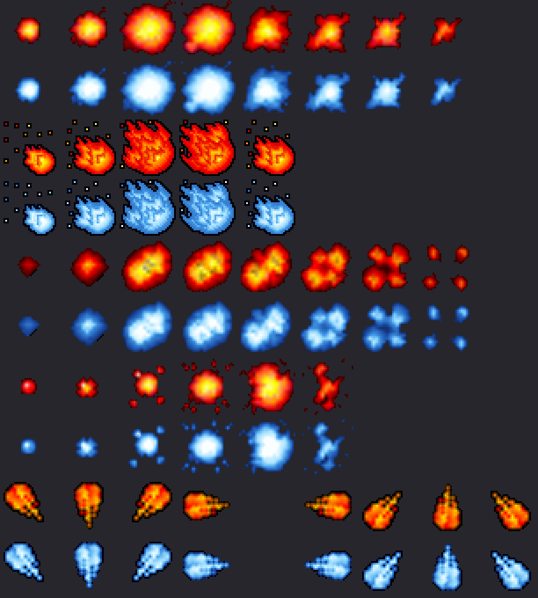
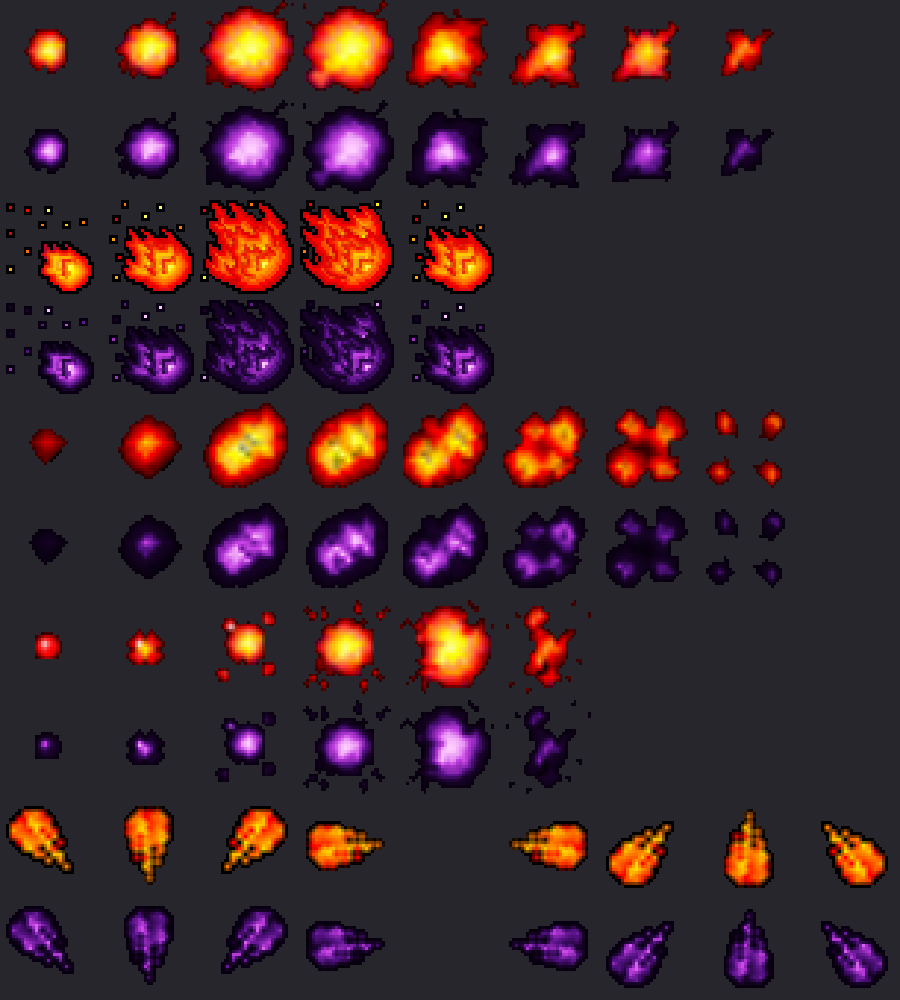

# Efectos y proyectiles nuevos del cliente

El cliente 7.6 base trae **25 efectos mágicos** (constantes `NM_ME_*` 0–24) y **15 proyectiles**
(`NM_ANI_*` 0–14). Se pueden agregar más: el servidor manda el número como `type + 1` en un byte
(`Protocol76::AddMagicEffect` / `AddDistanceShoot`) y el Lua lo pasa como `char`, así que el límite práctico
es **126** por tipo. Los clientes leen la cantidad desde el encabezado del `Tibia.dat`.

Los efectos nuevos se crean **recoloreando** uno existente: misma animación, mismos cuadros, otra paleta
(igual que los monstruos de [`CUSTOM_MONSTER_WORKFLOW.md`](CUSTOM_MONSTER_WORKFLOW.md)).

## Pack "ice" (nov 2026)



| Constante Lua | Número | Sale de | Uso pensado |
|---------------|-------:|---------|-------------|
| `NM_ME_ICE_AREA` | 25 | `NM_ME_FIRE_AREA` (6) | Área de hechizo de hielo (aliento, ola) |
| `NM_ME_ICE_HIT` | 26 | `NM_ME_HITBY_FIRE` (15) | Llamarada helada (ventisca) |
| `NM_ME_ICE_EXPLOSION` | 27 | `NM_ME_EXPLOSION_AREA` (4) | Explosión de una bola de hielo |
| `NM_ME_ICE_SHATTER` | 28 | `NM_ME_EXPLOSION_DAMAGE` (5) | Impacto sobre la criatura golpeada |
| `NM_ANI_FROSTBALL` | 15 | `NM_ANI_FIRE` (3) | Proyectil: bola de hielo (8 direcciones) |

Paleta: el fuego se mapea por luminosidad a hielo (rojo oscuro → azul noche, naranja → celeste,
amarillo → blanco); los grises (humo, chispas) reciben un tinte frío.

**Luz:** los efectos de fuego y la bola de fuego traen luz naranja en el `.dat` (colores 206/208). El pack
le pone a sus copias luz celeste (color **137**). La primera versión del script copiaba la luz naranja; volver
a correrlo sobre un cliente ya aplicado solo corrige el color (`luz corregida al color 137`).

Constantes en `server/YurOTS/ots/data/spells/lib/spells.lua`. Las usa el [Frost Dragon](FROST_DRAGON.md).
Ejemplo:

```lua
areaEffect = NM_ME_ICE_AREA
hitEffect = NM_ME_ICE_SHATTER
animationEffect = NM_ANI_FROSTBALL   -- en runas / ataques a distancia
```

## Pack "shadow" (nov 2026)



| Constante Lua | Número | Sale de | Uso |
|---------------|-------:|---------|-----|
| `NM_ME_SHADOW_AREA` | 29 | `NM_ME_FIRE_AREA` (6) | Aliento oscuro del [Black Dragon](BLACK_DRAGON.md) |
| `NM_ME_SHADOW_HIT` | 30 | `NM_ME_HITBY_FIRE` (15) | Llamarada oscura (sin uso todavía) |
| `NM_ME_SHADOW_EXPLOSION` | 31 | `NM_ME_EXPLOSION_AREA` (4) | Estallido de la bola de sombra |
| `NM_ME_SHADOW_IMPACT` | 32 | `NM_ME_EXPLOSION_DAMAGE` (5) | Impacto sobre la criatura golpeada |
| `NM_ANI_SHADOWBALL` | 17 | `NM_ANI_FIRE` (3) | Proyectil: bola de sombra (8 direcciones) |

Paleta: el fuego se mapea por luminosidad a sombra (rojo oscuro → casi negro violeta, naranja → morado,
amarillo → magenta claro); los grises reciben un tinte violeta oscuro. Luz violeta (color **119**).
Se eligió frente a una variante morada más clara porque se lee como oscuridad y no se confunde con el hielo
ni con la energía azul. En suelos muy oscuros los bordes se pierden; el centro magenta se sigue viendo.

Va **después** de "ice" y de la Enchanted Spear (por eso el proyectil es el 17).

## Otros proyectiles agregados

| Constante | Número | Script | Qué es |
|---|---:|---|---|
| `NM_ANI_ENCHANTED_SPEAR` | 16 | `add_enchanted_spear.py` | Proyectil de la [Enchanted Spear](ENCHANTED_SPEAR.md), con luz en vuelo. Requiere el pack "ice" antes. |

## Cómo se generan

```bash
python3 scripts/client-rme/add_recolor_effects.py --pack ice --preview /tmp/ice.png       # solo vista previa
python3 scripts/client-rme/add_recolor_effects.py --pack ice devtools/rme/rme-client-760  # aplica (idempotente)
python3 scripts/client-rme/add_enchanted_spear.py devtools/rme/rme-client-760
python3 scripts/client-rme/add_recolor_effects.py --pack shadow devtools/rme/rme-client-760
```

El script agrega las entradas al final de la sección de efectos y al final del `.dat` (proyectiles), sube
los contadores del encabezado y agrega los sprites al final del `.spr`. Verificado con lectura independiente
sobre el cliente del RME: contadores 25/15 → 29/16, los 25 efectos y 15 proyectiles viejos idénticos,
looktypes (incluido el 231) e ítems sin cambios, 400 sprites viejos al azar idénticos, sprites 11058 → 11094.

**Los packs se aplican en orden** (el número de cada constante depende de cuántos efectos había):
ice → Enchanted Spear → shadow. Cada pack de `PACKS` declara en `base` los contadores sobre los que se aplica.
Para uno nuevo (ej. sagrado), agregarlo al final con `base: (33, 18)`: efectos desde **33**, proyectiles desde
**18**. Volver a correr la Enchanted Spear con packs posteriores ya aplicados conserva sus proyectiles.

## Antes de usarlos en producción

1. **Probar en los dos clientes** que el efecto nuevo se ve: OTClientV8 (Mac) y el cliente oficial 7.6
   parcheado (Windows). Ambos leen los contadores del `.dat`, pero no se probó todavía en el juego.
   Prueba rápida con un GM (access 1+): **`/z 25`** … `/z 32` muestran cada efecto nuevo sobre
   el personaje (`Commands::testCommand`). Para los proyectiles: `/m Frost Dragon` (bola de hielo) y
   `/m Black Dragon` (bola de sombra).
   Con un cliente **viejo**, probar también `/z 25` para ver qué le pasa a quien no actualizó.
2. Aplicar el pack a la base del cliente de jugadores y regenerar el pack Zagan
   (`build_zagan_test_assets.py` copia los contadores de efectos y proyectiles de la base).
3. Publicar el cliente (updater) **antes** de desplegar hechizos que los usen: un cliente viejo no tiene
   esos números y el efecto no se ve (o, en el peor caso, el cliente falla).

Los efectos se pueden ver animados en la página de recursos del cliente (pestaña "Efectos mágicos").
