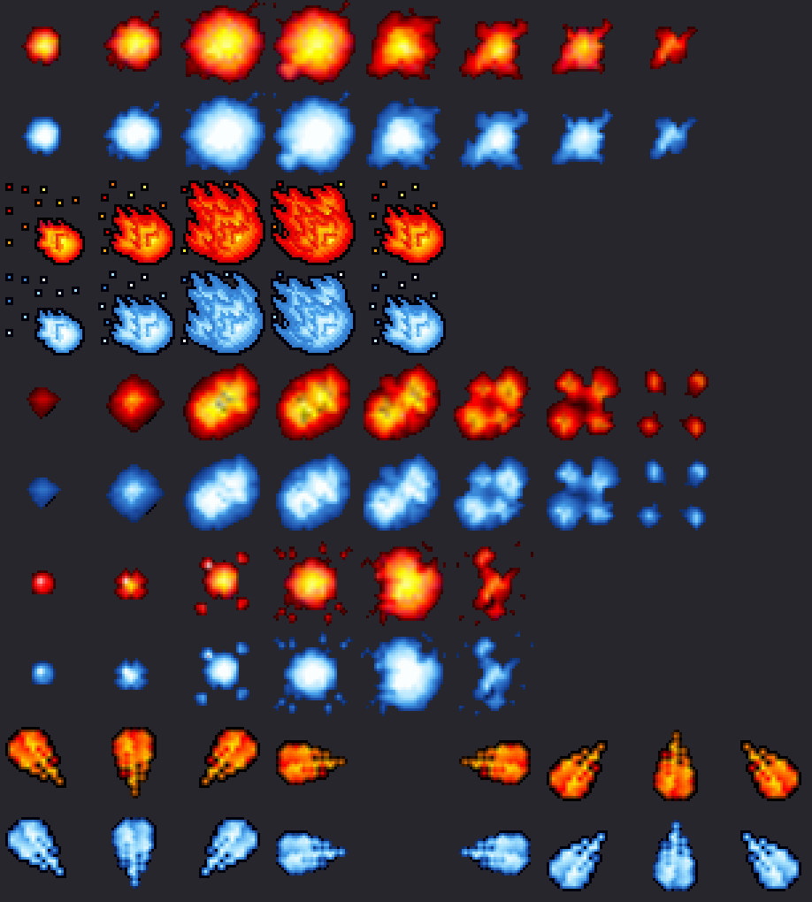
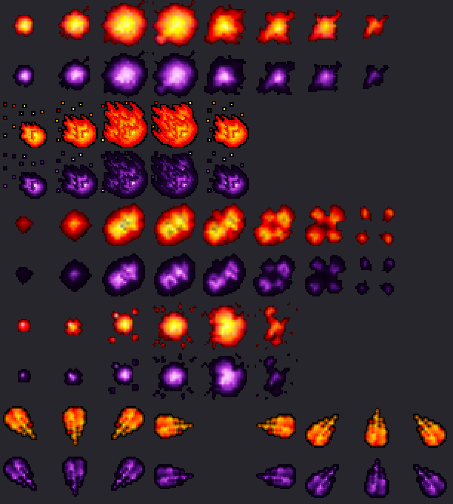
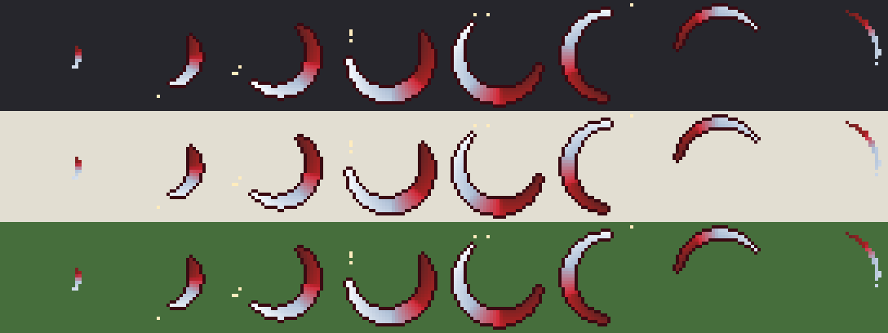
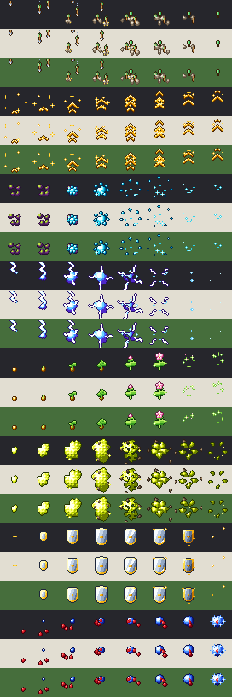

# Efectos y proyectiles nuevos del cliente

El cliente 7.6 base trae **25 efectos mágicos** (constantes `NM_ME_*` 0–24) y **15 proyectiles**
(`NM_ANI_*` 0–14). Se pueden agregar más: el servidor manda el número como `type + 1` en un byte
(`Protocol76::AddMagicEffect` / `AddDistanceShoot`) y el Lua lo pasa como `char`, así que el límite práctico
es **126** por tipo. Los clientes leen la cantidad desde el encabezado del `Tibia.dat`.

Los efectos nuevos se crean **recoloreando** uno existente: misma animación, mismos cuadros, otra paleta
(igual que los monstruos de [`CUSTOM_MONSTER_WORKFLOW.md`](CUSTOM_MONSTER_WORKFLOW.md)).

## Pack "ice" (nov 2026)



| Constante Lua | Número | Sale de | Uso pensado |
|---------------|-------:|---------|-------------|
| `NM_ME_ICE_AREA` | 25 | `NM_ME_FIRE_AREA` (6) | Área de hechizo de hielo (aliento, ola) |
| `NM_ME_ICE_HIT` | 26 | `NM_ME_HITBY_FIRE` (15) | Llamarada helada (ventisca) |
| `NM_ME_ICE_EXPLOSION` | 27 | `NM_ME_EXPLOSION_AREA` (4) | Explosión de una bola de hielo |
| `NM_ME_ICE_SHATTER` | 28 | `NM_ME_EXPLOSION_DAMAGE` (5) | Impacto sobre la criatura golpeada |
| `NM_ANI_FROSTBALL` | 15 | `NM_ANI_FIRE` (3) | Proyectil: bola de hielo (8 direcciones) |

Paleta: el fuego se mapea por luminosidad a hielo (rojo oscuro → azul noche, naranja → celeste,
amarillo → blanco); los grises (humo, chispas) reciben un tinte frío.

**Luz:** los efectos de fuego y la bola de fuego traen luz naranja en el `.dat` (colores 206/208). El pack
le pone a sus copias luz celeste (color **137**). La primera versión del script copiaba la luz naranja; volver
a correrlo sobre un cliente ya aplicado solo corrige el color (`luz corregida al color 137`).

Constantes en `server/YurOTS/ots/data/spells/lib/spells.lua`. Las usa el [Frost Dragon](FROST_DRAGON.md).
Ejemplo:

```lua
areaEffect = NM_ME_ICE_AREA
hitEffect = NM_ME_ICE_SHATTER
animationEffect = NM_ANI_FROSTBALL   -- en runas / ataques a distancia
```

## Pack "shadow" (nov 2026)



| Constante Lua | Número | Sale de | Uso |
|---------------|-------:|---------|-----|
| `NM_ME_SHADOW_AREA` | 29 | `NM_ME_FIRE_AREA` (6) | Aliento oscuro del [Black Dragon](BLACK_DRAGON.md) |
| `NM_ME_SHADOW_HIT` | 30 | `NM_ME_HITBY_FIRE` (15) | Llamarada oscura (sin uso todavía) |
| `NM_ME_SHADOW_EXPLOSION` | 31 | `NM_ME_EXPLOSION_AREA` (4) | Estallido de la bola de sombra |
| `NM_ME_SHADOW_IMPACT` | 32 | `NM_ME_EXPLOSION_DAMAGE` (5) | Impacto sobre la criatura golpeada |
| `NM_ANI_SHADOWBALL` | 17 | `NM_ANI_FIRE` (3) | Proyectil: bola de sombra (8 direcciones) |

Paleta: el fuego se mapea por luminosidad a sombra (rojo oscuro → casi negro violeta, naranja → morado,
amarillo → magenta claro); los grises reciben un tinte violeta oscuro. Luz violeta (color **119**).
Se eligió frente a una variante morada más clara porque se lee como oscuridad y no se confunde con el hielo
ni con la energía azul. En suelos muy oscuros los bordes se pierden; el centro magenta se sigue viendo.

Va **después** de "ice" y de la Enchanted Spear (por eso el proyectil es el 17).

## Pack "power" (nov 2026)

| Constante | Número | Sale de | Uso |
|-----------|-------:|---------|-----|
| `NM_ME_POWER_HIT` | 33 | `NM_ME_ENERGY_AREA` (10) | [Power hit](POWER_HIT.md): explosión de energía en dorado |
| `NM_ME_MEGA_HIT` | 34 | `NM_ME_ENERGY_AREA` (10) | Mega hit: la misma explosión en fucsia con centro dorado |

Sin proyectiles. Luz dorada (color **204**). Va **después** de "shadow": `base: (33, 18)`.

## Pack "gran" (nov 2026): dibujado de cero



| Constante | Número | Qué es | Uso |
|-----------|-------:|--------|-----|
| `NM_ME_WHIRL_SLASH` | 35 | Tajo en medialuna que gira 330° en 8 cuadros: filo de acero blanco, cuerpo de acero, estela carmesí, chispas en la punta y contorno oscuro para pisos claros | `exori gran` |

No sale de recolorear: lo dibuja `scripts/client-rme/add_drawn_effects.py` con numpy (supermuestreo ×8 y
alfa duro a 32×32). Luz roja suave (intensidad 2, color 187). Va **después** de "power": `base: (35, 18)`.

## Pack "spells" (nov 2026): un efecto dibujado por hechizo nuevo



Ocho animaciones dibujadas de cero, una por cada hechizo nuevo de nov 2026. Cada entrada lleva su **propia
luz** en el `.dat` (tercer elemento de la tupla en `PACKS["spells"]`):

| Constante | Número | Qué es | Luz | Uso |
|-----------|-------:|--------|-----|-----|
| `NM_ME_ARROW_VOLLEY` | 36 | Tres flechas (astil de madera, punta de acero, plumas verdes) **caen desde arriba**, se clavan y levantan nubecitas de polvo | Polvo cálido (206, intensidad 1) | `exori con gran` (areaEffect, en cada casilla de la línea: cae vertical, así sirve para cualquier dirección) |
| `NM_ME_RALLY_RING` | 37 | Tres galones dorados que suben desde los pies y chispas doradas que se juntan sobre el aliado | Dorado (204) | `exeta sio` (en el aliado rescatado; los monstruos siguen con `NM_ME_SOUND_BLUE`) |
| `NM_ME_CLEANSE_SWIRL` | 38 | Manchas de veneno (violeta y verde) que revientan en un destello de agua, gotas que salen hacia afuera y chispas celestes que suben | Agua (71) | `exana res` |
| `NM_ME_CHAIN_ARC` | 39 | Rayo grueso que cae sobre el monstruo, bola de energía celeste con borde violeta y ramas que chisporrotean | Celeste (95) | `exori vis con` (en cada monstruo de la cadena) |
| `NM_ME_SEED_BURST` | 40 | Semilla dorada que brota, crece una planta con 4 hojas, florece en rosa y se deshace en las chispas verdes de curación | Verde (103) | `exura tera` (curación inmediata y diferida) |
| `NM_ME_DETONATION_RING` | 41 | Estallido amarillo verdoso manchado que crece, se parte en 5 pedazos y tira piedras | Lima (174) | `exevo vis tera` (en el caster; cada campo detona con su efecto elemental) |
| `NM_ME_STANCE_GUARD` | 42 | Escudo de caballero de acero con borde y clavo dorados; le cruza un brillo y se deshace en chispas doradas | Acero y oro (213, intensidad 1) | `utito tera` |
| `NM_ME_BLOOD_SPIRAL` | 43 | Gotas de sangre que suben en espiral y forman un orbe de maná azul, que estalla en chispas azules | Maná (53) | `utamo mort` (cast y cada tick) |

### Estilo: que parezca de 7.6 (v2, 17 nov 2026)

La primera versión eran líneas finas de 1 px, degradés suaves y anillos perfectos: se veían como de otro juego.
La v2 copia lo que hacen los efectos originales (explosiones, `NM_ME_MAGIC_*`, `NM_ME_ENERGY_AREA`) y los
packs recoloreados. Reglas para cualquier efecto dibujado nuevo (`Frame`, `blob`, `capsule`, `sparkle` en
`add_drawn_effects.py`):

| Regla | Cómo |
|-------|------|
| Figuras **llenas**, nada de líneas de 1 px | `blob` (bola con borde irregular), `capsule` (trazo de 2–3 px) |
| **4–5 tonos fijos** por color, sin degradé | Rampas de oscuro a claro (`GOLD`, `AQUA`, `VOLT`…); el sombreado elige un tono |
| Luz arriba a la izquierda | `blob` corre el brillo hacia arriba-izquierda |
| **Contorno oscuro** del mismo color | Cada rampa tiene su `OL_*`; se lee en piso claro, oscuro y pasto |
| Chispas **en cruz** con centro blanco | `sparkle(x, y, tamaño, rampa)`, como las de `NM_ME_MAGIC_BLUE/RED/GREEN` |
| Nada de círculos perfectos | Bordes con ruido (`amp`), interiores manchados (`tex`) en explosiones y humo |
| Terminar rompiéndose | Las explosiones se parten en pedazos (`NM_ME_EXPLOSION_AREA`), lo demás en chispas |
| Si el efecto se repite en una línea o área | Que no tenga dirección (las flechas caen verticales) |
| Distinto de los demás | Silueta y color propios; no repetir "anillo que crece" |

Para comparar con los originales: `scripts/client-rme/add_drawn_effects.py --pack spells --preview x.png`
(cada efecto sobre fondo oscuro, piso claro y pasto).

**Redibujar un pack ya aplicado:** `--replace` reemplaza sus sprites en el lugar (mismos números de efecto;
si un efecto tiene más cuadros, los agrega al final del `.spr`, y los que sobran quedan transparentes). Los
packs que vinieron después, como los sprites de los trolls, no se mueven. La v2 se aplicó así: 63 sprites
reemplazados y 2 agregados (13782 → 13784), con el resto del `.spr` y del `.dat` comparado igual.

Va **después** de "gran": `base: (36, 18)` → efectos 36–43, sin proyectiles nuevos.

## Otros proyectiles agregados

| Constante | Número | Script | Qué es |
|---|---:|---|---|
| `NM_ANI_ENCHANTED_SPEAR` | 16 | `add_enchanted_spear.py` | Proyectil de la [Enchanted Spear](ENCHANTED_SPEAR.md), con luz en vuelo. Requiere el pack "ice" antes. |

## Cómo se generan

```bash
python3 scripts/client-rme/add_recolor_effects.py --pack ice --preview /tmp/ice.png       # solo vista previa
python3 scripts/client-rme/add_recolor_effects.py --pack ice devtools/rme/rme-client-760  # aplica (idempotente)
python3 scripts/client-rme/add_enchanted_spear.py devtools/rme/rme-client-760
python3 scripts/client-rme/add_recolor_effects.py --pack shadow devtools/rme/rme-client-760
python3 scripts/client-rme/add_recolor_effects.py --pack power devtools/rme/rme-client-760
python3.11 scripts/client-rme/add_drawn_effects.py --pack gran devtools/rme/rme-client-760
python3.11 scripts/client-rme/add_drawn_effects.py --pack spells devtools/rme/rme-client-760
python3.11 scripts/client-rme/add_drawn_effects.py --pack spells --replace devtools/rme/rme-client-760  # redibujar
```

El script agrega las entradas al final de la sección de efectos y al final del `.dat` (proyectiles), sube
los contadores del encabezado y agrega los sprites al final del `.spr`. Verificado con lectura independiente
sobre el cliente del RME: contadores 25/15 → 29/16, los 25 efectos y 15 proyectiles viejos idénticos,
looktypes (incluido el 231) e ítems sin cambios, 400 sprites viejos al azar idénticos, sprites 11058 → 11094.

**Los packs se aplican en orden** (el número de cada constante depende de cuántos efectos había):
ice → Enchanted Spear → shadow → power → gran → spells. Cada pack de `PACKS` declara en `base` los contadores sobre los que se aplica.
Para uno nuevo, agregarlo al final con `base: (44, 18)`: efectos desde **44**, proyectiles desde
**18**. Volver a correr la Enchanted Spear con packs posteriores ya aplicados conserva sus proyectiles.

## Antes de usarlos en producción

1. **Probar en los dos clientes** que el efecto nuevo se ve: OTClientV8 (Mac) y el cliente oficial 7.6
   parcheado (Windows). Ambos leen los contadores del `.dat`, pero no se probó todavía en el juego.
   Prueba rápida con un GM (access 1+): **`/z 25`** … `/z 43` muestran cada efecto nuevo sobre
   el personaje (`Commands::testCommand`). Para los proyectiles: `/m Frost Dragon` (bola de hielo) y
   `/m Black Dragon` (bola de sombra).
   Con un cliente **viejo**, probar también `/z 25` para ver qué le pasa a quien no actualizó.
2. Aplicar el pack a la base del cliente de jugadores y regenerar el pack Zagan
   (`build_zagan_test_assets.py` copia los contadores de efectos y proyectiles de la base).
3. Publicar el cliente (updater) **antes** de desplegar hechizos que los usen: un cliente viejo no tiene
   esos números y el efecto no se ve (o, en el peor caso, el cliente falla).

Los efectos se pueden ver animados en la página de recursos del cliente (pestaña "Efectos mágicos").
