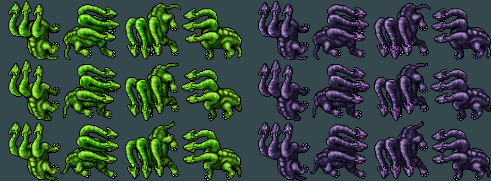
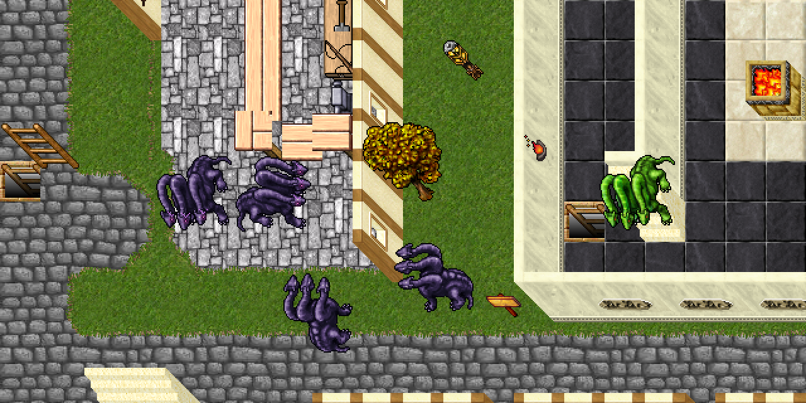

# Dark Hydra

Variante de caza un escalón por encima de la Hydra, con escamas carbón/violeta, ojos fucsia y marcas
arcanas en los cuellos. Look **241**, derivado de Hydra (**121**). Balance inicial pendiente de combate
in-game. Flujo: [CUSTOM_MONSTER_WORKFLOW.md](CUSTOM_MONSTER_WORKFLOW.md).

## Stats

| Stat | Hydra | Dark Hydra |
|---|---:|---:|
| Vida | 2250 | 3200 |
| Experiencia base | 2100 | 3000 |
| Level / maglevel | 20 / 40 | 25 / 45 |
| Armor / defense | 38 / 35 | 42 / 40 |
| Speed | 200 | 215 |
| Melee | 60–150 | 90–220 |

Combate melee (`targetdistance=1`), sin huida. Conserva las inmunidades a poison, paralyze, drunk e
invisible de Hydra; conserva su cadáver (**4283**).

## Ataques

| Ataque | Daño | Intento cada | Probabilidad |
|---|---:|---:|---:|
| Melee | 90–220 | Ritmo del motor | 100% |
| `darkhydra_darkwave` | 130–220, lifedrain | 5 s | 60% |
| `hydra_poisonwave` | 90–300, poison | 6 s | 60% |
| `exura vita` | Cura existente según level/ML | 5 s | 55% |

El aliento oscuro reemplaza a `hydra_bubblewave`: conserva su matriz direccional, con daño lifedrain
y efecto clásico `NM_ME_MORT_AREA`. **El drenaje también cura al atacante**: `GameState::onAttack`
en `game.cpp` suma el daño de `ATTACK_LIFEDRAIN` a su vida, limitado a `healthmax`. Tenerlo en cuenta
al probar contra grupos, porque puede alcanzar varios blancos. La autocura es adicional.

No se agrega inmunidad `lifedrain`: el loader no la reconoce. No requiere cambios ni rebuild de C++.

## Loot

Basado en Hydra: hasta 300 gold, comida, platinum coins y bolsa con royal helmet, warrior helmet,
medusa shield, boots of haste, ring of healing, small sapphires y knight armor. Las probabilidades de
equipo suben moderadamente respecto a Hydra (0,8–1,5% según pieza); la bolsa es garantizada.
El XML es la fuente exacta de cantidades y probabilidades.

## Sprite y aprendizaje de la base

Preset `dark-hydra`: **48 sprites nuevos (11510–11557)**; se preservan los 12 cuadros y la silueta.
`BASE_PARTS[121]` en `sprite_kit.py` separa contorno (`v < 0.13`), ojos rojos (`h < 0.05`, `s > 0.7`,
`v > 0.35`), detalles claros y escamas. Los ojos son solo 18 píxeles en toda la hoja: las marcas se
anclan a sus grupos originales, en vez de asumir coordenadas de cara humana. De espaldas no se pintan
ojos nuevos. Las luces lavanda mantienen legibilidad contra suelo oscuro.

## Archivos

| Pieza | Ruta |
|---|---|
| Monstruo | `server/YurOTS/ots/data/monster/dark hydra.xml` |
| Alta en servidor | `server/YurOTS/ots/data/monster/monsters.xml` |
| Aliento | `server/YurOTS/ots/data/spells/instant/darkhydra_darkwave.lua` |
| Alta del hechizo | `server/YurOTS/ots/data/spells/spells.xml` |
| Preset | `scripts/client-rme/presets/dark_hydra.py` |
| Clasificador compartido | `scripts/client-rme/sprite_kit.py` |
| Paleta de RME | `devtools/rme/rme-extensions/yurots-creatures.xml` |
| Assets de RME | `devtools/rme/rme-client-760/Tibia.dat`, `Tibia.spr` |
| Previews | `docs/gameplay/img/dark-hydra-hoja.png`, `dark-hydra-escena.png` |

## Validación y pendientes

- Hoja y escena revisadas; `sprite_tool.py verify --expect 241,242` contra los assets previos de la
  sesión: `TODO BIEN`, junto a Emerald Scarab. Se verificó sobre copia aislada para conservar respaldos
  `.bak` preexistentes de otras sesiones. Ítems, efectos, proyectiles y 11509 sprites anteriores intactos.
- `luac -p` y ejecución de `onCast` con la biblioteca real y un sustituto de `doAreaMagic`: OK en tipo,
  daño, matriz, cuatro direcciones con igual cantidad de casillas y exclusión del propio centro.
- XML, registro único, referencias a spells, loot y entrada de RME comprobados.
- Falta boot/probe satisfactorio y prueba real con `/m Dark Hydra`: esta máquina no tiene Docker,
  binario local ni cliente de jugadores. El sustituto Lua no verifica el combate del motor.
- Aplicar el preset a la base del cliente, regenerar el pack y publicar/verificar el updater **antes**
  de agregar un spawn. No se modificó el mapa ni se eligió una zona de caza.
- Sin deploy a ThinkPad. Requiere el OK de Gonzalo y el procedimiento habitual.
