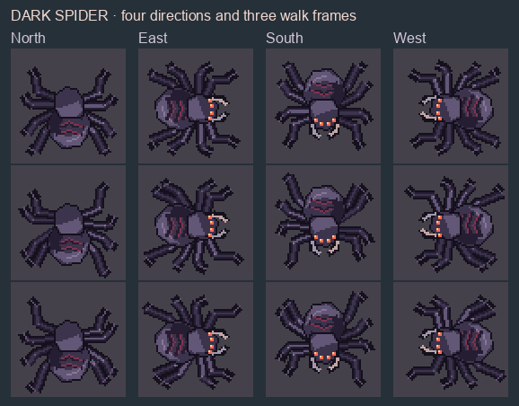

# Dark Spider

Araña de caparazón negro violáceo, ojos rojos, colmillos claros y ocho patas
articuladas. Tiene tamaño visual de 2×2, cuatro direcciones y tres cuadros de
movimiento. Looktype `190` y cadáver propio `20663`, con el contenedor y decay
del cadáver de Giant Spider (`2857`).



| Monstruo | Vida | Exp | Velocidad | Melee |
|---|---:|---:|---:|---:|
| Giant Spider | 1.300 | 900 | 270 | 120–300 |
| Dragon Lord | 1.900 | 2.100 | 200 | 62–205 |
| Dark Spider | 3.400 | 3.200 | 355 | 180–410 |

Persigue hasta quedar adyacente y usa los campos venenosos de Giant Spider y
`necro_lifedrain` a los blancos que la rodean. Inmune a poison, invisible y drunk.

Aparece en dos cámaras de [Duskweb Hollow](../items-and-map/DUSKWEB_HOLLOW.md)
(`29,132,8` y `31,143,8`), con acceso desde el sendero de la costa oeste en
`17,136,7`. Se recomienda nivel 65 o más para el tramo final.

```bash
python3.11 scripts/client-rme/add_dark_spider.py --apply \
  --preview docs/gameplay/img/dark-spider.png \
  --corpse devtools/zagan-test/custom-sprites/dead_dark_spider.png
python3.11 scripts/client-rme/add_custom_items.py \
  --things devtools/rme/rme-client-760 \
  --otb server/YurOTS/ots/data/items/items-zagan-test.otb \
  --otb server/YurOTS/ots/data/items/items.otb --only 20663
```
