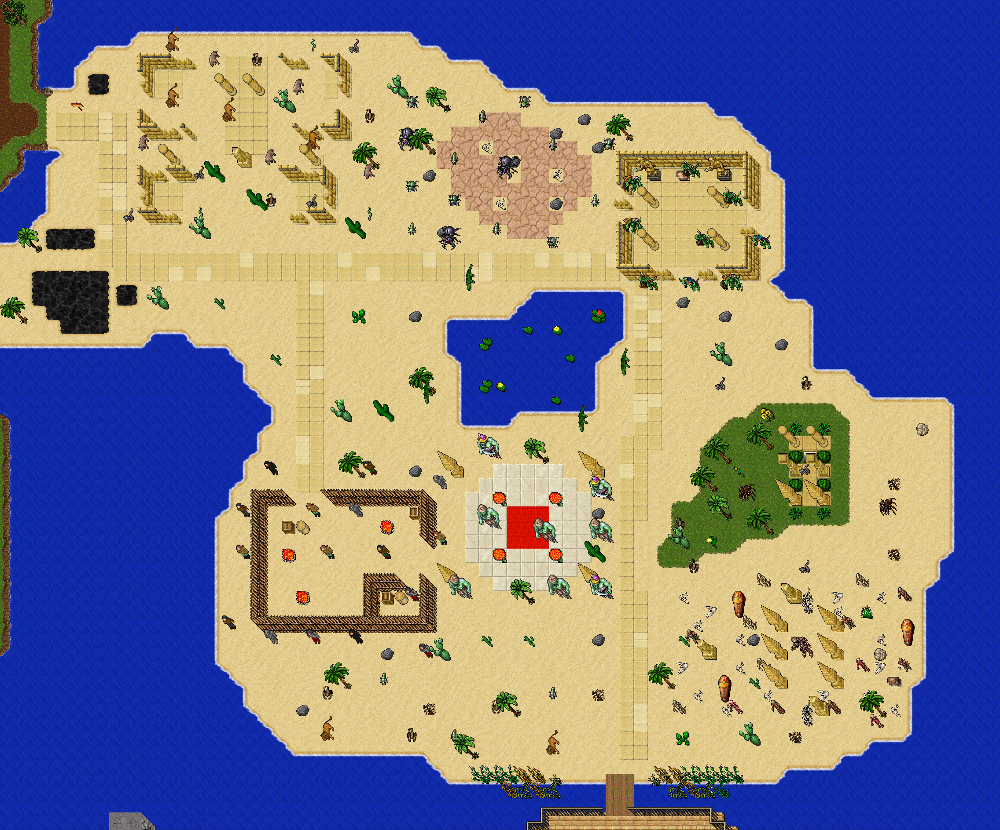

# Desierto de las Ruinas

La isla de arena al este de la ciudad, rehecha en nov 2026. Antes era una "ciudad del desierto" con casas
(Desert Street I–VI y la Sand Mansion) y un NPC Seller. Ahora es una zona de caza con nueve lugares, dos jefes
y dos cofres de quest. Sin NPC y sin casas.



## Cómo se llega

Caminando desde la ciudad: el camino de tierra del este termina en la entrada (`198, 74, 7`). Ahí hay un cartel
con las zonas y el nivel sugerido. Un camino de piedra recorre la isla y llega al muelle del sur (`237, 120, 7`).

## Zonas

Caja de la isla: x 198–262, y 68–120, z7. La dificultad sube al alejarse de la entrada.

| Zona | Nivel | Caja (x1 y1 x2 y2) | Monstruos (cantidad) |
|---|---|---|---|
| Ruinas de la ciudad vieja | 8–20 | 203 69 221 82 | Hyaena 5, Lion 4, Cobra 4, Scorpion 3, Snake 3 |
| Dunas del sur | 10–25 | 214 113 233 119 | Scorpion 3, Larva 3, Lion 2 |
| Laguna | 15–30 | 223 86 240 97 | Crocodile 4 |
| Oasis | 15–30 | 240 93 260 106 | Cobra 3, Tarantula 2, Scorpion 3 |
| Campamento de bandidos | 20–40 | 210 99 225 112 | Smuggler 3, Bandit 4, Wild Warrior 3, Stalker 2, Assassin 2, Hunter 2 |
| Nido de escarabajos | 30–60 | 223 72 237 83 | Larva 6, Scarab 6, Ancient Scarab 2, **Furious Ancient Scarab** (jefe) |
| Templo de los lagartos | 40–70 | 238 77 248 88 | Lizard Sentinel 4, Lizard Templar 3, Lizard Snakecharmer 2 |
| Campo de huesos | 45–80 | 241 107 258 118 | Ghoul 3, Mummy 5, Crypt Shambler 3, Demon Skeleton 3, Bone Beast 2, **Omruc** (jefe) |
| Santuario de los djinn | 60–90 | 225 98 237 108 | Green Djinn 5, Efreet 3 |

Total: 104 monstruos. Respawn de 60 a 240 s según la zona.

## Jefes

| Jefe | Posición | Respawn | Dónde |
|---|---|---|---|
| Furious Ancient Scarab | `230, 78, 7` | 30 min | Centro del nido |
| Omruc | `251, 112, 7` | 1 h | Entre los cuatro obeliscos del campo de huesos |

## Quest

Dos cofres con `quest.lua` (el uniqueId es el id del premio). Uno por personaje cada uno.

| Cofre | Posición | Premio |
|---|---|---|
| Templo de los lagartos, contra la pared norte | `242, 78, 7` | Knight Armor (2476) |
| Campo de huesos, al este del jefe | `257, 114, 7` | Vampire Shield (2534) |

## Qué no se tocó

- El **oasis** con su escalera a las tumbas (`251, 98, 7`) y todo lo de abajo (z8–z11: tumbas, Thalas, Rahemos).
- Los **pozos de alquitrán** del oeste, la costa y el barco del sur.
- Los kongras y demás monstruos de tierra firme, al oeste de la entrada.

## Qué se sacó

- Las casas **Desert Street I–VI** y **Sand Mansion** de `houses.xml`, y sus 15 archivos de `data/houses/`
  (incluidos los `Sand Mansion I–VIII`, que ya no estaban en `houses.xml`). Ninguna tenía dueño ni ítems en la
  ThinkPad. Quedan 28 casas.
- El NPC **Seller** de `208, 80, 7` (queda el de la ciudad).
- Los pisos altos de las casas (z4–z6) y los 24 monstruos viejos de la superficie (20 scarabs, 2 leones, una
  hiena y un ancient scarab).

## Regenerar

```bash
python3.11 scripts/map/generate-desert-hunts.py --dry-run --preview /tmp/desierto.png   # valida y dibuja
python3.11 scripts/map/generate-desert-hunts.py                                         # escribe
python3 scripts/map/check-map-load.py                                                   # 0 errores
```

- Rehace la superficie entera cada vez, así que se puede repetir.
- Cada lugar es un plano de texto en `STAMPS` (se pega sobre la arena en la posición indicada), los caminos
  son rectángulos en `ROADS` y los monstruos están en `ZONES`. Los jefes van en la casilla `O` de su plano
  (`BOSSES`) y los premios en `CHESTS`.
- Valida antes de escribir: que cada plano caiga en arena de la isla, que los sarcófagos tengan sus dos
  piezas, que se llegue caminando desde la entrada a los cofres, los jefes, el muelle y la bajada del oasis,
  que los monstruos estén registrados y que los uniqueId de los cofres estén libres.
- La decoración suelta (palmas, cactus, piedras) solo cae donde las ocho casillas vecinas quedan libres, para
  no tapar pasos.
- Escribe `test.otbm` (respaldo `test.otbm.bak-desert` la primera vez, no va a git), el bloque
  `DESERT_HUNTS_SPAWNS` de `test-spawn.xml`, el cartel en `readables.xml`, `npc.xml`, `houses.xml` y
  `generated-desert-hunts.json`.
- Piezas usadas: paredes de arenisca (V 1067, H 1069, esquina 1070, poste 1062), bambú (V 3423, H 3426,
  esquina 3429, poste 3425), restos de pared 1085/1087, pilares 1549 y 1551, obelisco roto 1561. Más en
  [PIEZAS_DE_MAPA.md](../items-and-map/PIEZAS_DE_MAPA.md).

## Deploy

Solo datos (mapa, spawns, casas, NPC, cartel): sin compilar y sin cliente nuevo. En la ThinkPad, `data/houses/`
también lo escribe el servidor: antes de actualizar, comprobar que los archivos que se borran no tienen cambios
locales.
