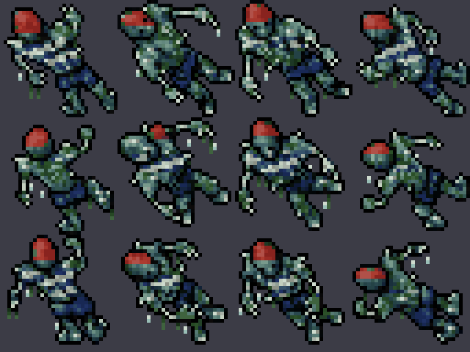
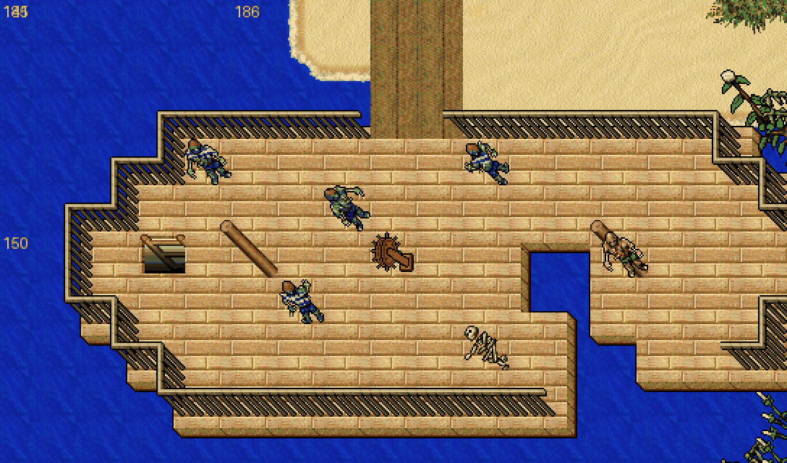

# Drowned Sailor (Marinero Ahogado)

Tripulante del naufragio de la playa de la selva (`182-199, 147-154`) que volvió del fondo. Es la
primera pieza del plan para que el barco sea más interesante de recorrer: un monstruo de nivel medio
para la cubierta y la bodega, entre los de la selva (Kongra, Elephant) y el Serpent Spawn.

**Lo que lo distingue:**
- **Se ve distinto:** sprite propio a partir del Crypt Shambler. Tiene piel hinchada gris verdosa,
  camiseta rayada de marinero, pantalón azul marino, pañuelo rojo desteñido, algas que cuelgan,
  percebes y gotas de agua que cambian de lugar al caminar.
- **Te enreda con algas:** tira un manojo de algas a distancia que envenena y, si pega, te deja
  **quieto 1 segundo**. Es lento, así que lo usa para alcanzarte.

Proceso general: [`CUSTOM_MONSTER_WORKFLOW.md`](CUSTOM_MONSTER_WORKFLOW.md).





## Stats

| | Crypt Shambler | **Drowned Sailor** |
|---|---:|---:|
| Vida | 330 | **520** |
| Exp | 195 | **280** |
| Nivel / magic level | 20 / 30 | **30 / 20** |
| Armor / defense | 25 / 26 | **20 / 18** |
| Speed | 150 | **170** (lento) |
| Distancia | cuerpo a cuerpo | cuerpo a cuerpo |
| Look | 100 | **233** |

Inmune a poison, paralyze y drunk. Cadáver: dead human (3128). Sangre de no-muerto, como el Crypt Shambler.

## Ataques

| Ataque | Tipo | Qué hace | Daño | Cada | Prob. |
|--------|------|----------|-----:|-----:|------:|
| melee | — | Golpe | 25–85 | — | 100 % |
| `drowned_seaweed` | rune (id 5037) | Algas a distancia (proyectil verde `NM_ANI_FLYPOISONFIELD`, salpicadura de agua `NM_ME_LOOSE_ENERGY`). Si pega, **raíz de 1 s** (`doAnchorRoot`, la misma de la [Anchor Rune](ANCHOR_RUNE.md): no paraliza, solo frena) | 25–55 de veneno | 6 s | 45 % |

`NM_ANI_FLYPOISONFIELD` (14) existía en el motor pero no en `data/spells/lib/spells.lua`; se agregó ahí.

Voces: "Glub... glub...", "Join the crew... below.", "The sea keeps what it takes.", "Cold... so cold...".

## Loot

Oro (hasta 40), fish ×3 (30 %), rope (5 %) y bolsa con leather trousers (6 %), sabre (4 %), white pearl
(3 %) y black pearl (1 %). La Anchor Rune no está en la loot a propósito: es una runa de guerra que hoy no
se consigue en ningún lado.

## Sprite

Recoloreado por algoritmo del Crypt Shambler (100: 1×1, 4 direcciones, 3 cuadros) con el script genérico:

```bash
python3 scripts/client-rme/add_recolor_look.py --preset drowned-sailor --preview /tmp/ahogado.png   # solo vista previa
python3 scripts/client-rme/add_recolor_look.py --preset drowned-sailor devtools/rme/rme-client-760 # aplica (idempotente)
```

- **Paleta** (`recolor_drowned`): piel → gris verdoso de ahogado; heridas rojas → manchas de algas;
  pantalón verde → azul marino; el contorno con un toque azul.
- **Retoque por cuadro** (`drowned_sailor_details`):
  - Pañuelo: la cabeza es el grupo de piel gruesa más alto del cuadro (los brazos, finos, no
    cuentan). El pañuelo cubre la mitad de arriba, y casi toda de espaldas.
  - Camiseta: la piel gruesa entre la cabeza y el pantalón va en franjas blanco / azul, en
    diagonal como la perspectiva.
  - Algas, gotas y percebes: algas colgando del borde de abajo, dos gotas que cambian de lugar
    en cada cuadro y tres percebes.

El script ahora acepta criaturas de 1×1 (12 sprites) además de 2×2 (48).

Verificado contra el `.dat`/`.spr` de RME: solo cambió el look 233 (cabecera del Crypt Shambler, sprites
11151–11162), los ítems quedaron iguales, 400 sprites viejos al azar siguen idénticos, y el preset del Ice
Monk sigue generando exactamente el look 232 que ya estaba.

## Antes de ponerlo en el mapa: el cliente

El look 233 es nuevo: un cliente viejo vería el monstruo invisible. Mismo orden que el Ice Monk
([`CUSTOM_MONSTER_WORKFLOW.md`](CUSTOM_MONSTER_WORKFLOW.md) §6.6):

1. Aplicar el preset a la base del cliente de jugadores (`client-local/data/things/760/`) y regenerar el
   pack con `build_zagan_test_assets.py`.
2. Publicar `Tibia.dat`/`Tibia.spr` en el updater y confirmar con un cliente actualizado que se ve.
3. Recién entonces el spawn: 3-4 en la cubierta (`190, 149, 7`, hoy 3 Crabs) y 4-5 en la bodega
   (`184, 149, 8`, hoy un Serpent Spawn suelto).

Hoy no está en ningún spawn. El C++ no cambió: no hace falta compilar.

Lo llama también el [Tide Priest](TIDE_PRIEST.md) (hasta 2 a la vez).

## Archivos

| Pieza | Archivo |
|-------|---------|
| Definición | `server/YurOTS/ots/data/monster/drowned sailor.xml` |
| Registro | `server/YurOTS/ots/data/monster/monsters.xml` |
| Ataque | `data/spells/runes/drowned_seaweed.lua` + `spells.xml` (id 5037) + `NM_ANI_FLYPOISONFIELD` en `spells/lib/spells.lua` |
| RME | `rme-extensions/yurots-creatures.xml` y `devtools/rme/rme-client-760/Tibia.{dat,spr}` |
| Sprite | `scripts/client-rme/add_recolor_look.py` (preset `drowned-sailor`) |
