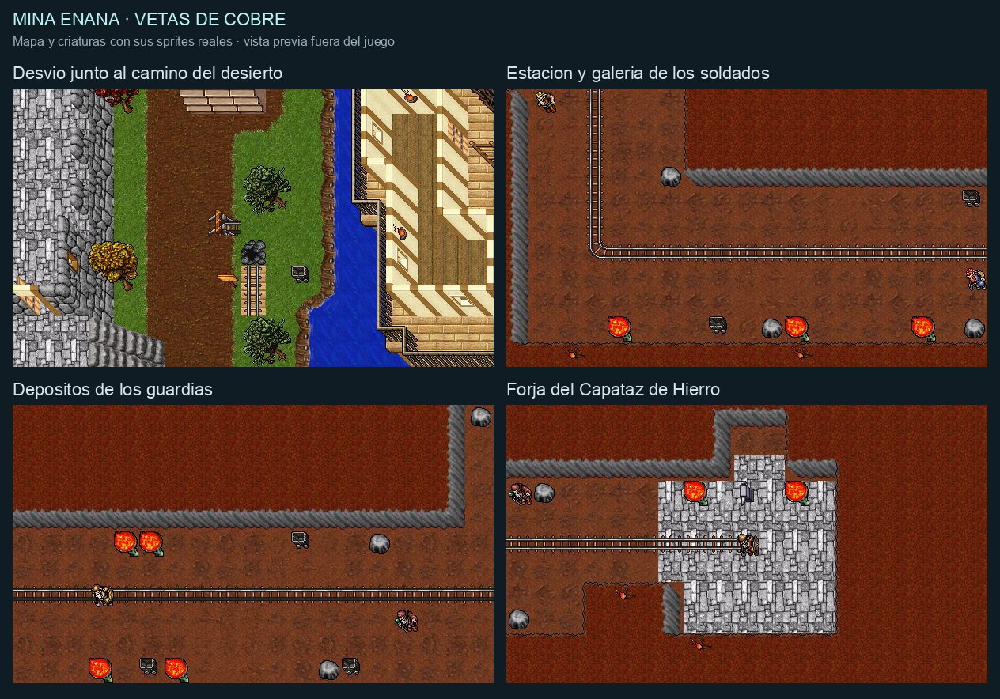

# Mina Enana — Vetas de Cobre

Hunt de nivel orientativo **20–50**, con entrada en **195,59,7**, en el desvío norte
del camino oriental hacia el desierto. Puesto de acceso con vagoneta, apoyo de madera,
cartel y un tramo de riel sobre tablones. El camino principal permanece transitable.



## Pisos y progresión

La antesala **z8** solo conecta escaleras, sin monstruos. El piso **z9** empieza con
un túnel de riel de 124 pasos que rodea las cuevas existentes y tiene dos apartaderos;
continúa por las galerías anchas de los soldados. La dificultad crece por distancia
caminando. En **z10** están los depósitos de los guardias y la forja del jefe.

| Piso | Superficie transitable | Monstruos | Respawn | Densidad |
|---|---:|---|---|---:|
| z9 | 1.099 sqm | 12 Dwarfs + 14 Dwarf Soldiers | 100 / 120 / 145 s según etapa | 1 cada 42,3 sqm |
| z10 | 1.428 sqm | 17 Dwarf Guards + 11 Dwarf Geomancers + jefe | 165 / 190 / 220 s; jefe 900 s | 1 cada 49,2 sqm |

Empiezan sueltos y aparecen en parejas al fondo. Centros separados 12–13 casillas,
ningún monstruo a seis casillas de escaleras y cámara del jefe reservada a ocho.
Recorridos mínimos hasta el final: z9 **255 pasos**, z10 **228**. Rangos sugeridos:
z9 20–35, z10 35–50, Capataz 45–55 o grupo; balance pendiente de juego real.

Tierra seca, paredes de piedra 371–382, rieles, carros y apoyos de madera fijos,
braseros y antorchas ámbar. La forja tiene losas y un yunque con dos braseros.
La mina solo ocupa roca/vacío. En la pantalla de la antesala se cubren **150 tiles
de lava desnuda impasable** con roca, conservando todos los pisos y spawns vecinos.

## Capataz de Hierro

Look propio **189**, basado en Dwarf Guard 70, con hierro oscuro, detalles de cobre
y lámpara animada en el casco. Doce cuadros; cuatro direcciones. Cadáver 2983 del guardia.

| Dato | Valor |
|---|---|
| Vida / experiencia base | 1.800 / 1.250 |
| Armadura / defensa / velocidad | 30 / 29 / 180 |
| Melee | 55–125 |
| Martillazo | físico 50–90, radio 1; evaluación cada 7 s, probabilidad 45 % |
| Chispas de forja | fuego 35–65, abanico corto; evaluación cada 5 s, probabilidad 35 % |
| Inmunidades | poison, invisible |
| Spawn | 334,134,10; respawn 900 s |

Daño fijo en ambos spells, efectos nativos, sin campos persistentes. Loot base:
oro hasta 120 (100 %), platino hasta 3 (20 %), esmeraldas hasta 2 (10 %), dwarven ring
(4 %), dwarfish shield (2,5 %) y dwarfish axe (1,2 %). Aplican los rates globales.

## Assets y reproducción

Ocho decoraciones importadas **píxel por píxel de Tibia 8.60**, sin reescalar.
Server **20354–20361**, client **5090–5097** (entradas nuevas antes vacías):
seis rieles, vagoneta y apoyo de madera 2x2. Rieles transitables, decoración sin
pickup/move. Prototipos 1794 (alfombra), 1285 (carro fijo) y 1515 (apoyo 2x2).
Los sprites origen son client IDs 7121–7126, 7131 y 7135 de 8.60.

```sh
python3.11 scripts/client-rme/import_dwarven_mine_sprites.py --client DIR_860
python3.11 scripts/client-rme/add_custom_items.py --things devtools/rme/rme-client-760 --only 20354 20355 20356 20357 20358 20359 20360 20361
python3.11 scripts/client-rme/sprite_tool.py check iron-foreman
python3.11 scripts/map/generate-dwarven-mine.py --dry-run
python3.11 scripts/map/generate-dwarven-mine.py
python3.11 scripts/map/render-dwarven-mine.py
```

El importador ahora permite `--only` para instalar exclusivamente IDs concretos sin
necesitar ni reconstruir PNG ajenos. Fuente de los PNG: cliente local 8.60 documentado
en [importación de criaturas](IMPORTAR_CRIATURA_DE_OTRA_VERSION.md); su metadata procede
de `hampusborgos/rme/data/860`. Los ocho PNG se versionan en `custom-sprites/`.

## Accesos y conservación

- `195,59,7` (469) → `195,59,8` (1386); vuelta a **195,60,7**.
- `197,58,8` (469) → `197,58,9` (1386); vuelta a **197,59,8**.
- `290,80,9` (469) → `290,80,10` (1386); vuelta a **290,81,9**.

Cada llegada está libre. La grilla del túnel reserva bloques 2x2 y su anillo de pared;
no atraviesa las cuevas existentes. Se conserva cada tile de spawn anterior, todos los
lockers y las 797 casillas atribuidas/casas. El generador del dungeon de la city reserva
la huella de esta mina incluso dentro de su caja histórica. Su `--dry-run` sigue válido.
El manifiesto guarda salida y terreno original; una regeneración detecta cambios de
otras sesiones y los rechaza. Segunda pasada: **0 cambios**. Respalda en `backups/map/`.

Auditorías: carga OTBM **0 errores**, techo sin vistas superiores, casas sincronizadas,
**11 lockers con depotid=1**, 156 casillas del paso público conectadas y spawns previos
idénticos. DAT solo cambia ocho entradas y look 189; 14.855 sprites previos y todos los
nodos OTB anteriores idénticos. Sintaxis Python/Lua y registros del jefe revisados.

Por indicación del usuario no se levantaron clientes, instancias ni suites de pruebas.
Las imágenes son renders nativos con los spawns del mapa, **no capturas in-game**.
**Deploy pendiente:** publicar DAT/SPR y minimapa antes de activar mapa/monstruo siguiendo
`THINKPAD_TEST_SERVER.md`. No se reinició la ThinkPad; combate y depot in-game pendientes.
