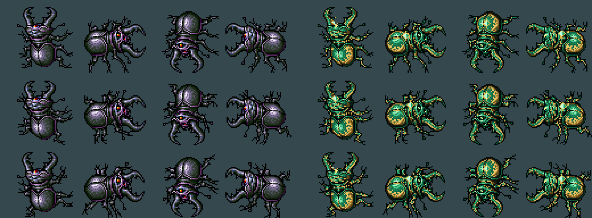
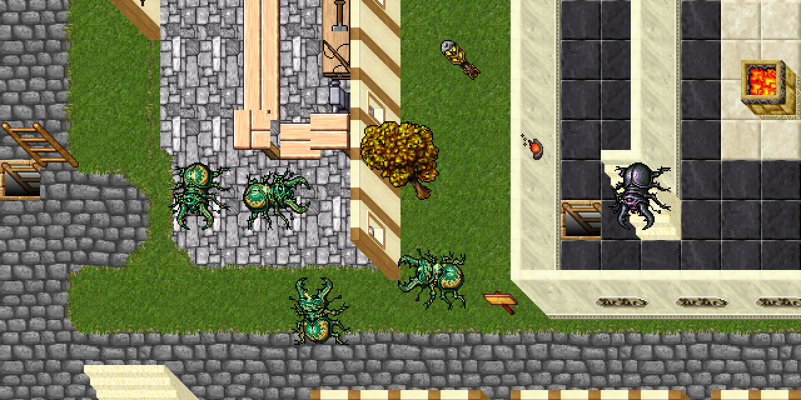

# Emerald Scarab

Variante de caza un escalón por encima del Ancient Scarab. Caparazón esmeralda, patas y ribetes dorados,
con una gema facetada en el lomo. Look **242**, derivado de Ancient Scarab (**79**). Balance inicial
pendiente de combate in-game. Flujo: [CUSTOM_MONSTER_WORKFLOW.md](CUSTOM_MONSTER_WORKFLOW.md).

## Stats

| Stat | Ancient Scarab | Emerald Scarab |
|---|---:|---:|
| Vida | 1000 | 1500 |
| Experiencia base | 720 | 1150 |
| Level / maglevel | 1 / 30 | 5 / 35 |
| Armor / defense | 32 / 33 | 38 / 38 |
| Speed | 212 | 225 |
| Melee | 54–180 | 65–220 |

Combate melee (`targetdistance=1`), sin huida. Inmune a poison e invisible, como la base.
Sin invocaciones de larvas: la dificultad está concentrada en la criatura. Conserva el cadáver
**3004** y los atributos de sangre del Ancient Scarab.

## Ataques

| Ataque | Daño / efecto | Intento cada | Probabilidad |
|---|---|---:|---:|
| Melee | 65–220 | Ritmo del motor | 100% |
| `poisonfield` (distance) | Hasta 90, ataque legacy de la base | 4 s | 60% |
| `emeraldscarab_poisonburst` | 45–85 poison, área de radio 2 | 5 s | 40% |
| `as_haste` | Haste existente del Ancient Scarab | 10 s | 35% |

El estallido reemplaza `as exevo gran mas pox`: hace **daño inmediato**, sin la larga secuencia de
veneno periódico del original. Área simétrica de 20 casillas alrededor, centro excluido. Efectos
clásicos `NM_ME_POISONCLOUD` y `NM_ME_POISEN_RINGS`; no necesita nuevos efectos ni rebuild de C++.

## Loot

Basado en Ancient Scarab, con hasta 140 gold y bolsa garantizada. Conserva scarab coins y equipo:
daramanian waraxe (**2440**, 1,2%) y great halberd (**2443**, 0,7%), entre otras piezas.
**Small emerald (2149), hasta 2, 8%** dentro de la bolsa. No se agregaron objetos nuevos ni se alteró
el sistema de gemas. El XML es la fuente exacta de cantidades y probabilidades.

## Sprite y aprendizaje de la base

Preset `emerald-scarab`: **48 sprites nuevos (11558–11605)**; 12 cuadros, silueta intacta.
`BASE_PARTS[79]` en `sprite_kit.py` separa contorno (`v < 0.13`), ojos rojos/amarillos saturados,
patas verdes (`0.20 ≤ h < 0.45`, `s ≥ 0.18`) y caparazón (violeta, azul o gris restante).
El verde original es oscuro: `v` está aproximadamente entre 0,14 y 0,25; no usar un umbral de
brillo alto para identificarlo. Los tonos claros del caparazón tienen saturación baja y también
deben incluirse para conservar el volumen.

La gema es un rombo de hasta 7×9 píxeles anclado a la zona gruesa del caparazón superior de cada
cuadro. Marco dorado y dos caras verdes de distinta luz. No pinta fuera de la silueta.

## Archivos

| Pieza | Ruta |
|---|---|
| Monstruo | `server/YurOTS/ots/data/monster/emerald scarab.xml` |
| Alta en servidor | `server/YurOTS/ots/data/monster/monsters.xml` |
| Estallido | `server/YurOTS/ots/data/spells/instant/emeraldscarab_poisonburst.lua` |
| Alta del hechizo | `server/YurOTS/ots/data/spells/spells.xml` |
| Preset | `scripts/client-rme/presets/emerald_scarab.py` |
| Clasificador compartido | `scripts/client-rme/sprite_kit.py` |
| Paleta de RME | `devtools/rme/rme-extensions/yurots-creatures.xml` |
| Assets de RME | `devtools/rme/rme-client-760/Tibia.dat`, `Tibia.spr` |
| Previews | `docs/gameplay/img/emerald-scarab-hoja.png`, `emerald-scarab-escena.png` |

## Validación y pendientes

- Hoja y escena revisadas; `sprite_tool.py verify --expect 241,242` contra la referencia previa de la
  sesión: `TODO BIEN`, junto a Dark Hydra. Copia aislada para conservar `.bak` de otras sesiones.
  Ítems, efectos, proyectiles y los 11509 sprites anteriores intactos; todos los presets reproducibles.
- `luac -p` y ejecución de `onCast` con biblioteca real y sustituto de `doAreaMagic`: OK en tipo,
  daño, área de 20 casillas y exclusión del centro. XML, registro, spells, loot y paleta RME: OK.
- Falta boot/probe satisfactorio y prueba real con `/m Emerald Scarab`. Docker, binario local y
  cliente de jugadores no están disponibles aquí; el sustituto Lua no verifica el combate del motor.
- Aplicar el preset a la base del cliente, regenerar y publicar/verificar el pack del updater
  **antes** de agregar un spawn. No se modificó el mapa ni se eligió una zona de caza.
- Sin deploy a ThinkPad. Requiere el OK de Gonzalo y el procedimiento habitual.
