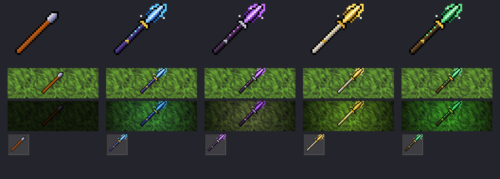
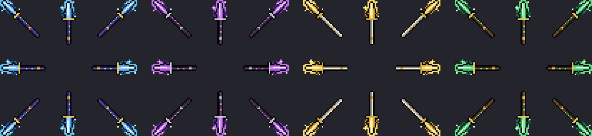

# Enchanted Spear (20156)

Una spear mejorada. Se tira igual que la spear, pero pega más fuerte, falla menos y tiene un dibujo propio: hoja de cristal, guarda dorada y runas que brillan en el asta. Además **emite luz de color** en el juego, como una antorcha chica, y al tirarla vuela con su **proyectil propio**, que también brilla.



## Estado

| Pieza | Estado |
|---|---|
| Diseño | 4 estilos; **arcana** (azul) aplicado. Cambiar de estilo cambia ítem y proyectil juntos. |
| Cliente del editor (RME) | Ítem y proyectil aplicados en `devtools/rme/rme-client-760/`. |
| Cliente de jugadores | **Falta**: correr el script sobre su `Tibia.dat`/`.spr` (ver "Publicar"). |
| Servidor (OTB) | Agregado a `items-zagan-test.otb`. |
| C++ (puntería 80%, descripción y proyectil) | Escrito, **sin compilar**. Sin compilar: puntería genérica de arrojadizas (50%) y vuela con el proyectil de la spear común. |
| Proyectil propio | `NM_ANI_ENCHANTED_SPEAR` = **16**, 8 direcciones, luz en vuelo (nivel 4). Necesita el C++ compilado y el cliente nuevo. |
| Loot / NPC | Sin asignar. Por ahora sale solo con `/i 20156 1`. |

## Stats

| | Spear (2389) | Enchanted Spear (20156) |
|---|---|---|
| Ataque | 30 | **36** |
| Puntería | 70% | **80%** |
| Daño esperado por tiro | 21 (30 × 0,7) | **28,8** (36 × 0,8), +37% |
| Se apila | Sí | No (es un ítem único) |
| Se gasta al tirar | No | No |
| Peso | 20 oz | 20 oz |
| Proyectil | spear | **propio (16)**, con luz |

El daño máximo usa la misma fórmula que toda arma a distancia (`player.cpp`): `skill × ataque / 20 × mul + ataque`.

## Ids

| Id | Valor | Nota |
|---|---|---|
| Server id | `20156` | El que se usa en `/i`, loot y mapa. |
| Client id | `3576` | Reutilizado: era *post officers hat* (2665), sin uso en mapa, loot, NPCs, scripts ni C++. |
| Sprite | el siguiente libre del `.spr` | En el cliente del editor quedó en 11095. |
| Luz | nivel 3, color según el estilo | Una antorcha es nivel 7. |

El nodo 20156 va **al final** del OTB: el servidor traduce client id → server id con "el último gana", así que el 3576 que manda el cliente apunta a la enchanted spear. El client id 3576 está reservado en `build_zagan_test_assets.py` (`EXTERNAL_CLIENT_IDS`) para que el builder nunca lo reutilice.

## Proyectil



- **Diagonales:** son el mismo dibujo del ítem espejado, igual que hace la spear original. El NE usa el mismo sprite que el ítem.
- **Rectas (N/S/E/O):** la misma lanza dibujada derecha: asta de 2 px como la spear original, hoja de cristal, guarda, runas y halo.
- **Luz en vuelo:** nivel 4 (la bola de fuego es 5), del color del estilo.
- **Número:** 16. Se agrega después de la bola de hielo (15, pack "ice"): el script se niega si el cliente no tiene el pack "ice" aplicado, para no correr los números.
- **Servidor:** el OTB sigue guardando el proyectil de la spear (14) porque su lista de proyectiles no tiene lugar para uno nuevo. `Item::getSubfightType()` (`item.cpp`) devuelve `DIST_ENCHANTED_SPEAR` para el ítem 20156. Sin recompilar, vuela con el proyectil de la spear común.
- **Lua:** `NM_ANI_ENCHANTED_SPEAR = 16` en `spells.lua`, por si un hechizo o un monstruo quiere tirarla.

## Estilos

| `--style` | Hoja | Asta | Luz (paleta 6×6×6) |
|---|---|---|---|
| `arcana` (por defecto) | cristal celeste | violeta oscuro, runas celestes | 65 (celeste) |
| `violeta` | amatista | casi negra, runas fucsia, guarda plateada | 161 (violeta) |
| `sagrada` | oro | blanca | 212 (amarillo claro) |
| `esmeralda` | esmeralda | madera oscura, runas verdes | 68 (verde) |

Volver a correr el script con otro `--style` cambia el dibujo, el proyectil y la luz **en el lugar** (mismos sprites, no agrega nuevos).

## Scripts

```bash
# Vista previa de los 4 estilos (no toca nada)
python3 scripts/client-rme/add_enchanted_spear.py --preview /tmp/spear.png
python3 scripts/client-rme/add_enchanted_spear.py --missile-preview /tmp/spear-missile.png

# Aplicar ítem + proyectil (o cambiar de estilo) en un cliente; necesita el pack ice antes
python3 scripts/client-rme/add_enchanted_spear.py DIR_THINGS --style arcana

# Servidor: agrega/actualiza el nodo 20156 en items-zagan-test.otb (idempotente)
python3 scripts/otb/patch-enchanted-spear-otb.py
```

`DIR_THINGS` es la carpeta con `Tibia.dat` y `Tibia.spr`. El script verifica que solo cambien la entrada 3576 y el proyectil 16 del `.dat` (ítems, criaturas, efectos y proyectiles anteriores idénticos) y que los sprites viejos no cambien; deja copia `.bak-enchanted-spear`. Un cliente armado desde cero (pack ice → Frost Dragon → spear) da el mismo contenido que el del editor, cosa por cosa y pixel por pixel.

## C++

| Archivo | Cambio |
|---|---|
| `const76.h` | `ITEM_ENCHANTED_SPEAR = 20156`, `ENCHANTED_SPEAR_HIT_CHANCE 80` |
| `player.cpp` | Puntería 80% para la enchanted spear (junto a la de la spear y la crystal arrow) |
| `item.cpp` | Línea extra al mirarla (puntería y "It is never used up.") y `getSubfightType()` → proyectil 16 |
| `const76.h` (proyectil) | `NM_ANI_ENCHANTED_SPEAR 16`, `DIST_ENCHANTED_SPEAR` |

Hace falta recompilar el servidor para que la puntería, la descripción extra y el proyectil tomen efecto.

## Publicar (cuando se apruebe el diseño)

1. Elegir estilo y aplicarlo al cliente del editor (`devtools/rme/rme-client-760/`).
2. Cliente de jugadores, en este orden sobre su `data/things/760/`: `build_zagan_test_assets.py` → `add_recolor_look.py` (dragones) → `add_recolor_effects.py --pack ice` → `add_enchanted_spear.py --style <elegido>`.
3. `patch-enchanted-spear-otb.py` (ya aplicado en el repo) y recompilar el servidor.
4. Deploy y repartir el cliente nuevo **antes** o junto con el servidor. Un cliente viejo vería un sombrero de cartero en lugar de la lanza, y el proyectil 16 no existe para él (no se ve o, en el peor caso, el cliente falla; probarlo).

## Probar

```
/i 20156 1
```

Ponerla en la mano y atacar a distancia: tiene que volar la lanza de cristal en las 8 direcciones. Mirarla (look) muestra la puntería. De noche o en una cueva tiene que verse la luz de color, en el piso y en vuelo.

## Pendiente

- Opcional: un efecto al pegar (por ejemplo los destellos azules `NM_ME_MAGIC_ENERGIE` o la explosión de hielo) para que el impacto también se note.
- Dónde se consigue: loot raro, recompensa del Crisol o NPC.
