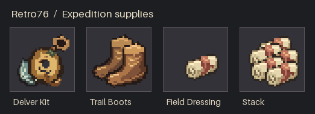

# Expedition supplies



Los tres objetos se consiguen con **Seller**. Decir `supplies` muestra
los precios y las frases de compra en inglés.

| Objeto | ID servidor / cliente | Precio | Uso |
|---|---|---:|---|
| Delver Kit | `20685` / `6085` | 480 gp | **Use With** sobre los mismos agujeros, arena y salidas que la pala y la cuerda. Reutilizable, 35 oz. |
| Trail Boots | `20686` / `6086` | 900 gp | Arm 2 y 9 oz. Entre Leather Boots (Arm 1) y Steel Boots (Arm 3). |
| Field Dressing | `20687` / `6087` | 70 gp | **Use** desde el inventario para recuperar hasta 100 HP propios. Un vendaje por uso, apilable hasta 100, 1,50 oz por unidad y espera de 2 segundos entre usos de este objeto. |

El Delver Kit llama a los scripts existentes de pala y cuerda en su propio estado Lua.
Las botas usan el slot y el cálculo de armadura normales. Los vendajes cuestan
10 gp más que el vial de vida a cambio de ocupar menos espacio y aplicarse con
un uso directo. El uso consume un vendaje incluso con la vida al máximo,
igual que el vial. La espera del vendaje se guarda en el storage `9120`.

## Regenerar assets

Los sprites fuente están en `devtools/zagan-test/custom-sprites/`. El vendaje
usa los ocho patrones de pila del prototipo Apple (`2674`).

```sh
python3.11 scripts/client-rme/add_custom_items.py --only 20685 20686 20687 \
  --things devtools/rme/rme-client-760 \
  --otb server/YurOTS/ots/data/items/items-zagan-test.otb \
  --otb server/YurOTS/ots/data/items/items.otb
python3.11 scripts/map/check-map-load.py
python3 scripts/npc/run_npc_tests.py seller
```
