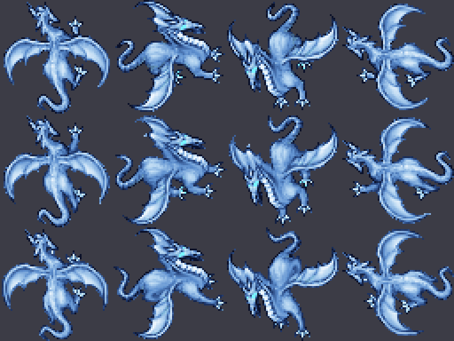

# Frost Dragon

Dragón de hielo inspirado en el Frost Dragon de las versiones nuevas de Tibia (blanco y celeste helado),
adaptado al cliente 7.6. Se ubica entre el Dragon Lord y el Black Dragon. **No usa fuego.**

Proceso general: [`CUSTOM_MONSTER_WORKFLOW.md`](CUSTOM_MONSTER_WORKFLOW.md). Hermano: [`BLACK_DRAGON.md`](BLACK_DRAGON.md).



## Stats

| Vida | Exp | Speed | Armor | Def | Melee | Huye con | Look |
|-----:|----:|------:|------:|----:|------:|---------:|-----:|
| 2200 | 2400 | 200 | 33 | 35 | 70–210 | 220 | 231 |

Inmune a paralyze, invisible y drunk. **No** es inmune al fuego (a diferencia de los otros dragones).

## Ataques (todos nuevos, sin fuego)

El motor 7.6 no tiene daño de hielo: los ataques hacen daño físico, con número celeste (`LIGHT_BLUE`) y los
**efectos de hielo nuevos** del pack "ice" ([`CLIENT_EFFECTS.md`](CLIENT_EFFECTS.md)): área `NM_ME_ICE_AREA`,
llamarada helada `NM_ME_ICE_HIT`, explosión `NM_ME_ICE_EXPLOSION`, impacto `NM_ME_ICE_SHATTER` y proyectil
`NM_ANI_FROSTBALL`.

| Ataque | Tipo | Forma | Daño | Cada | Prob. |
|--------|------|-------|-----:|-----:|------:|
| `frostdragon_icewave` | instant | Aliento en abanico hacia donde mira (forma del aliento de dragón), efecto `ICE_AREA` | 150–260 | 6 s | 80 % |
| `frostdragon_iceball` | rune (id 5034) | Bola de hielo (`FROSTBALL`) que estalla en cruz sobre el objetivo (`ICE_EXPLOSION`) | 80–150 | 4 s | 50 % |
| `frostdragon_blizzard` | instant | Ventisca alrededor suyo, radio 2, efecto `ICE_HIT` (castiga quedarse pegado) | 100–180 | 9 s | 40 % |
| `exura` | instant | Se cura | — | 7 s | 50 % |
| melee | — | Garras | 70–210 | — | 100 % |

**Pendiente opcional (C++):** frenar al jugador con el aliento. Desde Lua no se puede obtener la criatura
objetivo de un hechizo, y `doParalyze` dura 60 s (demasiado para un monstruo). Ya existe el "chill" de 4 s del
arma del Frostwarden (`game.cpp`); exponerlo como `doChill(cid, pos)` es un cambio chico, pero requiere compilar.

## Loot

Oro (100 + 70 al 60 %), small sapphire ×3 (15 %), dragon ham ×2 (20 %), ice rapier (2,5 %), dragon shield (1,5 %),
dragon lance (1 %), crystal mace (0,8 %) y bolsa (50 %) con oro, platino y sapphire.

## Sprite

Recoloreado por algoritmo del Dragon (34) con el script genérico:

```bash
python3 scripts/client-rme/add_recolor_look.py --preset frost-dragon --preview /tmp/frost.png      # solo vista previa
python3 scripts/client-rme/add_recolor_look.py --preset frost-dragon devtools/rme/rme-client-760    # aplica (idempotente)
```

Paleta: cuerpo verde → degradé azul acero a blanco según luminosidad; panza y membranas (amarillo/naranja) →
blanco hielo; ojos, lengua y garras rojas → celeste brillante. Probado sobre nieve, hielo, cueva y pasto: se distingue en todos.

Verificado con lectura independiente: solo cambió el look 231, se agregaron 48 sprites (11010 → 11058),
400 sprites viejos al azar idénticos y los ítems del `.dat` sin cambios.

## Antes de ponerlo en el mapa: el cliente

Igual que el Black Dragon: el look 231 es nuevo, y además usa los efectos nuevos del pack "ice". **Primero** se actualiza el `Tibia.dat`/`Tibia.spr` de los
jugadores (aplicar el script a la base del cliente y regenerar el pack Zagan), **después** el spawn.
Hoy no está en ningún spawn. Encaja en una zona de nieve o en el Crisol.

## Archivos

| Pieza | Archivo |
|-------|---------|
| Definición | `server/YurOTS/ots/data/monster/frost dragon.xml` |
| Registro | `server/YurOTS/ots/data/monster/monsters.xml` |
| Ataques | `data/spells/instant/frostdragon_icewave.lua`, `frostdragon_blizzard.lua`, `data/spells/runes/frostdragon_iceball.lua` + `spells.xml` |
| RME | `rme-extensions/yurots-creatures.xml` y `devtools/rme/rme-client-760/Tibia.{dat,spr}` |
| Sprite | `scripts/client-rme/add_recolor_look.py` (preset `frost-dragon`) |
