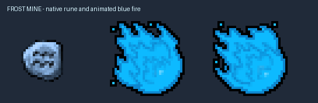

# Frost Mine Rune — fuego azul, solo compra y PvP

Runa solicitada el 21 nov 2026: se compra en Dark Rodo, coloca fuego azul visible
y detona una sola vez cuando otro jugador entra en su casilla. No aplica slow,
root ni daño periódico; los monstruos y NPCs no activan ni consumen la mina.



## Valores iniciales

| Dato | Valor |
|---|---|
| Runa / client ID | `20369` / `5105` |
| Fuego / client ID | `20370` / `5106` |
| Tienda | Dark Rodo: `frost mine`, `3 frost mine`, `bp frost mine` |
| Precio | 1.000 gp por runa de **1 carga**; backpack de 20: 20.000 gp |
| Fabricación / loot | Ningún conjuro, receta, quest ni loot de monstruos |
| Uso | ML 10, cualquier vocación; 2,1 oz por carga |
| Alcance al colocar | Hasta 4 casillas por eje, mismo piso y línea de tiro |
| Armado / duración máxima | 1.000 ms / 30.000 ms desde colocación |
| Límite | 3 minas activas por jugador; una por casilla |
| Daño | Fuego, base 180–240; reducción PvP normal → **90–120** |
| Efectos | Fuego nativo 1492 recoloreado, 2 cuadros, luz azul 137; impactos 26/27 |

El daño pasa por el motor habitual: protecciones, mana shield, Power Hit y
registro de muerte/skull/frag siguen vigentes. Los 90–120 son el daño base de
jugador normal antes de protecciones y posibles críticos; un GM conserva su
comportamiento habitual de combate. La detonación no consume un segundo exhaust.

## Reglas

- Colocación y detonación deshabilitadas en mundos no-PvP, PZ, casas y training.
- Se coloca en una casilla transitable con suelo, sin criatura, field, teleport,
  escalera o agujero. No reemplaza magic walls ni otros campos.
- El dueño recibe exhaust ofensivo y PZ lock al colocarla. Los intentos fallidos
  no gastan carga ni añaden exhaust.
- No se activa con el dueño, su party, rookies o GMs protegidos. El dueño no puede
  colocarla siendo rookie. Ni siquiera el GM ignora las zonas protegidas/no-PvP.
- La entrada por paso normal, empuje o teleport se revisa. Se retira **antes** de
  aplicar daño, evitando una segunda detonación por callbacks de muerte/teleport.
- El dueño tiene que seguir conectado, vivo, en el mismo piso y fuera de zonas
  protegidas. Si ya no cumple esas condiciones cuando la pisan, la mina se retira
  sin daño. No existe daño anónimo de una trampa con dueño desconectado.
- Destroy Field y el reemplazo por otro field pueden retirarla. La referencia
  del evento de expiración mantiene vivo el objeto y se libera aunque ya detonó.
- El timer es un evento propio: no depende de la granularidad de `startDecay`.
  No se guarda en casas ni en datos de jugadores; desaparece al reiniciar.

## Archivos y reproducción

- `source/frost_mine.cpp` / `.h`: estado de trampas, armado, expiración y daño.
- `source/game.cpp`: entrada por paso y teleport; el resto de fields no cambia.
- `source/spells.cpp` / `.h`: binding `doFrostMine`, exhaust y resultado del cast.
- `source/const76.h`: IDs. No se agregan miembros a Player/Creature.
- `data/spells/runes/frost mine.lua` y `spells.xml`: runa de 1 carga sin conjuro.
- `data/npc/scripts/runes.lua`: venta unitaria y backpacks con confirmación normal.
- `data/items/items{,-zagan-test}.{otb,xml}`: ambos OTB y peso XML.
- `scripts/client-rme/build_frost_mine.py`, `add_custom_items.py` y extensión RME.

```sh
python3.11 scripts/client-rme/build_frost_mine.py
python3.11 scripts/client-rme/add_custom_items.py --only 20369 20370 \
  --things devtools/rme/rme-client-760 \
  --otb server/YurOTS/ots/data/items/items-zagan-test.otb \
  --otb server/YurOTS/ots/data/items/items.otb
```

Los assets parten de fuego/runa nativos; conservan tamaño, alfa y animación.
Auditoría local: solo cambian DAT 5105/5106; tail de criaturas/efectos/proyectiles
idéntico y los 14.896 sprites anteriores intactos; tres sprites nuevos. Los dos OTB
conservan todos sus nodos previos y agregan únicamente 20369/20370. Lua/XML/Python
parsean correctamente. No se modifica mapa ni runtime de jugadores.

**Pendiente:** recompilación C++ y aplicación en la ThinkPad, autorizadas por Gonzalo;
no se han ejecutado builds, suites, bots ni pruebas in-game de esta runa.
Publicar DAT/SPR antes de habilitarla. Ver [SPELL_RUNTIME.md](SPELL_RUNTIME.md),
[PVP_SYSTEM.md](../PVP_SYSTEM.md) y [deploy](../systems/THINKPAD_TEST_SERVER.md).
