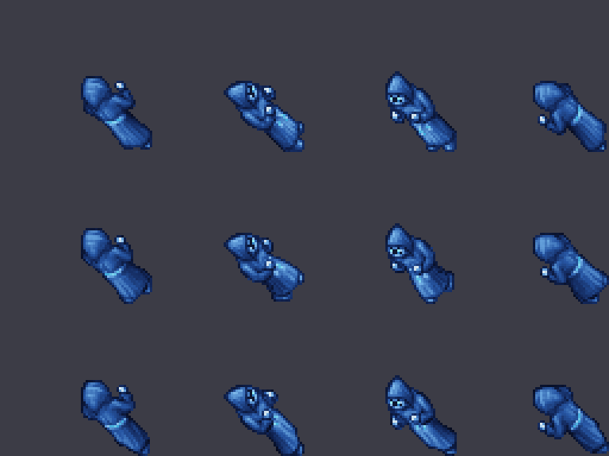

# Ice Monk

Monje-mago del hielo: un Monk recoloreado (túnica azul profundo y blanco hielo, piel pálida, cinturón
celeste brillante) que **se queda a distancia** y ataca con hielo. Nivel medio, entre el Monk y los
dragones.

Proceso general: [`CUSTOM_MONSTER_WORKFLOW.md`](CUSTOM_MONSTER_WORKFLOW.md). Usa los efectos de hielo del
pack "ice" ([`CLIENT_EFFECTS.md`](CLIENT_EFFECTS.md)), los mismos del [Frost Dragon](FROST_DRAGON.md).



## Stats

| | Monk | **Ice Monk** |
|---|---:|---:|
| Vida | 240 | **650** |
| Exp | 200 | **520** |
| Nivel / magic level | 20 / 1 | **35 / 30** |
| Armor / defense | 30 / 31 | **18 / 22** (más frágil: es mago) |
| Speed | — | 220 |
| Distancia | cuerpo a cuerpo | **se mantiene a 4 casillas** (`targetdistance="4"`) |
| Look | 57 | **232** |

Inmune a paralyze, drunk e invisible.

## Ataques

El motor 7.6 no tiene daño de hielo: los ataques hacen daño físico con número celeste (`LIGHT_BLUE`) y los
efectos de hielo nuevos.

| Ataque | Tipo | Qué hace | Daño | Cada | Prob. |
|--------|------|----------|-----:|-----:|------:|
| `icemonk_iceshard` | rune (id 5035) | Fragmento de hielo a distancia contra un objetivo (proyectil `FROSTBALL`, impacto `ICE_SHATTER`) | 45–95 | 2 s | 75 % |
| `icemonk_frostburst` | rune (id 5036) | Bola de hielo que estalla en cruz sobre el objetivo (`ICE_EXPLOSION`) | 30–70 | 6 s | 35 % |
| `exura` | instant | Se cura | — | 5 s | 40 % |
| melee | — | Golpe débil si lo alcanzas | 10–45 | — | 100 % |

Voces: "Feel the cold of the north!", "Your blood will freeze.", "Silence... like the snow."

## Loot

Oro (hasta 45), small sapphire ×2 (8 %), snowball ×6 (20 %), blank rune (8 %), scroll (6 %) y bolsa con
life ring (1,5 %), tempest rod (0,4 %) e ice rapier (0,3 %).

## Sprite

Recoloreado por algoritmo del Monk (57, 2×2, 4 direcciones, 3 cuadros) con el script genérico:

```bash
python3 scripts/client-rme/add_recolor_look.py --preset ice-monk --preview /tmp/ice-monk.png      # solo vista previa
python3 scripts/client-rme/add_recolor_look.py --preset ice-monk devtools/rme/rme-client-760    # aplica (idempotente)
```

Paleta (`recolor_ice_monk`): túnica marrón → degradé de azul noche a blanco hielo según la luz; cara y
manos (tonos piel) → celeste pálido helado; cinturón dorado → celeste brillante. Probado sobre nieve,
hielo, cueva y pasto: se distingue en todos.

Verificado con lectura independiente del `.dat`/`.spr` de RME: solo cambió el look 232 (cabecera del
Monk, sprites 11103-11150), los ítems quedaron iguales y 400 sprites viejos al azar siguen idénticos.

## Antes de ponerlo en el mapa: el cliente

El look 232 es nuevo: un cliente viejo vería el monstruo invisible. Orden obligatorio
([`CUSTOM_MONSTER_WORKFLOW.md`](CUSTOM_MONSTER_WORKFLOW.md) §6.6):

1. Aplicar el script a la base del cliente de jugadores (`client-local/data/things/760/`, no está en git
   ni en esta Mac) y regenerar el pack con `build_zagan_test_assets.py`.
2. Publicar `Tibia.dat`/`Tibia.spr` en el updater y confirmar con un cliente actualizado que se ve.
3. Recién entonces el spawn. Encaja en la Tundra Helada del Paso del Norte o en zonas de nieve.

Hoy no está en ningún spawn.

## Archivos

| Pieza | Archivo |
|-------|---------|
| Definición | `server/YurOTS/ots/data/monster/ice monk.xml` |
| Registro | `server/YurOTS/ots/data/monster/monsters.xml` |
| Ataques | `data/spells/runes/icemonk_iceshard.lua`, `icemonk_frostburst.lua` + `spells.xml` (ids 5035, 5036) |
| RME | `rme-extensions/yurots-creatures.xml` y `devtools/rme/rme-client-760/Tibia.{dat,spr}` |
| Sprite | `scripts/client-rme/add_recolor_look.py` (preset `ice-monk`) |
