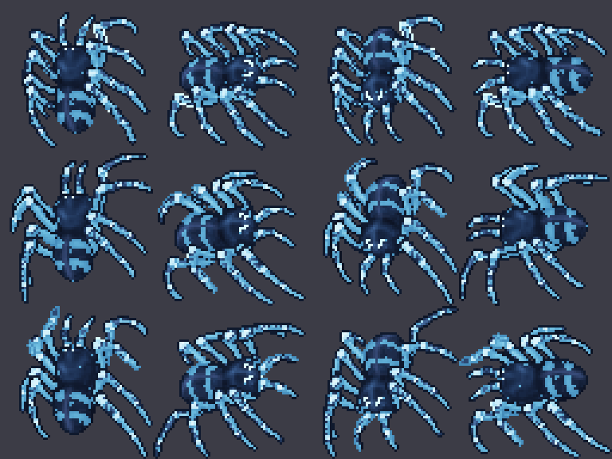

# Ice Spider

Variante de hielo del **Giant Spider**, más fuerte que el original. Usa un **looktype nuevo
(235)** recoloreado por algoritmo y ataca con los efectos de hielo del pack "ice" (los mismos del
Frost Dragon). Mantiene la forma, la animación y el loot base del Giant Spider.

Proceso general: [`CUSTOM_MONSTER_WORKFLOW.md`](CUSTOM_MONSTER_WORKFLOW.md).



## Stats

| Stat | Giant Spider | Ice Spider |
|------|-------------:|-----------:|
| Vida | 1300 | **1800** |
| Exp | 900 | **1400** |
| Level | 14 | **20** |
| Armor | 35 | **40** |
| Defense | 37 | **40** |
| Speed | 270 | **285** |
| Melee | 120–300 | **140–340** |
| Huye con | 0 HP | 0 HP |

Inmune a poison, paralyze, invisible y drunk. **No** es inmune a fire: el fuego es su contrapeso.

## Ataques

| Ataque | Tipo | Daño | Cada | Prob. |
|--------|------|-----:|-----:|------:|
| melee | — | 140–340 | — | 100 % |
| `frostdragon_iceball` | runa a distancia | 80–150 | 6 s | 35 % |
| `icespider_blizzard` | instant, radio 2 | 45–90 | 8 s | 40 % |
| `exura` | instant, cura | — | 4,5 s | 30 % |
| `gs_haste` | instant, +velocidad | — | 9 s | 40 % |

El motor 7.6 no tiene daño de hielo: los ataques hacen daño **físico** con número `LIGHT_BLUE` y
los efectos nuevos del pack "ice" (`NM_ME_ICE_HIT`, `NM_ME_ICE_SHATTER`, `NM_ANI_FROSTBALL`).
La bola de hielo reusa la runa existente del Frost Dragon; la ventisca es una versión reducida
(`icespider_blizzard`, 45–90) para que no pegue como un boss de 2200 HP.

## Loot

Loot base del Giant Spider (oro, plate armor, platinum amulet, iron helmet, bag con knight
armor/legs, brass legs y time ring) **+ small sapphire ×1–2 al 12 %**. Sin summons: la pelea es
ella sola, sin Poison Spiders.

## Sprite

Recoloreado por algoritmo del Giant Spider (looktype 38, 2×2, 4 direcciones × 3 frames = 48
sprites). No se redibujó el pixel art: se mapeó cada píxel por canal/luminosidad.

```bash
python3 scripts/client-rme/add_recolor_look.py --preset ice-spider --preview docs/gameplay/img/ice-spider.png  # solo preview
python3 scripts/client-rme/add_recolor_look.py --preset ice-spider devtools/rme/rme-client-760                   # aplica (idempotente)
```

Paleta:

| Zona | Tratamiento |
|------|-------------|
| Cuerpo marrón | Azul acero oscuro, conserva las bandas del abdomen |
| Rayas rojas | Celeste/blanco hielo |
| Articulaciones y puntos amarillos | Celeste a blanco |
| Ojos verdes | Cian blanco |
| Sombras azules | Azul acero oscuro |

La variante "celeste" fue la elegida sobre las versiones fuego/rojo, azul fuego y azul noche.
Conserva la silueta y el caparazón del Giant Spider, y se distingue del Giant Spider marrón y del
Poison Spider verde.

Verificado con lectura independiente del `.dat`/`.spr`:

- Looktype 235 con 48 sprites nuevos (11175–11222).
- Looktype 38 (Giant Spider) sin cambios.
- Looktypes 34, 231 y 232–234 (Ice Monk, Drowned Sailor, Tide Priest) sin cambios.
- Sprites viejos y sección de ítems sin cambios.

## Antes de ponerla en el mapa: el cliente

El looktype 235 es nuevo y los ataques usan los efectos `NM_ME_ICE_*` del pack "ice". **Primero**
hay que actualizar el `Tibia.dat`/`Tibia.spr` de los jugadores (base del cliente + regenerar el
pack del updater) y confirmar que el pack "ice" está aplicado; **después** agregar el spawn.
Un cliente viejo ve el looktype vacío (invisible) o sin los efectos de hielo.

El server no necesita rebuild: solo envía el número de looktype y ejecuta los hechizos Lua. Al
reiniciar carga el XML y el spell nuevos.

## Archivos

| Pieza | Archivo |
|-------|---------|
| Definición | `server/YurOTS/ots/data/monster/ice spider.xml` |
| Registro | `server/YurOTS/ots/data/monster/monsters.xml` |
| Ataque de ventisca | `server/YurOTS/ots/data/spells/instant/icespider_blizzard.lua` |
| Registro del spell | `server/YurOTS/ots/data/spells/spells.xml` |
| RME | `devtools/rme/rme-extensions/yurots-creatures.xml` |
| Sprite | `scripts/client-rme/presets/ice_spider.py` (preset `ice-spider`; se aplica con `add_recolor_look.py`) |
| Assets RME | `devtools/rme/rme-client-760/Tibia.{dat,spr}` (looktype 235) |
| Preview | `docs/gameplay/img/ice-spider.png` |

## Pendiente

- **Cliente de jugadores:** aplicar el preset a la base `client-local/data/things/760/` y
  regenerar/publicar el pack del updater. En esta máquina esa base no está disponible.
- **Spawn:** no está en `test-spawn.xml` ni en el mapa. Agregarlo cuando el cliente esté
  actualizado.
- **Prueba in-game:** falta verla con el cliente real y ajustar el balance de la ice ball
  (80–150) y la ventisca (45–90) si resultan demasiado fuertes.
