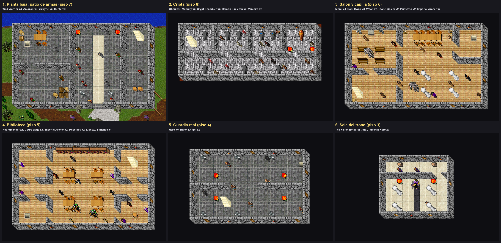
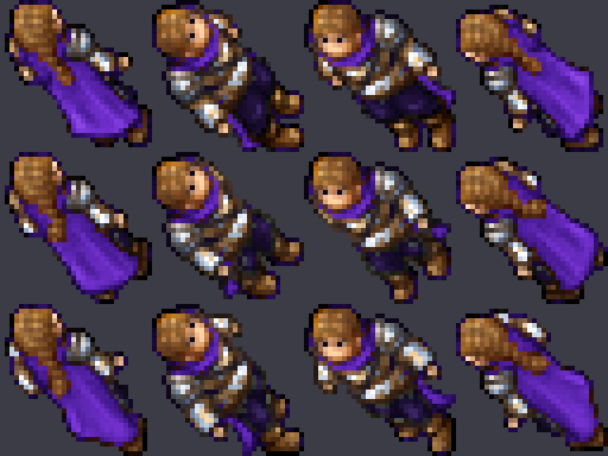
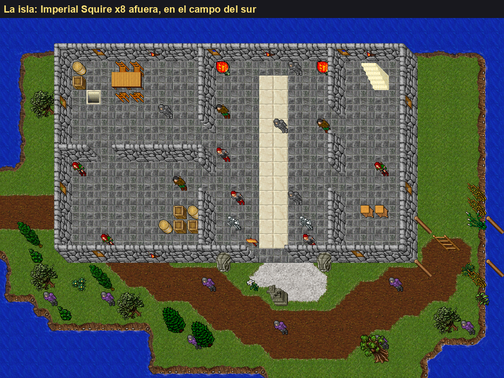
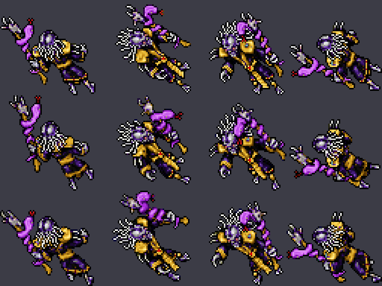

# Castillo Imperial

El castillo de la isla al noroeste del templo, rehecho de cero en nov 2026. Antes era una casa vacía de tres
pisos con monstruos sueltos. Ahora son seis pisos de dificultad creciente, cinco monstruos nuevos (con un jefe) y una quest.



## Cómo se llega

Desde el torreón del noroeste de la ciudad sale un puente en el piso 6. Al final hay una trampilla que baja a la
isla (`115, 39, 7`). La puerta del castillo está en su pared sur (`102–103, 39, 7`).

## Pisos

Caja: x 88–112, y 25–39 (25×15). Los pisos 4 y 3 son más chicos. Cada escalera queda en la punta opuesta a la
anterior.

| Orden | Piso | Zona | Monstruos (cantidad) |
|---|---|---|---|
| 1 | z7 | Planta baja: patio de armas | Wild Warrior 4, Amazon 3, Valkyrie 3, Hunter 3 |
| 2 | z8 | Cripta (opcional, baja desde `90, 28, 7`) | Ghoul 3, Mummy 3, Crypt Shambler 3, Demon Skeleton 3, Vampire 2 |
| 3 | z6 | Salón y capilla | Monk 4, Dark Monk 3, Witch 2, Stone Golem 2, Priestess 2, Imperial Archer 2 |
| 4 | z5 | Biblioteca | Necromancer 3, Court Mage 3, Imperial Archer 2, Priestess 2, Lich 2, Banshee 1 |
| 5 | z4 | Guardia real | Hero 5, Black Knight 2 |
| 6 | z3 | Sala del trono | The Fallen Emperor (jefe), Imperial Hero 3 |
| — | z7 | Afuera, campo del sur de la isla | Imperial Squire 8 |

- La cripta ocupa y 25–34 en z8. Debajo del resto, desde y 36, hay una cueva de rotworms que no se tocó.
- El castillo viejo llegaba hasta x 116: esa franja de z7 quedó como pasto y en z5–z6 se borró.
- El puente de z6 (x ≥ 113, y ≥ 37) no se tocó.
- Se sacaron los spawns viejos de la caja (minotauros en z7, necromancers en z6, heroes en z5).

## Imperial Hero

`data/monster/imperial hero.xml`, registrado en `monsters.xml`.

| Dato | Imperial Hero | Hero |
|---|---|---|
| Vida | 3000 | 1400 |
| Experiencia | 2600 | 1200 |
| Melee | 150–380 | 100–250 |
| Extra | bolt 90–210, `bk exori`, `exura` | arrow 52–130 |
| Respawn | 600 s | — |

- **Look 240:** el Hero (73) recoloreado con el preset `imperial-hero`
  (`scripts/client-rme/presets/imperial_hero.py`): capa morada, cota plateada, pantalón violeta oscuro. Necesita
  el cliente actualizado; con uno viejo no se ve.

  
- **Loot:** set crown, fire sword, war hammer y la Imperial Crown Armor (`20161`, chance 800 sobre 100000). Ver
  [CROWN_ARMORS.md](../items-and-map/CROWN_ARMORS.md).

## Los otros monstruos nuevos



| Monstruo | Vida | Exp | Dónde | Cómo pelea | Look |
|---|---:|---:|---|---|---|
| Imperial Squire | 95 | 45 | Afuera (8, respawn 60 s) | Melee 5–28. Caza fácil pegada a la ciudad | Ropa de knight (131) en morado claro |
| Imperial Archer | 450 | 300 | z6 y z5 | Bolts 50–130 a 4 casillas de distancia | Ropa de cazador (129) en morado |
| Court Mage | 650 | 520 | z5 | Heavy magic missile 45–95, bola de fuego, `exura`; huye con poca vida | Ropa de mago (130) en morado |
| The Fallen Emperor | 12000 | 9000 | z3, frente al trono (`100, 32, 3`), respawn 2 h | Melee 200–460, sudden death 150–320, robo de vida, se cura e invoca hasta 2 Imperial Heroes | Look 244: Lich recoloreado (`fallen_emperor.py`) |

- Squire y Archer tienen además un ataque de su kit (golpe de escudo y flecha incendiaria): ver
  [MONSTER_KITS.md](MONSTER_KITS.md).
- Squire, Archer y Mage usan ropa de jugador con otros colores: **no necesitan cliente nuevo**. El Emperor y
  el Imperial Hero sí.
- El Emperor suelta la Imperial Crown Armor con chance 6000 (6%), el set crown (chance 20000 cada pieza; crown
  armor, legs y helmet caen a la mitad, 10%, por `isRareEquipmentLootItem`; el escudo, 20%), violet gem y skull staff.

  
- En el generador: el jefe está en `FIXED` (casilla fija) y los escuderos en `OUTSIDE` (casillas libres del campo
  del sur, lejos de la puerta y de la bajada del puente).

## Quest

En la tesorería, detrás del trono (z3), hay dos cofres con `quest.lua` (el uniqueId es el id del premio):

| Cofre | Posición | Premio |
|---|---|---|
| A | `97, 28, 3` | Crown Legs (2488) |
| B | `103, 28, 3` | Royal Helmet (2498) |

Uno por personaje cada uno.

## Regenerar

```bash
python3.11 scripts/map/generate-imperial-castle.py --dry-run --preview /tmp/castillo.png   # valida y dibuja
python3.11 scripts/map/generate-imperial-castle.py                                         # escribe
python3 scripts/map/check-map-load.py                                                      # 0 errores
```

- Escribe `test.otbm`, el bloque `IMPERIAL_CASTLE_SPAWNS` de `test-spawn.xml`, el cartel de la entrada en
  `readables.xml` y `generated-imperial-castle.json`.
- Los pisos son planos de texto (`PLANS`) y los monstruos están en `MONSTERS_BY_FLOOR`. Para cambiar un cuarto
  o una cantidad se edita ahí y se vuelve a correr.
- Deja un respaldo `test.otbm.bak-castle` la primera vez (no va a git).
- Cómo usar paredes, escaleras y muebles: [PIEZAS_DE_MAPA.md](../items-and-map/PIEZAS_DE_MAPA.md).

## Deploy

Solo datos (mapa, spawns, monstruo): no hace falta compilar. Después hay que publicar el cliente
(`publish_client.py`) para que se vea el look 240.
