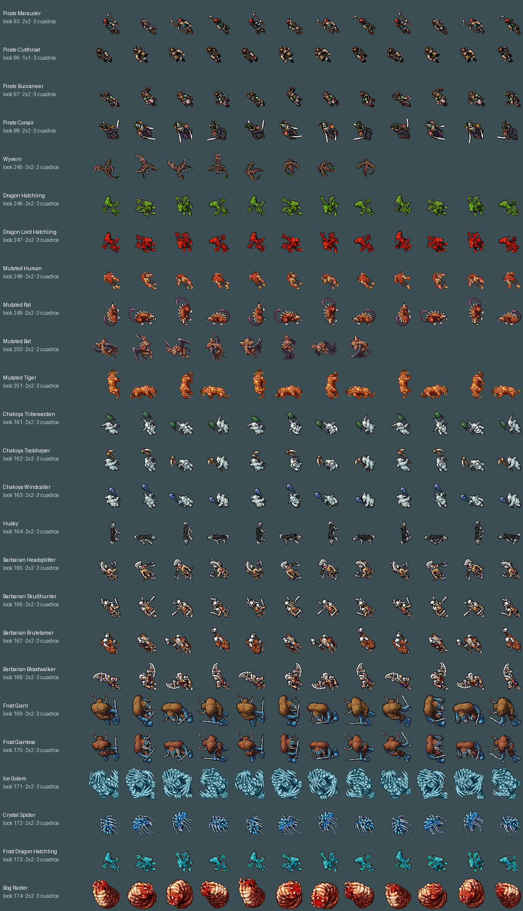
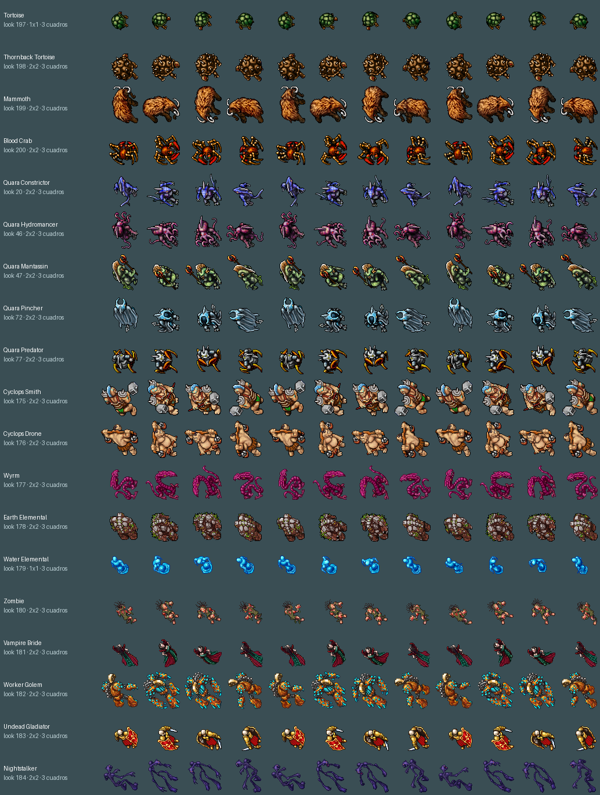
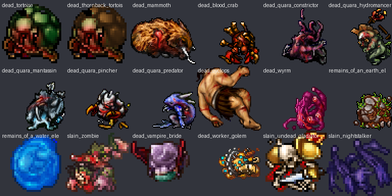

# Traer criaturas de otra versión de Tibia

Cómo sumar monstruos de versiones más nuevas con su dibujo original. Hecho en nov 2026 con 25 criaturas + 19 looks del resto del catálogo del
cliente 8.60. Para ítems, ver [IMPORTAR_ITEM_DE_OTRA_VERSION.md](../items-and-map/IMPORTAR_ITEM_DE_OTRA_VERSION.md).



## Lo que hay

| Monstruo | Look | Vida | Exp | Nivel | Ataques | Dónde está |
|---|---:|---:|---:|---|---|---|
| Pirate Marauder | 93 | 210 | 125 | 20–30 | melee 20–80, spear 10–40 | Barco del desierto, cubierta |
| Pirate Cutthroat | 96 | 325 | 175 | 25–35 | melee 30–110, throwing knife 20–60 | Barco del desierto, cubierta |
| Pirate Buccaneer | 97 | 425 | 250 | 30–45 | melee 40–150, throwing knife 30–100 | Barco del desierto, cubierta |
| Pirate Corsair | 98 | 675 | 350 | 40–60 | melee 50–170, throwing star 40–140 | Barco del desierto, cubierta |
| Dragon Hatchling | 246 | 380 | 185 | 20–35 | melee 15–55, onda de fuego 55–90, bola 30–55; huye con poca vida | **Sin spawn** |
| Wyvern | 245 | 795 | 515 | 30–50 | melee 30–120, aliento venenoso 35–80, se cura | **Sin spawn** |
| Dragon Lord Hatchling | 247 | 750 | 645 | 35–50 | melee 30–90, onda de fuego 90–125, bola 45–105 | **Sin spawn** |
| Mutated Human | 248 | 240 | 150 | 25–40 | melee 20–90, misil 10–50, veneno | **Sin spawn** |
| Mutated Rat | 249 | 550 | 450 | 40–60 | melee 40–155, veneno, se cura | **Sin spawn** |
| Mutated Bat | 250 | 900 | 615 | 50–70 | melee 50–165, chillido en cono 70–160 | **Sin spawn** |
| Mutated Tiger | 251 | 1100 | 750 | 60–80 | melee 80–260, se cura | **Sin spawn** |
| Chakoya Tribewarden | 161 | 68 | 40 | 10–20 | melee 5–35 | Isla del Hielo, bosque |
| Chakoya Toolshaper | 162 | 80 | 40 | 10–20 | melee 5–30, piedras 5–25 | Isla del Hielo, bosque |
| Chakoya Windcaller | 163 | 84 | 48 | 10–20 | bola de hielo 10–35 a distancia | Isla del Hielo, bosque |
| Husky | 164 | 140 | 90 | 15–25 | melee 5–50, rápido | Isla del Hielo, bosque y lago |
| Barbarian Headsplitter | 165 | 100 | 85 | 15–30 | melee 10–50, cuchillos 10–45 | Isla del Hielo, lago |
| Barbarian Skullhunter | 166 | 135 | 85 | 15–30 | melee 15–55 | Isla del Hielo, lago |
| Barbarian Brutetamer | 167 | 145 | 90 | 20–35 | bola de hielo, se cura, invoca 2 War Wolf | Isla del Hielo, montaña |
| Barbarian Bloodwalker | 168 | 305 | 195 | 25–40 | melee 20–110, se acelera | Isla del Hielo, montaña |
| Frost Giant | 169 | 270 | 150 | 25–40 | melee 15–90, rocas 10–60 | Isla del Hielo, montaña |
| Frost Giantess | 170 | 275 | 150 | 25–40 | melee 10–70, rocas 20–90 | Isla del Hielo, montaña |
| Ice Golem | 171 | 385 | 295 | 30–50 | melee 20–110, esquirlas 25–60 alrededor | Isla del Hielo, grutas (z8) |
| Crystal Spider | 172 | 1250 | 900 | 55–75 | melee 50–200, onda de hielo 80–150, se acelera | Isla del Hielo, grutas (z8) |
| Frost Dragon Hatchling | 173 | 800 | 745 | 45–65 | melee 20–90, aliento 60–110, bola 40–80 | Isla del Hielo, guarida (z9) |
| Bog Raider | 174 | 1300 | 800 | 50–70 | melee 30–110, chorro que roba vida 50–110, se cura | Desierto de las Ruinas, ciénaga |

- Vida y experiencia son las de Tibia 8.60. Los ataques están adaptados a lo que tiene este servidor y el loot
  usa ítems de 7.6 (los de 8.x no existen acá).
- Los piratas conservan su número de look de 8.60 (93, 96–98 estaban vacíos en 7.6). Los demás se pusieron
  en 245–251 y 161–174 (libres en 7.6 y vacíos también en 8.60).
- Los cuatro bárbaros traen máscara de colores (dos capas, como los trajes de jugador): sus colores van en
  `head`/`body`/`legs`/`feet` del XML.
- Cadáveres: no hay cadáver propio. Usan el de una criatura parecida de 7.6 (humano, dragón, dragon lord,
  ghoul, cave rat, bat, tiger).
- Hechizos nuevos: `hatchling_firewave`, `dlhatchling_firewave`, `wyvern_poisonwave`, `mutatedbat_shriek`,
  `frosthatchling_icewave`, `crystalspider_icewave`, `icegolem_shards` (instant) y las runas `hatchling_fireball`
  (5041), `chakoya_iceball` (5042), `frosthatchling_iceball` (5043) y `bograider_drown` (5044). El hielo es daño
  físico con los efectos del pack "ice", como el del Frost Dragon (7.6 no tiene daño de hielo).
- Siete no tienen spawn todavía: existen en el servidor (se pueden invocar o poner con RME) pero no aparecen
  en el mapa.
- Los que pegaban solo cuerpo a cuerpo o con un proyectil común tienen además un kit de ataques de su tema
  (cañonazos de los piratas, hielo de chakoyas y gigantes, grito de los bárbaros...): ver
  [MONSTER_KITS.md](MONSTER_KITS.md).

## El cliente de origen

`devtools/tibia-860/` con `Tibia.dat` y `Tibia.spr` de 8.60. **No va a git** (pesa 43 MB y no es nuestro): está
en `.gitignore`. Se copió de la Papelera de la Mac de Gonzalo el 13 nov 2026; si falta, hay que volver a
conseguirlo. Nunca se ejecuta nada del cliente, solo se leen esos dos archivos. Trae 367 looks.

## Paso a paso

```bash
# 1. encontrar el número de look en el otro cliente (hoja con todos)
python3.11 scripts/client-rme/import_client_look.py --catalog /tmp/looks.png
# 2. elegir un look libre en el nuestro (máximo 255)
python3.11 scripts/client-rme/sprite_tool.py looks
# 3. agregar la fila a IMPORTS en import_client_look.py y mirar la hoja
python3.11 scripts/client-rme/import_client_look.py --sheet /tmp/import.png
# 4. importar (lo que ya está no se toca) y revisar cómo quedó en nuestro cliente
python3.11 scripts/client-rme/import_client_look.py --apply
python3.11 scripts/client-rme/import_client_look.py --check /tmp/check.png
```

Después, lo de siempre para un monstruo nuevo ([CUSTOM_MONSTER_WORKFLOW.md](CUSTOM_MONSTER_WORKFLOW.md)): su XML
en `data/monster/`, la línea en `monsters.xml`, el nombre en `rme-extensions/yurots-creatures.xml`, el spawn, y
publicar el cliente (`publish_client.py`) para que los jugadores lo vean.

## Qué hace y qué no

- Copia la entrada del `.dat` (flags, tamaño, 4 direcciones, cuadros de animación) y los sprites tal cual. El
  formato de 7.6 y el de 8.60 comparten esos campos y los flags que usan las criaturas (24 = corrimiento,
  27 = animar siempre).
- Los sprites se agregan al final del `.spr`. Los 44 sumaron 1.889 sprites (11.741 → 13.646).
- **No importa** looks con addons o montura (patrón Y o Z distinto de 1): son los trajes de jugador.
- Dos de los importados tienen 2 cuadros de animación en vez de 3 (Wyvern y Mutated Bat). El cliente los dibuja
  bien, pero `sprite_tool.py sheet` y `add_recolor_look.py` esperan 3 cuadros: no sirven como base para recolorear.
- Los XML de monstruo van **sin tildes**: el servidor lee el XML como UTF-8 y una tilde en latin-1 no carga.

## Resto del catálogo 8.60 importado (nov 2026)

Se importaron los **19 looks de criaturas** que faltaban, con sus sprites originales de 8.60. Por ahora son
solo **looks**: no tienen XML de monstruo, stats, loot ni spawn. Para convertirlos en enemigos, seguir
[`CUSTOM_MONSTER_WORKFLOW.md`](CUSTOM_MONSTER_WORKFLOW.md).



| Criatura | Look 8.60 | Look nuestro |
|----------|----------:|-------------:|
| Tortoise | 197 | 197 |
| Thornback Tortoise | 198 | 198 |
| Mammoth | 199 | 199 |
| Blood Crab | 200 | 200 |
| Quara Constrictor | 20 | 20 |
| Quara Hydromancer | 46 | 46 |
| Quara Mantassin | 47 | 47 |
| Quara Pincher | 72 | 72 |
| Quara Predator | 77 | 77 |
| Cyclops Smith | 277 | 175 |
| Cyclops Drone | 280 | 176 |
| Wyrm | 291 | 177 |
| Earth Elemental | 301 | 178 |
| Water Elemental | 286 | 179 |
| Zombie | 311 | 180 |
| Vampire Bride | 312 | 181 |
| Worker Golem | 304 | 182 |
| Undead Gladiator | 306 | 183 |
| Nightstalker | 320 | 184 |

Los que ya existían en 7.6 (tortugas, mammoth, blood crab, quaras) conservan su número. Los demás se
remaparon a 175–184, que estaban libres. El cliente de jugadores necesita `publish_client.py` para verlos.

## Corpses de las 19 criaturas

Se importaron también los corpses de 8.60, con el color y la forma de cada criatura. Son items del OTB
(contenedores) listos para cuando se creen los XML de monstruo; todavía no hay monstruo que los use.



| Criatura | Corpse | Server id |
|----------|--------|----------:|
| Tortoise | dead tortoise | `20173` |
| Thornback Tortoise | dead thornback tortoise | `20174` |
| Mammoth | dead mammoth | `20175` |
| Blood Crab | dead blood crab | `20176` |
| Quara Constrictor | dead quara constrictor | `20177` |
| Quara Hydromancer | dead quara hydromancer | `20178` |
| Quara Mantassin | dead quara mantassin | `20179` |
| Quara Pincher | dead quara pincher | `20180` |
| Quara Predator | dead quara predator | `20181` |
| Cyclops Smith / Drone | dead cyclops (compartido) | `20182` |
| Wyrm | dead wyrm | `20183` |
| Earth Elemental | remains of an earth elemental | `20184` |
| Water Elemental | remains of a water elemental | `20185` |
| Zombie | slain zombie | `20186` |
| Vampire Bride | dead vampire bride | `20187` |
| Worker Golem | dead worker golem (2×1) | `20188` |
| Undead Gladiator | slain undead gladiator | `20189` |
| Nightstalker | slain nightstalker | `20190` |

Cuando se cree cada monstruo, poner `corpse="201xx"` en su `<look>`. Los corpses se agregaron con
`add_custom_items.py` (soporta 1×1, 2×2 y 2×1) y se publican junto con el cliente.
