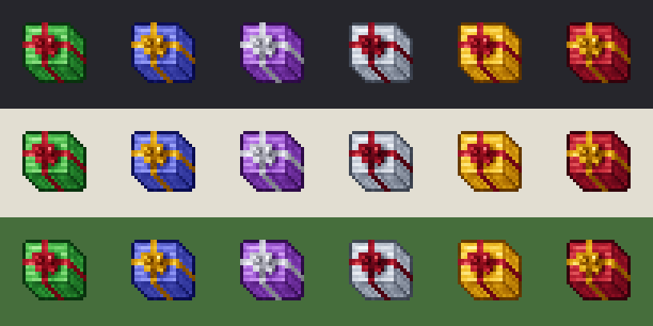
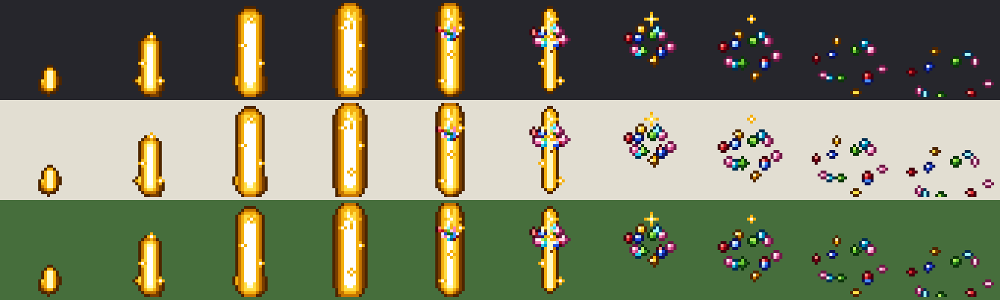

# Subir de nivel: efecto, regalos y avisos de raros

Desde el 20 nov 2026, para que subir de nivel y encontrar un raro se note y den ganas de volver:

| Qué | Cómo |
|-----|------|
| Vida y maná al máximo | Al subir de nivel (si el personaje está vivo) se rellenan `health` y `mana` a `healthmax` y `manamax`, y se actualiza la barra de vida para los que están cerca. |
| Efecto al subir | Columna de luz dorada que sube desde los pies, estrella y confeti de colores (`NM_ME_LEVEL_UP`, efecto **50**), y el texto **LEVEL UP** en amarillo. Lo ven todos los que están cerca. |
| Regalo por nivel | Una caja por cada nivel nuevo, del rango del nivel alcanzado. Se abre con "Use": da oro, un ítem o, con suerte, un raro. |
| Aviso de raro de un regalo | "Fulano opened a veteran gift and found boots of haste!" a todo el server, en el centro de la pantalla. |
| Aviso de raro de un monstruo | "Fulano found a magic plate armor on a demon!" a todo el server. |





## Regalos

El [padrinazgo](PADRINAZGO.md) también da estas cajas: al ahijado de bienvenida y a los dos en cada hito.

Las cajas son ítems sueltos (no contenedores: no se pueden llenar y perder lo de adentro). Pesan 7 oz. Si no
hay lugar ni capacidad, caen al piso y el mensaje lo dice.

| Caja | Server / client id | Niveles | Raro | Ítem | Oro (gp) |
|------|-------------------:|---------|-----:|-----:|---------:|
| novice gift (verde) | 20354 / 5090 | 2–19 | 1 % | 30 % | 30–150 |
| adventurer gift (azul) | 20355 / 5091 | 20–34 | 2 % | 30 % | 200–600 |
| veteran gift (violeta) | 20356 / 5092 | 35–49 | 3 % | 30 % | 500–1 500 |
| champion gift (plateada) | 20357 / 5093 | 50–79 | 4 % | 35 % | 1 500–4 000 |
| heroic gift (dorada, con luz) | 20358 / 5094 | 80–99 | 5 % | 35 % | 3 000–8 000 |
| legendary gift (carmesí, con luz) | 20359 / 5095 | 100+ | 6 % | 35 % | 6 000–15 000 |

Las listas de ítems y raros de cada caja están en `data/actions/scripts/level_gift.lua` (`GIFTS`). Ejemplos de
raros:

- rangos bajos: knight armor, dragon shield, fire sword, boots of haste;
- desde el 50: dragon scale mail, magic sword, golden armor;
- desde el 100: magic plate armor, thunder hammer, great shield, great axe.

No dan exclusivos de quests ni de bosses (armas 8.x, rares del Crisol, Melee Relics).

Reglas:

- **Una caja por nivel nuevo.** El storage `9400` guarda el nivel más alto que ya dio caja: morir y volver
  a subir no da otra. Los personajes que ya existían reciben cajas desde su próximo nivel.
- Si se suben muchos niveles de golpe, como máximo 20 cajas (los últimos 20 niveles).
- **Los GMs no reciben cajas** (`access > 0`): pueden darse exp con comandos. Con `/nivel N Nombre` un GM sí le
  da cajas a un jugador, porque pasa por `addExp`.
- El oro sale en monedas (crystal, platinum y gold).

## Aviso de raros de monstruos

Se avisa a todos cuando el botín tiene un ítem que cumple las dos cosas:

1. Está marcado como raro para el mensaje de loot (`isHighlightedLootItem` en `game.cpp`, el que sale en rojo y
   en mayúsculas). Eso incluye gemas grandes y equipo bueno: armas de 30+ de ataque, escudos de 28+ de
   defensa, armaduras de 10+, etc.
2. Ese monstruo lo suelta con chance base ≤ **500** (0,5 %; de 100 000 en el XML del monstruo, sin contar
   `lootmul`, premium ni la mitad que se aplica a los raros).

El tope se cambia con `rarelootbroadcastchance` en `config.lua` (por defecto 500; 0 apaga el aviso). No está
en el `config.lua` del repo a propósito: la ThinkPad tiene su `config.lua` con cambios locales.

Con 500 se avisan, entre otros: magic plate armor (Demon 433), boots of haste (Nightstalker 121), mastermind
shield (Demon 500), dragon scale mail (Dragon Lord 500), crown armor (Quara Pincher 340), Riftblade,
Aethercleaver, Graviton Maul y las armas de stars. No se avisan las de 1 % (dragon shield de los Dragon,
warrior helmet de los Hydra) para que no sea a cada rato.

Si quien mata es un GM, no se avisa: los GMs prueban loot.

## Código

| Dónde | Qué |
|-------|-----|
| `player.cpp` `Player::addExp` → `onLevelAdvance` | Relleno de HP y maná al máximo (si `health > 0`), `sendCreatureHealth` a espectadores, efecto 50 y "LEVEL UP" a los que ven la casilla; cajas por nivel nuevo (storage 9400, tope 20). |
| `const76.h` | `NM_ME_LEVEL_UP = 50`. En Lua: `NM_ME_LEVEL_UP` en `data/spells/lib/spells.lua`. |
| `game.cpp` `isBroadcastRareLoot` / `broadcastRareLoot` | Aviso de raro al morir el monstruo (también queda en `server.log` con `[rare]`). |
| `monsters.cpp` `MonsterType::getLootChance` | Chance base más baja con la que el monstruo suelta el ítem (también dentro de bolsas del loot). |
| `luascript.cpp` | `rarelootbroadcastchance` (por defecto 500). |
| `actions.cpp` `doBroadcastMessage(tipo, texto)` | Función Lua nueva: mensaje a todos los conectados. |
| `data/actions/scripts/level_gift.lua` + `actions.xml` | Abrir la caja: tablas `GIFTS` por server id. |
| `scripts/client-rme/make_level_gifts.py` | Dibuja las 6 cajas recoloreando el present de 7.6 (server 1990). |
| `scripts/client-rme/add_custom_items.py` | Instala las cajas (prototipo teddy bear 2112, ítem suelto de 7 oz). |
| `scripts/client-rme/add_drawn_effects.py --pack levelup` | Dibuja el efecto 50. |

Para cambiar premios o probabilidades alcanza con editar `level_gift.lua` y reiniciar (sin compilar). Los
rangos de nivel de cada caja están en `levelGiftItemId` (`player.cpp`).

## Prueba

Servidor de prueba aparte, sobre una copia de los datos, como en [SUMMONS.md](SUMMONS.md#prueba), con el
binario nuevo, en el puerto 7275 y los bots en `116 60 7` (fuera de PZ). En la copia:

- `lootmul = 100`, y en `rat.xml` un raro: `<item id="2472" chance="400"/>`;
- el Bot Mage con las manos y la mochila vacías;
- opcional: `rare = 40` en las cajas 20355 y 20356, para ver varios avisos.

```bash
python3 scripts/ot/test-level-gifts.py --port 7275
```

Resultado del 20 nov 2026:

- `/nivel 37` al Bot Mage (nivel 20): 17 cajas (21–34 adventurer, 35–37 veteran); una cayó al piso por
  capacidad, con su aviso;
- efecto 50 y "LEVEL UP" vistos por el mago y por el GM de al lado;
- se abrieron las 16 de la mochila y las manos (7 raros, avisados a todos);
- bajar a 32 y volver a 37: 0 cajas. Subir a 38: una;
- el Bot Knight mató ratas hasta que salió la magic plate armor y el GM recibió el aviso.

Además, 2 minutos de `exercise-server.py --fuzz` sin caídas.

Errores que ya pasaron, en la prueba:

- **Lo que sale de la caja entra adelante en la mochila.** Usar siempre la posición 0 abre una moneda, no
  la caja. El test lee la mochila (`0x6E`) y busca la caja.
- **Un bot que se reconecta encuentra la mochila abierta.** El primer "use" la cierra.
- **El que encuentra un raro recibe el aviso global.** No hace falta mandarle además un mensaje propio:
  saldrían dos en el centro de la pantalla.

## Pendiente

Probar en el cliente real:

- que el efecto 50 se vea bien en OTClientV8 y en el cliente 7.6;
- el texto "LEVEL UP";
- que las cajas se vean con sus colores.

Un cliente sin actualizar no ve las cajas: las entradas 5090–5095 están vacías.
