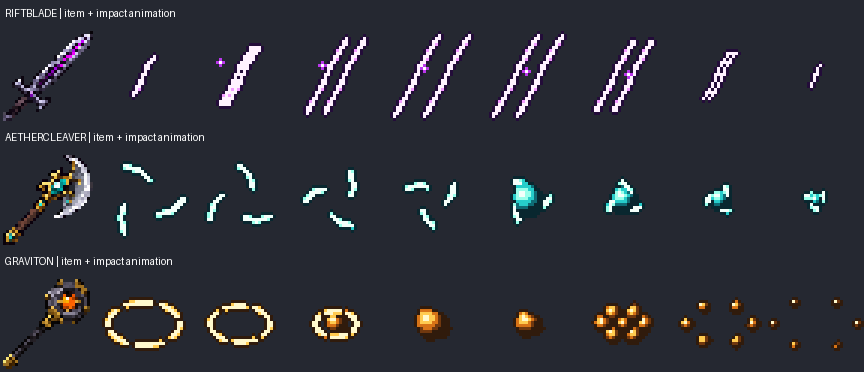

# Riftblade, Aethercleaver y Graviton Maul

Estado: **implementado y compilado, con validación parcial en instancia aislada**. Push solicitado
por Gonzalo; cliente sin publicar y servidor de juego sin deploy. No requiere cambios de mapa.



| Arma | Server / client ID | Skill / manos | Ataque / defensa | Intervalo base | Efecto |
|---|---|---|---|---|---|
| Riftblade | 20225 / 3242 | sword / 1 | 46 / 28 | 1200 ms | Cada tercer golpe que causa daño al mismo blanco añade 22–34 de energía, 11–17 contra jugadores. Grieta violeta en el blanco. |
| Aethercleaver | 20226 / 3238 | axe / 1 | 48 / 26 | 1333 ms | Recupera 12% del daño real a vida como maná, mínimo 1 y máximo 10 por golpe (5 en PvP), limitado al maná faltante. Espirales turquesa convergen sobre el atacante. |
| Graviton Maul | 20227 / 3235 | club / 2 | 55 / 22 | 1600 ms | 25% al golpear: añade `12 + min(max(armor,0),60)/2` de daño físico (12–42, mitad en PvP). Anillo ámbar que colapsa y expulsa fragmentos. |

Los intervalos usan el reloj real del motor, no una velocidad de animación. Frenzy/Rapid Fire
siguen aplicando su multiplicador, con el mínimo normal de 500 ms. Sin requisito adicional
de vocación o nivel: cada arma usa su skill habitual. Enchant fijo: Big Ruby se rechaza sin gastarla.

## Reglas de combate

- El combo Riftblade vive en `Player::riftCombo`, es transitorio y se inicializa vacío.
  Reinicia por fallo/bloqueo completo, cancelación/cambio de blanco, desequipar la espada,
  muerte del blanco, retroceso del reloj o **6 s** sin golpe válido. El tercer golpe consume
  el combo aun si el blanco es inmune a energía. No se persiste en XML.
- La energía de Riftblade respeta inmunidad y amuletos/Imperial Crown Armor. Se añade antes
  del flujo normal de daño: maná shield, frags, XP, muerte y arenas pertenecen al mismo ataque.
- Graviton cuenta la armadura actual del blanco, incluidos equipos. Su extra se incorpora
  al daño físico antes de amuletos, Sapphire Crown Armor y Counter Stance: esas protecciones
  se procesan una sola vez por golpe. Nunca añade daño a un bloqueo completo ni a un blanco
  inmune a physical. No reduce permanentemente la armadura ni causa daño de área.
- Aethercleaver observa la pérdida efectiva de vida, limitada también por el daño informado
  por el motor. No obtiene maná de daño absorbido por maná shield, overkill, curación,
  maná ya lleno o una muerte de arena que restaura la vida. El recurso no cuenta como maná
  gastado ni incrementa magic level. Su animación solo sale si se recupera maná.
- Ningún efecto especial se activa contra trainers o summons de jugadores, GM protegidos,
  blancos muertos, en training no-PvP o contra jugadores en mundo no-PvP. El golpe base
  conserva las reglas normales del motor. No se dispara ningún spell ofensivo adicional.

## Obtención

Loot directo de las variantes base, no condicionado a una mochila ni agregado a las rage:

| Monstruo | Ítem | Chance XML base |
|---|---|---|
| Warlock | Riftblade | 300 / 100000 (0,30%) |
| Root Colossus | Aethercleaver | 350 / 100000 (0,35%) |
| Worker Golem | Graviton Maul | 400 / 100000 (0,40%) |

GM: `/i 20225 1`, `/i 20226 1`, `/i 20227 1`. Los tres cuentan como equipo raro.

## Assets y reproducción

Inventarios creados con **ImageGen integrado**, un llamado por arma, fondo transparente.
Prompts exactos, originales y PNG finales en `devtools/zagan-test/custom-sprites/melee-relics/`.
`prompts.json` conserva las entradas y rutas de generación; los originales están copiados
en el repo. `melee_relic_art.py` recorta alpha, adapta con nearest-neighbor a 32×32 y dibuja
los impactos con las primitivas pixel-art del cliente. No se modifica arte previo.

- Efectos protocolo base cero: **47 Rift Cut, 48 Aether Return, 49 Graviton Crush**.
  DAT: 48, 49, 50; ocho cuadros cada uno. Luz de efectos 3/161, 3/71, 3/187;
  luz de los ítems 2/161, 2/71, 2/187.
- **27 sprites añadidos**: 3 ítems y 24 cuadros de impacto. 14072 → 14099.
- DAT conserva item count 5089, outfits 254 y proyectiles 21; efectos 47 → 50.
- Prototipos: bright sword 2407, knight axe 2430 y war hammer 2391, con flags y manos nativos.
  Slots reutilizados: rabbit present 2355, cobrafang dagger 2351 y ancient rune 2348.
- El primer candidato del maul, music piece 2349/client 3236, **se descartó**: existe en el
  personaje GM de la ThinkPad. El slot 3236 queda idéntico. Verificar runtime en solo lectura
  además del buscador de candidatos; ningún archivo del jugador se modifica.
- Mac y Windows tienen DAT/SPR idénticos al canónico de RME. Cliente y servidor deben
  publicarse juntos: cliente primero, luego OTB y binario nuevo. No publicar solo el OTB.

```sh
python3.11 scripts/client-rme/add_melee_relics.py --prepare --apply --preview docs/gameplay/img/melee-relics.png
python3.11 scripts/client-rme/validate_melee_relics.py
clang++ -std=c++14 -Wall -Wextra -Werror scripts/ot/test-melee-relics.cpp -o /tmp/retro76-test-melee-relics
/tmp/retro76-test-melee-relics
python3 scripts/map/check-map-load.py
```

Backup local de instalación: `backups/map/melee-relics-before/`. El instalador es idempotente
y comprueba que los IDs de ítems/efectos no estén ocupados. Auditoría: todos los sprites,
outfits, efectos/proyectiles y nodos OTB anteriores intactos, solo tres entradas de ítem
cambian; manos, stats, loot y paridad Mac/Windows verificados. Las pruebas C++ comprueban
combo, cambio de blanco, timeout exacto, límites de armadura/maná, maná lleno y reducción PvP.

## Validación realizada y cierre

Build limpio autorizado por Gonzalo y terminado en `~/build/melee-relics-src-20261119`:
**0 errores y 0 warnings**, con las seis fuentes finales cotejadas por SHA256.
Es obligatorio un build limpio por el nuevo miembro de Player: no usar objetos con el layout viejo.

Instancia sintética `~/build/melee-relics-qa-20261119`, puerto **7281**, cuenta ficticia.
Pruebas de protocolo con `scripts/ot/test-melee-relics-combat.py`:

- Riftblade: 8 golpes, 2 grietas; mismo resultado en Elite Knight. Cada grieta consumió tres golpes.
- Aethercleaver PvP: 8 golpes, 8 recuperaciones, máximo 5 por evento. Contra maná shield:
  sin pérdida de vida y sin recuperación de maná. Contra monstruo blindado: recuperación hasta 10.
- Graviton PvP: 14 golpes, 2 efectos de crush; se comprobó también su impacto con maná shield.
- Enemigo inmune a energy: golpes físicos, sin grietas. Trainer: sin efectos de las tres armas.
- Cliente Mac real: tres ítems y efectos cargados (`MELEE_RELICS_CLIENT_PASS`), con settings/minimapa
  propios y updater vacío. Scripts de Lua parseados sin errores.
- Assets, mapa y tests unitarios pasaron; repetir el instalador conservó DAT/SPR/OTB idénticos.

**Gonzalo pidió detener las pruebas y pushear.** Se interrumpió el caso de Graviton contra
monstruo blindado y se detuvo el contenedor QA. No hay un pase de la suite completa;
queda pendiente ese caso y la revisión visual de combate. No se ejecutan más pruebas en esta tarea.
El servidor de juego, sus jugadores y el updater no fueron modificados. Smoke tests desactivados.

Notas del fixture: NPC vacío usa `<npclist/>`; copiar `commands.xml` actual evita avisos de los
comandos GM recientes. `speed=0` cae al movimiento normal 220 y `staticattack=0` se convierte en 1:
para blancos de prueba se usó speed 1, staticattack alto y pisos separados. `pzlocked=0` evita
que una desconexión sintética deje ocupado el lugar del siguiente actor. Estas opciones son solo QA.

