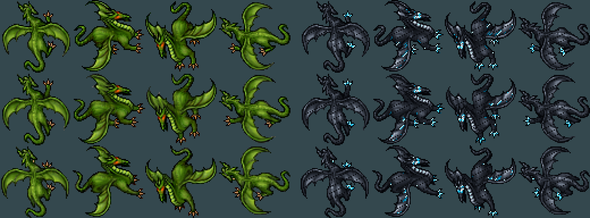
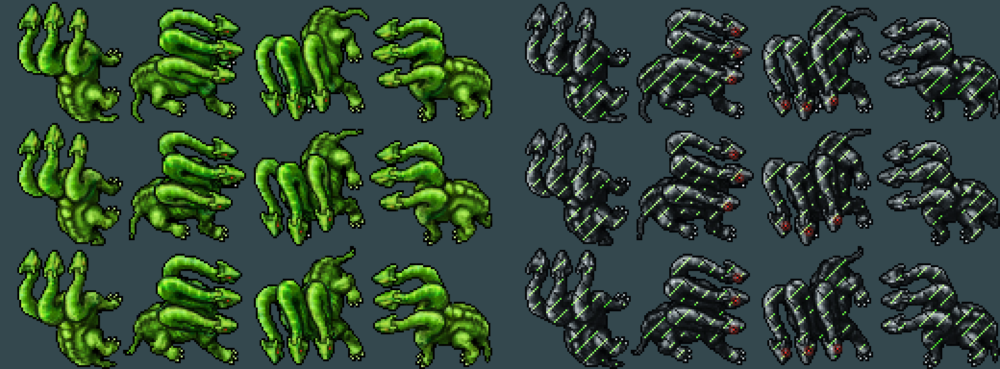
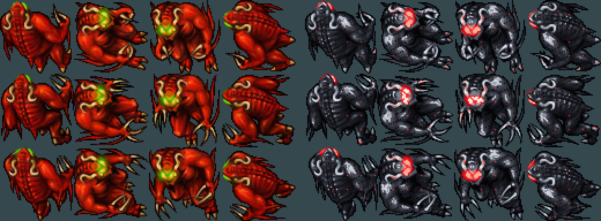

# Metal Dragon, Metal Hydra y Metal Demon (19 nov 2026)

Tres monstruos cyborg con estética oscura y futurista: blindaje de acero negro con brillo metálico, juntas de
placas y luces de neón. Cada uno es un escalón sobre su original y tiene sprite propio (recoloreado por
algoritmo, ver [`SPRITE_RECOLOR_GUIDE.md`](SPRITE_RECOLOR_GUIDE.md)). **Todavía no tienen spawn**: se crean
con `/m Metal Dragon` (GM). Guía general: [`CUSTOM_MONSTER_WORKFLOW.md`](CUSTOM_MONSTER_WORKFLOW.md).

| Monstruo | Base (look) | Look | Vida | Exp | Armor/Def | Speed | Melee | Neón |
|----------|-------------|-----:|-----:|----:|----------:|------:|------:|------|
| Metal Dragon | Dragon (34) | 186 | 2900 | 3200 | 42/40 | 210 | 90–250 | celeste (panza que late), óptica roja, garras de energía |
| Metal Hydra | Hydra (121) | 187 | 3400 | 3300 | 46/40 | 205 | 90–230 | anillos verde ácido en diagonal, ópticas rojas, colmillos cromados |
| Metal Demon | Demon (35) | 188 | 9500 | 7200 | 56/54 | 250 | 210–540 | plasma rojo en boca/pecho, cuernos y alas cromados, luces rojas en las juntas |

Comparar: Black Dragon 2600/2900, Dark Hydra 3200/3000, Demon 8200/6000.

(Hojas: izquierda el original, derecha el nuevo; columnas norte, este, sur, oeste.)

## Ataques

| Hechizo | Tipo | Forma | Daño | Lo usa |
|---------|------|-------|-----:|--------|
| `metaldragon_laserwave` | energía | abanico del Dragon Lord | 180–300 | Dragon |
| `metal_plasmabolt` (runa 5050) | energía | proyectil de energía, estalla 3×3 | 80–150 | Dragon, Demon |
| `metalhydra_acidwave` | veneno | ola de la Hydra (anillos verdes) | 130–290 | Hydra |
| `metal_discharge` | energía | anillo de 2 casillas alrededor | 90–180 | Hydra, Demon |
| `metaldemon_plasmabeam` | fuego | rayo en línea del Demon (explosiones rojas) | 320–460 | Demon |

Además: Dragon `exura`; Hydra `exura vita`; Demon `exura` y `demon_manadrain`. El Metal Demon no invoca.
Los Lua están en `data/spells/instant/` y `data/spells/runes/` y se registran en `spells.xml` con `maglv="4000"`.

**Inmunidades.** Dragon: energía, veneno, paralyze (le entra fuego y SD). Hydra: veneno, energía, paralyze (le
entra fuego). Demon: igual que el Demon (energía, fuego, veneno, paralyze). Todos: invisible y drunk.

**Loot.** Parecido al del original, con algo de acero en el Dragon y la Hydra (steel shield 2509, steel helmet
2457, plate armor 2463 en el Dragon). Sin rares custom. Cadáver: el del original (3104, 4283, 2916); no hay
cadáver metálico propio.

**Rage.** Tienen Angry/Furious/Enraged (`rage-variants.py --write --only ...`, tramo ≥ 2000), ver
[`RAGE_MONSTERS.md`](RAGE_MONSTERS.md).

## Sprites

Presets `scripts/client-rme/presets/metal_{dragon,hydra,demon}.py`, aplicados a
`devtools/rme/rme-client-760` (que es lo que publica `publish_client.py`). Lo que tiene cada uno:

- **Dragon:** ojos/lengua (`h < 0.045`) separados de las garras (`0.045–0.09`); la panza amarilla
  (`0.06 < h < 0.2`) pasa a neón celeste con un brillo que corre con la animación; el cuerpo a acero con
  juntas oscuras `(x + 2y) % 11`. Las garras quedaron clasificadas como panza y salen celestes: se dejó así
  (garras de energía).
- **Hydra:** `BASE_PARTS[121]`; anillos `(x + y) % 9` en verde ácido (siguen la diagonal de los cuellos) y
  juntas `(x - y) % 10`.
- **Demon:** reglas del Ashen Lord; las luces de la piel roja pasan a brillo cromado (en rojo parecían
  sangre) y el fuego/ojos a plasma rojo que late; juntas `(x + 2y) % 12` con luces rojas en los cruces.
- **Probado y descartado:** remaches sueltos `(x*7 + y*13) % 41` en todo el cuerpo: a tamaño de juego
  parecen estrellas, no metal.

## Pendiente

- Probarlos in-game (lo hace Gonzalo): `/m Metal Dragon`, `/m Metal Hydra`, `/m Metal Demon`, y `/loot`.
- Elegir zona y spawn (el cliente ya está publicado, así que se pueden spawnear).
