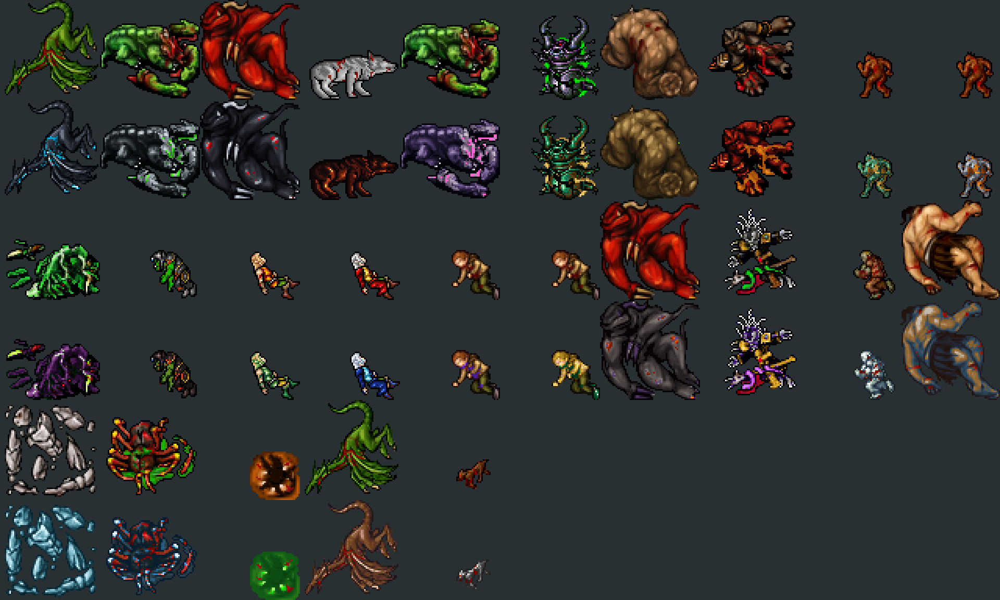

# Monstruos: catálogo completo

> Generado con `python3 scripts/monsters/monster-catalog.py --write`: **no editar a mano**, volver a correrlo
> después de crear, borrar o spawnear un monstruo. Lee `monsters.xml`, los XML, `test-spawn.xml`, los presets
> de sprites y la historia de git.

223 monstruos (sin contar variantes rage): 137 originales de YurOTS, 44 traídos de 8.60 y 42 creados acá; además 312 variantes rage de 104 familias.

- **Originales**: los 137 del `monsters.xml` del primer commit (`2491c60`, YurOTS 7.6).
- **Traídos de 8.60**: sprite original de Tibia 8.60 (looks 20, 46–47, 72, 77, 93, 96–98, 161–184, 197–200,
  245–251). Ver [IMPORTAR_CRIATURA_DE_OTRA_VERSION.md](IMPORTAR_CRIATURA_DE_OTRA_VERSION.md).
- **Creados acá**: monstruos nuevos de este servidor. Los que tienen "sprite propio" se hicieron
  recoloreando una criatura de 7.6 con un preset ([SPRITE_RECOLOR_GUIDE.md](SPRITE_RECOLOR_GUIDE.md)); los
  demás reutilizan un look existente (outfit coloreado o el de su original).
- **Variantes rage** (Angry / Furious / Enraged): copias más fuertes que aparecen al matar al original
  ([RAGE_MONSTERS.md](RAGE_MONSTERS.md)). No se listan una por una.
- **Cadáver**: `propio` = ítem nuestro (20000+, con los colores del monstruo); `de 7.6` = el de una criatura
  del cliente original. Cómo se hacen: [Cadáveres](#cadáveres).
- **En el mapa**: cuántos hay en `test-spawn.xml` y en qué zona (bloque del generador que los escribe;
  `mapa base` = fuera de esos bloques). No cuenta las variantes rage puestas a mano.
- Para crear uno: [CUSTOM_MONSTER_WORKFLOW.md](CUSTOM_MONSTER_WORKFLOW.md).

## Creados acá (42)

| Monstruo | Agregado | Vida | Exp | Sprite | Cadáver | En el mapa | Rage | Doc |
|---|---|---|---|---|---|---|---|---|
| **Ashen Lord** | 2026-11-11 | 32000 | 18000 | propio, look 239 (`ashen_lord.py`) | `20241` propio | 1: Hell Quest 1 | no | [HELL_QUEST](HELL_QUEST.md) |
| **Black Dragon** | 2026-11-09 | 2600 | 2900 | propio, look 230 (`black_dragon.py`) | `20172` propio | 16: Beast Valley 10, Hell Quest 4, mapa base 1, Dragon Spot 1 | sí | [BLACK_DRAGON](BLACK_DRAGON.md) |
| **Blue Elf Arcanist** | 2026-11-10 | 220 | 174 | look 63 | `20166` propio | 4: Epstein Hunts 4 | sí | [BLUE_ELF_ARCANIST](BLUE_ELF_ARCANIST.md) |
| **Court Mage** | 2026-11-12 | 650 | 520 | look 130 | `3128` de 7.6 | 7: Imperial Castle 3, Imperial Crypt 3, Mage Tower 1 | sí | [IMPERIAL_CASTLE](IMPERIAL_CASTLE.md) |
| **Crucible Ashlord** | 2026-07-23 | 7200 | 6200 | look 39 | `2881` de 7.6 | sin spawn | no | [CRUCIBLE](CRUCIBLE.md) |
| **Crucible Bloodreaver** | 2026-07-23 | 9800 | 8500 | look 35 | `2916` de 7.6 | sin spawn | no | [CRUCIBLE](CRUCIBLE.md) |
| **Crucible Bonepriest** | 2026-07-23 | 6800 | 6800 | look 9 | `3128` de 7.6 | sin spawn | no | [CRUCIBLE](CRUCIBLE.md) |
| **Crucible Frostwarden** | 2026-07-23 | 7500 | 6400 | look 67 | `2952` de 7.6 | sin spawn | no | [CRUCIBLE](CRUCIBLE.md) |
| **Crucible Ironhide** | 2026-07-23 | 9000 | 7200 | look 55 | `2931` de 7.6 | sin spawn | no | [CRUCIBLE](CRUCIBLE.md) |
| **Crucible Stormcaller** | 2026-07-23 | 7600 | 7400 | look 80 | `3001` de 7.6 | sin spawn | no | [CRUCIBLE](CRUCIBLE.md) |
| **Crucible Venomqueen** | 2026-07-23 | 7800 | 7000 | look 38 | `2857` de 7.6 | sin spawn | no | [CRUCIBLE](CRUCIBLE.md) |
| **Dark Hydra** | 2026-11-12 | 3200 | 3000 | propio, look 241 (`dark_hydra.py`) | `20229` propio | 13: Dark Hydra Isle 6, Beast Valley 5, mapa base 1, City Depths 1 | sí | [DARK_HYDRA](DARK_HYDRA.md) |
| **Dark Mage** | 2026-11-17 | 5200 | 8000 | look 133 | `3128` de 7.6 | 1: Mage Tower 1 | no | [MAPEAR_TORRE_MAGO](../items-and-map/MAPEAR_TORRE_MAGO.md) |
| **Drowned Sailor** | 2026-11-10 | 520 | 280 | propio, look 233 (`drowned_sailor.py`) | `20169` propio | 12: Epstein Hunts 10, Bridge Tower 2 | sí | [DROWNED_SAILOR](DROWNED_SAILOR.md) |
| **Elven Archmage** | 2026-11-19 | 4200 | 5000 | propio, look 223 (`elven_archmage.py`) | `20238` propio | 1: Elvenbane 1 | no | [ELVENBANE](../items-and-map/ELVENBANE.md) |
| **Elvenbane Ranger** | 2026-11-19 | 5000 | 4500 | propio, look 222 (`elvenbane_ranger.py`) | `20237` propio | 1: Elvenbane 1 | no | [ELVENBANE](../items-and-map/ELVENBANE.md) |
| **Emerald Scarab** | 2026-11-12 | 1500 | 1150 | propio, look 242 (`emerald_scarab.py`) | `20230` propio | 4: City Depths 2, mapa base 1, Natural Island 1 | sí | [EMERALD_SCARAB](EMERALD_SCARAB.md) |
| **Frost Dragon** | 2026-11-09 | 2200 | 2400 | propio, look 231 (`frost_dragon.py`) | `20171` propio (compartido) | 10: Frozen Isle 5, Glacier Reach 5 | sí | [FROST_DRAGON](FROST_DRAGON.md) |
| **Fury** | 2026-07-07 | 9200 | 7800 | look 137 | `3065` de 7.6 | 13: Inferno Pits 8, Beast Valley 4, Tp Gauntlet 1 | no | [CUSTOM_MONSTER_WORKFLOW](CUSTOM_MONSTER_WORKFLOW.md) |
| **Hellhound** | 2026-11-11 | 1500 | 1300 | propio, look 238 (`hellhound.py`) | `20228` propio | 71: Inferno Pits 38, Hell Quest 31, mapa base 2 | sí | [HELL_QUEST](HELL_QUEST.md) |
| **Ice Monk** | 2026-11-10 | 650 | 520 | propio, look 232 (`ice_monk.py`) | `20168` propio | 15: Frozen Isle 11, Mage Tower 2, Glacier Reach 2 | sí | [ICE_MONK](ICE_MONK.md) |
| **Ice Spider** | 2026-11-10 | 1800 | 1400 | propio, look 235 (`ice_spider.py`) | `20167` propio | 34: Frozen Isle 28, Glacier Reach 5, mapa base 1 | sí | [ICE_SPIDER](ICE_SPIDER.md) |
| **Imperial Archer** | 2026-11-12 | 450 | 300 | look 129 | `3128` de 7.6 | 7: Imperial Castle 4, Imperial Crypt 3 | sí | [IMPERIAL_CASTLE](IMPERIAL_CASTLE.md) |
| **Imperial Hero** | 2026-11-12 | 3000 | 2600 | propio, look 240 (`imperial_hero.py`) | `20239` propio | 10: Imperial Crypt 6, Imperial Castle 3, mapa base 1 | sí | [IMPERIAL_CASTLE](IMPERIAL_CASTLE.md) |
| **Imperial Squire** | 2026-11-12 | 95 | 45 | look 131 | `3128` de 7.6 | 10: Imperial Castle 8, Imperial Crypt 2 | sí | [IMPERIAL_CASTLE](IMPERIAL_CASTLE.md) |
| **Lord of Elvenbane** | 2026-11-19 | 12000 | 15000 | propio, look 185 (`lord_of_elvenbane.py`) | `20240` propio | 1: Elvenbane 1 | no | [ELVENBANE](../items-and-map/ELVENBANE.md) |
| **Metal Demon** | 2026-11-19 | 9500 | 7200 | propio, look 188 (`metal_demon.py`) | `20227` propio | 6: Inferno Pits 4, Beast Valley 2 | sí | [METAL_MONSTERS](METAL_MONSTERS.md) |
| **Metal Dragon** | 2026-11-19 | 2900 | 3200 | propio, look 186 (`metal_dragon.py`) | `20225` propio | 3: Beast Valley 3 | sí | [METAL_MONSTERS](METAL_MONSTERS.md) |
| **Metal Hydra** | 2026-11-19 | 3400 | 3300 | propio, look 187 (`metal_hydra.py`) | `20226` propio | 3: Beast Valley 3 | sí | [METAL_MONSTERS](METAL_MONSTERS.md) |
| **Mini Trainer Monk** | 2026-06-30 | 50000 | 0 | propio, look 237 (`novice_monk.py`) | `3128` de 7.6 | 4: mapa base 4 | no | [CAMBIAR-MAPA](.././CAMBIAR-MAPA.md) |
| **Orc Berserker Pot Thrower** | 2026-07-28 | 1500 | 550 | look 8 | `2864` de 7.6 | 4: City Depths 4 | sí | [MAPEAR_DUNGEON_CITY](../items-and-map/MAPEAR_DUNGEON_CITY.md) |
| **Orc Warchief** | 2026-11-19 | 7000 | 5500 | propio, look 224 (`orc_warchief.py`) | `20236` propio | 1: Elvenbane 1 | no | [ELVENBANE](../items-and-map/ELVENBANE.md) |
| **Private Trainer Dummy** | 2026-07-07 | 500000 | 0 | look 57 | `3128` de 7.6 | sin spawn | no | [PRIVATE_TRAINER_DUMMY](PRIVATE_TRAINER_DUMMY.md) |
| **Red Kongra** | 2026-11-18 | 600 | 230 | propio, look 254 (`red_kongra.py`) | `20232` propio | 12: Kongra Towers 12 | no | [RED_KONGRA](RED_KONGRA.md) |
| **River Troll** | 2026-11-17 | 85 | 42 | propio, look 252 (`river_troll.py`) | `20233` propio | 6: mapa base 4, Troll Den 2 | sí | [RIVER_STONE_TROLLS](RIVER_STONE_TROLLS.md) |
| **Root Colossus** | 2026-11-12 | 4800 | 3400 | propio, look 243 (`root_colossus.py`) | `20231` propio | 1: Beast Valley 1 | sí | [ROOT_COLOSSUS](ROOT_COLOSSUS.md) |
| **Serpent Spawn** | 2026-07-05 | 5000 | 3600 | look 220 | `4323` de 7.6 | 11: Beast Valley 6, mapa base 4, Tp Gauntlet 1 | sí | [CRYSTAL_ARROW](CRYSTAL_ARROW.md) |
| **Stone Troll** | 2026-11-17 | 160 | 90 | propio, look 253 (`stone_troll.py`) | `20234` propio | 5: mapa base 3, Troll Den 2 | sí | [RIVER_STONE_TROLLS](RIVER_STONE_TROLLS.md) |
| **The Fallen Emperor** | 2026-11-12 | 12000 | 9000 | propio, look 244 (`fallen_emperor.py`) | `20242` propio | 1: Imperial Castle 1 | no | [IMPERIAL_CASTLE](IMPERIAL_CASTLE.md) |
| **Thornwarden** | 2026-11-19 | 6500 | 5500 | propio, look 226 (`thornwarden.py`) | `20235` propio | 1: Elvenbane 1 | no | [ELVENBANE](../items-and-map/ELVENBANE.md) |
| **Tide Priest** | 2026-11-10 | 720 | 620 | propio, look 234 (`tide_priest.py`) | `20170` propio | 6: Epstein Hunts 5, Bridge Tower 1 | sí | [TIDE_PRIEST](TIDE_PRIEST.md) |
| **Wrath** | 2026-07-17 | 15000 | 12500 | look 137 | `3065` de 7.6 | 1: Tp Gauntlet 1 | no | [BOAT_TRAVEL](BOAT_TRAVEL.md) |

## Traídos de 8.60 (44)

| Monstruo | Agregado | Vida | Exp | Sprite | Cadáver | En el mapa | Rage | Doc |
|---|---|---|---|---|---|---|---|---|
| **Barbarian Bloodwalker** | 2026-11-13 | 305 | 195 | look 168 (8.60) | `3128` de 7.6 | 2: Frozen Isle 2 | sí | [IMPORTAR_CRIATURA_DE_OTRA_VERSION](IMPORTAR_CRIATURA_DE_OTRA_VERSION.md) |
| **Barbarian Brutetamer** | 2026-11-13 | 145 | 90 | look 167 (8.60) | `3128` de 7.6 | 1: Frozen Isle 1 | sí | [IMPORTAR_CRIATURA_DE_OTRA_VERSION](IMPORTAR_CRIATURA_DE_OTRA_VERSION.md) |
| **Barbarian Headsplitter** | 2026-11-13 | 100 | 85 | look 165 (8.60) | `3128` de 7.6 | 1: Frozen Isle 1 | sí | [IMPORTAR_CRIATURA_DE_OTRA_VERSION](IMPORTAR_CRIATURA_DE_OTRA_VERSION.md) |
| **Barbarian Skullhunter** | 2026-11-13 | 135 | 85 | look 166 (8.60) | `3128` de 7.6 | 1: Frozen Isle 1 | sí | [IMPORTAR_CRIATURA_DE_OTRA_VERSION](IMPORTAR_CRIATURA_DE_OTRA_VERSION.md) |
| **Blood Crab** | 2026-11-13 | 290 | 160 | look 200 (8.60) | `20176` propio | 9: Forgotten Pit 7, Fargum Tower 1, Bridge Tower 1 | sí | [IMPORTAR_CRIATURA_DE_OTRA_VERSION](IMPORTAR_CRIATURA_DE_OTRA_VERSION.md) |
| **Bog Raider** | 2026-11-13 | 1300 | 800 | look 174 (8.60) | `20247` propio | 10: Epstein Hunts 6, Desert Hunts 3, Bridge Tower 1 | sí | [IMPORTAR_CRIATURA_DE_OTRA_VERSION](IMPORTAR_CRIATURA_DE_OTRA_VERSION.md) |
| **Chakoya Toolshaper** | 2026-11-13 | 80 | 40 | look 162 (8.60) | `20243` propio (compartido) | 3: Frozen Isle 2, Glacier Reach 1 | sí | [IMPORTAR_CRIATURA_DE_OTRA_VERSION](IMPORTAR_CRIATURA_DE_OTRA_VERSION.md) |
| **Chakoya Tribewarden** | 2026-11-13 | 68 | 40 | look 161 (8.60) | `20243` propio (compartido) | 4: Frozen Isle 2, Glacier Reach 2 | sí | [IMPORTAR_CRIATURA_DE_OTRA_VERSION](IMPORTAR_CRIATURA_DE_OTRA_VERSION.md) |
| **Chakoya Windcaller** | 2026-11-13 | 84 | 48 | look 163 (8.60) | `20243` propio (compartido) | 3: Frozen Isle 2, Glacier Reach 1 | sí | [IMPORTAR_CRIATURA_DE_OTRA_VERSION](IMPORTAR_CRIATURA_DE_OTRA_VERSION.md) |
| **Crystal Spider** | 2026-11-13 | 1250 | 900 | look 172 (8.60) | `20246` propio | 5: Glacier Reach 3, Frozen Isle 2 | sí | [IMPORTAR_CRIATURA_DE_OTRA_VERSION](IMPORTAR_CRIATURA_DE_OTRA_VERSION.md) |
| **Cyclops Drone** | 2026-11-13 | 325 | 200 | look 175 (8.60) | `20182` propio (compartido) | 13: Forgotten Pit 7, Beast Valley 6 | sí | [IMPORTAR_CRIATURA_DE_OTRA_VERSION](IMPORTAR_CRIATURA_DE_OTRA_VERSION.md) |
| **Cyclops Smith** | 2026-11-13 | 435 | 255 | look 176 (8.60) | `20182` propio (compartido) | 16: Forgotten Pit 12, Beast Valley 4 | sí | [IMPORTAR_CRIATURA_DE_OTRA_VERSION](IMPORTAR_CRIATURA_DE_OTRA_VERSION.md) |
| **Dragon Hatchling** | 2026-11-13 | 380 | 185 | look 246 (8.60) | `3104` de 7.6 | 15: Epstein Hunts 5, Natural Island 5, Beast Valley 5 | no | [IMPORTAR_CRIATURA_DE_OTRA_VERSION](IMPORTAR_CRIATURA_DE_OTRA_VERSION.md) |
| **Dragon Lord Hatchling** | 2026-11-13 | 750 | 645 | look 247 (8.60) | `2881` de 7.6 | 7: City Depths 6, Boat Stowaway 1 | no | [IMPORTAR_CRIATURA_DE_OTRA_VERSION](IMPORTAR_CRIATURA_DE_OTRA_VERSION.md) |
| **Earth Elemental** | 2026-11-13 | 650 | 450 | look 178 (8.60) | `20184` propio | 7: Forgotten Pit 7 | sí | [IMPORTAR_CRIATURA_DE_OTRA_VERSION](IMPORTAR_CRIATURA_DE_OTRA_VERSION.md) |
| **Frost Dragon Hatchling** | 2026-11-13 | 800 | 745 | look 173 (8.60) | `20171` propio (compartido) | 5: Glacier Reach 3, Frozen Isle 2 | no | [IMPORTAR_CRIATURA_DE_OTRA_VERSION](IMPORTAR_CRIATURA_DE_OTRA_VERSION.md) |
| **Frost Giant** | 2026-11-13 | 270 | 150 | look 169 (8.60) | `20244` propio (compartido) | 3: Frozen Isle 2, Glacier Reach 1 | sí | [IMPORTAR_CRIATURA_DE_OTRA_VERSION](IMPORTAR_CRIATURA_DE_OTRA_VERSION.md) |
| **Frost Giantess** | 2026-11-13 | 275 | 150 | look 170 (8.60) | `20244` propio (compartido) | 2: Frozen Isle 1, Glacier Reach 1 | sí | [IMPORTAR_CRIATURA_DE_OTRA_VERSION](IMPORTAR_CRIATURA_DE_OTRA_VERSION.md) |
| **Husky** | 2026-11-13 | 140 | 90 | look 164 (8.60) | `20249` propio | 2: Frozen Isle 2 | no | [IMPORTAR_CRIATURA_DE_OTRA_VERSION](IMPORTAR_CRIATURA_DE_OTRA_VERSION.md) |
| **Ice Golem** | 2026-11-13 | 385 | 295 | look 171 (8.60) | `20245` propio | 5: Frozen Isle 3, Glacier Reach 2 | sí | [IMPORTAR_CRIATURA_DE_OTRA_VERSION](IMPORTAR_CRIATURA_DE_OTRA_VERSION.md) |
| **Mammoth** | 2026-11-13 | 320 | 160 | look 199 (8.60) | `20175` propio | 3: mapa base 2, Glacier Reach 1 | sí | [IMPORTAR_CRIATURA_DE_OTRA_VERSION](IMPORTAR_CRIATURA_DE_OTRA_VERSION.md) |
| **Mutated Bat** | 2026-11-13 | 900 | 615 | look 250 (8.60) | `4298` de 7.6 | 16: Epstein Hunts 10, Natural Island 6 | sí | [IMPORTAR_CRIATURA_DE_OTRA_VERSION](IMPORTAR_CRIATURA_DE_OTRA_VERSION.md) |
| **Mutated Human** | 2026-11-13 | 240 | 150 | look 248 (8.60) | `3113` de 7.6 | 7: Epstein Hunts 6, Natural Island 1 | sí | [IMPORTAR_CRIATURA_DE_OTRA_VERSION](IMPORTAR_CRIATURA_DE_OTRA_VERSION.md) |
| **Mutated Rat** | 2026-11-13 | 550 | 450 | look 249 (8.60) | `2813` de 7.6 | 13: Epstein Hunts 7, Natural Island 6 | sí | [IMPORTAR_CRIATURA_DE_OTRA_VERSION](IMPORTAR_CRIATURA_DE_OTRA_VERSION.md) |
| **Mutated Tiger** | 2026-11-13 | 1100 | 750 | look 251 (8.60) | `4292` de 7.6 | 6: Epstein Hunts 5, mapa base 1 | sí | [IMPORTAR_CRIATURA_DE_OTRA_VERSION](IMPORTAR_CRIATURA_DE_OTRA_VERSION.md) |
| **Nightstalker** | 2026-11-13 | 700 | 500 | look 184 (8.60) | `20190` propio | 29: Forgotten Pit 29 | sí | [IMPORTAR_CRIATURA_DE_OTRA_VERSION](IMPORTAR_CRIATURA_DE_OTRA_VERSION.md) |
| **Pirate Buccaneer** | 2026-11-13 | 425 | 250 | look 97 (8.60) | `3128` de 7.6 | 5: mapa base 2, Desert Hunts 2, Bridge Tower 1 | sí | [IMPORTAR_CRIATURA_DE_OTRA_VERSION](IMPORTAR_CRIATURA_DE_OTRA_VERSION.md) |
| **Pirate Corsair** | 2026-11-13 | 675 | 350 | look 98 (8.60) | `3128` de 7.6 | 4: mapa base 2, Desert Hunts 1, Bridge Tower 1 | sí | [IMPORTAR_CRIATURA_DE_OTRA_VERSION](IMPORTAR_CRIATURA_DE_OTRA_VERSION.md) |
| **Pirate Cutthroat** | 2026-11-13 | 325 | 175 | look 96 (8.60) | `3128` de 7.6 | 7: mapa base 3, Desert Hunts 3, Bridge Tower 1 | sí | [IMPORTAR_CRIATURA_DE_OTRA_VERSION](IMPORTAR_CRIATURA_DE_OTRA_VERSION.md) |
| **Pirate Marauder** | 2026-11-13 | 210 | 125 | look 93 (8.60) | `3128` de 7.6 | 8: Desert Hunts 4, mapa base 2, Bridge Tower 2 | sí | [IMPORTAR_CRIATURA_DE_OTRA_VERSION](IMPORTAR_CRIATURA_DE_OTRA_VERSION.md) |
| **Quara Constrictor** | 2026-11-13 | 450 | 250 | look 20 (8.60) | `20177` propio | 21: Forgotten Pit 13, Beast Valley 6, Fargum Tower 1, Bridge Tower 1 | sí | [IMPORTAR_CRIATURA_DE_OTRA_VERSION](IMPORTAR_CRIATURA_DE_OTRA_VERSION.md) |
| **Quara Hydromancer** | 2026-11-13 | 1100 | 800 | look 46 (8.60) | `20178` propio | 20: Beast Valley 18, mapa base 1, Bridge Tower 1 | sí | [IMPORTAR_CRIATURA_DE_OTRA_VERSION](IMPORTAR_CRIATURA_DE_OTRA_VERSION.md) |
| **Quara Mantassin** | 2026-11-13 | 800 | 400 | look 47 (8.60) | `20179` propio | 18: Forgotten Pit 12, Beast Valley 5, Bridge Tower 1 | sí | [IMPORTAR_CRIATURA_DE_OTRA_VERSION](IMPORTAR_CRIATURA_DE_OTRA_VERSION.md) |
| **Quara Pincher** | 2026-11-13 | 1800 | 1200 | look 72 (8.60) | `20180` propio | 41: Forgotten Pit 22, Beast Valley 18, Bridge Tower 1 | sí | [IMPORTAR_CRIATURA_DE_OTRA_VERSION](IMPORTAR_CRIATURA_DE_OTRA_VERSION.md) |
| **Quara Predator** | 2026-11-13 | 2200 | 1600 | look 77 (8.60) | `20181` propio | 45: Forgotten Pit 32, Beast Valley 11, Fargum Tower 1, Bridge Tower 1 | sí | [IMPORTAR_CRIATURA_DE_OTRA_VERSION](IMPORTAR_CRIATURA_DE_OTRA_VERSION.md) |
| **Thornback Tortoise** | 2026-11-13 | 300 | 150 | look 198 (8.60) | `20174` propio | 8: Forgotten Pit 7, Fargum Tower 1 | sí | [IMPORTAR_CRIATURA_DE_OTRA_VERSION](IMPORTAR_CRIATURA_DE_OTRA_VERSION.md) |
| **Tortoise** | 2026-11-13 | 185 | 90 | look 197 (8.60) | `20173` propio | 8: Forgotten Pit 7, Fargum Tower 1 | sí | [IMPORTAR_CRIATURA_DE_OTRA_VERSION](IMPORTAR_CRIATURA_DE_OTRA_VERSION.md) |
| **Undead Gladiator** | 2026-11-13 | 1000 | 800 | look 183 (8.60) | `20189` propio | sin spawn | sí | [IMPORTAR_CRIATURA_DE_OTRA_VERSION](IMPORTAR_CRIATURA_DE_OTRA_VERSION.md) |
| **Vampire Bride** | 2026-11-13 | 1200 | 1050 | look 181 (8.60) | `20187` propio | 11: Beast Valley 11 | sí | [IMPORTAR_CRIATURA_DE_OTRA_VERSION](IMPORTAR_CRIATURA_DE_OTRA_VERSION.md) |
| **Water Elemental** | 2026-11-13 | 550 | 650 | look 179 (8.60) | `20185` propio | 2: mapa base 1, Bridge Tower 1 | sí | [IMPORTAR_CRIATURA_DE_OTRA_VERSION](IMPORTAR_CRIATURA_DE_OTRA_VERSION.md) |
| **Worker Golem** | 2026-11-13 | 1470 | 1250 | look 182 (8.60) | `20188` propio | 38: Forgotten Pit 38 | sí | [IMPORTAR_CRIATURA_DE_OTRA_VERSION](IMPORTAR_CRIATURA_DE_OTRA_VERSION.md) |
| **Wyrm** | 2026-11-13 | 1825 | 1550 | look 177 (8.60) | `20183` propio | 15: Beast Valley 15 | sí | [IMPORTAR_CRIATURA_DE_OTRA_VERSION](IMPORTAR_CRIATURA_DE_OTRA_VERSION.md) |
| **Wyvern** | 2026-11-13 | 795 | 515 | look 245 (8.60) | `20248` propio | 9: Epstein Hunts 5, Natural Island 4 | sí | [IMPORTAR_CRIATURA_DE_OTRA_VERSION](IMPORTAR_CRIATURA_DE_OTRA_VERSION.md) |
| **Zombie** | 2026-11-13 | 500 | 280 | look 180 (8.60) | `20186` propio | sin spawn | sí | [IMPORTAR_CRIATURA_DE_OTRA_VERSION](IMPORTAR_CRIATURA_DE_OTRA_VERSION.md) |

## Sin spawn

Monstruos agregados que hoy no aparecen en el mapa (jefes de evento, invocaciones, trainers o pendientes):
Crucible Ashlord, Crucible Bloodreaver, Crucible Bonepriest, Crucible Frostwarden, Crucible Ironhide, Crucible Stormcaller, Crucible Venomqueen, Private Trainer Dummy, Undead Gladiator, Zombie.

## Cadáveres

Cada monstruo nuevo tiene su cadáver con sus colores (nov 2026), salvo los que ya coinciden con uno de 7.6.

- **Monstruos con preset** (sprite recoloreado): el cadáver del monstruo base pasa por la misma receta del
  preset (`recolor`, o `parts` + `palettes`). Los Metal cambian además la sangre por el color de su neón.
- **Criaturas de 8.60** sin cadáver propio: un cadáver de 7.6 de forma parecida (cyclops para los gigantes,
  stone golem para el Ice Golem, giant spider para la Crystal Spider, rotworm para el Bog Raider, dragon
  para el Wyvern, dog para el Husky, ghoul para los chakoyas) con la gama de colores del look: la luz de
  cada píxel del cadáver elige un color del sprite ordenado por luz; la sangre roja queda igual.
- **Sin cadáver nuevo** porque ya combina: Dragon Hatchling (dragon), Dragon Lord Hatchling (dragon lord),
  Mutated Human/Rat/Bat/Tiger (ghoul, rat, bat, tiger: se probó y salían iguales). El Frost Dragon Hatchling
  usa el del Frost Dragon (`20171`) y el Dark Monk el humano (`3128`; antes tenía el del Demon).
- Las variantes rage usan el mismo cadáver que su original.
- Como todos los cadáveres custom, al pudrirse pasan a la etapa siguiente del cadáver base (verde, rojo, etc.).

Script: `python3.11 scripts/client-rme/creature_corpses.py --preview /tmp/cadaveres.png` escribe los PNG
(`devtools/zagan-test/custom-sprites/`); `--entries` imprime las líneas para `NEW_ITEMS` de
`add_custom_items.py`, que los instala en el `.dat`/`.spr` y en `items-zagan-test.otb`. Ids: server
`20225`–`20249`, client ids sacrificados (runas sin uso y adornos sueltos, de `--candidates`).

## Originales de YurOTS (137)

| Monstruo | Vida | Exp | Look | En el mapa | Rage |
|---|---|---|---|---|---|
| Amazon | 110 | 60 | 137 | 3 | sí |
| Ancient Scarab | 1000 | 720 | 79 | 29 | sí |
| Ashmunrah | 6000 | 3100 | 88 | 1 | no |
| Assassin | 175 | 105 | 129 | 6 | no |
| Badger | 20 | 0 | 105 | sin spawn | no |
| Bandit | 245 | 65 | 129 | 27 | no |
| Banshee | 1000 | 900 | 78 | 5 | no |
| Bat | 30 | 30 | 122 | 5 | no |
| Bear | 80 | 23 | 16 | 18 | no |
| Behemoth | 4000 | 2500 | 55 | 18 | sí |
| Beholder | 260 | 170 | 17 | 1 | no |
| Black Knight | 1800 | 1600 | 131 | 5 | sí |
| Black Sheep | 20 | 0 | 13 | sin spawn | no |
| Blue Djinn | 330 | 190 | 80 | 11 | no |
| Bone Beast | 515 | 580 | 101 | 13 | no |
| Bug | 29 | 18 | 45 | 17 | no |
| Butterfly | 2 | 0 | 213 | sin spawn | no |
| Carniphila | 22 | 110 | 120 | 3 | no |
| Cave Rat | 30 | 10 | 56 | 1 | no |
| Centipede | 70 | 30 | 124 | 11 | no |
| Chicken | 15 | 0 | 111 | sin spawn | no |
| Cobra | 65 | 30 | 81 | 11 | no |
| Crab | 55 | 30 | 112 | 3 | no |
| Crocodile | 105 | 40 | 119 | 14 | no |
| Crypt Shambler | 330 | 195 | 100 | 42 | sí |
| Cyclops | 260 | 150 | 22 | 42 | sí |
| Dark Monk | 225 | 145 | 225 | 17 | sí |
| Deathslicer | 1000 | 0 | 102 | sin spawn | no |
| Deer | 25 | 0 | 31 | 8 | no |
| Demodras | 14100 | 4500 | 39 | 1 | no |
| Demon | 8200 | 6000 | 35 | 52 | sí |
| Demon Skeleton | 400 | 240 | 37 | 64 | no |
| Dipthrah | 3500 | 2900 | 87 | 1 | no |
| Dog | 20 | 0 | 32 | sin spawn | no |
| Dragon | 1000 | 700 | 34 | 93 | sí |
| Dragon Lord | 1900 | 2100 | 39 | 60 | sí |
| Dwarf | 90 | 45 | 69 | 11 | sí |
| Dwarf Geomancer | 380 | 245 | 66 | 2 | sí |
| Dwarf Guard | 245 | 185 | 70 | 31 | sí |
| Dwarf Soldier | 135 | 70 | 71 | 6 | sí |
| Dworc Fleshhunter | 80 | 35 | 215 | 4 | no |
| Dworc Venomsniper | 80 | 30 | 216 | 21 | no |
| Dworc Voodoomaster | 250 | 100 | 214 | 6 | no |
| Efreet | 550 | 300 | 103 | 4 | no |
| Elder Beholder | 1100 | 290 | 108 | 2 | no |
| Elephant | 320 | 160 | 211 | 13 | no |
| Elf | 100 | 42 | 62 | 26 | no |
| Elf Arcanist | 220 | 174 | 63 | 9 | no |
| Elf Scout | 160 | 75 | 64 | 8 | no |
| Elite Trainer Monk | 50000 | 0 | 57 | sin spawn | no |
| Fire Devil | 200 | 110 | 40 | 19 | no |
| Fire Elemental | 280 | 220 | 49 | 65 | no |
| Flamingo | 25 | 0 | 212 | 1 | no |
| Frost Troll | 55 | 23 | 53 | 40 | no |
| Gargoyle | 250 | 150 | 95 | 6 | sí |
| Gazer | 250 | 120 | 109 | 2 | no |
| Ghost | 150 | 120 | 48 | 16 | no |
| Ghoul | 100 | 85 | 18 | 36 | sí |
| Giant Spider | 1300 | 900 | 38 | 10 | sí |
| Goblin | 50 | 25 | 61 | 38 | no |
| Green Djinn | 330 | 190 | 51 | 7 | no |
| Grorlam | 2750 | 1600 | 67 | 1 | no |
| Hero | 1400 | 1200 | 73 | 19 | sí |
| Hunter | 150 | 150 | 129 | 13 | sí |
| Hyaena | 60 | 20 | 94 | 5 | no |
| Hydra | 2250 | 2100 | 121 | 25 | sí |
| Kongra | 340 | 105 | 116 | 28 | no |
| Larva | 70 | 44 | 82 | 9 | no |
| Lich | 880 | 900 | 99 | 15 | sí |
| Lion | 80 | 30 | 41 | 8 | no |
| Lizard Sentinel | 265 | 100 | 114 | 11 | no |
| Lizard Snakecharmer | 325 | 185 | 115 | 4 | no |
| Lizard Templar | 410 | 140 | 113 | 27 | sí |
| Mahrdis | 6000 | 3050 | 89 | 1 | no |
| Marid | 550 | 300 | 104 | 4 | no |
| Merlkin | 230 | 110 | 117 | 5 | no |
| Minotaur | 100 | 50 | 25 | 57 | sí |
| Minotaur Archer | 100 | 65 | 24 | 25 | sí |
| Minotaur Guard | 185 | 160 | 29 | 53 | sí |
| Minotaur Mage | 155 | 150 | 23 | 36 | sí |
| Monk | 240 | 200 | 57 | 15 | no |
| Morguthis | 6000 | 3000 | 85 | 1 | no |
| Mummy | 240 | 150 | 65 | 22 | sí |
| Murius | 650 | 300 | 29 | 2 | no |
| Necromancer | 580 | 580 | 9 | 30 | sí |
| Old Widow | 8230 | 2800 | 38 | 1 | no |
| Omruc | 3000 | 2000 | 84 | 1 | no |
| Orc | 70 | 25 | 5 | 21 | sí |
| Orc Berserker | 210 | 195 | 8 | 45 | sí |
| Orc Leader | 450 | 270 | 59 | 16 | sí |
| Orc Rider | 180 | 110 | 4 | 7 | no |
| Orc Shaman | 115 | 110 | 6 | 27 | sí |
| Orc Spearman | 105 | 38 | 50 | 5 | no |
| Orc Warlord | 950 | 670 | 2 | 31 | sí |
| Orc Warrior | 125 | 50 | 7 | 104 | sí |
| Orshabaal | 22400 | 12000 | 35 | 1 | no |
| Panda | 80 | 23 | 123 | sin spawn | no |
| Parrot | 25 | 0 | 217 | 1 | no |
| Pig | 15 | 0 | 60 | 3 | no |
| Poison Spider | 26 | 22 | 36 | 10 | no |
| Polar Bear | 85 | 28 | 42 | 14 | no |
| Priestess | 390 | 420 | 58 | 15 | no |
| Rabbit | 15 | 0 | 74 | 8 | no |
| Rahemos | 6000 | 3100 | 91 | 1 | no |
| Rat | 20 | 5 | 21 | 1 | no |
| Rotworm | 65 | 40 | 26 | 58 | sí |
| Scarab | 320 | 120 | 83 | 6 | sí |
| Scorpion | 45 | 45 | 43 | 9 | no |
| Sheep | 20 | 0 | 14 | sin spawn | no |
| Sibang | 225 | 95 | 118 | 8 | no |
| Skeleton | 50 | 35 | 33 | 16 | sí |
| Skunk | 20 | 0 | 106 | sin spawn | no |
| Slime | 150 | 160 | 19 | 7 | no |
| Smuggler | 130 | 48 | 134 | 27 | no |
| Snake | 15 | 10 | 28 | 4 | no |
| Spider | 20 | 12 | 30 | 11 | no |
| Spit Nettle | 150 | 25 | 221 | 2 | no |
| Stalker | 150 | 90 | 128 | 4 | no |
| Stone Golem | 270 | 160 | 67 | 9 | sí |
| Swamp Troll | 55 | 25 | 76 | 3 | no |
| Tarantula | 225 | 120 | 219 | 30 | no |
| Terror Bird | 300 | 150 | 218 | 3 | no |
| Thalas | 6000 | 2950 | 86 | 1 | no |
| Tiger | 75 | 40 | 125 | 6 | no |
| Trainer Monk | 50000 | 0 | 236 | 12 | no |
| Troll | 50 | 20 | 15 | 58 | sí |
| Valkyrie | 190 | 85 | 139 | 3 | sí |
| Vampire | 450 | 290 | 68 | 23 | sí |
| Vashresamun | 6000 | 2950 | 90 | 1 | no |
| War Wolf | 140 | 55 | 3 | 8 | no |
| Warlock | 3200 | 4000 | 130 | 7 | sí |
| Wasp | 35 | 24 | 44 | 9 | no |
| Wild Warrior | 120 | 55 | 131 | 30 | no |
| Winter Wolf | 30 | 20 | 52 | 49 | no |
| Witch | 300 | 120 | 54 | 11 | no |
| Wolf | 25 | 18 | 27 | 22 | no |
| Yeti | 1000 | 700 | 110 | 8 | no |
