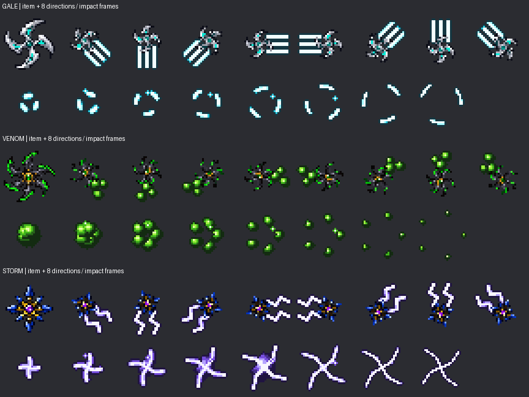

# Tres estrellas para paladín

Estado: **publicado y desplegado el 19 nov 2026**, con autorización de Gonzalo.
Binario/datos: `1fe3070`; cliente publicado: `c064d46`. No publicar el OTB en el servidor activo antes del cliente y del binario.



| Estrella | Server ID | Client ID | Ataque | Intervalo base | Característica |
|---|---:|---:|---:|---:|---|
| Gale Star | 20211 | 3396 | 30 | 900 ms | Rápida, cuchillas curvas plateadas y cian; estela de viento y tajo triple al pegar |
| Venom Star | 20212 | 3395 | 38 | 1333 ms | 25% al causar daño: veneno, 4 ticks de 8–12 cada 2 s; estela de gotas verdes |
| Storm Star | 20213 | 3393 | 40 | 1500 ms | 20% al acertar: +18–30 de energía al mismo blanco; estela de rayos violetas y descarga ramificada |

Las tres usan **distance**, tienen **85% de precisión**, son de **una mano**, no se apilan,
no necesitan munición y **no se consumen**. Conservan el alcance normal de arrojadizas
(8×5 y línea de tiro libre). Solo atacan paladines y royal paladins: `VOCATION_PALADIN=3`,
con o sin `promoted=1`. No hay requisito extra de nivel.

Rapid Fire sigue multiplicando el intervalo de cada arma, con el mínimo normal de 500 ms.
Los encantamientos son fijos: Big Ruby se rechaza sin consumirla; Blue Gem sigue reservada
a Crystal Arrow. No se añade ningún miembro a `Creature` o `Player`.

## Efectos de combate

- El daño físico usa la fórmula normal de habilidad distance, ataque, defensa, armadura y power hit.
- Venom solo se aplica después de daño efectivo, con el blanco vivo y no inmune a poison.
  Usa `CreatureCondition` atribuido al atacante, con refresco de la condición poison existente,
  sin apilar varias copias; curación del veneno y reglas de daño indirecto son las del motor.
- Storm comprueba inmunidad a energy y aplica amuletos/Imperial Crown Armor al extra elemental.
  Se suma antes de `creatureApplyDamage`: maná shield, muerte, frag, experiencia y arena pasan
  por el flujo normal del golpe. No salta a otros blancos y no causa daño de área.
- El extra eléctrico se reduce a la mitad contra jugadores. El veneno usa la reducción PvP
  normal del motor (8–12 → 4–6 por tick, antes de defensas/power hit del motor).
- Los procs no se aplican a trainers, en training no-PvP ni a jugadores/summons en mundo no-PvP.
  Un fallo, bloqueo completo o enemigo protegido no genera un proc elemental.

## Obtención

| Monstruo | Premio | Chance XML base |
|---|---|---:|
| Furious Amazon | Gale Star | 300 / 100000 (0,30%) |
| Serpent Spawn | Venom Star | 400 / 100000 (0,40%) |
| Black Dragon | Storm Star | 400 / 100000 (0,40%) |

Son entradas directas de loot, sin condicionarlas a que salga una mochila. Se resaltan como
equipo raro. GM: `/i 20211 1`, `/i 20212 1`, `/i 20213 1`.

## Assets y reproducción

Arte de inventario: **Gale** y **Venom** creadas con **ImageGen integrado**; **Storm Star** redibujada
en pixel art minimalista estilo Tibia 7.6 (`draw_storm_star()` en `paladin_star_art.py`: shuriken
diagonal en X de 22×22, 10 colores, contorno oscuro de 1 px, acero cobalto biselado arriba-izquierda y
núcleo violeta). Fuentes, prompts y PNG finales en `devtools/zagan-test/custom-sprites/paladin-stars/`:
`prompts.json`, `{gale,venom,storm}-generated.png` y `{gale,venom,storm}.png` (32×32).
`paladin_star_art.py` compone las estelas y los ocho cuadros de cada impacto con las
primitivas `Frame/blob/capsule` usadas en los efectos actuales, con alpha 0/255.

| Constantes | IDs de protocolo (base cero) | DAT del cliente |
|---|---|---|
| `NM_ANI_GALE_STAR`, `NM_ANI_VENOM_STAR`, `NM_ANI_STORM_STAR` | 18, 19, 20 | Proyectiles 19, 20, 21 |
| `NM_ME_GALE_STAR_HIT`, `NM_ME_VENOM_STAR_HIT`, `NM_ME_STORM_STAR_HIT` | 44, 45, 46 | Efectos 45, 46, 47 |

Cada proyectil tiene ocho orientaciones y luz de color. El centro de su patrón 3×3 queda
vacío; la estela queda detrás de la dirección de viaje. Son apariencias en vuelo propias;
el motor interpola el movimiento, no se modifica su velocidad de viaje. Se añaden 51 sprites
(3 ítems + 24 de vuelo + 24 cuadros de impacto), conservando todos los anteriores.

Prototipo OTB/DAT: Crystal Arrow 2352, ya convertida en DIST no apilable. El OTB usa
`shootType=7` como respaldo; `Item::getSubfightType()` asigna el proyectil custom al ID exacto.
Los client IDs reservados eran dwarven helmet 2502, mask 2501 y lady helmet 2499; se eligieron
con el buscador canónico de candidatos (sin usos en mapa, loot, scripts o transformaciones).

```sh
python3.11 scripts/client-rme/add_paladin_stars.py --prepare --preview docs/gameplay/img/paladin-stars.png
python3.11 scripts/client-rme/add_paladin_stars.py --apply
python3.11 scripts/client-rme/add_paladin_stars.py --apply  # verifica idempotencia
# Para actualizar sprites ya instalados en el lugar sin tocar Tibia.dat ni OTB:
python3.11 scripts/client-rme/add_paladin_stars.py --prepare --preview docs/gameplay/img/paladin-stars.png --apply --update-sprites
```

El importador trabaja solo sobre esta familia, sin requerir el pack Zagan perdido. Respaldo
local en `backups/map/paladin-stars-before/`. `--things` y `--otb` permiten probar en copias.
Rechaza contadores o IDs ocupados y verifica el contenido del pack si ya está instalado.
Los próximos packs parten de **47 efectos y 21 proyectiles**.

El detector genérico escanea también scripts Python: la propia declaración de IDs aparece
como referencia. `exclude_paths` permite excluir únicamente este instalador al auditar sus
reservas; se mantienen los controles de todos los demás scripts y archivos de gameplay.

## Código

- `source/paladin_stars.h`: balance y reconocimiento de IDs.
- `source/player.cpp`: precisión, arma activa, delays y exclusión Ruby.
- `source/item.cpp`: proyectiles y look detallado.
- `source/game.cpp`: restricción de vocación, procs y loot raro.
- `data/actions/scripts/gem_imbue.lua`: rechazo Ruby sin gastar la gema.
- `data/spells/lib/spells.lua`, `source/const76.h`: constantes de efectos/proyectiles.

## Validación y publicación

Antes de publicar: compilar en una copia autorizada, probe y combate con bots sintéticos;
comprobar frecuencia, no consumo, ambos promoted/base, rechazo de otras vocaciones,
veneno e inmunidad, descarga y maná shield, bajas/loot y los tres proyectiles en cliente real.
Publicar DAT/SPR de Mac/Windows antes del OTB/binario. El mapa no necesita cambios.
Seguir `docs/systems/THINKPAD_TEST_SERVER.md`; smoke tests siguen desactivados.

### Comprobaciones locales realizadas

- `validate_paladin_stars.py --before backups/map/paladin-stars-before`: PASS. Los 13.886
  sprites previos, criaturas, 44 efectos, 18 proyectiles y todos los nodos OTB anteriores
  permanecen iguales; solo se sustituyen los tres slots de ítem reservados.
- Repetir el importador deja DAT/SPR/OTB idénticos byte por byte. Mac/Windows: 774 archivos
  comunes idénticos, incluidas las calaveras y las murallas del depot.
- `check-map-load.py`: 0 errores. El mapa activo no cambió.
- LuaJIT: sintaxis de spells/gem_imbue OK; usando `onUse` real y stubs de inventario,
  Big Ruby se rechaza en las tres stars sin consumo ni refresco de stats.
- Binario distribuido de Mac con perfil exclusivo, sin login: PASS. Se cargan y crean
  tres items no apilables, tres efectos y tres proyectiles, y se renderizan los items
  en widgets reales. Script: `scripts/ot/test-paladin-stars-client.lua`.
- El probe local a 127.0.0.1:7171 devuelve ConnectionRefused: no hay OT local y Docker
  no está instalado en esta Mac. Por eso se autorizó y usó una instancia aislada de la ThinkPad en el puerto 7279.

### Combate en instancia aislada (19 nov 2026)

Fixture en `~/build/paladin-stars-qa-20261119`, puerto 7279, cuentas sintéticas. Script
`scripts/ot/test-paladin-stars-combat.py` (se niega a usar 7171). Build en copia separada,
sin avisos. Mediciones de paquetes del servidor: Gale 900 ms, Royal Paladin 900 ms,
Venom 1333 ms y Storm 1500 ms. Veneno completa 4 ticks tras cancelar el ataque;
la descarga con maná shield reduce maná y conserva HP. Knight es rechazado sin proyectil.
El cliente Mac real abrió el locker del mapa final y mostró las 7 crystal coins guardadas.

La integración conservó los mapas, jefes, black fire sword y calavera negra publicados
por otras sesiones. Auditoría final sobre los assets ya publicados: **13.986 sprites previos
idénticos**, 51 nuevos; final 14.037. Todas las apariencias anteriores quedan intactas.
Se recompiló también la actualización de comandos de GM ya desplegada, incluido `/comandos`.

El verificador de combate usa paquetes enmarcados y posiciones reales de aparición: el
fallback del mapa puede desplazar un personaje una casilla si la anterior sigue ocupada.
Los monstruos del fixture pueden moverse; para inmunidad/trainer se identifica el proyectil
por origen y tipo. Al buscar efectos en bytes con regex hay que escapar el ID: `46 = 0x2E`
es un punto de regex, no un literal. El fallo inicial era del verificador, no un proc real.

Con el binario final, las cuatro combinaciones Venom/Storm contra un monstruo inmune
y contra un trainer completan 12 tiros cada una sin proc elemental. Repetición final
`--quick`: Gale y Royal 901 ms, rechazo de knight OK. Los cuatro personajes conservan
su estrella equipada en el XML tras combatir. El fuente compilado coincide por checksum
con el árbol local; build completo y enlaces finales sin avisos ni errores.

## Resultado del deploy

Push a `main` en ambos repositorios. Cliente publicado primero con `publish_client.py --no-sync`:
**2 archivos cambiados, 0 borrados** (DAT/SPR), conservando minimapa, updater, calavera negra,
black fire sword y todos los sprites de otras sesiones. CRC DAT `82a0c2f1`, SPR `72eb537e`.
Los 774 archivos comunes de los ZIPs Mac/Windows coinciden con la fuente; manifest y descargas
DAT/SPR verificadas por contenido en 8080/8076. Dry-run posterior: 0 cambios.

Respaldo: `~/backups/pre-deploy-20261119-203154-paladin-stars`, con runtime, binario anterior,
mapa/OTB, updater y ZIPs. `before-stop/` refresca los datos justo antes de apagar y `after-save/`
contiene los saves tras el shutdown. ff-merge sin solapamientos; el mapa de esta actualización
**no cambió** respecto de lo que ya corría.

Se instaló el binario probado con el servidor apagado (`docker stop -t 45`, copia mediante
contenedor, `docker start`). Log: graceful shutdown completo, mapa cargado en **0.812 s**.
Probe OK, healthy, 0 reinicios automáticos; el jugador pudo reconectar. Se conservaron
**1 cuenta, 8 personajes y 31 casas**; nombres de archivos, depots, dueños y config verificados.
El SHA del binario instalado coincide con el de la copia compilada. Instancia QA detenida.

La compilación incremental necesitó `touch commands.cpp protocol76.cpp` tras integrar la ayuda
GM: el Makefile no sigue headers y podía omitir un archivo por su timestamp. El enlace final
se repitió con esos objetos y el ajuste de `isGmProtected()`, con 0 avisos/errores; los fuentes
compilados se cotejaron por checksum antes de instalar el binario.

Pendiente: revisión visual manual del jugador en Windows y en su sesión habitual. Las pruebas
nativas se hicieron en Mac y el combate con cuentas sintéticas; no se usaron credenciales reales.

### Actualización visual de Storm Star (22 nov 2026)

Se reemplazó la Storm Star original (8 puntas, 236 colores) por el diseño minimalista estilo
Tibia 7.6 (`draw_storm_star()` en `paladin_star_art.py`: shuriken diagonal en X de 22×22,
10 colores). Aplicado en el lugar con `add_paladin_stars.py --prepare --apply --update-sprites`:

- `Tibia.dat` y `items-zagan-test.otb`: **idénticos byte por byte** (sin cambios de IDs ni C++).
- `Tibia.spr`: mantiene los 15.160 sprites; **15.151 sprites previos idénticos**, solo se
  reemplazaron en el lugar los 9 sprites propios de Storm Star (`13989` del ítem `3393` y
  `14030`–`14037` del proyectil 20).
- Re-ejecución de `add_paladin_stars.py --apply`: 100% idempotente.
- **Publicado (22 nov 2026):** `serverrepo` `029f1b6`, cliente publicado con `publish_client.py`
  (`clienteretro` `da510a1`, 1 archivo cambiado: `data/things/760/Tibia.spr`, CRC `4a313895`,
  DAT `f1ad3633` sin cambios; HTTP 8080/8076 y ZIPs Mac/Windows verificados; respaldo
  `~/backups/pre-publish-20261122-181122-storm-star`; sin reinicio del OT).
