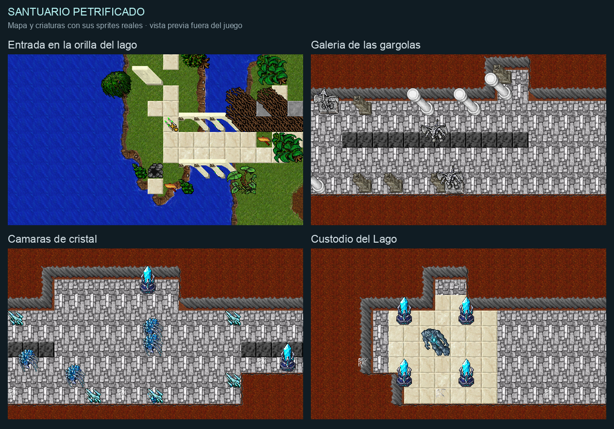

# Santuario Petrificado — Lake Custodian

> Nombres y carteles in-game en inglés: [SERVER_LANGUAGE.md](SERVER_LANGUAGE.md).

Zona de caza bajo el lago de las [Ruinas del Sauce](../items-and-map/ELF_WEST.md).
Entrada en **94,74,7**, al extremo occidental del puente. No usa la casa Willow Nook.
La bajada deja en una antesala sin monstruos; una segunda escalera lleva al santuario.



## Recorrido y monstruos

Un solo piso principal **z9**, con tres galerías en zigzag, separadas por roca.
**1.351 casillas transitables**, 222 pasos mínimos desde la escalera hasta el jefe.
Piedra gris 431, pavimento negro fragmentado 966, estatuas y columnas rotas;
el fondo cambia a cristales y telarañas, con un altar de mármol blanco.
Las paredes 371–382 usan las mismas doce orientaciones de la familia 356–367.
El relleno 101 es tierra sólida, sin lava. Se completan pantalla y techo solo en vacío.

| Tramo | Composición | Respawn | Separación entre centros |
|---|---|---:|---:|
| Entrada | Gargoyle, sueltos | 120 s | 13 |
| Galería baja | Gargoyle / Stone Golem, sueltos | 145 s | 12 |
| Galería central | Stone Golem, parejas | 170 s | 12 |
| Transición | Stone Golem / Crystal Spider, sueltos | 200 s | 12 |
| Fondo | Crystal Spider, parejas | 240 s | 12 |
| Altar 24,41,9 | Lake Custodian | 900 s | sala reservada |

Total: **6 Gargoyles, 11 Stone Golems, 10 Crystal Spiders y un jefe**.
Densidad: una criatura por 48,2 casillas. Las etapas se calculan por distancia caminando,
no por proximidad en el plano; sin spawns a seis casillas de la escalera.
Nivel orientativo: entrada 25–40, cristales 55–75 y jefe 60+ con equipo o grupo.
Estos rangos y el balance están pendientes de juego real.

## Lake Custodian

Estatua agrietada con núcleo turquesa que late y grietas luminosas.
Look **229**, basado en Stone Golem **67**: doce cuadros, cuatro direcciones.
Reutiliza el cadáver 2952 del golem; no necesita C++.

| Atributo / ataque | Valor |
|---|---|
| Vida / experiencia base | 3.300 / 2.400 |
| Armadura / defensa / velocidad | 36 / 38 / 190 |
| Melee | 70–175 |
| Pulso del núcleo | energía 75–130, radio 2 recortado; evaluación cada 7 s, probabilidad 45 % |
| Astillas | físico 60–110, abanico corto; evaluación cada 5 s, probabilidad 35 % |
| Inmunidades | poison, paralyze, invisible |

Los hechizos propios usan daño fijo y efectos existentes; el hielo es visual, el daño de
astillas es físico (7.6). No paraliza ni invoca monstruos. Loot base: oro hasta 150 (100 %),
platino hasta 4 (20 %), zafiros hasta 3 (20 %), crystal ring (5 %), stone skin amulet (3 %)
y **crystal mace (0,8 %)**. Los rates globales pueden modificar el loot efectivo.

## Escaleras y conservación

- `94,74,7`: agujero 469 → `94,74,8`, ladder 1386; vuelta a `94,75,7` (loseta libre).
- `92,77,8`: agujero 469 → `92,77,9`, ladder 1386; vuelta a `92,78,8` (libre).
- La pared de la cueva de rotworms en x95/z8 se conserva. No se toca z10.
- Los 11 lockers y todas las casillas con ítems atribuidos/casas permanecen byte por byte.
  Los spawns anteriores permanecen idénticos fuera del nuevo bloque administrado.
- `generate-elf-west.py` reserva la boca al regenerar las ruinas.

## Regenerar y publicar

```sh
python3.11 scripts/map/generate-petrified-sanctuary.py --dry-run
python3.11 scripts/map/generate-petrified-sanctuary.py
python3.11 scripts/map/render-petrified-sanctuary.py
python3.11 scripts/client-rme/sprite_tool.py check lake-custodian
```

El generador guarda respaldos en `backups/map/petrified-sanctuary-FECHA/`, rechaza
casillas ajenas ocupadas/atribuidas y guarda el ámbito en `generated-petrified-sanctuary.json`.
La segunda pasada reporta **0 cambios**. Preset: `scripts/client-rme/presets/lake_custodian.py`.
Para rehacer el look, usar `add_recolor_look.py --preset lake-custodian --replace`
sobre `devtools/rme/rme-client-760`; no reconstruir el pack completo de ítems.

Auditorías realizadas: carga OTBM **0 errores**, techo **sin vistas superiores**,
lockers **11 con depotid=1**, casas sincronizadas, registros XML/Lua y sprites anteriores intactos.
Por indicación del usuario no se levantaron clientes, instancias aisladas ni suites de pruebas.
Las imágenes son renders nativos del mapa y sus spawns, **no capturas in-game**.

**Pendiente de deploy:** publicar primero DAT/SPR y minimapa en el updater, y después activar
mapa/monstruo siguiendo `THINKPAD_TEST_SERVER.md`. No se reinició la ThinkPad con este cambio.
La apertura in-game de depots y el balance de combate no están verificados.
