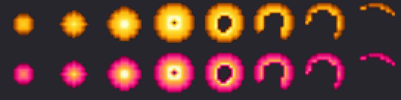

# Power hit — golpes con más poder al azar

Cualquier ataque de un jugador puede salir con más poder: melee, distancia, runas y hechizos de ataque
(no las curas). La idea es **refuerzo intermitente**: el premio llega cada tanto, sin patrón, y se ve.

| Nivel | Probabilidad | Daño | Efecto | Texto |
|-------|-------------:|-----:|--------|-------|
| Power hit | 8% | ×1,5 | `NM_ME_POWER_HIT` (33): explosión de energía en **dorado** | `POWER!` amarillo |
| Mega hit | 1% | ×2,5 | `NM_ME_MEGA_HIT` (34): la misma explosión en **fucsia con centro dorado** | `MEGA!` fucsia |



- Un knight pega ~30 veces por minuto: un power hit cada ~25 s y un mega cada ~3-4 min.
- El daño promedio de los jugadores sube ~5% (8% × 0,5 + 1% × 1,5).
- **Una tirada por golpe o por lanzamiento**: un hechizo de área comparte el resultado entre todos los
  objetivos (si no, una GFB sobre 8 monstruos casi siempre tendría un power hit y dejaría de sorprender).
- **PvP**: contra jugadores el mega cuenta como power hit (×1,5), para que una SD no mate de un golpe.
  Se habilita con `megahitpvp = "yes"`. El power hit se aplica después de la reducción PvP a la mitad.
- Solo si el golpe hace daño: un golpe bloqueado o en zona sin PvP no muestra el efecto.
- Mana drain no tiene power hit; life drain sí (cura más).

## Configuración (`config.lua`, sin recompilar)

```lua
powerhitchance = 80     -- por mil (80 = 8%); 0 lo desactiva
powerhitdamage = 150    -- % del golpe normal
megahitchance = 10      -- por mil (10 = 1%)
megahitdamage = 250
megahitpvp = "no"
```

## Código

- `GameState::applyPowerHit` en `server/YurOTS/ots/source/game.cpp`. Se llama desde los dos puntos por
  donde pasa todo el daño de jugador:
  - `GameState::onAttack(attacker, pos, attackedCreature)`: melee y distancia.
  - `GameState::onAttack(attacker, pos, me)`: runas y hechizos.
- La tirada se guarda en `GameState::powerHitTier`; hay un `GameState` por golpe o por lanzamiento.
- Constantes `NM_ME_POWER_HIT` / `NM_ME_MEGA_HIT` en `const76.h` y en `data/spells/lib/spells.lua`.
- Es C++: hay que recompilar el server.

## Efecto en el cliente

Pack `power` de `scripts/client-rme/add_recolor_effects.py` (ver [CLIENT_EFFECTS.md](CLIENT_EFFECTS.md)):
los dos salen de la explosión de energía (`NM_ME_ENERGY_AREA`), una esfera que estalla en onda, con luz
dorada. Se eligió el dorado porque se asocia con premio y no se confunde con el fuego, la energía (azul),
el hielo ni la sombra.

**Requiere el cliente nuevo**: un cliente sin el pack no tiene los efectos 33 y 34.
