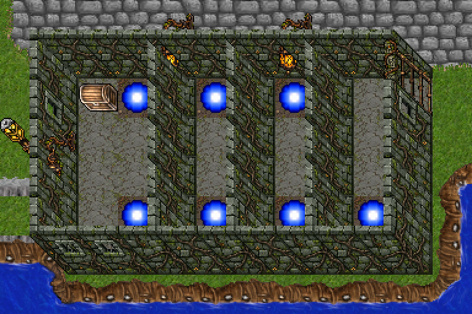
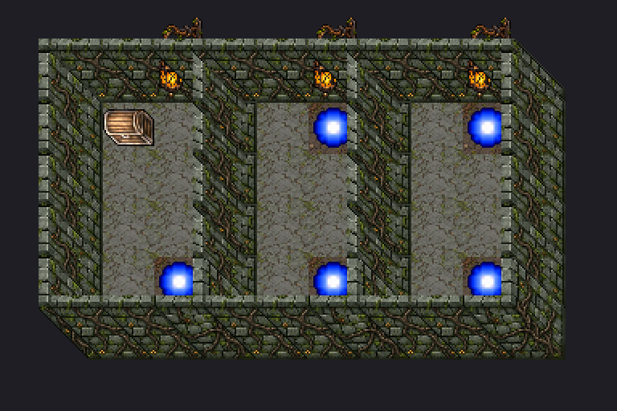

# Quest de Boots of Haste: la casa de los teleports al sur del depot

Casa de la quest justo al sur del depot (`x 127–136, y 61–66`, pisos 7 y 6). Cada piso está partido en
salas angostas por paredes; se pasa de una a otra por teleports (`1387`), arriba (`y 62`) y abajo (`y 65`).
Dos cofres: `128,62,7` y `128,62,6` (Boots of Haste y Blue Robe). Registro de quests: `boh` en
`web/site/src/data/quests.json`.

## Recorrido (destinos leídos del `test.otbm`)

Se entra por la puerta este del piso 7 (`136,62,7`). Cada sala tiene un teleport para seguir y otro para volver.

| Orden | Sala | Teleport para seguir | Monstruo (nov 2026) | Exp | Respawn |
|---|---|---|---|---:|---:|
| 1 | z7 `135, 62–65` (entrada) | `135,65,7` → `133,64,7` | Mutated Tiger (`135,63`) | 750 | 200 s |
| 2 | z7 `133, 62–65` | `133,62,7` → `131,64,7` | Emerald Scarab (`133,63`) | 1150 | 200 s |
| 3 | z7 `131, 62–65` | `131,62,7` → `129,64,7` | Ice Spider (`131,64`) | 1400 | 200 s |
| 4 | z7 `128–129, 62–65` (**cofre** `128,62,7`) | `129,62,7` → `135,64,6` | 2 Hellhound (`128,63` y `128,64`) | 1300 c/u | 200 s |
| 5 | z6 `134–135, 62–65` | `135,62,6` → `132,64,6` | Imperial Hero (`134,63`) | 2600 | 300 s |
| 6 | z6 `131–132, 62–65` | `132,62,6` → `129,64,6` | Black Dragon (`131,63`) | 2900 | 300 s |
| 7 | z6 `128–129, 62–65` (**cofre final** `128,62,6`) | — | Dark Hydra (`128,63`) | 3000 | 300 s |

Vueltas: `133,65,7` → `135,64,7`; `131,65,7` → `133,63,7`; `129,65,7` → `131,63,7`; `135,65,6` → `129,63,7`;
`132,65,6` → `135,63,6`; `129,65,6` → `132,63,6`.

**Antes (hasta nov 2026):** Angry Troll, Angry Minotaur Guard, Furious Cyclops, 4 Angry Orc Berserker, 2 Angry
Giant Spider, 2 Enraged Vampire y 2 Enraged Hydra, para nivel 60–80. Ahora son monstruos nuevos de sprite propio, de a
uno en las salas fuertes, y la quest figura para **nivel 80–100**.

## Detalles

- Las salas de 1 de ancho (`135`, `133`, `131`) solo tienen dos casillas libres, y las dos son llegadas de
  teleports: el monstruo queda en una de ellas, igual que antes.
- **Sin ventanas en la sala del Imperial Hero** (nov 2026): las dos ventanas de entramado (`1264`) de su pared
  este (`136,63,6` y `136,65,6`) pasaron a pared (`1043`): la sala queda cerrada.
  En el piso 7 quedan las ventanas de antes (`127,63`, `136,63`, `128–129,66`).
- Los spawns son a mano en `test-spawn.xml` (ningún generador los pisa), con un comentario arriba de cada piso.

## Cripta de Raíces — visual del 20 nov 2026

Publicada y activada en la ThinkPad el 20 nov 2026 (servidor `cd841f6`, cliente `521249f`).
Piedra gris verdosa, raíces y musgo, suelo de losas y lámparas ámbar; distinta del
basalto/cian del templo y de las piezas exclusivas del depot. Solo esta casa cambia.





Se conservan las siete salas, los doce teleports y sus destinos, los ocho monstruos,
respawns y ambos cofres (`uid 2656`/`2195`). La reja nueva **20272** mantiene el
`actionId 1060` original: nivel 60, con el mismo `leveldoor.lua`. El rango 80–100 es
una recomendación de dificultad, no el requisito de entrada.
No se añaden escaleras ni se amplía la huella. Se corrige el pasto bajo la esquina
sur de `132,66,7` y se retiran tapices rojos, sangre y libros sueltos sin atributos.

| Server ID | Client ID | Pieza / prototipo |
|---:|---:|---|
| 20262 | 3213 | losas con musgo / 405 |
| 20263 | 3212 | losa de portal / 405 |
| 20264 | 3210 | poste / 1038 |
| 20265 | 3208 | muro horizontal / 1039 |
| 20266 | 3205 | muro vertical / 1043 |
| 20267 | 3158 | esquina / 1044 |
| 20268 | 3156 | ventana horizontal / 1263 |
| 20269 | 3154 | ventana vertical / 1264 |
| 20270 | 3151 | separador interior / 1041 |
| 20271 | 3130 | farol ámbar 1×2, luz 5/198 / 2037 |
| 20272 | 3124 | reja de nivel 2×2, dos capas / 1245 |

Los prototipos conservan la colisión y la velocidad de suelo originales. Los separadores
reducen su altura manteniendo el pie de cada columna: comprimir toda la imagen en Y dejaba
huecos entre tramos. La reja conserva sus dos capas nativas (segunda transparente), sin animación.
`add_custom_items.py` acepta `layers=2` para estos planos, apilados dentro de cada cuadro.

Fuentes y prompts exactos de ImageGen integrado:
`devtools/zagan-test/custom-sprites/root-crypt/` (`prompts.json`, `gate-prompt.json`).
Los PNG finales, plantillas nativas y fuentes generadas quedan en el repo.

```sh
python3.11 scripts/client-rme/root_crypt_assets.py --prepare --apply
python3 scripts/map/root-crypt.py
```

El generador valida antes de escribir: misma huella/colisión, cofres y destinos intactos,
puerta con iguales atributos y ningún tile ajeno modificado. Resultado contra el backup:
**120 tiles**, todos dentro de la casa; sin casillas nuevas. Assets: **11 slots DAT**,
14356 sprites anteriores intactos, 44 registros añadidos (14400 total; cuatro del primer
perfil de separador quedan históricos), outfits/efectos/proyectiles idénticos.
Los IDs antiguos de los once slots no aparecían en jugadores, casas ni houseitems de
la ThinkPad (consulta de solo lectura). DAT/SPR locales idénticos para Mac/Windows.
Backup local: `backups/map/root-crypt-before/`. Se corrieron importador, generador,
auditoría de ámbito/assets y render; sin suites, pruebas in-game, compilación ni reinicio.

### Deploy — 20 nov 2026

Autorizado por Gonzalo. ff-merges sin solapamientos; config local y `.server-save-ok`
preservados. Respaldo `~/backups/pre-deploy-20261120-121746-root-crypt`, refrescado
antes del reinicio y con copia posterior al guardado. Cliente publicado primero
con `publish_client.py`: 774 archivos, 3 cambiados (DAT/SPR/minimapa), 0 borrados;
ZIPs Mac/Windows y manifest/contenido HTTP en 8080/8076 coinciden.
CRC DAT `61142f45`, SPR `2d5b06c9`, minimapa `c6ec995a`.
Se cotejaron los 120 tiles de la quest contra el mapa remoto anterior; huella,
colisión, cofres, puerta y teleports conservados. Once tiles completos de locker idénticos.
`docker restart -t 45 yurots`: guardado ordenado completo, Loaded in **1,409 s**,
sin errores ni warnings; probe `192.168.1.17:7171` OK / healthy, 0 reinicios automáticos.
1 cuenta, 8 personajes, 31 casas, contenido de depots, dueños, config y binario iguales
al snapshot previo. Sin suites, recorrido/depot in-game ni rebuild, por pedido de Gonzalo.
