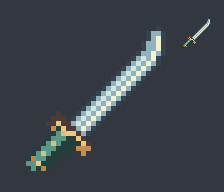

# Quicksilver Katana

Espada de una mano hecha para golpes rápidos. Tiene hoja curva de acero claro,
guarda de bronce y empuñadura verde. Usa sword fighting y los golpes físicos
normales del servidor.



| Arma | Ataque | Defensa | Intervalo base |
|---|---:|---:|---:|
| Katana común (`2412`) | 16 | 12 | 1333 ms |
| Quicksilver Katana (`20660`) | 32 | 16 | 650 ms |

Los 650 ms se aplican al primer ataque y a los siguientes cuando la katana es
el arma activa. Frenzy conserva el límite común de 500 ms. El encantamiento es
fijo y Big Ruby se rechaza antes de consumirla. El daño, su alcance y las reglas
PvP usan el camino común de espada.

Server ID `20660`, client ID `6060`. El OTB hereda peso, slot y tipo de arma de
la katana común. La apariencia usa un slot de cliente antes vacío. El arma está
activa en la ThinkPad. Se puede crear con `/i 20660 1`.

```bash
python3.11 scripts/client-rme/add_custom_items.py \
  --things devtools/rme/rme-client-760 \
  --otb server/YurOTS/ots/data/items/items-zagan-test.otb \
  --otb server/YurOTS/ots/data/items/items.otb --only 20660
```

`Player::getBaseAttackDelayMs()` usa el ID del arma activa. La descripción
usa la misma constante que el reloj de ataque. `gem_imbue.lua` aplica la regla
del encantamiento fijo. La validación local revisa DAT/SPR, ambos OTB y Lua.

## Publicación del 23 nov 2026

Fuente y servidor `e2f6f11`, cliente Mac y Windows `2c514a8` en `main`. Compilación
limpia con `make -j4 yurots` en `/home/gonzalo/build/quicksilver-katana-hqI0h8`,
con cero errores y avisos. Se verificaron los 775 archivos de los ZIPs y del
actualizador. CRC de DAT `d2662bbe` y de SPR `0ad14aff`.

Respaldo del binario anterior y del runtime en
`/home/gonzalo/backups/pre-deploy-20261123-145035-quicksilver-katana`, con copia
fresca después de `server-save.sh --now`. Parada ordenada con `docker stop -t 45`,
instalación del binario compilado y arranque sin errores a las 17:51:12 UTC.
Probe OK en 19,3 ms. Se conservaron una cuenta, ocho personajes, 35 casas,
inventarios y depots. Validación de compilación y arranque, sin combate in-game.
