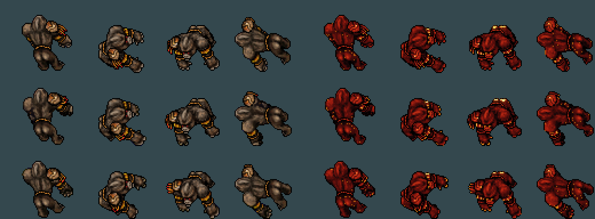
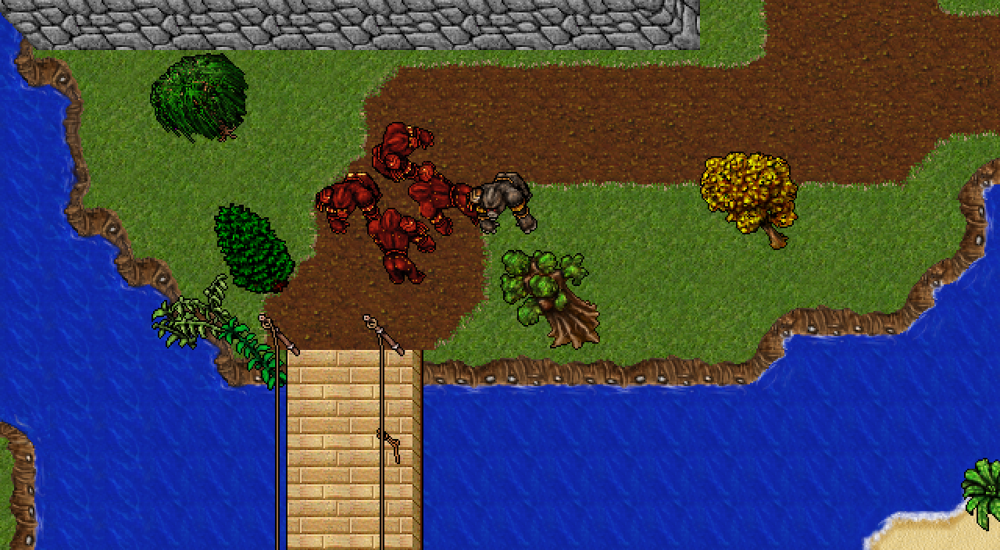

# Red Kongra

Variante carmesí y enfurecida del Kongra de la selva. Tier medio: un escalón arriba del Kongra
normal, como los Angry/Enraged/Furious del catálogo (vida ~×1.8, exp ~×2.2, mismo rol melee).

**Lo que lo distingue:**
- **Se ve distinto:** sprite propio a partir del Kongra (look **254**). Pelaje carmesí, contorno
  con tinte maroon, garras y hocico en ámbar dorado, y **ojos ámbar encendidos** que parpadean
  con la animación (el rasgo propio).
- **Ruge y se enfurece:** anillo de rugido físico (`k_roar_burst_4`, el mismo del Mutated Tiger)
  y se pone rápido (`orcb_haste`), armados con el sistema de kits
  ([`MONSTER_KITS.md`](MONSTER_KITS.md)).

Proceso general: [`CUSTOM_MONSTER_WORKFLOW.md`](CUSTOM_MONSTER_WORKFLOW.md).





## Stats

| | Kongra | **Red Kongra** |
|---|---:|---:|
| Vida | 340 | **600** |
| Exp | 105 | **230** |
| Nivel / magic level | 20 / 10 | **30 / 10** |
| Armor / defense | 3 / 5 | **8 / 11** |
| Speed | 240 | **250** |
| Distancia | cuerpo a cuerpo | cuerpo a cuerpo |
| Look | 116 | **254** |

Inmune a poison, paralyze y drunk (igual que el Kongra). Cadáver: dead kongra (4268).

## Ataques

| Ataque | Tipo | Qué hace | Daño | Cada | Prob. |
|--------|------|----------|-----:|-----:|------:|
| melee | — | Golpe | hasta 115 | 2 s | 100 % |
| `k_roar_burst_4` | instant | Rugido en anillo alrededor suyo (físico, `NM_ME_SOUND_RED`, saca sangre) | kit escalón 4 | 3,5 s | 30 % |
| `orcb_haste` | instant | Se acelera unos segundos | — | 6 s | 15 % |

Voces: "Hugah!", "Ungh! Ungh!", "RAAAARGH!".

## Loot

Oro (hasta 35, siempre), cocos ×5 (5 %), leather armor (14 %), steel helmet (7 %) y
el resto del botín del Kongra con chances subidas.

## Sprite

Recoloreado por algoritmo del Kongra (116: 2×2, 48 sprites) con el preset
`scripts/client-rme/presets/red_kongra.py`:

```bash
python3 scripts/client-rme/sprite_tool.py check red-kongra                          # hoja + escena
python3 scripts/client-rme/add_recolor_look.py --preset red-kongra devtools/rme/rme-client-760
python3 scripts/client-rme/sprite_tool.py verify --expect 254                       # TODO BIEN
rm devtools/rme/rme-client-760/*.bak-*
```

- **Partes** (corte automático de `new`): `orange` (pelaje, 60 %), `dark` (contorno/piel, 38 %)
  y `rest` (2 %: garras, hocico y los brillos de perfil).
- **Paletas:** pelaje → carmesí con luces naranja rojizo (para no perderse en suelo oscuro);
  contorno → casi negro con tinte maroon; `rest` → ámbar dorado (las garras quedan doradas).
- **Rasgo propio** (`detail`): los ojos pasan a ámbar encendido con un aura tibia y parpadean
  con la animación. Cómo se encuentran (útil para otras criaturas):
  - de frente (sur) los ojos del Kongra **no** son parte `rest`: son manchas claras del pelaje
    arriba de la cara oscura (banda `y_top+2`, las dos más grandes);
  - de perfil son el brillo `rest` más alto de la cabeza (este) y el más a la izquierda (oeste);
  - de espaldas (norte) no se ve la cara y no se pintan.
  - **Pitfall:** el grupo oscuro interior más grande de la mitad de arriba **no** es la cara,
    es la sombra del brazo. No buscar "la cara": anclar a la posición real de los ojos.

Verificado: solo cambió el look 254 (48 sprites nuevos, 13785–13832), los ítems y los demás looks
quedaron idénticos, y el preset reproduce exactamente el look (`verify` TODO BIEN).

## Antes de ponerlo en el mapa: el cliente

El look 254 es nuevo: un cliente viejo vería al monstruo invisible. Orden
([`CUSTOM_MONSTER_WORKFLOW.md`](CUSTOM_MONSTER_WORKFLOW.md) §6.6): publicar el cliente
**antes** de que jueguen contra él (el `publish_client.py` de la ThinkPad toma el
`Tibia.dat`/`.spr` de `devtools/rme/rme-client-760`, que ya tiene el look):

```bash
# ThinkPad, tras el deploy:
python3 scripts/client-rme/publish_client.py
```

Con el deploy ya hecho, cada jugador que abra el cliente se actualiza solo (updater).

## Spawn: las Torres del Kongra

Vive en las **torres medias de la selva del Bamboo Camp**
([`../items-and-map/MAPEAR_TORRES_KONGRA.md`](../items-and-map/MAPEAR_TORRES_KONGRA.md)):
Kongra en la planta baja, Red Kongra arriba (12 en total entre las 3 torres).

| Torre | Pisos | Red Kongra |
|-------|-------|-----------:|
| Torre del Kongra (claro, `170-176, 103-109`) | z7-z5 | 5 |
| Torre Sur (`161-167, 126-132`) | z7-z5 | 5 |
| Atalaya Norte (`186-190, 74-78`) | z7-z6 | 2 |

El C++ no cambió: no hace falta compilar.

## Archivos

| Pieza | Archivo |
|-------|---------|
| Definición | `server/YurOTS/ots/data/monster/red kongra.xml` |
| Registro | `data/monster/monsters.xml` |
| Ataques | kit `roar:burst` + `+haste` de `scripts/monsters/apply-monster-kits.py` (reusa `k_roar_burst_4.lua` y `orcb_haste.lua`, ya registrados) |
| RME | `rme-extensions/yurots-creatures.xml` y `devtools/rme/rme-client-760/Tibia.{dat,spr}` |
| Spawn | `data/world/test-spawn.xml` (bloque `KONGRA_TOWERS_SPAWNS`) — las torres en [`../items-and-map/MAPEAR_TORRES_KONGRA.md`](../items-and-map/MAPEAR_TORRES_KONGRA.md) |
| Sprite | `scripts/client-rme/presets/red_kongra.py` (preset `red-kongra`) |
