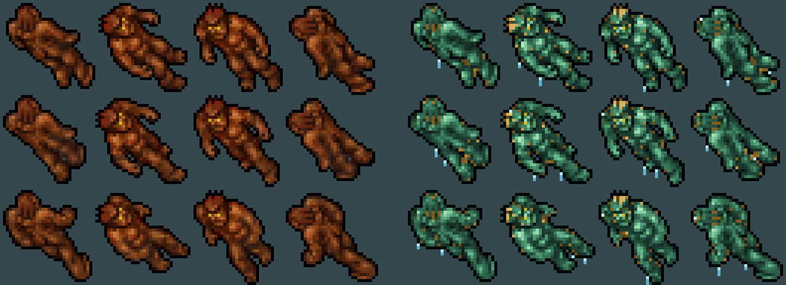

# River Troll y Stone Troll: los dos trolls nuevos (nov 2026)

> **Estado:** deployados. Dos tipos nuevos de troll para la zona del río y las ruinas de los trolls:
> el **River Troll** patrulla las orillas del puente de sogas de River Street y el **Stone Troll**
> guarda el campo de rocas de las ruinas del otro lado del arco.

| | River Troll | Stone Troll |
|---|---:|---:|
| Vida | 85 | 160 |
| Experiencia | 42 | 90 |
| Velocidad | 140 | 112 (lento, es una piedra) |
| Armadura / Defensa | 16 / 20 | 32 / 34 |
| Melee | 8–32 | 20–55 |
| Distancia | lodo envenenado (`poisonfield`, 8–18, 35 %) | piedras (`smallstone`, 12–30, 30 %) |
| Inmunidad | poison | drunk |
| Looktype | **252** (nuevo) | **253** (nuevo) |
| Cadáver | 2806 (el del troll) | 2806 (el del troll) |
| Variante rage | Angry/Furious/Enraged (`angry river troll.xml`, …) | Angry/Furious/Enraged |

Rol en la zona: entre el Troll (20 exp) y el Minotaur Guard (160 exp). El River Troll es el escalón
anfibio del río (como el Swamp Troll es el del pantano y el Frost Troll el de la isla de hielo);
el Stone Troll es el tanque lento de las ruinas, con la armadura más alta de la familia.

## El sprite

Ambos son recoloreados del Troll (looktype 15) con rasgo propio, creados con
`scripts/client-rme/presets/river_troll.py` y `stone_troll.py` (ver
[SPRITE_RECOLOR_GUIDE.md](SPRITE_RECOLOR_GUIDE.md)). Son 1×1, 12 sprites, mismos cuadros que el base.

- **River Troll (252):** piel de agua turbia con algas (verde azulado, para no confundirse con el
  Swamp Troll verde ni el Frost Troll cian), penacho de **juncos secos** y ojos pálidos de pez,
  **brillo mojado** en el lomo, **parche de algas** en el hombro y **gotas que caen** del borde de
  abajo al caminar.
- **Stone Troll (253):** piel de **granito** gris azulado (extremo claro alto para no perderse en
  piso de piedra), penacho y ojos de **brasa**, **matas de musgo** en la cabeza y el hombro y
  **grietas** oscuras en diagonal por el cuerpo.

Los took los looktypes **252 y 253** (el próximo libre según `sprite_tool.py looks`; los custom
llegaban hasta 244 y los 245–251 los usan las criaturas importadas de 8.60).

## Ataques

Ningún hechizo nuevo: los dos usan ataques `distance` nativos de `monsters.cpp` (los mismos que el
Orc Leader con su throwingknife):

- River Troll: `name="poisonfield"` — proyectil de nube de veneno (el "lodo" del río), daño poison 8–18.
- Stone Troll: `name="smallstone"` — piedras físicas 12–30, como los mono-piedra del mapa.

Con `targetdistance="1"` persiguen y pegan cuerpo a cuerpo; la distancia sale de camino, igual que
el Orc Leader.

## Spawn

Escaneando `test.otbm` con un parser del formato de `iomapotbm.cpp` (aguas = ground `4608`
"shallow water" en este mapa, no los 490–503):

- **River Trolls (4):** orillas del puente de sogas (`x153, y66–72`), en el nuevo bloque
  `centerx="153" centery="69" centerz="7" radius="8"`. Casillas `147,65` y `158,65` (banco norte,
  miran al agua) y `150,73` / `156,73` (banco sur, a los costados del camino al arco). Todas
  ground `4756` (grass) sin ítems encima.
- **Stone Trolls (3):** dentro del bloque existente de las ruinas (`150,86,6` r16), en offsets
  `-4,-4` (146,82), `-3,4` (147,90) y `12,0` (162,86) — ground `4757` (rocks). Los offsets con
  muro `912` encima (155,89 / 158,83) y las casillas sin tile se descartaron con el escaneo.

La zona: el Troll común y el Swamp Troll siguen en las ruinas (mismo bloque), así el jugador que
cruza el puente encuentra River Trolls y al pasar el arco, Stone Trolls al fondo.

## Verificación hecha

- `sprite_tool.py verify --expect "252,253"` → TODO BIEN (los 12 sprites viejos del 15 intactos,
  presets reproducibles, sin `.bak-*`).
- XMLs válidos; `monsters.xml` y `test-spawn.xml` parsean.
- Las casillas de spawn elegidas tienen ground caminable y ningún ítem bloqueante encima.
- Las variantes rage se generaron con `rage-variants.py --write --only "River Troll" "Stone Troll"`
  (tramos 1 y 2: Angry/Furious/Enraged con las fórmulas de siempre, ya registradas en `monsters.xml`).

## Pendiente

- Recorrido in-game: cruzar el puente y ver los 4 River Trolls en las orillas; entrar a las ruinas
  y toparse con los Stone Trolls. Verificar que el lodo y las piedras salen con el proyectil correcto.
- Arte para la web (`generate-monster-art.py`) si se quiere retrato/banner como el Black Dragon.

## Deploy (orden)

Los looks 252/253 viven en `Tibia.dat`/`.spr`: **publicar el cliente primero**
(`publish_client.py`, que sincroniza desde `devtools/rme/rme-client-760`), después mergear y
reiniciar el OT. Sin cambios de C++: monstruos y spawns son solo datos, no hace falta recompilar.
