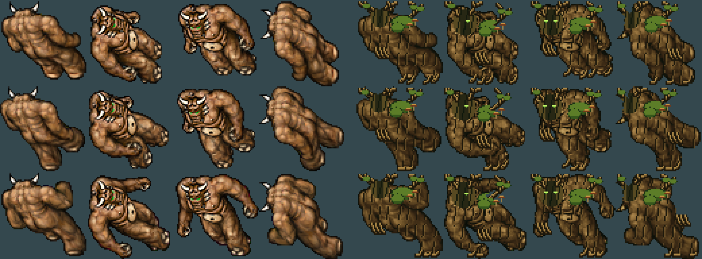
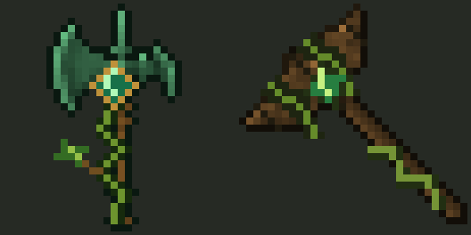
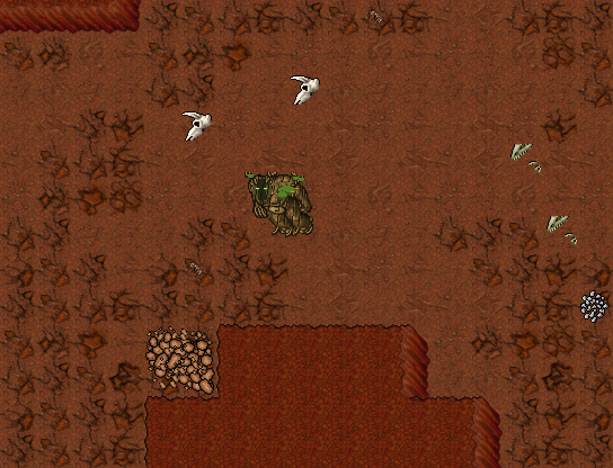
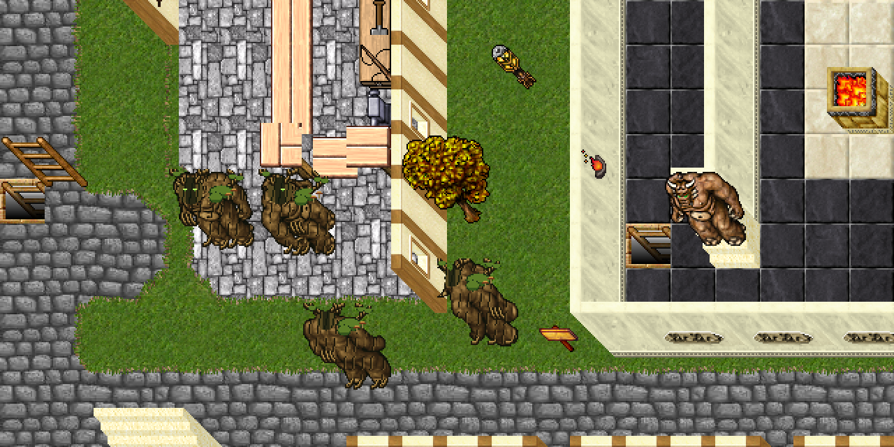

# Root Colossus

Guardián vegetal creado sobre **Behemoth (look 55)**, con look nuevo **243**. Corteza surcada,
rostro de tronco, ojos verdes, corona de ramas con brotes, musgo y hongos en los hombros, raíces en
manos y pies. La transformación cambia la silueta conservando la caminata original de 12 cuadros.
Balance inicial de criatura de caza, pendiente de combate in-game.



## Stats y rol

| Stat | Behemoth | Root Colossus |
|---|---:|---:|
| Vida | 4000 | 4800 |
| Experiencia base | 2500 | 3400 |
| Level / maglevel | 61 / 30 | 61 / 30 |
| Armor / defense | 44 / 42 | 46 / 44 |
| Speed | 270 | 220 |
| Melee | 160–400 | 140–360 |

Melee (`targetdistance=1`), no huye, empuja ítems. Más lento que Behemoth, sin haste ni piedras a
distancia: castiga permanecer cerca con dos áreas. Inmune a poison, invisible y paralyze.
El fuego y la energía lo dañan normalmente; no hereda esas inmunidades del Behemoth y no se agregó
un multiplicador de vulnerabilidad. Cadáver reutilizado de la base (**2931**, dead behemoth).

## Ataques

| Ataque | Tipo / daño | Intento cada | Probabilidad |
|---|---|---:|---:|
| Melee | Físico, 140–360 | Ritmo del motor | 100% |
| `rootcolossus_rootslam` | Físico, 100–180, radio 2 | 5 s | 50% |
| `rootcolossus_spores` | Poison, 50–90, radio 1 | 7 s | 35% |

El golpe de raíces ocupa 20 casillas; las esporas, las 8 adyacentes. Áreas simétricas, con el centro
excluido. El golpe no inmoviliza y las esporas hacen daño inmediato, sin condición periódica.
Se usan efectos clásicos (`NM_ME_HIT_AREA`, `NM_ME_POISONCLOUD`, `NM_ME_POISEN_RINGS`). No se
modifica C++ ni se requiere rebuild. Los dos spells son exclusivos de monstruos (`maglv=4000`).

## Loot

Hasta 160 gold, hasta 5 brown mushrooms (20%), double axe (4%), two-handed sword (2%), giant sword
(0,7%) y hasta 6 platinum coins (10%). Bolsa garantizada con steel boots (0,6%), wand of plague
(1,2%) y strange talisman (3,5%), más las dos armas propias de abajo. Probabilidades XML sobre 100000.

### Armas propias

| Server id | Arma | Tipo | Atk / Def | Drop |
|---:|---|---|---|---:|
| 20163 | **rootcleaver** | Axe, una mano | **49 / 31** | **0,6%** (`chance=600`) |
| 20164 | **heartwood maul** | Club, dos manos | **52 / 28** | **0,5%** (`chance=500`) |

Drops independientes dentro de la bolsa garantizada: pueden salir ambas. Armas físicas normales,
sin procs ni velocidad especial. Sus stats, tipo, slot y nombres se leen del OTB; no requieren C++.
Rootcleaver permite escudo; Heartwood Maul cambia esa protección por mayor ataque.



Los sprites derivan del knight axe (client id 3318) y war hammer (3279), con hoja de jade/madera,
raíces y un corazón verde. `draw_root_weapons.py` genera los PNG 32×32; `add_custom_items.py`
los instala en los client ids **3573** (antes magician hat 2662) y **3561** (antes jacket 2650).
Ambos estaban en la lista de candidatos libres: sin uso en mapa, loot, NPC ni scripts.
Se heredan peso y manos de knight axe **2430** y war hammer **2391**; las estadísticas se sustituyen.

```bash
python3.11 scripts/client-rme/draw_root_weapons.py --preview docs/gameplay/img/root-weapons.png
python3.11 scripts/client-rme/add_custom_items.py --things devtools/rme/rme-client-760
# GM, despues de cargar OTB y cliente actualizados:
# /i 20163 1
# /i 20164 1
```

Los PNG fuente están en `devtools/zagan-test/custom-sprites/` (carpeta ignorada; al preparar el commit,
incluir estos dos PNG explícitamente con `git add -f`). Sprites nuevos **11654–11655**.

## Spawn en el mapa local

**Un Root Colossus en `310,254,9`**, radio 3, respawn **300 s**, en el último tramo del **Abismo del
Valle de las Bestias**. Está después del sector de Hydra/Lich, en la transición a Behemoth y Demon.
Su dificultad de 4800 HP encaja en esta etapa; no aparece entre lobos y osos del Paso del Norte.

Recorrido: portal del templo `158,47,7` → llegada `312,360,7` → superficie con Minotauros, Cíclopes
y ruinas → Catacumbas por `312,252,7` (Giant Spider/Vampire → Necromancer → Hero/Black Knight) →
bajada al Abismo en `344,360,8` → Dragon/Ancient Scarab → Dragon Lord/Warlock → Hydra/Lich → Root Colossus.



Se comprobó una ruta de **141 pasos cardinales** desde la llegada del Abismo (`344,361,9`), una sala
caminable de 5×5 y separación de 6 casillas respecto de otros spawns. Está en el último cuarto de
la progresión por distancia (umbral 133 pasos), junto a Hydra/Lich y antes del fondo con Demon/Fury.
La casilla está libre, sin casa ni PZ. El spawn viejo del bosque fue retirado.

`generate-beast-valley.py` lo coloca mediante `root_colossus_spawn()`: selecciona un único claro
al inicio del último cuarto por distancia caminable, conserva los demás monstruos y falla si no
encuentra espacio suficiente. Para seed 11 resulta `310,254,9`. El spawn está dentro de
`BEAST_VALLEY_SPAWNS`, marcado `ROOT_COLOSSUS_SPAWN` en la edición actual. No se pierde al regenerar;
otra semilla puede cambiar la coordenada manteniendo la etapa de dificultad.

**Solo cambió el XML de spawns y su generador/manifiesto; `test.otbm` quedó idéntico.** Se prepara localmente por pedido
del usuario; antes de cargarlo en el servidor compartido, publicar y verificar el cliente con look 243
y ambas armas. Un cliente viejo no puede mostrar correctamente estos assets.

## Sprite y base estudiada

Preset `root-colossus`, 48 sprites nuevos (**11606–11653**). Base 2×2, cuatro direcciones, tres
cuadros. Clasificador en `BASE_PARTS[55]`: contorno con `v < 0.13`; verdes de la cara con
`0.20 < h < 0.45, s > 0.35`; hueso claro con `s < 0.25, v > 0.35`; el resto es piel marrón.
El verde original pertenece a detalles de toda la cara, no a dos ojos aislados.

El preset reemplaza la cara dentro de una máscara según dirección, pinta surcos de corteza y
añade ramas con trazos enteros, musgo, hongos y raíces. Los brotes están conectados a las ramas.
Cabeza/hombros se desplazan como mucho un píxel; las manos tienen anclas por pose. No usa azar.
Los ojos se dibujan solo mirando al este/sur; de espaldas se ve la madera.

Las ramas nuevas dejan margen dentro de 64×64 para evitar recortes. Hay **2364 píxeles añadidos
fuera de la silueta original** entre los 12 cuadros; el cambio no es solo de paleta.



## Archivos

| Pieza | Ruta |
|---|---|
| Monstruo | `server/YurOTS/ots/data/monster/root colossus.xml` |
| Registro | `server/YurOTS/ots/data/monster/monsters.xml` |
| Golpe de raíces | `server/YurOTS/ots/data/spells/instant/rootcolossus_rootslam.lua` |
| Esporas | `server/YurOTS/ots/data/spells/instant/rootcolossus_spores.lua` |
| Registro de spells | `server/YurOTS/ots/data/spells/spells.xml` |
| Preset | `scripts/client-rme/presets/root_colossus.py` |
| Clasificador | `scripts/client-rme/sprite_kit.py` |
| Paleta RME | `devtools/rme/rme-extensions/yurots-creatures.xml` |
| Assets RME | `devtools/rme/rme-client-760/Tibia.dat`, `Tibia.spr` |
| Armas en servidor | `server/YurOTS/ots/data/items/items-zagan-test.otb` |
| Definición/importación de armas | `scripts/client-rme/add_custom_items.py` |
| Generador de sprites de armas | `scripts/client-rme/draw_root_weapons.py` |
| PNG fuente de armas | `devtools/zagan-test/custom-sprites/rootcleaver.png`, `heartwood_maul.png` |
| Loot de armas | `server/YurOTS/ots/data/monster/root colossus.xml` |
| Spawn | `server/YurOTS/ots/data/world/test-spawn.xml` (`ROOT_COLOSSUS_SPAWN`) |
| Generador de la ubicación progresiva | `scripts/map/generate-beast-valley.py` (`root_colossus_spawn`) |
| Manifiesto de zona | `server/YurOTS/ots/data/world/generated-beast-valley.json` |
| Imágenes | `docs/gameplay/img/root-colossus-hoja.png`, `root-colossus-escena.png` |
| Imágenes de loot/spawn | `docs/gameplay/img/root-weapons.png`, `root-colossus-spawn.png` |
| Documentación común | `docs/INDEX.md`, `docs/gameplay/SPRITE_BASES.md`, `SPRITE_RECOLOR_GUIDE.md` |

## Validación y pendientes

- Hoja y escena revisadas. `sprite_tool.py verify --expect 243` contra los assets previos de esta
  tarea: `TODO BIEN`. Solo cambia look 243; los 11605 sprites previos, ítems, efectos y proyectiles
  quedan intactos. Todos los presets, incluidas Dark Hydra y Emerald Scarab, siguen reproduciéndose.
  La comparación se hizo sobre una copia aislada, conservando `.bak` ajenos y cambios de otras sesiones.
- `luac -p` y casts repetidos con biblioteca real y sustituto de `doAreaMagic`: OK en tipos, daños,
  simetría, número de casillas y centro excluido. No sustituyen una prueba de combate del motor.
- XML, registro único, inmunidades, loot, referencias a spells y entrada en paleta RME: OK.
  Auditoría de spells habilitados: **175 OK, 0 problemas**.
- Armas/spawn: `check-map-load.py` **0 errores**; `add_custom_items.py --dry-run` confirma que una segunda
  aplicación no cambia nada. OTB: solo se agregaron los nodos 20163/20164; los anteriores son idénticos.
  DAT: solo se modificaron las entradas 3561/3573; PNG exactos y flags del prototipo. SPR: 11653 sprites
  anteriores intactos, dos nuevos. `sprite_tool.py verify` dio `TODO BIEN` para looks/efectos/proyectiles
  con una referencia normalizada en las dos entradas de ítems previamente comprobadas. Spawns anteriores
  conservados exactamente; único Root Colossus accesible en `310,254,9`. `test.otbm` no fue modificado.
- Reubicación: `generate-beast-valley.py --dry-run` valida **398 spawns / 767 monstruos** (un Root
  Colossus). Se contrastó la posición generada con el mapa existente y la progresión por distancia.
- Docker, binario local y cliente de jugadores no están disponibles en esta máquina. Falta boot/probe
  satisfactorio y prueba de `/m Root Colossus` para verificar visual, comportamiento, loot y balance.
- Publicar/verificar en el cliente el `Tibia.dat`/`Tibia.spr` actual de RME, con look 243 y armas nuevas,
  **antes de activar el spawn preparado en el servidor compartido**. Falta probar drops y equipamiento.
- Sin commit, push ni deploy a ThinkPad. El deploy requiere autorización y el procedimiento de
  [THINKPAD_TEST_SERVER.md](../systems/THINKPAD_TEST_SERVER.md).
