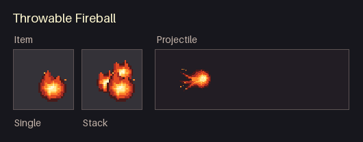

# Throwable Fireball



La Throwable Fireball se equipa y se lanza igual que una Snowball. Es un
arma apilable de una mano, reutilizable, con 22 de ataque y la probabilidad de
acierto estándar de los arrojadizos (50%). Usa Distance Fighting y hace daño
físico a un solo objetivo. Fire Elemental puede soltar entre una y tres, con
`chance1=12000` y `chancemax=2000` antes de los modificadores de loot.

| Componente | Valor |
|------------|-------|
| ID servidor / cliente | `20666` / `6066` |
| Prototipo | Snowball `2111` / `2992` |
| Ítem | Cuatro cuadros animados en cada uno de los ocho patrones de pila |
| Proyectil | Ocho direcciones con una estela de brasas, `NM_ANI_THROWABLE_FIREBALL=21` |
| OTB | `DIST`, `AMU_NONE`, `OTB_DIST_THROWABLE_FIREBALL=16` |

## Regenerar los archivos

Desde la raíz del repo, con Python y Pillow. El instalador agrega la Fireball
al final de la sección de proyectiles y comprueba su contenido si el ID ya
existe. `--only` limita el cambio del catálogo a este ítem.

```sh
python3.11 scripts/client-rme/add_throwing_fireball.py --prepare
python3.11 scripts/client-rme/add_custom_items.py --only 20666 \
  --things devtools/rme/rme-client-760 \
  --otb server/YurOTS/ots/data/items/items-zagan-test.otb \
  --otb server/YurOTS/ots/data/items/items.otb
python3.11 scripts/client-rme/add_throwing_fireball.py --apply
```

El cargador de OTB traduce el tipo de proyectil 16 al efecto 21. El protocolo
envía 22 en el paquete de lanzamiento porque sus IDs son de base uno. Publicar
el binario, el OTB y los assets de cliente juntos. En juego, comprobar el
parpadeo en inventario y en el suelo, equipar una pila y atacar en línea recta
y en diagonal con el cliente actualizado.
