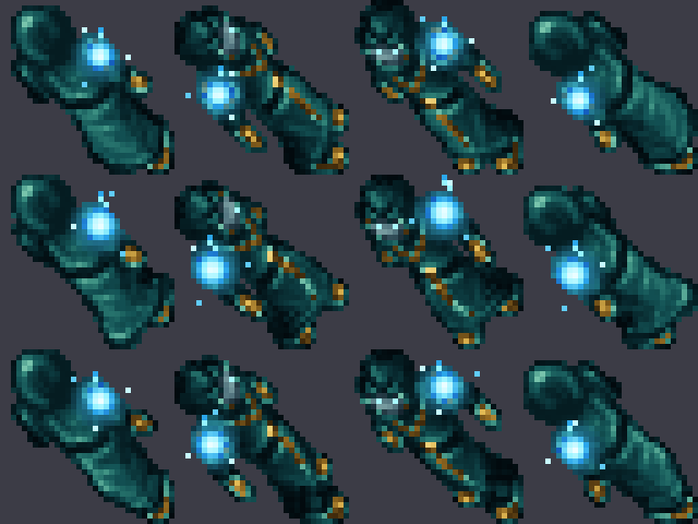
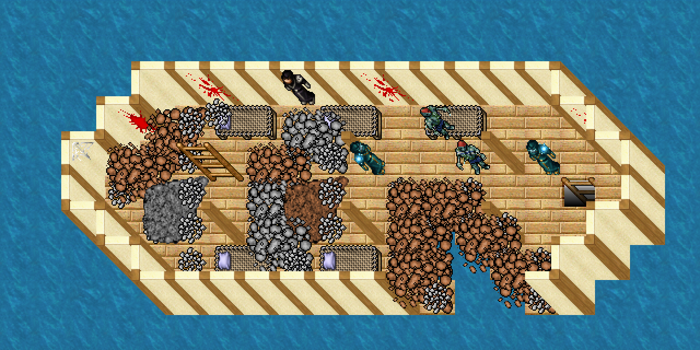

# Tide Priest (Sacerdote de la Marea)

El capellán del naufragio de la playa de la selva (`182-199, 147-154`): el que levantó a la tripulación
ahogada. Es la segunda pieza del plan del barco, después del [Drowned Sailor](DROWNED_SAILOR.md): un
mago que pelea de lejos y manda a los ahogados, pensado para la bodega.

**Lo que lo distingue:**
- **Se ve distinto:** sprite propio a partir del Necromancer. La túnica negra pasa a verde mar con
  ribete, guantes y botas de bronce, y la cara queda en sombra con ojos celestes. En vez de la calavera
  lleva una **bola de fuego de San Telmo** (el fuego azul de los mástiles en las tormentas): late con la
  animación, tiene una lengua de fuego, ilumina la túnica alrededor y suelta chispas que cambian de lugar.
- **Levanta a la tripulación:** llama hasta 2 Drowned Sailors. Ellos te dejan quieto con las algas
  mientras él ataca de lejos.
- **Te vacía el maná:** además del rayo de energía, tira una marea que saca maná en vez de vida.

Proceso general: [`CUSTOM_MONSTER_WORKFLOW.md`](CUSTOM_MONSTER_WORKFLOW.md).





## Stats

| | Necromancer | **Tide Priest** |
|---|---:|---:|
| Vida | 580 | **720** |
| Exp | 580 | **620** |
| Nivel / magic level | 60 / 35 | **40 / 35** |
| Armor / defense | 29 / 31 | **22 / 24** |
| Speed | 188 | **200** |
| Distancia | 5 | **4** |
| Summons | hasta 5 (Skeleton, Ghoul, Mummy) | **hasta 2 Drowned Sailors** |
| Look | 9 | **234** |

Inmune a energy, poison e invisible. Cadáver: dead human (3128).

## Ataques

| Ataque | Tipo | Qué hace | Daño | Cada | Prob. |
|--------|------|----------|-----:|-----:|------:|
| melee | — | Golpe | 0–40 | — | 100 % |
| `tidepriest_elmofire` | rune (id 5038) | Rayo de fuego de San Telmo a distancia (proyectil `NM_ANI_ENERGY`, golpe `NM_ME_ENERGY_DAMAGE`) | 40–95 de energía | 2 s | 70 % |
| `tidepriest_manatide` | rune (id 5039) | Marea que saca maná, no vida (proyectil blanco `NM_ANI_SNOWBALL`, salpicadura de agua `NM_ME_LOOSE_ENERGY`) | 40–90 de maná | 5 s | 40 % |
| `exura` | instant | Se cura | — | 5 s | 40 % |
| summon | — | Drowned Sailor, hasta 2 a la vez | — | — | chance 1200 |

Voces: "The tide always returns.", "Rise, crew! Rise!", "Saint Elmo lights your grave.", "The deep is calling you.".

## Loot

Oro (hasta 60), small sapphire ×2 (8 %), blank rune (8 %) y bolsa con white pearl (5 %), black pearl
(2 %), energy ring (1,5 %) y wand of cosmic energy (0,4 %).

## Sprite

Recoloreado por algoritmo del Necromancer (9: 1×1, 4 direcciones, 3 cuadros) con el script genérico:

```bash
python3 scripts/client-rme/add_recolor_look.py --preset tide-priest --preview /tmp/sacerdote.png    # solo vista previa
python3 scripts/client-rme/add_recolor_look.py --preset tide-priest devtools/rme/rme-client-760  # aplica (idempotente)
```

- **Paleta** (`recolor_tide_priest`): túnica casi negra → verde mar profundo; piel → gris azulado en
  sombra; manos, botas y ribete grises → bronce dorado. El brillo violeta de la capucha cuenta como túnica.
- **Retoque por cuadro** (`tide_priest_details`):
  - Fuego de San Telmo: la calavera es el grupo claro más grande del cuadro. Se tapa con un disco
    celeste de centro blanco, de radio 2,6 / 3,1 / 2,8 según el cuadro (late).
  - Lengua de fuego: 2 o 3 píxeles sobre la bola, que se inclinan distinto en cada cuadro.
  - Resplandor: la túnica a menos de 3 píxeles de la bola se aclara hacia el celeste.
  - Chispas: tres píxeles giran alrededor de la bola y cambian de lugar en cada cuadro.
  - Ojos: celestes, dos de frente y uno mirando al este; de espaldas y mirando al oeste no se ve la cara.

Verificado contra el `.dat`/`.spr` de RME: solo cambió el look 234 (cabecera del Necromancer, sprites
11163–11174), los ítems, los efectos y los proyectiles quedaron iguales, 400 sprites viejos al azar siguen
idénticos y los otros cuatro presets siguen generando exactamente sus looks (230–233).

## Antes de ponerlo en el mapa: el cliente

El look 234 es nuevo: un cliente viejo vería el monstruo invisible. Mismo orden que el Drowned Sailor
([`CUSTOM_MONSTER_WORKFLOW.md`](CUSTOM_MONSTER_WORKFLOW.md) §6.6), y conviene publicar los dos juntos
porque el Tide Priest llama Drowned Sailors (look 233):

1. Aplicar los presets `drowned-sailor` y `tide-priest` a la base del cliente de jugadores
   (`client-local/data/things/760/`) y regenerar el pack con `build_zagan_test_assets.py`.
2. Publicar `Tibia.dat`/`Tibia.spr` en el updater y confirmar con un cliente actualizado que se ven.
3. Recién entonces el spawn: 1 o 2 en la bodega (`184, 149, 8`), con los Drowned Sailors.

Hoy no está en ningún spawn ni se probó en el juego. El C++ no cambió: no hace falta compilar.

## Archivos

| Pieza | Archivo |
|-------|---------|
| Definición | `server/YurOTS/ots/data/monster/tide priest.xml` |
| Registro | `server/YurOTS/ots/data/monster/monsters.xml` |
| Ataques | `data/spells/runes/tidepriest_elmofire.lua` y `tidepriest_manatide.lua` + `spells.xml` (ids 5038 y 5039) |
| RME | `rme-extensions/yurots-creatures.xml` y `devtools/rme/rme-client-760/Tibia.{dat,spr}` |
| Sprite | `scripts/client-rme/presets/tide_priest.py` (preset `tide-priest`; se aplica con `add_recolor_look.py`) |
