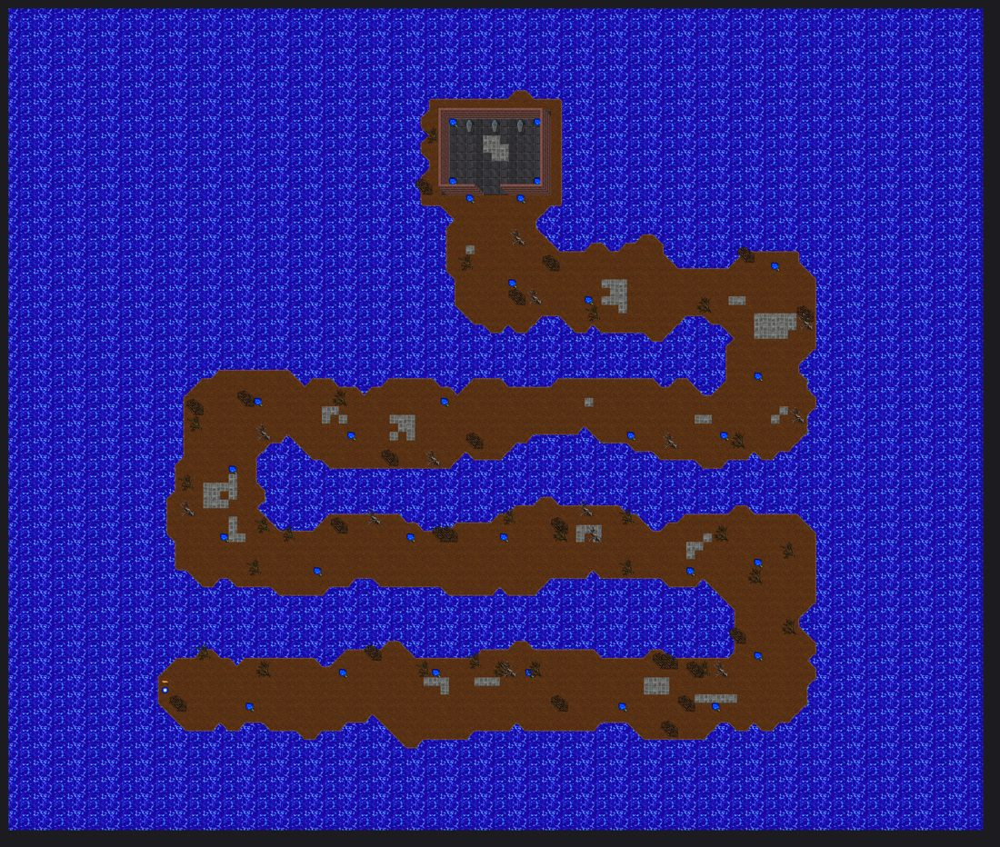
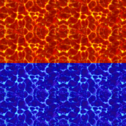
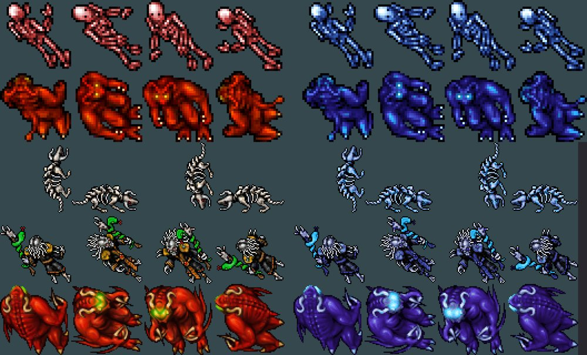
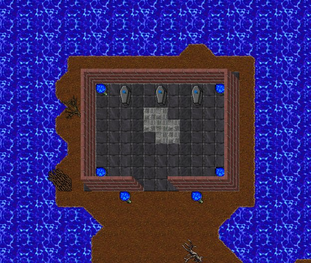

# Caldera Azul — lava azul y zona de caza de fuego frío (24 nov 2026)

Zona nueva con la estética de la isla volcánica del noroeste (tierra sobre un mar de lava, árboles muertos,
manchas de ceniza, cripta) pero con **lava azul** y **5 monstruos propios**. Se entra por el portal
**163,47,7** de la plaza del templo (cartel `163,46,7`, llegada al volver `163,48,7`).



## Lava azul (`20680`)

| Dato | Valor |
|---|---|
| Server id / client id | `20680` / `6080` (`add_custom_items.py`, prototipo `598`) |
| Sprites | 32: 8 patrones (4×2) × 4 cuadros de animación, igual que la lava común |
| Luz | nivel 4 (como la lava), color azul `143` (el del blue bassin) |
| OTB | copia del nodo de la `598` (`decor=True`): suelo que bloquea |
| Script | `scripts/client-rme/recolor_lava.py` → `devtools/zagan-test/custom-sprites/blue_lava.png` |



Cómo se recolorea: cada tono del fuego pasa a uno frío con el mismo brillo. El rojo del fondo va a violeta
índigo (255°), el amarillo de las vetas a cian (188°) y el naranja queda en el medio (azul). Las vetas más
claras se blanquean un poco.

- **Primero se probó intercambiar rojo y azul** (como el blue bassin, `recolor_basin.py`). Queda un azul parejo que
  **se confunde con el agua**. Por eso el degradé violeta → cian.
- Los **bordes de tierra de la lava común (`4667–4678`) sirven tal cual** sobre la lava azul: son tierra con fondo
  transparente y se ve la lava de abajo. Se ponen con la misma regla `lava_borders` de `generate-ember-field.py`.
- Para la luz y el fuego frío de la decoración se usa el **blue bassin `20192`** (coal basin azul, ya existía).

Instalar (re-ejecutable; `--only` evita tener que regenerar los PNG de otros ítems):

```bash
python3.11 scripts/client-rme/recolor_lava.py --preview /tmp/lava.png
python3.11 scripts/client-rme/add_custom_items.py --only 20680 --things devtools/rme/rme-client-760 \
    --otb server/YurOTS/ots/data/items/items-zagan-test.otb
```

## Monstruos (looks 145–149)

Recolores de criaturas de 7.6 con presets de `scripts/client-rme/presets/` (receta:
[SPRITE_RECOLOR_GUIDE.md](../gameplay/SPRITE_RECOLOR_GUIDE.md)). Ataques de energía, hielo y muerte con los
kits de [MONSTER_KITS.md](../gameplay/MONSTER_KITS.md).



| Monstruo | Look (base) | Vida | Exp | Golpe | Kit | Inmune | Rol |
|---|---|---:|---:|---:|---|---|---|
| Azure Skeleton | 145 (Demon Skeleton) | 600 | 420 | 50–170 | energy strike 5, death touch 4 | fuego, veneno | cuerpo a cuerpo |
| Azure Devil | 146 (Fire Devil) | 750 | 650 | 40–150 | energy ball 5, energy wave 5, ice strike 4 | fuego, energía | a distancia (4) |
| Azure Bonebeast | 147 (Bone Beast) | 1500 | 1300 | 80–260 | ice wave 7, death touch 7, prisa | fuego, veneno, paralyze | cuerpo a cuerpo rápido |
| Azure Lich | 148 (Lich) | 2200 | 2400 | 20–110 + SD 100–260 | energy wave 7, drain burst 6, ice ball 6, cura | fuego, energía, veneno, paralyze | mago; invoca 2 Azure Skeleton |
| **Azhurak** (jefe) | 149 (Demon) | 16000 | 18000 | 250–620 | rayo del Demon, energy wave 10, ice burst 10, drain strike 9, cura, prisa | energía, fuego, veneno, paralyze, invisible, drunk | invoca 2 Azure Devil; respawn 30 min |

- Loot con **small sapphires** (el azul de la zona). Azhurak: 1–3 crystal coins, 30 platinum, hasta 8 small
  sapphires, Aurora Shield (`20165`, 3 %), Mastermind Shield, Magic Plate Armor, Golden Legs, Giant Sword.
- Cadáveres: los de sus bases (rojos); no hay cadáveres azules todavía.
- No tienen variantes rage (el sistema de rage solo cubre las familias de su lista).
- Al agregarlos a `KITS`, **no se volvió a correr `apply-monster-kits.py` entero**: la corrida completa también
  reformatea los XML de los 40 monstruos con kit y cambia el escalón de dos (Mutated Tiger y Quara Predator), porque
  sus golpes cambiaron después de la última vez. Se agregaron a mano solo los 10 hechizos nuevos en `spells.xml`
  (runas `6029–6031`). Antes de una corrida completa, revisar esas diferencias.

## La zona (`scripts/map/generate-azure-caldera.py`)

Caja `638,298 – 752,394`, z7, en el distrito de eventos (lejos del mapa principal, nada alrededor). Todo lo que no
es tierra es lava azul: desde ninguna casilla caminable se ve el vacío (validado: todo a ±9, ±7 existe).

| Qué | Dónde |
|---|---|
| Llegada (desde el templo) | `660,378` |
| TP de vuelta al templo y cartel | `656,378` / `656,377` |
| Camino | zigzag por las filas `y 378 / 362 / 346 / 330` (x 660–728), 290 casillas de eje, 5–9 de ancho, ondulado |
| Santuario | sala 11×8 `690,311 – 700,318`, mármol negro y ladrillo, 3 ataúdes de gema azul, 6 blue bassins, puerta al sur `694–696,319` |
| Jefe | Azhurak en `695,314` (círculo de ceniza) |

Receta de [ZONAS_DE_CAZA.md](ZONAS_DE_CAZA.md): recorrido en zigzag con filas a 16 de distancia, ensanches a mitad
de cada tramo y en las esquinas, y monstruos por **etapas según la distancia caminando** desde la llegada (nada a
menos de 6 de la llegada, el TP y la puerta):

| Etapa | Monstruos | Por spawn | Separación | Spawns (monstruos) |
|---|---|---|---|---|
| 1 | Azure Skeleton | 1 | 12 | 12 (12) |
| 2 | Azure Skeleton / Azure Devil | 1 | 11 | 8 (8) |
| 3 | Azure Devil + Azure Bonebeast | 2 | 12 | 10 (20) |
| 4 | Azure Bonebeast + Azure Lich | 2 | 12 | 6 (12) |
| Jefe | Azhurak | 1 | — | 1 |

Spawns en el bloque `AZURE_CALDERA_SPAWNS` de `test-spawn.xml`; cartel en `AZURE_CALDERA_SIGNS` de `readables.xml`;
manifiesto `data/world/generated-azure-caldera.json`.

Decoración (como la isla volcánica): ceniza `3152` en manchas redondeadas a 2+ de la lava, árboles muertos
(`2709/2717/2720`), madera vieja `2721` y blue bassins `20192` cada ~11 casillas del camino (dan la luz azul).
Todo lo que bloquea va a 2+ del eje del camino y se descarta si deja casillas sin acceso.



```bash
python3.11 scripts/map/generate-azure-caldera.py --dry-run --png /tmp/caldera.png
python3.11 scripts/map/generate-azure-caldera.py --replace
python3 scripts/map/temple-portals.py            # portal 163 y vuelta a la plaza
python3.11 scripts/map/check-map-load.py
```

## Deploy

Hay sprites nuevos (lava y 5 looks): **el cliente se publica antes de que existan los spawns**
(`publish_client.py` en la ThinkPad, ver [CLIENT_UPDATER_RETRO76.md](../CLIENT_UPDATER_RETRO76.md)). Sin C++.
