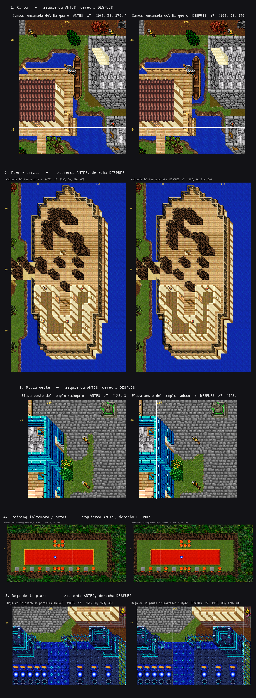
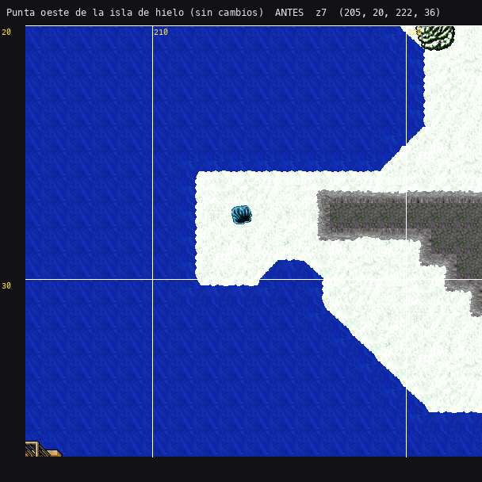

# Arreglos visuales de la city — 24 de noviembre de 2026

Revisión visual de la **Ciudad (Retro76)** (caja oficial z7 `(120,18)–(200,80)`, con
margen a muralla, puerto, campo norte y río). La primera pasada se hizo sobre una
copia del Mac que estaba 256 commits atrás; **los cambios de este documento se
rechequearon y se aplicaron sobre `origin/main` (`180c90e`)**.

Renders con el `Renderer` del repo (vista como el cliente, un piso de techos, sprites
reales). No son capturas de una sesión de juego: no hay criaturas, NPC ni luz
dinámica. Las etiquetas amarillas son coordenadas.

Script: `scripts/map/fix-city-visual-20261124.py` (`--replace` para escribir).
Mapa tocado: `server/YurOTS/ots/data/world/test.otbm`. No se modificaron casas,
lockers, spawns ni `houses.xml`.

## Qué se arregló

### 1. Canoa de la ensenada del Barquero

- **Antes:** `(171,62–66,7)`, secuencia `3587, 3590, 3589+3597, 3590, 3591` (faltaba
  `3588`, había dos `3590`) y el casco sobre pasto `4526` + borde `4647`.
- **Después:** la misma columna, `3587 → 3588 → 3589 + vela 3597 → 3590 → 3591`,
  todas las casillas sobre agua `4608`. Se actualizaron los bordes de pasto del
  anillo de 1 casilla (la orilla nueva quedó en `x=172`).
- **Por qué no se corrió al oeste:** en `x=170`, `y≥63` está el muelle de madera
  (`405` / `434` + farol `20284`). No hay una tira vertical de 5 casillas de agua
  libre al lado de la canoa.
- **Imágenes:** [antes](img/city-visual-2026-11-24/canoa-antes.png) ·
  [después](img/city-visual-2026-11-24/canoa-despues.png)

### 2. Maleza sobre la cubierta del fuerte pirata

- **Antes:** 22 casillas con `1499 (wild growth)` encima de `1284 (drawbridge)`
  alrededor de `(201–210, 40–62,7)`. Se veían como manchones o agujeros en la
  madera y además bloqueaban el paso (`block_solid`).
- **Después:** se sacó el `1499`; quedó solo el tablón `1284`.
- **Imágenes:** [antes](img/city-visual-2026-11-24/fuerte-antes.png) ·
  [después](img/city-visual-2026-11-24/fuerte-despues.png)

### 3. Bordes de pasto colgados en la plaza oeste del templo

- **Antes:** piezas `4542–4553` sobre adoquín `724` en casillas que no tocaban
  pasto real, sobre todo en `y=41–43`.
- **Después:** se sacaron solo estas 9 casillas abiertas:
  `(132,41)`, `(134,41)`, `(135,41)`, `(132–135,42–43)` excepto `(133,*)` que ya
  estaba limpio. En `(134,42)` se conservó el farol `3744`.
- **No se tocó:** `(130–131,41)` (tienen pared eléctrica del depot `20428`) ni los
  bordes de `y≥44`, que sí tocan pasto `4756`.
- **Imágenes:** [antes](img/city-visual-2026-11-24/plaza-antes.png) ·
  [después](img/city-visual-2026-11-24/plaza-despues.png)

### 4. Duplicados menores

- Alfombra roja `4398` ×2 en el training: `(138,11)`, `(139,11)`, `(140,11)`,
  `(143,12)`, `(144,12)`, `(145,13)`, `(146,12)`, `(146,13)` (esta última no
  estaba en la revisión vieja; en main también estaba duplicada). Quedó una por
  casilla.
- `1499` ×2 en `(160,7,7)` (seto del training): quedó una.
- Reja en `(163,42,7)`: en la copia vieja era `1544` ×2; en main es
  `20257 (arcane railing horizontal)` ×2. Se sacó el duplicado, quedó una.
- **Imágenes:** [training antes](img/city-visual-2026-11-24/training-antes.png) ·
  [después](img/city-visual-2026-11-24/training-despues.png) ·
  [reja antes](img/city-visual-2026-11-24/reja-antes.png) ·
  [después](img/city-visual-2026-11-24/reja-despues.png)

### 5. Dead trees 2716

Gonzalo señaló en el juego (24/11, 18:54 hora de Buenos Aires) un *dead tree*
en `17,141,7` (item 2716 sobre pasto 4756). En todo el `test.otbm` había
exactamente 4 colocaciones de 2716, todas en z7 y en casillas simples, sin
otro objeto encima. Se sacaron las cuatro:

| Posición | Piso previo | Notas |
|---|---|---|
| `17,141,7` | 4756 (grass) | Lo plantaba `SURFACE_PROPS` de `generate-duskweb-hollow.py`. |
| `41,39,7` | 103 (dirt) | Junto a un 2715, en tierra al borde de lava. No lo pone ningún generador actual. |
| `104,105,7` | 117 (grass) | En un grupo con 2715/2717. No lo pone ningún generador actual. |
| `114,115,7` | 103 (dirt) | Junto a un 2715. No lo pone ningún generador actual. |

Causa: el único script que colocaba 2716 era el de Duskweb Hollow. Los otros
generadores de árboles secos usan 2709, 2710, 2717, 2719, 2720 (y a veces
2697), nunca 2716. Ese ítem quedó sacado de `SURFACE_PROPS`; los árboles
secos vecinos de la península (`15,139,7` = 2709 y `20,140,7` = 2720) se
dejaron. Si se vuelve a correr el generador de Duskweb, ya no reaparece el
2716.

El script `scripts/map/fix-city-visual-20261124.py` ahora también saca los
2716. Si los arreglos de la city ya están aplicados, esa parte se saltea
(idempotente para los árboles: `python3.11 scripts/map/fix-city-visual-20261124.py --dead-trees`).

## Qué se dejó a propósito

- **Caminito `413` en `(140,33–36,7)`:** es un sendero de baldosas en el cantero
  del templo, con hueco en la reja sur que sale al adoquín. No es un tile suelto.
- **Terraza z6 de las ruinas de los trolls** `(150–169, 79–89,6)`: 177 de 178
  casillas son `4757 (rocks)`. Se ve plana, pero agregar roturas o tejas podía
  tapar el arco, la escalera `409` o el paso desde el puente de sogas. Se deja
  como está.
- **Punta de nieve `(211–215, 25–30,7)` y agujero `(213,27,7)`:** en la copia
  vieja parecía un islote suelto en la bahía. En `origin/main` es la **punta
  oeste de la isla de hielo vieja** (`x205–262, y25–49`, ver
  [Glaciar del Este](MAPEAR_GLACIAR_DEL_ESTE.md)). A partir de `x=216` sigue la
  nieve con pisos de piedra. Convertir solo `211–215` a pasto dejaría un corte
  feo. Se conserva la entrada nevada `20368` y la escalera `1386` en
  `(213,27,8)`; el retorno `(213,28,7)` sigue libre.
  
- **Cercos `1533+1537` en `(144–146,36,7)`:** no son el mismo ítem dos veces;
  son dos piezas distintas, típicas de una esquina.
- **`1499` ×2 en `(203,44,6)` y `(208,46,6)`:** duplicados en el piso de arriba
  del fuerte, fuera de la lista aprobada. No se tocaron.

## Verificación

Corrido después de escribir el mapa, en el worktree `~/proyectos/serverrepo-city-fix`:

- `python3.11 scripts/map/check-map-load.py` — 0 errores.
- `python3.11 scripts/map/check-upper-view.py --box 115 10 215 90 --z 5 6 7 8 9 10` — OK.
- `python3.11 scripts/map/scan-map-depots.py` — 11 lockers, todos `depotid=1`, idénticos a antes.
- `python3.11 scripts/map/sync-houses-with-map.py --dry-run` — `houses.xml` coincide; 549262 tiles (igual).
- SHA-256 de `test-spawn.xml` y `houses.xml` sin cambios.

Después de sacar los 2716, en el mismo worktree:

- `python3.11 scripts/map/check-map-load.py` — 0 errores.
- `python3.11 scripts/map/scan-map-depots.py` — 11 lockers, todos `depotid=1`, idénticos a antes.
- `python3.11 scripts/map/sync-houses-with-map.py --dry-run` — `houses.xml` coincide; 549262 tiles (igual).
- SHA-256 de `test-spawn.xml`, `houses.xml` y `test-house.xml` sin cambios.
- SHA-256 de `test.otbm` después de sacar los árboles:
  `ecb95dfd0b52039f0a0351e001b22905d978388598cb18df67a03b11c8096635`.
- No quedó ningún 2716 en el mapa.

## Cómo volver atrás

El mapa anterior a los arreglos de la city (canoa, fuerte, bordes, duplicados)
está en:

- `backups/map/city-visual-20261124/test.otbm` (gitignored; SHA-256
  `d260970915fff1d3866d9c2be804e418c6f2cf4d1a7ee5accba26ffef7397580`)
- `/tmp/serverrepo-city-fix-backup/test.otbm` en el Mac

El mapa ya con esos arreglos, antes de sacar los 2716, está en:

- `backups/map/city-visual-20261124/test.otbm.pre-dead-trees` (SHA-256
  `6a82a8f6cdb50c44902d1c7f011cfe1accb825fba05f44e539060d35279b5cba`)
- `/tmp/serverrepo-city-fix-backup/test.otbm.pre-dead-trees`

Para restaurar, copiar el archivo elegido sobre
`server/YurOTS/ots/data/world/test.otbm`. La parte de la city del script no es
idempotente (si se corre sobre el mapa ya arreglado, se saltea). La de los
2716 sí lo es: si no hay ninguno, no hace nada.

## Despliegue

El mapa (city + dead trees 2716) y, si se incluye, el sprite de la Memory Gem
van a `main` cuando se haga push. El deploy al servidor y la publicación del
cliente no forman parte de este cambio:

1. Backup del `test.otbm` que está en la ThinkPad.
2. Fast-forward de `main` en el server.
3. Reinicio del contenedor `yurots` (`docker stop` / `docker start`), sin `pkill`.
4. Confirmar que el mapa carga, el puerto 7171 responde y los lockers siguen en su lugar.

Los jugadores conectados se caen un momento en el reinicio. Los arreglos del
mapa no piden cliente nuevo. La Memory Gem sí: hay que publicar el paquete del
updater (`publish_client.py`) para que los clientes bajen el sprite cian. Eso
pide aprobación aparte; no se corre en este paso.
