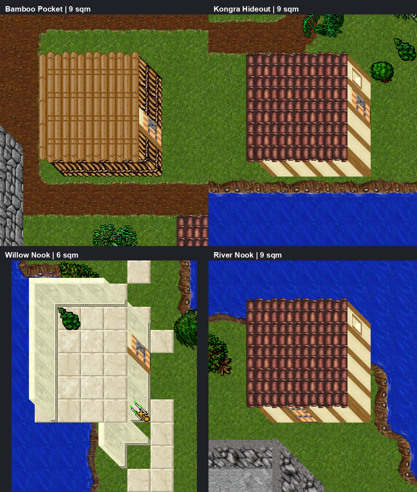

# Casitas curiosas comprables — 20 nov 2026

Cuatro viviendas pequeñas pedidas por Gonzalo: dos en los Kongras, una en las
Ruinas del Sauce y otra junto al río. Son **casas comprables**, con puerta principal,
registro en `houses.xml`, plantilla sin dueño y PZ. Sin muebles movibles de regalo;
el comprador puede decorarlas. No requieren assets nuevos ni C++.



| Casa | Ubicación (z7) | Puerta | Interior | Precio base* |
|---|---|---|---:|---:|
| Bamboo Pocket | `178–182,100–104`, dentro del camino del claro de Kongras | `182,103` (este) | 3×3 = 9 sqm | 9000 gp |
| Kongra Hideout | `184–188,107–111`, junto a la orilla del claro | `188,109` (este) | 3×3 = 9 sqm | 9000 gp |
| Willow Nook | `91–94,57–61`, costado oeste del sendero élfico | `94,59` (este) | 2×3 = 6 sqm | 6000 gp |
| River Nook | `167–171,71–75`, rincón de la ribera al oeste del puente | `169,75` (sur) | 3×3 = 9 sqm | 9000 gp |

*Con el valor predeterminado de 1000 gp por casilla. El motor aplica
`housepricepertile`; exige nivel 8 por defecto y una sola casa por personaje.
Para comprar: mirar la puerta desde la casilla exterior y usar `!buyhouse`.
Las paredes interiores con gancho se asocian automáticamente a la casa y permiten
colgar decoración; no aumentan el precio. Ver [HOUSES.md](../gameplay/HOUSES.md).

## Diseño y medidas

- Bamboo Pocket: bambú, cubierta de tablones y entrada visible al este.
- Kongra Hideout: entramado blanco/madera, ventana y tejas, pegada al lago.
- Willow Nook: mármol claro y pequeño jardín sobre la cubierta plana. El sendero
  público sigue por el este: la casa no cierra el paso hacia los arcanistas.
- River Nook: entramado y tejas, con ventana al río. Se desplazó una casilla al
  este porque la primera ubicación aislaba una casilla de la ribera.

Solo **209 tiles** cambian: 95 de planta y 114 de techo. Se añaden 33 casillas de
casa y cuatro umbrales PZ; los 22 registros de casas anteriores quedan idénticos
(26 casas en el registro tras el cambio). No se modifica ningún XML de dueño
preexistente, `houseitems.xml`, spawns, NPCs, escaleras, cofres ni lockers.

## Archivos y aplicación

- `scripts/map/curious-houses.py`: modelos, guardas y aplicación idempotente.
- `data/world/test.otbm`, `data/world/generated-curious-houses.json`.
- `data/houses.xml` y cuatro **plantillas nuevas sin dueño** en `data/houses/`.
- `generate-elf-west.py` respeta la planta y el techo de estas casas al regenerar
  las ruinas; el recorrido público conserva 97 casillas transitables.

```sh
python3 scripts/map/curious-houses.py --dry-run
python3 scripts/map/curious-houses.py
```

El script respalda mapa/registro en `backups/map/curious-houses-FECHA/`, rechaza
casas existentes con dueño, datos atribuidos, spawns/NPCs pisados, techos ocupados,
entradas bloqueadas y cortes en los pasos públicos. Nunca se debe ejecutarlo para
reubicar una casa comprada; `data/houses/*.xml` en la ThinkPad es runtime.

## Cubiertas y comprobaciones

Las cubiertas se revisan con `Renderer.client_view(..., z=7)`, que superpone z6
corrido una casilla arriba/izquierda. Las imágenes `*-inside.png` son cortes sin
techo; `*-roof.png` muestran el exterior. No son capturas in-game.

No sumar 10 a todos los IDs de un tejado para cambiar de material: las familias
925/935/945 no comparten exactamente los remates. Se usan tejas 935/936/938 y
940/941/943; madera 945/947/949 y 950/951/954, vistos con los sprites reales.

Guardas del generador: OK; segunda pasada, **0 cambios**. Regenerador élfico en
`--dry-run`: 0 cambios. `sync-houses-with-map.py --dry-run`: coincide. Auditoría:
37 tiles PZ, pasos públicos conservados y 11 lockers completos/ítems atribuidos
idénticos. Sin suites, arranque ni compra in-game por pedido del usuario.
**Preparado en el repo; pendiente de deploy y compra real.**
