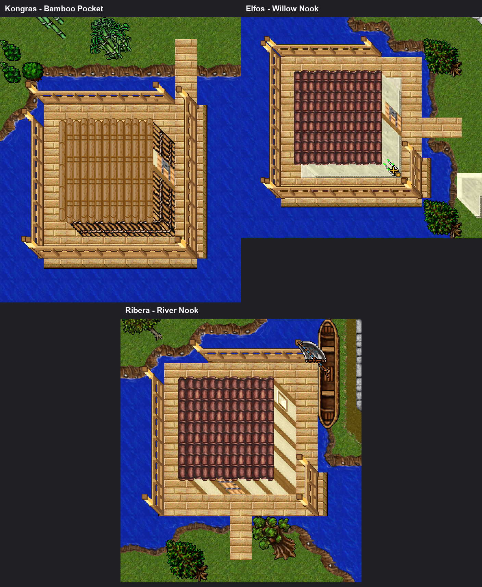

# Casas flotantes comprables — 20 nov 2026

**Una casa por zona**, todas sobre plataformas en el agua: Kongras, ruinas
élficas y río. Sustituye la propuesta anterior de cuatro viviendas sobre tierra.
No ocupa caminos ni espacios de caza existentes. Siguen siendo comprables,
con puerta principal, plantilla sin dueño y PZ; sin C++ ni sprites nuevos.



| Casa / zona | Planta (z7) | Puerta | Desembarco en tierra | Interior |
|---|---|---|---|---:|
| Bamboo Pocket / Kongras | `179–183,115–119` | `183,117`, este | `184,111` | 3×3 = 9 sqm |
| Willow Nook / elfos | `85–89,57–61` | `89,59`, este | `92,59` | 3×3 = 9 sqm |
| River Nook / ribera | `165–169,65–69` | `167,69`, sur | `167,72` | 3×3 = 9 sqm |

Cada casa tiene una plataforma de **7×7**, originalmente toda de agua, y una
pasarela pública corta. El interior privado son 9 sqm: **9000 gp** con el valor
predeterminado de 1000 gp por casilla. El motor aplica `housepricepertile`,
nivel mínimo 8 por defecto y una sola casa por personaje. Comprar con `!buyhouse`
mirando la puerta desde el exterior. Los muelles públicos no se cobran al dueño.

## Cambios respecto de la primera propuesta

- Se restauraron las plantas sobre tierra y se retiraron sus **114 tiles de
  techo**. Se conservan todos los pasos públicos y las casillas de caza originales.
- Kongras queda con **una sola casa**, Bamboo Pocket. Kongra Hideout sale del
  registro; su plantilla vacía se conserva como archivo inactivo, sin borrar nada.
- La élfica se rehízo como casa completa: 3×3, muros de mármol unidos, cubierta
  de tejas y puerta visible. El árbol que tapaba su pasarela pasó de `92,60` a
  `92,64`, ambos en costa bloqueada. La vista desde su plataforma no muestra lava.
- Las plataformas tienen canto de madera y las barandas/faroles ya publicados
  del muelle (`20283` y familia), dejando libres las entradas de las pasarelas.

El registro conserva los 22 nombres anteriores y suma **tres** activos (25 en
total). Son 27 casillas interiores y tres umbrales PZ. No se cambian spawns,
NPCs, escaleras, cofres, lockers ni XML de dueños anteriores.

## Archivos y regeneración

- `scripts/map/curious-houses.py`: plantas, plataformas, pasarelas, guardas y registro.
- `data/world/test.otbm`, `data/world/generated-curious-houses.json` (versión 2).
- `data/houses.xml` y las tres plantillas activas en `data/houses/`.
- `generate-elf-west.py` reserva casas y pasarelas y cuenta como agua lo que hay
  bajo los muelles al elegir las piezas de costa; no deshace las orillas.

```sh
python3 scripts/map/curious-houses.py --dry-run
python3 scripts/map/curious-houses.py
```

El cambio de ubicación se hizo **antes del deploy**: la ThinkPad seguía en
`f7cc8e9` y ninguno de los cuatro nombres anteriores existía allí. Respaldo
local: `backups/map/floating-houses-before/`. Se restauraron solo los 209 tiles
de la propuesta anterior, desde ese mismo mapa base, y luego se aplicó el diseño
flotante. No hay pérdida de contenido ni cambios en data runtime.

El generador respalda mapa/registro, rechaza dueños existentes, datos atribuidos,
techos ocupados y entidades pisadas. Exige plataforma enteramente sobre agua,
acceso conectado a tierra, interior transitable con la puerta abierta, vista
sin lava y **ninguna casilla pública anterior bloqueada**.

## Revisión

Respecto del mapa sin casas: **337 tiles**, 247 en z7 y 90 de techo en z6.
La revisión cotejó las 147 casillas de plataformas con el agua original; todos
los pasos públicos anteriores, las 22 casas, los 11 lockers completos, los
objetos atribuidos y el XML de spawns quedan conservados. 30 tiles PZ nuevos.
Generador de casas y regenerador élfico: segunda pasada **0 cambios**;
`sync-houses-with-map.py --dry-run`: coincide. Los renders superponen z6 corrido
como el cliente. Sin suites, arranque ni compra in-game por pedido del usuario.
**Preparado y aplicado en el repo; pendiente de deploy y compra real.**
