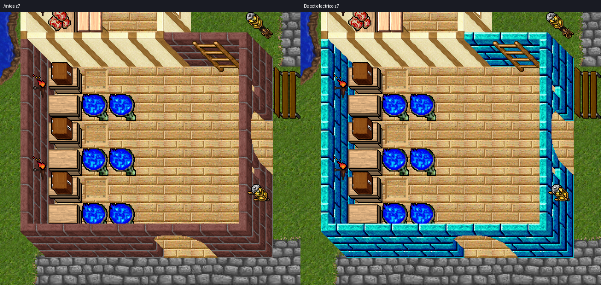
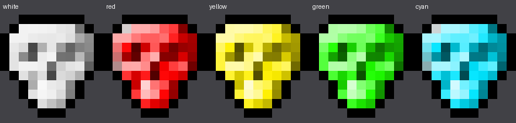
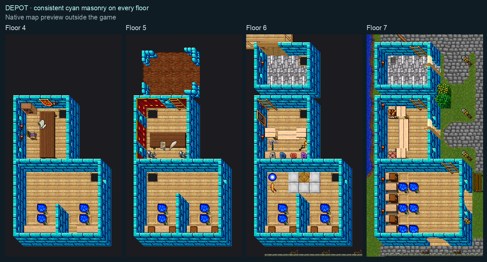

# Depot eléctrico y calavera cian — 19 nov 2026

Estado: **publicado y desplegado el 19 nov 2026**, con autorización de Gonzalo. Mapa/OTB: `51ca529`; calavera del cliente: `31b718c`; sprites publicados en `clienteretro` `81435b3`. Corrección del dibujo de la calavera: cliente `33a1201`, fuente `07ea90d`.
No requiere recompilar C++. Se probó el mapa nuevo con el binario actual en una instancia aislada.

## Aspecto y alcance

Ladrillos cian/turquesa, caras sombreadas en azul cobalto, juntas azul marino y bordes claros.
Once piezas propias cubren los paños, esquinas, remates de entrada y ventana existentes.




Se sustituyeron **104 piezas en 104 tiles** del ala de lockers:
**x126–134, y52–59, z4–z7**. Los otros edificios siguen usando las paredes originales.
En la versión inicial el ala norte conservó su entramado; la revisión del 22 nov
completa esa parte y el vestíbulo norte (ver al final). La sustitución conserva el orden de los items,
los flags de tile, puertas, escaleras, pisos, mostradores, braseros azules, NPCs y lockers.

**Los 11 lockers conservan su posición y `depotid=1`.** No se edita data de jugadores del servidor.

## Piezas nuevas

| Server ID | Prototipo | Client ID reutilizado | Cantidad aplicada |
|---:|---:|---:|---:|
| 20200 | 1028 | 3452 | 14 |
| 20201 | 1030 | 3451 | 39 |
| 20202 | 1032 | 3408 | 14 |
| 20203 | 1033 | 3406 | 1 |
| 20204 | 1034 | 3405 | 21 |
| 20205 | 1035 | 3404 | 6 |
| 20206 | 1205 | 3402 | 1 |
| 20207 | 1206 | 3401 | 1 |
| 20208 | 1207 | 3399 | 1 |
| 20209 | 1208 | 3398 | 1 |
| 20210 | 1266 (ventana) | 3397 | 5 |

Rango reservado para esta familia: **20200–20210**. Los client IDs se eligieron de la lista de candidatos
seguros de `add_custom_items.py` antes de declarar la familia (sin usos en mapa, loot, scripts, acciones
ni destinos de transformaciones). Se reutilizan slots por la restricción del cliente 7.6; no se cambia
`item_count` del DAT.

Cada pieza es un PNG **64×64**, dividido en cuatro sprites 32×32. Copia exactamente el prefijo DAT y
los atributos OTB del prototipo: capa, bloqueo, soporte de colgables, tamaño y minimapa. La ventana
conserva su transparencia y permite proyectiles igual que antes. Los remates de puerta mantienen su
capa superior. Se añadieron 44 sprites; los **13.842 sprites previos quedaron byte por byte iguales**.
Solo cambian las once apariencias correspondientes a los slots reutilizados; el resto del DAT y su cola
(outfits, efectos y proyectiles) permanecen iguales.

## Calavera cian

> **19 nov 2026, más tarde:** la cian se reemplazó por la **calavera negra** nativa porque no se distinguía de la
> blanca. Ver [PINK_SKULL.md](../gameplay/PINK_SKULL.md#calavera-negra-19-nov-2026-reemplaza-a-la-cian). Lo de abajo queda como historia.



**Corrección visual:** la versión frontal generada difería del resto. La final recolorea
`skull_red.png` nativa: conserva píxel por píxel la silueta, ojos, contorno negro, grises
y alpha. El rojo puro pasa a **#00E5FF** y sus tonos conservan el sombreado original.

Se aplica al estado punitivo existente, **ID 7** (`SkullPink` / `SKULL_PINK`): nuevo
`data/images/game/skulls/skull_cyan.png`, 11×11 RGBA con alpha 0/255, y mapeo desde
`modules/gamelib/creature.lua`, idénticos en Mac y Windows. El nombre técnico y los comandos `/pink`
y `/unpink`, la persistencia y el drop total al morir conservan su funcionamiento.
El PNG rosa anterior se conserva para compatibilidad; el cliente actualizado dibuja el cian.

## Fuentes del arte y reproducción

Las paredes se crearon con la herramienta **ImageGen integrada** (`image_gen.imagegen`), usando las
piezas del cliente como referencia de geometría. La calavera final es un recolor de la roja nativa.
Las fuentes y los prompts se guardan en `devtools/zagan-test/custom-sprites/depot-electric/`:

- `prompts.json`: prompts completos y herramienta.
- `walls-template.png`: atlas original, 4 columnas × 3 filas; última celda vacía.
- `walls-generated.png`: atlas de paredes de ImageGen.
- `skull-generated.png`: primera calavera generada, histórica; ya no se usa para exportar.
- `skull-template-red.png`: calavera roja nativa, fuente de la versión final.
- `wall-<prototipo>.png`: once piezas finales 64×64.
- `skull_cyan.png`: export final 11×11.

`depot_electric_assets.py --prepare` adapta el tamaño con nearest-neighbor y recorta cada pieza con
la **máscara original exacta**: elimina halos externos y asegura uniones, huecos y transparencias.
La calavera usa `recolor_cyan_skull.py`: `(r,g,b)` → `(g, g+round((r-g)*229/255), r)`
en píxeles opacos; los transparentes quedan intactos. No redibuja ni escala el dibujo.
`--prepare` también usa esta plantilla para evitar restaurar la versión frontal descartada.

```sh
python3.11 scripts/client-rme/recolor_cyan_skull.py --client RUTA_CLIENTERETRO
python3.11 scripts/client-rme/depot_electric_assets.py --prepare
python3.11 scripts/client-rme/depot_electric_assets.py --dry-run
python3.11 scripts/client-rme/depot_electric_assets.py
python3 scripts/map/electric-depot-walls.py       # dry-run
python3 scripts/map/electric-depot-walls.py --apply
```

El importador usa las funciones canónicas de `add_custom_items.py` **solo para esta familia**: no necesita
los PNG antiguos del pack Zagan. Ambos scripts son idempotentes. Los archivos de arte están en una
carpeta ignorada; se agregan explícitamente al commit como los otros custom sprites del proyecto.

## Validaciones realizadas

- `check-map-load.py`: **0 errores**.
- `sync-houses-with-map.py --dry-run`: casas coinciden con el mapa.
- `scan-map-depots.py` antes/después: **11 lockers, todos depotid 1; 0 diferencias**.
- `electric-depot-walls.py --before <mapa-anterior>`: invertir únicamente los 104 IDs sustituidos
  recupera el mapa anterior byte por byte. No hay piezas nuevas fuera de la caja permitida.
- Importador repetido: todas las piezas ya instaladas, sin cambios.
- DAT: once entradas modificadas, resto y cola intactos; SPR: todos los registros antiguos intactos.
- Las once máscaras y flags coinciden con los prototipos; imágenes y Lua iguales en Mac/Windows.
  Los once IDs antiguos de los slots reutilizados tampoco aparecen en los XML de jugadores de la
  ThinkPad (consulta de solo lectura; ningún archivo runtime editado).
- Render de comparación de los cuatro pisos en `img/depot-electric/before-after-z4.png` a `z7.png`.

### Prueba con cliente real y objetos guardados

Instancia **aislada** en la ThinkPad, puerto **7278**, contenedor `yurots-electric-depot-qa`, con copia de
los datos y el binario actual; ninguna modificación del OT de juego. Datos en
`~/build/electric-depot-qa-20261119/`, personajes sintéticos de `make-test-bots.py`.
El fixture inicial necesitó `queue.xml` vacío y copias de los XML de casas para completar el boot.

Bot Knight tiene la marca punitiva 7, aparece en `129,57,6` y tiene siete crystal coins guardadas en `<depot depotid="1">`.
El **OTClient Mac distribuido**, con perfil de QA exclusivo y assets nuevos, abre el locker real
`129,58,6` y comprueba el contenido recibido:

```text
SKULL_QA_PASS: estado 7 recibido; textura cian cargada por el cliente real
DEPOT_QA_PASS: locker 129,58,6: se ven las 7 crystal coins guardadas en depotid=1
```

El script de cliente es `scripts/ot/test-electric-depot-client.lua`; se ejecuta en una copia de QA,
como `depot_qa.lua`, después de cargar módulos. Usa solo las credenciales sintéticas y el puerto 7278.
El probe del servidor aislado dio **OK**. No se ejecutaron los smoke tests desactivados.

## Publicación y deploy

1. Publicar primero el cliente con el PNG/mapeo cian y los DAT/SPR nuevos en ambas plataformas.
2. Llevar **mapa y OTB juntos** al servidor siguiendo `THINKPAD_TEST_SERVER.md`, con autorización,
   respaldo runtime y reinicio ordenado. No necesita rebuild de C++.
3. Probe y nueva prueba del locker después del deploy. Quien tenga el cliente abierto debe cerrarlo
   y abrirlo para recibir las apariencias nuevas.

La prueba aislada permite revisar el cambio antes de reiniciar el servidor de juego.

### Resultado del deploy (19 nov 2026)

Se integró el Dragon Spot v2 ya desplegado (`f3760a8`): al reaplicar las 104 sustituciones sobre ese
mapa, la inversión recupera exactamente esa versión reciente. El cambio sigue limitado al depot.
Se repitió la prueba con el cliente real contra el mapa final en 7278: calavera cian y monedas del
locker, ambos OK.

Respaldo completo: `~/backups/pre-deploy-20261119-120309-electric-depot` (runtime, mapa, OTB,
cliente anterior, updater y ZIPs). Los ff-merges no se cruzaron con cambios de otras sesiones.
El cliente publicó 5 archivos, 0 borrados: PNG cian, `const.lua`, `creature.lua`, DAT y SPR.
Los dos ZIPs contienen los mismos 774 archivos verificados; manifest y descargas HTTP OK en 8080/8076.

Tras `docker restart -t 45 yurots`: graceful shutdown completo, mapa cargado en 0.967 s, servidor
healthy y probe OK. Se preservaron 1 cuenta, 8 personajes y 31 casas; dueños, contenido de depots,
config y binario coinciden con el snapshot previo. No hubo rebuild de C++.

El banco de NPCs pasó 16 casos y detectó un golden antiguo de `boat` (1903 líneas de diferencia):
se reprodujo exactamente en un checkout temporal de `origin/main` anterior a este cambio.
No se cambiaron NPCs ni se regrabó el golden. La revisión visual manual en Windows y abrir un
locker en la sesión de juego habitual quedan como comprobación del jugador; la prueba con objetos
guardados se hizo con el cliente real en el servidor aislado.

### Corrección de la calavera nativa (19 nov 2026)

Publicado cliente `33a1201`, fuente/reproducción `07ea90d`. PNG 11×11 recoloreado de la roja
original, sin alterar máscara, contorno, ojos ni grises; paridad de los 774 archivos Mac/Windows
comprobada. `publish_client.py --no-sync`: **1 archivo cambiado, 0 borrados**, solo
`data/images/game/skulls/skull_cyan.png` (CRC `5a3c1cc5`). ZIPs cotejados contra la fuente;
manifest, PNG y descargas HTTP OK en 8080/8076. Dry-run posterior: 0 cambios.

Respaldo: `~/backups/pre-publish-20261119-121809-native-cyan-skull` (updater, ZIPs, PNGs previos,
config hash y diff de trabajo). Se preservaron los cambios ajenos de la ThinkPad. Publicación de
cliente sin reinicio del OT; probe OK, healthy. La nueva imagen llega al reabrir el cliente.
La comparación ampliada del apartado «Calavera cian» muestra las originales junto a la corregida.

## Unificación del edificio completo — 22 nov 2026

Publicado y desplegado el 22 nov 2026, con autorización de Gonzalo. Servidor `4996acc`; cliente `c810e0c`.
La primera intervención cubría solo lockers (y52–59). El ala norte y el vestíbulo
seguían en entramado beige y piedra gris. Ahora se aplica la misma mampostería cian
al edificio completo **x126–134, y41–59, z4–z7**, sin tocar el edificio vecino de
piedra al oeste (x124), ni extender la estética fuera del depot.



Se sustituyen **125 paredes/ventanas/remates adicionales** (229 piezas en total). Se
conservan el trazado, pisos, puertas, escaleras, mostradores, colgables y los
11 lockers completos. Ventanas conservan paso de proyectiles y paredes conservan
sus hooks horizontal/vertical. No se edita runtime de jugadores ni C++.

| Server ID | Prototipo original | Apariencia cian de ladrillo | Client ID | Uso |
|---:|---:|---:|---:|---:|
| 20420 | 1037 | 1034 | 5127 | 9 |
| 20421 | 1038 | 1027 (poste nuevo) | 5128 | 4 |
| 20422 | 1039 | 1034 | 5129 | 15 |
| 20423 | 1041 | 1030 | 5130 | 23 |
| 20424 | 1043 | 1030 | 5131 | 14 |
| 20425 | 1044 | 1033 | 5132 | 4 |
| 20426 | 1045 | 1034 | 5133 | 11 |
| 20427 | 1049 | 1030 | 5134 | 11 |
| 20428 | 1050 | 1034 | 5135 | 16 |
| 20429 | 1051 | 1027 (poste nuevo) | 5136 | 2 |
| 20430 | 1053 | 1033 | 5137 | 2 |
| 20431 | 1263 | 1265 (ventana horizontal nueva) | 5138 | 1 |
| 20432 | 1264 | 1266 | 5139 | 6 |
| 20433 | 1268 | 1266 | 5140 | 2 |
| 20434 | 1524 | remate nativo recoloreado | 5141 | 1 |
| 20435 | 1526 | remate nativo recoloreado | 5142 | 1 |
| 20436 | 1527 | remate nativo recoloreado | 5143 | 1 |
| 20437 | 1530 | remate nativo recoloreado | 5144 | 1 |
| 20438 | 1531 | remate nativo recoloreado | 5145 | 1 |

Cada variante copia exactamente los atributos OTB y el prefijo DAT de su prototipo
original; solo cambia el dibujo. 1049, 1050 y 1268 tienen **8 sprites (dos patrones)**,
no cuatro: se repite la textura cian en ambos patrones conservando su estructura.
Los remates 1524 y 1526 son 2×1/1×2 con dos patrones, y 1527 es 2×2 con dos patrones.
Se conservan también las cinco barandas de azotea, ahora cian, sin cerrar huecos
ni cambiar su colisión/paso de proyectiles. Se añaden 92 sprites (15161–15252), sin
alterar ningún registro previo, outfits, efectos ni proyectiles.

El poste y la ventana horizontal se completaron con **image_gen.imagegen** sobre
el atlas nativo y referencias de las paredes cian existentes. Arte, prompt exacto
y referencia en `devtools/zagan-test/custom-sprites/depot-electric/`:
`walls-completion-generated.png`, `walls-completion-reference.png`,
`completion-prompts.json`, `wall-1027.png`, `wall-1265.png` y los tres
`wall-*-patterns2.png`. Exportación con máscara nativa exacta y sin halos; las
once piezas originales permanecen intactas. Los remates usan `roof-completion-generated.png`,
`roof-completion-reference.png` y cinco `roof-<id>.png`, con el prompt exacto en
`completion-prompts.json`. Las otras variantes reutilizan sus
PNG existentes sin redibujarlas.

```bash
python3.11 scripts/client-rme/depot_electric_assets.py --prepare-completion
python3.11 scripts/client-rme/depot_electric_assets.py --complete-only
python3.11 scripts/client-rme/depot_electric_assets.py --complete-only --otb server/YurOTS/ots/data/items/items.otb
python3.11 scripts/map/electric-depot-walls.py --apply
python3.11 scripts/map/render-electric-depot.py
```

Validaciones: inversión byte por byte de las 125 sustituciones, todas dentro de la
caja; colisión, hooks, ventanas y 11 lockers intactos. DAT: solo 19 entradas nuevas,
todos los registros SPR/OTB anteriores y la cola DAT idénticos. Segunda pasada del
mapa: 0 cambios; `check-map-load.py`: 0 errores; `scan-map-depots.py`: 11 depotid 1;
`sync-houses-with-map.py --dry-run`: coincide. Renders de los cuatro pisos y vista
con piso superior revisados; no se ejecutaron suites ni pruebas in-game, según la
preferencia del usuario. Backup local `backups/map/depot-unify/`.

Los recursos se publicaron con `publish_client.py` antes de reiniciar la ThinkPad,
siguiendo el flujo de respaldo y reinicio del servidor.

### Resultado de la unificación — 22 nov 2026

- Servidor **`4996acc`**, assets **`6433f59`**; cliente **`c810e0c`**, todos en main.
- Respaldo completo `~/backups/pre-deploy-20261122-202609-depot-unify`, renovado
  tras `server-save.sh --now` antes del reinicio. Incluye runtime, configuración,
  binario, mapa, ambos OTB y assets de ambas plataformas.
- ff-merge sin solapamientos con cambios ajenos. La documentación sin commitear de
  otra sesión (`THINKPAD_TEST_SERVER.md`, puertos de qBittorrent) quedó idéntica;
  por eso el registro de este deploy se guarda aquí, sin modificar aquel archivo.
- Cliente publicado primero: **775 archivos** iguales en Mac/Windows, updater y
  ambos ZIPs (`data.zip` incluido). HTTP 8080 y 8076 verificados. Solo cambiaron
  DAT y SPR: CRC **`88b99039`** / **`f9023b7e`**. Minimapa sin cambios (`8e64ceb5`).
- `docker restart -t 45 yurots`: graceful shutdown completo, mapa cargado en
  **1.052 s**, `Retro76 Server Running`, healthy y **0 reinicios automáticos**.
  Logs sin errores ni warnings desde el arranque; probe LAN **OK, 10,6 ms**.
- Snapshots idénticos después del reinicio: **1 cuenta, 8 archivos de personajes**,
  inventarios, depots, **35 archivos de casas**, permisos, houseitems, sponsors,
  configuración y binario. Hashes del mapa, OTB y assets coinciden con el commit.
- `scan-map-depots.py`: **11 lockers, depotid 1**; casas coinciden con el mapa.
  Sin C++ nuevo, suites, bots ni recorrido in-game por preferencia del usuario.

Las apariencias nuevas llegan al abrir el cliente o pulsar Login. La revisión
visual en la sesión habitual queda a cargo del jugador.
