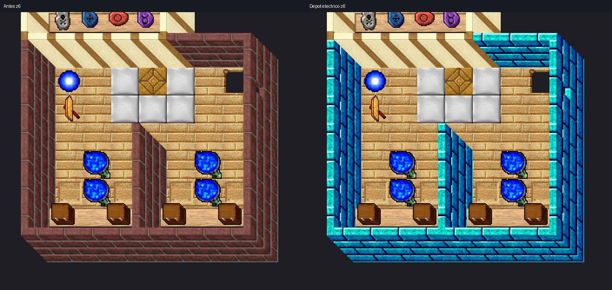

# Depot eléctrico y calavera cian — 19 nov 2026

Estado: **publicado y desplegado el 19 nov 2026**, con autorización de Gonzalo. Mapa/OTB: `51ca529`; calavera del cliente: `31b718c`.
No requiere recompilar C++. Se probó el mapa nuevo con el binario actual en una instancia aislada.

## Aspecto y alcance

Ladrillos cian/turquesa, caras sombreadas en azul cobalto, juntas azul marino y bordes claros.
Once piezas propias cubren los paños, esquinas, remates de entrada y ventana existentes.




Se sustituyeron **104 piezas en 104 tiles** del ala de lockers:
**x126–134, y52–59, z4–z7**. Los otros edificios siguen usando las paredes originales.
El ala norte de entramado conserva su aspecto. La sustitución conserva el orden de los items,
los flags de tile, puertas, escaleras, pisos, mostradores, braseros azules, NPCs y lockers.

**Los 11 lockers conservan su posición y `depotid=1`.** No se edita data de jugadores del servidor.

## Piezas nuevas

| Server ID | Prototipo | Client ID reutilizado | Cantidad aplicada |
|---:|---:|---:|---:|
| 20200 | 1028 | 3452 | 14 |
| 20201 | 1030 | 3451 | 39 |
| 20202 | 1032 | 3408 | 14 |
| 20203 | 1033 | 3406 | 1 |
| 20204 | 1034 | 3405 | 21 |
| 20205 | 1035 | 3404 | 6 |
| 20206 | 1205 | 3402 | 1 |
| 20207 | 1206 | 3401 | 1 |
| 20208 | 1207 | 3399 | 1 |
| 20209 | 1208 | 3398 | 1 |
| 20210 | 1266 (ventana) | 3397 | 5 |

Rango reservado para esta familia: **20200–20210**. Los client IDs se eligieron de la lista de candidatos
seguros de `add_custom_items.py` antes de declarar la familia (sin usos en mapa, loot, scripts, acciones
ni destinos de transformaciones). Se reutilizan slots por la restricción del cliente 7.6; no se cambia
`item_count` del DAT.

Cada pieza es un PNG **64×64**, dividido en cuatro sprites 32×32. Copia exactamente el prefijo DAT y
los atributos OTB del prototipo: capa, bloqueo, soporte de colgables, tamaño y minimapa. La ventana
conserva su transparencia y permite proyectiles igual que antes. Los remates de puerta mantienen su
capa superior. Se añadieron 44 sprites; los **13.842 sprites previos quedaron byte por byte iguales**.
Solo cambian las once apariencias correspondientes a los slots reutilizados; el resto del DAT y su cola
(outfits, efectos y proyectiles) permanecen iguales.

## Calavera cian


Se aplica al estado punitivo existente, **ID 7** (`SkullPink` / `SKULL_PINK`): nuevo
`data/images/game/skulls/skull_cyan.png`, 11×11 RGBA con alpha 0/255, y mapeo desde
`modules/gamelib/creature.lua`, idénticos en Mac y Windows. El nombre técnico y los comandos `/pink`
y `/unpink`, la persistencia y el drop total al morir conservan su funcionamiento.
El PNG rosa anterior se conserva para compatibilidad; el cliente actualizado dibuja el cian.

## Fuentes del arte y reproducción

Arte creado con la herramienta **ImageGen integrada** (`image_gen.imagegen`), usando las piezas del
cliente como referencia de geometría para las paredes. Los prompts exactos y ambos originales generados
se guardan en `devtools/zagan-test/custom-sprites/depot-electric/`:

- `prompts.json`: prompts completos y herramienta.
- `walls-template.png`: atlas original, 4 columnas × 3 filas; última celda vacía.
- `walls-generated.png` y `skull-generated.png`: salidas originales de ImageGen.
- `wall-<prototipo>.png`: once piezas finales 64×64.
- `skull_cyan.png`: export final 11×11.

`depot_electric_assets.py --prepare` adapta el tamaño con nearest-neighbor y recorta cada pieza con
la **máscara original exacta**: elimina halos externos y asegura uniones, huecos y transparencias.
La exportación de la calavera recorta el alpha y lo normaliza a 0/255, sin semitransparencias.

```sh
python3.11 scripts/client-rme/depot_electric_assets.py --prepare
python3.11 scripts/client-rme/depot_electric_assets.py --dry-run
python3.11 scripts/client-rme/depot_electric_assets.py
python3 scripts/map/electric-depot-walls.py       # dry-run
python3 scripts/map/electric-depot-walls.py --apply
```

El importador usa las funciones canónicas de `add_custom_items.py` **solo para esta familia**: no necesita
los PNG antiguos del pack Zagan. Ambos scripts son idempotentes. Los archivos de arte están en una
carpeta ignorada; se agregan explícitamente al commit como los otros custom sprites del proyecto.

## Validaciones realizadas

- `check-map-load.py`: **0 errores**.
- `sync-houses-with-map.py --dry-run`: casas coinciden con el mapa.
- `scan-map-depots.py` antes/después: **11 lockers, todos depotid 1; 0 diferencias**.
- `electric-depot-walls.py --before <mapa-anterior>`: invertir únicamente los 104 IDs sustituidos
  recupera el mapa anterior byte por byte. No hay piezas nuevas fuera de la caja permitida.
- Importador repetido: todas las piezas ya instaladas, sin cambios.
- DAT: once entradas modificadas, resto y cola intactos; SPR: todos los registros antiguos intactos.
- Las once máscaras y flags coinciden con los prototipos; imágenes y Lua iguales en Mac/Windows.
  Los once IDs antiguos de los slots reutilizados tampoco aparecen en los XML de jugadores de la
  ThinkPad (consulta de solo lectura; ningún archivo runtime editado).
- Render de comparación de los cuatro pisos en `img/depot-electric/before-after-z4.png` a `z7.png`.

### Prueba con cliente real y objetos guardados

Instancia **aislada** en la ThinkPad, puerto **7278**, contenedor `yurots-electric-depot-qa`, con copia de
los datos y el binario actual; ninguna modificación del OT de juego. Datos en
`~/build/electric-depot-qa-20261119/`, personajes sintéticos de `make-test-bots.py`.
El fixture inicial necesitó `queue.xml` vacío y copias de los XML de casas para completar el boot.

Bot Knight tiene la marca punitiva 7, aparece en `129,57,6` y tiene siete crystal coins guardadas en `<depot depotid="1">`.
El **OTClient Mac distribuido**, con perfil de QA exclusivo y assets nuevos, abre el locker real
`129,58,6` y comprueba el contenido recibido:

```text
SKULL_QA_PASS: estado 7 recibido; textura cian cargada por el cliente real
DEPOT_QA_PASS: locker 129,58,6: se ven las 7 crystal coins guardadas en depotid=1
```

El script de cliente es `scripts/ot/test-electric-depot-client.lua`; se ejecuta en una copia de QA,
como `depot_qa.lua`, después de cargar módulos. Usa solo las credenciales sintéticas y el puerto 7278.
El probe del servidor aislado dio **OK**. No se ejecutaron los smoke tests desactivados.

## Publicación y deploy

1. Publicar primero el cliente con el PNG/mapeo cian y los DAT/SPR nuevos en ambas plataformas.
2. Llevar **mapa y OTB juntos** al servidor siguiendo `THINKPAD_TEST_SERVER.md`, con autorización,
   respaldo runtime y reinicio ordenado. No necesita rebuild de C++.
3. Probe y nueva prueba del locker después del deploy. Quien tenga el cliente abierto debe cerrarlo
   y abrirlo para recibir las apariencias nuevas.

La prueba aislada permite revisar el cambio antes de reiniciar el servidor de juego.

### Resultado del deploy (19 nov 2026)

Se integró el Dragon Spot v2 ya desplegado (`f3760a8`): al reaplicar las 104 sustituciones sobre ese
mapa, la inversión recupera exactamente esa versión reciente. El cambio sigue limitado al depot.
Se repitió la prueba con el cliente real contra el mapa final en 7278: calavera cian y monedas del
locker, ambos OK.

Respaldo completo: `~/backups/pre-deploy-20261119-120309-electric-depot` (runtime, mapa, OTB,
cliente anterior, updater y ZIPs). Los ff-merges no se cruzaron con cambios de otras sesiones.
El cliente publicó 5 archivos, 0 borrados: PNG cian, `const.lua`, `creature.lua`, DAT y SPR.
Los dos ZIPs contienen los mismos 774 archivos verificados; manifest y descargas HTTP OK en 8080/8076.

Tras `docker restart -t 45 yurots`: graceful shutdown completo, mapa cargado en 0.967 s, servidor
healthy y probe OK. Se preservaron 1 cuenta, 8 personajes y 31 casas; dueños, contenido de depots,
config y binario coinciden con el snapshot previo. No hubo rebuild de C++.

El banco de NPCs pasó 16 casos y detectó un golden antiguo de `boat` (1903 líneas de diferencia):
se reprodujo exactamente en un checkout temporal de `origin/main` anterior a este cambio.
No se cambiaron NPCs ni se regrabó el golden. La revisión visual manual en Windows y abrir un
locker en la sesión de juego habitual quedan como comprobación del jugador; la prueba con objetos
guardados se hizo con el cliente real en el servidor aislado.
