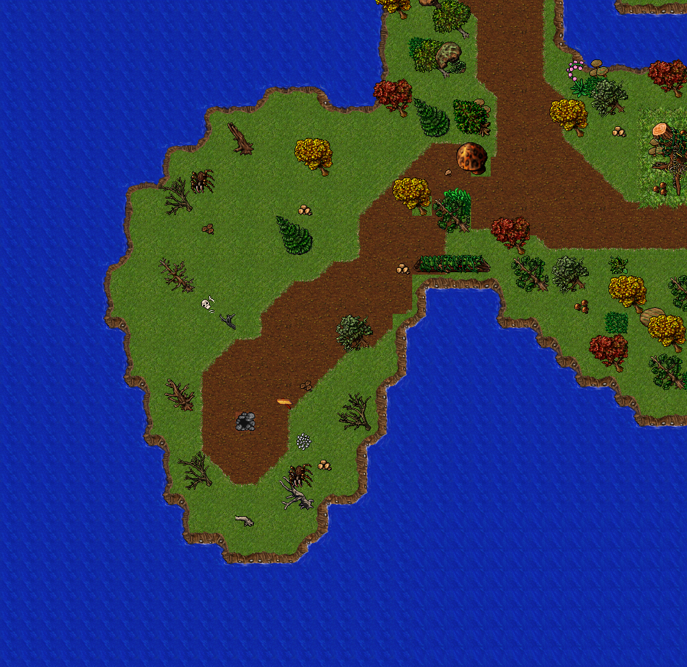
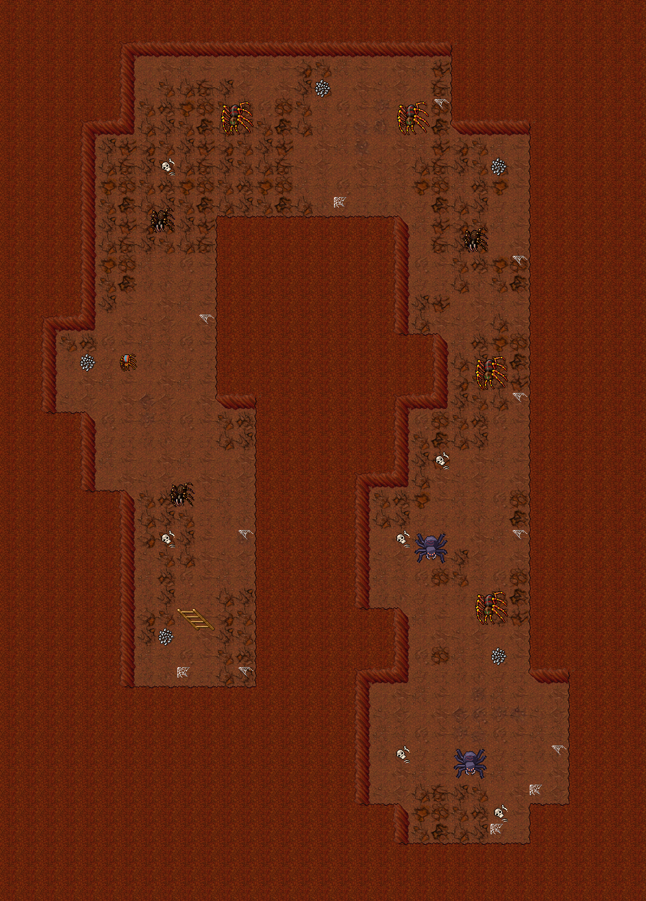

# Duskweb Hollow

En la costa oeste, desde `25,128,7`, seguir el sendero de tierra hacia el
sudoeste hasta la entrada en `17,136,7`. El camino nace en el sendero viejo,
cruza la península nueva y termina junto al cartel. El barco y las demás
entradas de la costa conservan sus accesos.

La península suma 296 casillas de terreno: orillas perfiladas, bosque de
árboles secos y dos Tarantulas. El mar se prolonga hacia el límite oeste del
mapa para cubrir el vacío negro visible desde la orilla.



## Cueva

La bajada de tierra en `17,136,7` llega a `17,136,8`. La escalera de mano
devuelve a `17,137,7`, sobre el sendero. Hay 532 casillas caminables en z8.
El pasaje primero va al norte, dobla al este y vuelve hacia el sur, con
paredes de tierra, telarañas y huesos. La progresión va de Tarantulas y una
Poison Spider a cuatro Giant Spiders y dos Dark Spiders. Se recomienda
nivel 65+ para el fondo. Las Dark Spiders aparecen en `29,132,8` y
`31,143,8` cada 235 y 255 segundos configurados, respectivamente.



```sh
python3.11 scripts/map/generate-duskweb-hollow.py --preview /tmp/duskweb-hollow
python3.11 scripts/map/generate-duskweb-hollow.py --apply
```

La vista previa usa Pillow. El generador preserva el contenido de otras
zonas y guarda copias del mapa, spawns y carteles antes de escribir. El
manifiesto `generated-duskweb-hollow.json` conserva el antes y el después
de cada casilla intervenida.

En la instancia aislada, el mapa cargó y un personaje de prueba usó el
agujero y la escalera de mano. El servidor confirmó la llegada en
`17,136,8` y el regreso a `17,137,7`. El cliente de prueba recibió una
Dark Spider en cada cámara. Publicar junto con el looktype y el cadáver
de la [Dark Spider](../gameplay/DARK_SPIDER.md).
