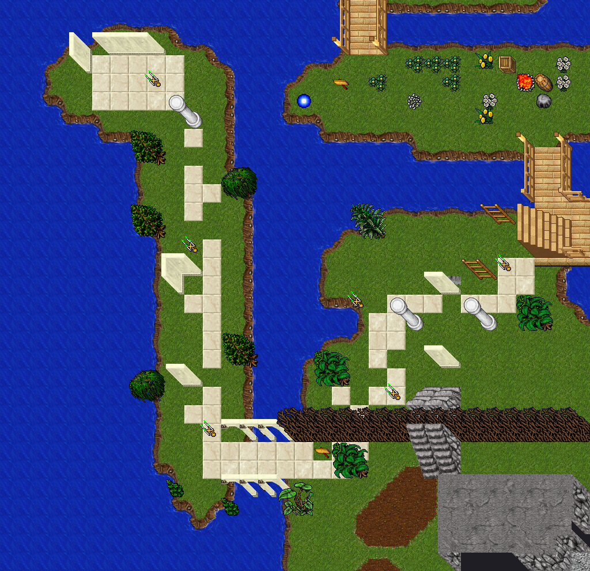

# Elfland y Ruinas del Sauce — 20 nov 2026

Ampliación **al oeste de los elfos de la ciudad**, en el canal entre Elfland y el hunt
volcánico. No es Elvenbane (la fortaleza del portal). El acceso sale del sector de
los elfos en `100,73,7`, junto al cartel `101,72,7`, y cruza el puente hacia el oeste.



## Recorrido y aspecto

- Isla alargada: **187 casillas de tierra**, con **110 transitables** tras costa,
  vegetación y ruinas; norte en `86–96,49–55`, sendero hasta `93–96,76`, todo z7.
- Puente de mármol de dos casillas de ancho (`95–100,72–73`) con barandas nativas
  1121 sobre costa/agua. Apertura de la costa solo bajo el tablero.
- Santuario abierto al sur, muros incompletos, columnas blancas, árboles y un
  sendero de losas rotas. La costa tiene una pieza válida por casilla, sin cortes.
- Terrazas antiguas (`106–110,63–67,z4–z6`): mármol claro en lugar de losas grises,
  columnas/muros en lugar de wild growth y magic wall. Apoyos de z7 a juego.
  Se conservan los huecos, escaleras de mano, la puerta y los cofres originales.
- Once luces esmeralda **fijas** `20353`, sin decay, pickupable ni moveable.
  Reutilizan el dibujo publicado de `20337` / client `2821` y su luz 6/color 31.
  No requieren DAT/SPR nuevos, rebuild ni habilidades de C++.

## Monstruos nuevos

| Lugar (z7) | Monstruos | Respawn |
|---|---|---:|
| `95,65` | Elf Scout | 150 s |
| `94,56` | Elf Arcanist | 180 s |
| `89,51` y `90,51` | Blue Elf Arcanist + Elf Arcanist | 220 s |

Son tres grupos separados 10 casillas Manhattan entre centros, lejos del acceso.
El Blue Elf Arcanist es la variante cosmética ya definida: **no tiene stats más
altos**. Los spawns anteriores del mundo permanecen byte por byte; se agrega el
bloque `ELF_WEST_SPAWNS`. Se conservan el piso caminable y los spawns del hunt de
fuego; su franja de lava a la vista pasa a lago (ver abajo). El dragón negro, el
islote de minotauros, la rampa al depot, las casas y los lockers no se modifican.

## Archivos y regeneración

- `scripts/map/generate-elf-west.py`: geometría, guardas, carteles y spawns.
- `server/YurOTS/ots/data/world/test.otbm`, `test-spawn.xml`, `generated-elf-west.json`.
- `server/YurOTS/ots/data/readables.xml`: cartel `ELF_WEST_SIGNS`.
- `scripts/client-rme/add_custom_items.py` y `data/items/items-zagan-test.otb`: luz fija.
  La versión portátil 20337 conserva sus flags y atributos.

```sh
python3 scripts/map/generate-elf-west.py --dry-run
python3 scripts/map/generate-elf-west.py
```

Guarda respaldo en `backups/map/elf-west-FECHA/`. Rechaza terreno ocupado ajeno,
casas, tiles duplicados, ítems atribuidos alterados, costas ambiguas, casillas
inaccesibles y spawns bloqueados. Puede repetirse: segunda pasada, **0 tiles**.

Revisión estructural: **300 tiles** respecto del respaldo inicial (228 z7 y 24 por
cada terraza z4/z5/z6). Once lockers completos, todos los ítems con atributos,
cofres, puertas, escaleras y spawns antiguos intactos. `check-upper-view` OK;
`sync-houses-with-map.py --dry-run`: houses.xml coincide. Sin suites, cliente ni
recorrido in-game por pedido del usuario. **Activado el 20 nov 2026**, ver despliegue abajo.


## Lava fuera de la vista — 20 nov 2026

Por pedido de Gonzalo, la franja de lava junto a las ruinas pasa a agua: **296
casillas bloqueadas**. El lago cubre la ventana del cliente (9×7 desde cada
casilla transitable de la isla/puente), con dos casillas adicionales de margen.
Se conservan los bordes y objetos del hunt vecino fuera de esa vista.

El generador incorpora el relleno y rechaza cualquier lava que aún sea visible
desde una casilla transitable. Agua 4608 y lava 598–601 tienen exactamente los
mismos flags OTB (`ground`, `block_solid`): no se abre ningún camino. Solo cambian
esos suelos, sin tocar spawns, ítems con atributos, casas, depots ni geometría élfica.
Segunda pasada: 0 tiles modificados. Imágenes actualizadas con los sprites reales.
Respaldo local: `backups/map/elf-no-lava-before/`. Activado junto con la
ampliación élfica; sin pruebas in-game.


## Despliegue — 20 nov 2026

Gonzalo autorizó **todo main**: `bad92cb`, con el mapa de `289cc8f`, la ampliación
DAT a client ids 5090–6089 y `fixshielddefense=1`. Sin cambios de C++ ni rebuild.
La IP LAN local se respaldó y se reaplicó con `git apply --3way` tras el ff-merge;
el único diff de config sigue siendo `127.0.0.1` → `192.168.1.17`.

Respaldo ThinkPad `~/backups/pre-deploy-20261120-194313-elf-west-lake`, refrescado
inmediatamente antes del reinicio y con copia del guardado posterior. Cliente
completo pusheado como `df02ede` (incluye los assets de decoración 73f4ec9 que ya
estaban publicados). Publicado antes del reinicio: DAT `a80fb1ff`, SPR `6ae0f055`,
minimapa `ef2bbb5b`; HTTP 8080/8076 y ZIPs Mac/Windows coinciden.

`docker restart -t 45 yurots`: guardado completo, Loaded in 0.974 s, protocolo OK,
healthy, 0 reinicios automáticos y arranque sin errores/warnings. 1 cuenta,
8 personajes, 31 casas, depots, dueños, houseitems y binario conservados; los once
lockers completos también son idénticos. Sin suites ni recorrido in-game.

## Casa flotante élfica — preparada el 20 nov 2026

Willow Nook se traslada al agua en `85–89,57–61,z7`, con 9 sqm comprables,
cubierta de tejas, plataforma 7×7 y puerta al este (`89,59`). Pasarela corta hasta
`92,59`; los senderos sobre la isla recuperan su forma anterior. El árbol de
`92,60` se mueve a `92,64` para despejar el acceso, sin cambiar la colisión de costa.
La ventana del cliente desde la plataforma queda sin lava.

`generate-elf-west.py` respeta las [casas flotantes](CURIOUS_HOUSES.md) y sus
pasarelas, y calcula la costa usando el agua bajo las plataformas. No retira
bordes al ver madera flotante junto a la isla. El reporte excluye el ancla
reservada de la pasarela (109 casillas), sin cortar el recorrido público.
La casa está aplicada en el repo, pendiente de deploy.

## Santuario bajo el lago — 20 nov 2026

La orilla sur tiene una entrada en `94,74,7` al
[Santuario Petrificado](../gameplay/PETRIFIED_SANCTUARY.md), con antesala z8 y galerías z9.
El generador reserva sus cinco tiles de superficie para conservar boca, llegada y cartel.
No usa la casa flotante ni cambia los cuatro spawns élficos.
