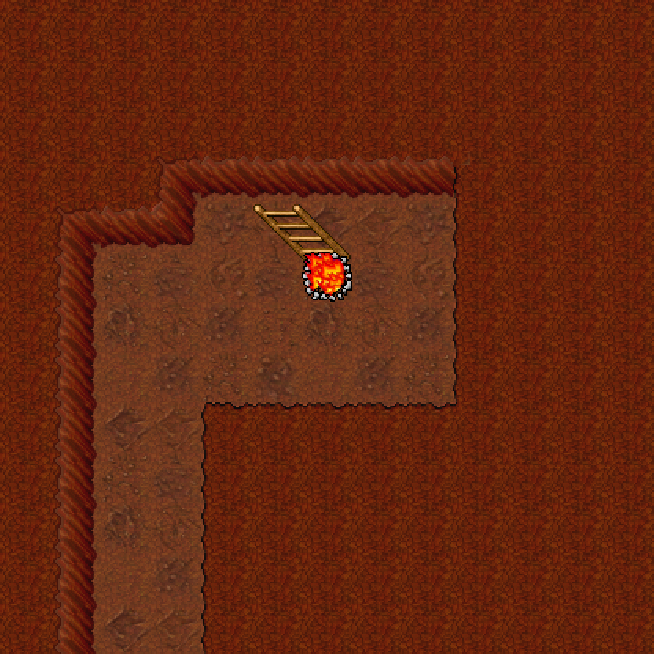
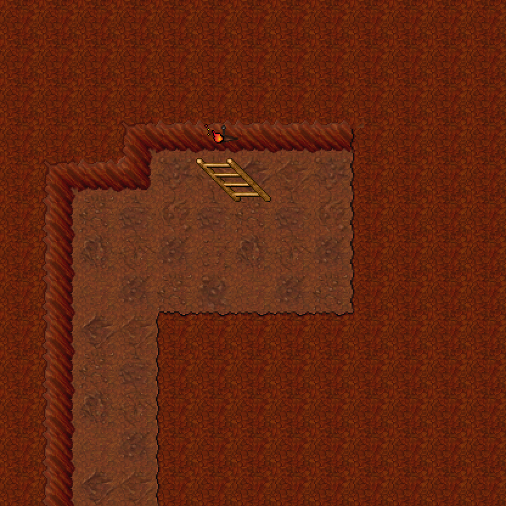

# Epstein Island — isla de caza larga (4 pisos)

Epstein Island es una isla de caza de nivel medio/alto con **cuatro pisos**: superficie z7, cuevas
z8, un piso z9 y un piso profundo z10. Las zonas son recorridos largos (pasillos + salas) para
poder cazar bastante. El barco ya no restringe el destino por vocación: cualquier jugador puede
viajar a `85,209,7`.

## Superficie (z7)

| Zona | Dónde | Monstruos |
|---|---|---|
| **Mutant Camp** | pasto oeste/sur, `x64-71, y207-216` | Mutated Human ×3, Blue Elf Arcanist ×2 |
| **Terror Bird Nest** | pasto norte, `x75-85, y187-198` | Terror Bird ×3, Dragon Hatchling ×1 |
| **Dragon Roost** | arena oeste, `x63-75, y191-204` | Dragon Hatchling ×2, Wyvern ×1 |

## Cuevas z8

| Cueva | Entrada | Monstruos |
|---|---|---|
| **Mutant Burrow** | agujero `82,190,7` | Mutated Rat ×2, Mutated Bat ×1 |
| **Drowned Grotto** | agujero `66,200,7` | Drowned Sailor ×4, Blue Elf Arcanist ×2 |
| **Wyvern Roost** | agujero `80,201,7` | Wyvern ×4, Dragon Hatchling ×2 |
| **Murius Den** | agujero `97,204,7` | Murius ×2, Mutated Bat ×4 |

## Piso z9

Cada cueva z8 baja a una zona z9 larga:

| Zona z9 | Bajo | Monstruos |
|---|---|---|
| **Mutated Tiger Den** | Drowned Grotto | Mutated Tiger ×3, Mutated Rat ×2 |
| **Tide Priest Sanctum** | Wyvern Roost | Tide Priest ×2, Drowned Sailor ×3 |
| **Bog Raider Bog** | Murius Den | Bog Raider ×3, Mutated Bat ×2 |

## Piso profundo z10

Cada zona z9 baja a una zona z10 más larga:

| Zona z10 | Bajo | Monstruos |
|---|---|---|
| **Deep Mutant Lab** | Mutated Tiger Den | Mutated Rat ×3, Mutated Bat ×3, Mutated Human ×3 |
| **Abyssal Grotto** | Tide Priest Sanctum | Tide Priest ×3, Drowned Sailor ×3 |
| **Bog Raider Queen** | Bog Raider Bog | Bog Raider ×3, Mutated Tiger ×2 |

> **Dificultad:** Bog Raider (1.300 HP, 800 exp, 110 de daño), Mutated Tiger (1.100 HP, 750 exp)
> y Murius (650 HP, 300 exp) son para personajes altos. El piso z10 está pensado para grupos.

## NPCs, tienda y Oracle

- Se sacaron **Nimral** (85,210,7), **The Oracle** y **Sally** (74,220,7).
- La tienda de Sally (x71-79, y217-223) se borró del mapa; quedó pasto.
- **The Oracle ya no existe en el juego.** Ojo: sin Oracle, un jugador con vocación 0 no puede
  elegir vocación (`promote.lua` también lo pide). Si querés conservar esa progresión, hay que
  volver a ponerlo en el templo o agregar otro método.
- En la llegada del barco, `85,210,7`, hay un **portal** al templo `130,53,6`.

## Generadores

```bash
# 1) limpieza de NPCs, tienda, Oracle y portal
python3 scripts/map/generate-epstein-cleanup.py --dry-run
python3 scripts/map/generate-epstein-cleanup.py

# 2) cuevas largas z8 + z9 + z10 (escribe generated-epstein-caves.json)
python3 scripts/map/generate-epstein-caves.py --dry-run --preview-dir /tmp/epstein
python3 scripts/map/generate-epstein-caves.py

# 3) spawns de todas las zonas (lee el manifiesto)
python3 scripts/map/generate-epstein-hunts.py --dry-run
python3 scripts/map/generate-epstein-hunts.py
```

Orden: cleanup → caves → hunts. El generador de hunts borra todos los spawns de la caja de
Epstein (z6-z10) y vuelve a colocar las zonas.

## Verificación

```bash
python3 scripts/map/check-map-load.py
python3 scripts/map/validate-tele-dest.py server/YurOTS/ots/data/world/test.otbm
python3 scripts/sync-houses-with-map.py --dry-run
```

Pendiente: prueba in-game del portal, de las escaleras/agujeros y del balance de z8/z9/z10.

## Reparación de cuevas — 20 nov 2026

Preparada en el mapa local, pendiente deploy. La revisión encontró fogatas sobre las
nueve escaleras de mano de las cuevas largas, roca de relleno pegada al piso sin pared,
contornos con más de una pieza posible y vacío negro visible en el mismo piso.





`scripts/map/epstein_cave_repair.py` repara el mapa existente sin regenerar recorridos:

- Cava 367 casillas de roca estrecha/ambigua y recompone el contorno para que cada
  pared tenga una pieza 356–367 válida. Conserva los pisos originales del recorrido.
- Retrae 33 casillas de bordes compartidos: 21 en la fila sur de Mutant Burrow y
  12 en Tiger/Tide. Así dos cuevas vecinas no comparten una pared de una sola cara.
  Ninguna entrada, salida, monstruo, agujero o escalera ocupa esas casillas.
- Sustituye las nueve fogatas sobre escaleras por nueve antorchas en paredes próximas.
  Las diez escaleras de entrada, incluida Mutant Burrow, quedan solas y con salida libre.
- Agrega 5163 tiles de roca/pared en vacío para cubrir la ventana del cliente.
  No sobrescribe casillas existentes ajenas. Conserva las paredes nativas 371–382
  de la parte original de Mutant Burrow.

Resultado: **5689 posiciones** cambiadas dentro de x32–131, y183–266, z8–z10;
5163 nuevas y 526 existentes. Superficie, depot, casas y resto del mapa intactos.
`test-spawn.xml` y `generated-epstein-caves.json` idénticos al backup: mismos monstruos,
respawns, coordenadas de las entradas y conexiones. Cofres, contenedores, teleports e
items con atributos se cotejaron byte por byte; los once lockers también son idénticos.

```sh
python3 scripts/map/epstein_cave_repair.py --dry-run
python3 scripts/map/epstein_cave_repair.py
python3 scripts/map/check-upper-view.py --box 40 175 122 260 --z 8 9 10
```

El script valida antes de escribir: contornos, conectividad, ventana sin vacío,
escaleras/agujeros y spawns pisables. Segunda aplicación: cero cambios. La revisión
de vista superior sigue dando OK. El generador base llama a esta reparación al
terminar y ya no crea fogatas sobre escaleras; su backup usa `backups/map/`.
Backup de esta revisión: `backups/map/epstein-caves-before/`.
Se corrieron reparación, validaciones estructurales y render de sprites; sin suites,
pruebas in-game, compilación ni reinicio, por pedido de Gonzalo.
