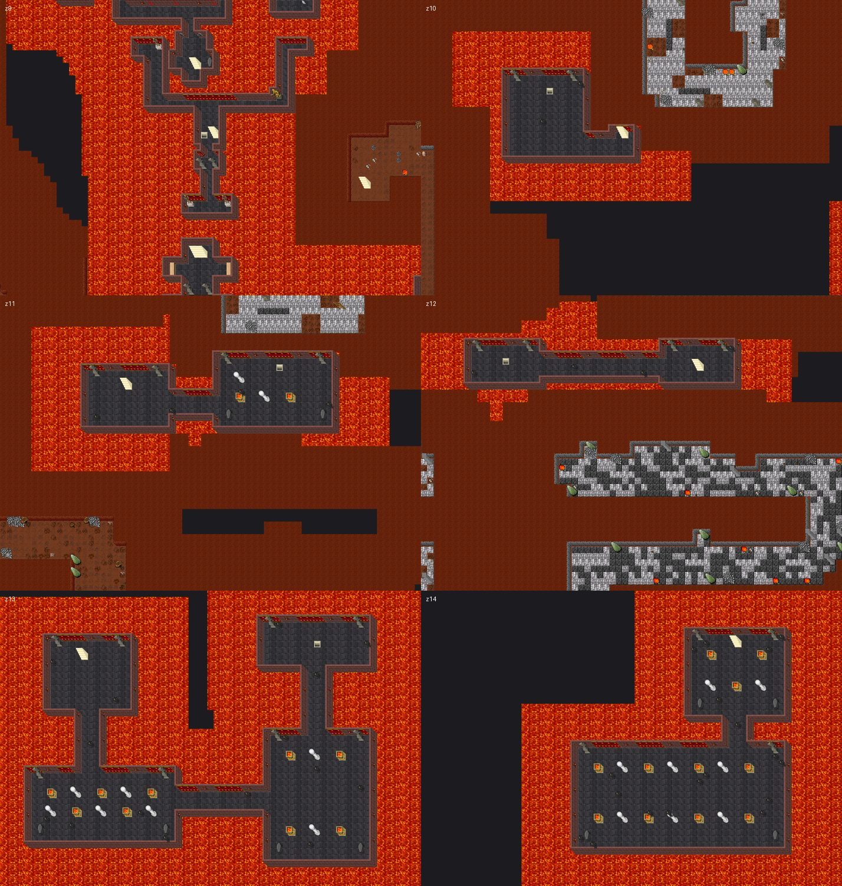

# Profundidades del Héroe (z10–z14)

Desde el 22 nov 2026. Mazmorra de 5 pisos debajo del lugar de los Hero, con el mismo estilo:

- **Paredes y suelo:** losa negra `407` y ladrillo `1028`/`1030`/`1027`/`1033`.
- **Decoración:** tapices rojos `1812` en las paredes del norte, antorchas `2059`/`2061`, monumentos
  `1445`, ataúdes `1410`+`1411`, columnas de mármol `1515` y braseros `1486`.
- **Alrededor:** lava `598` en vez de vacío negro.

Generador: `scripts/map/generate-hero-depths.py` (manifiesto `data/world/generated-hero-depths.json`).

## Recorrido

`/ir depths` (GM) deja en la llegada de z10. Se entra por el hueco `432` en el pasillo de los Hero, en **`146,93,9`** (al lado de la escalera que sube).
Cada bajada es un hueco `432` arriba y la escalera `1385` en la misma casilla del piso de abajo
([MAPAS.md](MAPAS.md#escaleras-entre-pisos)).

| Piso | Nombre | Se llega a | Bajada al siguiente | Casillas de piso |
|------|--------|-----------|---------------------|-----------------:|
| z10 | Antesala | `146,94` | `134,86` | 183 |
| z11 | Galería | `134,87` | `158,83` | 339 |
| z12 | Puente (con 3 pasos de 1 sqm) | `158,84` | `127,82` | 180 |
| z13 | Salón de los Caballeros (3 salones) | `127,83` | `164,80` | 943 |
| z14 | Fondo | `164,81` | — | 738 |

## El puente de z12: pasos de 1 sqm

El puente alterna tramos de 3 de ancho con **tres pasos de 1 sqm** (2 casillas de largo), en x=137–138,
143–144 y 149–150, sobre y=83. Sirven para trapear. Las columnas de ladrillo que los marcan salen solas de la
regla de paredes y el resto se ve igual (tapices y antorchas). Se cambia en `PLAN[12]`.

## Monstruo: Black Knight

1600 de exp y 1800 de vida: el escalón siguiente al Hero (1200 / 1400). Es un caballero como el Hero, va
con el castillo, es inmune al fuego y en el resto del mapa hay solo 3.

- z10–z13: de a 1, separados 12–14 casillas.
- z14: de a 2.
- En total, 43 en 34 spawns.

Para cambiar cuántos hay: `STAGES` (por spawn, spawntime, separación).

## Vecinos

Debajo y al lado hay otros hunts: Mutated Sewers en z10–z11, Spider Nest en z11, Demona Local en z11–z12 y
la Gruta del Río en z12. El generador:

- usa solo casillas vacías o de roca `101`;
- deja su piso a **4 casillas o más** del piso de otro hunt (los generadores vecinos validan con
  `grow(piso, 3)`);
- pone lava sobre roca solo donde ningún jugador de otro hunt la ve;
- **no toca ninguna casilla de Demona Local**, porque su generador reescribe su roca de estructura y
  fallaría. Por eso z11 termina en y=92 y el puente de z12 está en y=80–85.

Después de generar, el `--dry-run` de `demona-local`, `mutated-sewers`, `river-grotto`, `spider-nest` y
`amazon-camp` tiene que dar `changed: 0`.

## Prueba (22 nov 2026)

- **Validaciones del mapa:** `check-map-load.py` 0 errores, `check-upper-view.py` OK,
  `validate-tele-dest.py` OK, casas sin cambios, 11 lockers.
- **Server aparte (7275):**
  - un GM bajó caminando de z9 a z14 por las 5 bajadas y subió de z14 a z13;
  - con los spawns puestos, un Black Knight le tapó el pasillo del puente de z12 (es de 3 de ancho);
    la prueba del recorrido se hace sin los spawns de la zona.
