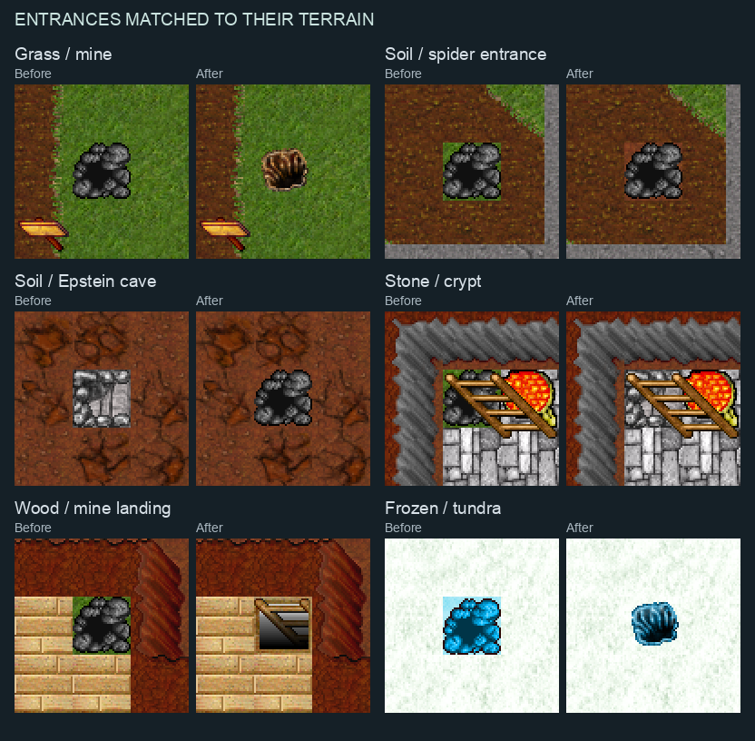

# Entradas de cuevas adaptadas al terreno — 21 nov 2026

Revisión de **48 hoyos** en todos los pisos del mundo, incluidas las tres hunts nuevas
cerca de la ciudad. Se corrigen **45 casillas**. No se agregan, borran ni mueven tiles,
monstruos, casas o lockers; solo cambia el ID visual de la entrada.



| Entorno | Casillas revisadas | Entrada |
|---|---:|---|
| Pasto / costa verde | 20 | 470, boca de tierra con fondo verde |
| Tierra / barro / camino | 16 | 383, fondo de cueva marrón |
| Piedra / mármol / grava | 8 | 479, apertura de piedra |
| Tablones | 1 | 409, escalera de mano de bajada en madera |
| Nieve | 1 | 20368, apertura helada sobre nieve (`213,27,7`, punta oeste de la isla de hielo; no es un islote suelto de la city, ver [arreglos visuales](CITY_VISUAL_FIXES_2026_11_24.md)) |
| Hielo | 2 | 485, apertura helada |

Los 48 destinos inferiores tienen escalera 1386 y son transitables. Sus 48 retornos
`x,y+1,z-1` permanecen libres. Los flags OTB de las variantes coinciden: ground,
block_pathfind y floorchange_down. Se conservan click derecho, bajada caminando y cuerda.
Los **11 lockers**, las casas, todos los ítems atribuidos y los spawns quedan idénticos.

## Qué estaba mal

469 incluye un fondo verde: no es un agujero neutral para poner en cualquier suelo.
479 tiene piedra dibujada detrás: sobre tierra hace un cuadrado gris. El 485 contiene
dos capas nativas, hielo de fondo y la apertura transparente. Sobre nieve, el hielo
formaba otro cuadrado de color. El item 104 se llama `sand` pero dibuja grava gris;
los bordes 110–113 se llaman `grass` pero pueden encerrar un centro de tierra.
El selector tiene en cuenta estas excepciones visuales.

20368 / client **5104** copia el prototipo 485 y sus flags. Su PNG 32x64 contiene las
dos capas originales sin modificar: suelo 670 (nieve) y overlay de 485. Se instala con
`layers=2`, no con dos frames. No cambia ningún sprite o ítem existente. Cuerda mapea
este ID al comportamiento de 485; `actions.xml` lo registra en `teleport.lua`.

## Aplicación y conservación

```sh
python3.11 scripts/map/style-hole-entrances.py          # informe sin escribir
python3.11 scripts/map/style-hole-entrances.py --apply
python3.11 scripts/map/render-hole-entrances.py
```

`kb/hole_entrance_style.py` elige por los suelos adyacentes, descartando paredes,
agua y otras entradas. El pase global valida cada bajada/retorno y modifica solo los
2 bytes del item ID, conservando el resto del tile y sus atributos. Respalda en
`backups/map/hole-entrances-FECHA/` y actualiza cinco manifiestos de propiedad.
`generated-hole-entrances.json` contiene las 48 posiciones, sus variantes y llegadas.
Una segunda pasada da **0 cambios**.

Mina Enana, Santuario Petrificado, Nido de Seda Negra, Cripta de los Ojos, Cloacas
Mutadas y Dungeon City invocan el selector compartido al generar. Los cinco primeros
reportan **0 tiles modificados** tras esta corrección. Al terminar una exportación RME
o cualquier otro generador, ejecutar el pase global antes de publicar el mapa.

Para reproducir el asset de nieve:

```sh
python3.11 scripts/client-rme/build_snow_entrance.py
python3.11 scripts/client-rme/add_custom_items.py --things devtools/rme/rme-client-760 --only 20368
```

Auditorías estructurales: carga OTBM **0 errores**, sintaxis Lua de cuerda correcta,
solo 45 IDs cambiados y todos los enlaces transitables. Vistas de todas las entradas
en [all-entrances.png](img/hole-entrances/all-entrances.png). Sin clientes, instancias
ni suites de pruebas por la indicación previa del usuario.

## Despliegue — 21 nov 2026

Publicado y aplicado junto con la [traducción al inglés](../gameplay/SERVER_LANGUAGE.md#despliegue--21-nov-2026):
servidor `f9ec655`, cliente `4121503`. DAT/SPR y minimapa publicados antes de activar el mapa;
HTTP 8080/8076 y ZIPs Mac/Windows coinciden. Backup
`~/backups/pre-deploy-20261121-120538-english-holes`, renovado antes del reinicio y tras el cierre.
Arranque sin errores, carga en 0,887 s, probe OK, healthy y 0 reinicios automáticos.
Cuentas, archivos de personajes, casas, depots y sus datos preservados. Sin prueba in-game;
se mantienen las auditorías de enlaces y de los 11 lockers con `depotid=1`.
