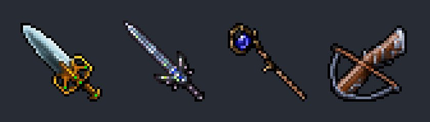

# Traer ítems de otras versiones de Tibia (ej. armas de 8.x)

Cómo se agregaron la **Emerald Sword**, la **Avenger**, la **Arcane Staff** y la **Arbalest** (nov 2026), y
cómo agregar más. El sprite sale del cliente de esa versión, píxel por píxel; los stats, de su `items.xml`.



## Ítems agregados

| Server id | Nombre | Tipo | Atk / Def | Prototipo 7.6 | Client id (sacrificado) |
|---:|---|---|---|---|---|
| 20157 | emerald sword | espada, 1 mano | 49 / 33 | 2407 bright sword | 3348 (banana staff) |
| 20158 | avenger | espada, 2 manos | 50 / 38 | 2393 giant sword | 3346 (ripper lance) |
| 20159 | arcane staff | maza, 2 manos | 50 / 30 | 2391 war hammer | 3345 (templar scytheblade) |
| 20160 | arbalest | ballesta, 2 manos, bolts | +2 al bolt | 2455 crossbow | 3575 (cowl) |

- Stats de Tibia 8.60. El peso y el slot son los del prototipo.
- La "the avenger" de 8.x quedó como **avenger** ("You see an avenger").
- **Arbalest:** en 7.6 el daño a distancia salía solo de la munición (los arcos y ballestas tienen
  ataque 0). Ahora `Player::getWeaponDamage()` suma el ataque del lanzador al de la munición, como en las
  versiones nuevas; la Arbalest es la primera con ataque (+2). Necesita el binario compilado.
- **Cómo se consiguen:** desde nov 2026, en la **Cámara de las Armas** de los Pozos del Infierno
  (uid 5104–5107, `pitschest.lua`): cada personaje elige UNA — Emerald Sword, Avenger, Arcane Staff
  o Arbalest. Ver [`MAPEAR_POZOS_DEL_INFIERNO.md`](MAPEAR_POZOS_DEL_INFIERNO.md).
- Los ítems viejos sacrificados (banana staff, ripper lance, templar scytheblade, cowl) no los da nada
  del servidor: no están en el mapa, ni en loot, NPC, acciones o scripts.

## Paso a paso para agregar otro

1. **Cliente de esa versión:** solo `Tibia.dat` y `Tibia.spr` (formato 7.55–8.60; se probó con 8.60). No se
   ejecuta nada del cliente.
2. **Nombres:** el `items.otb` y el `items.xml` de esa versión. RME los publica en GitHub:
   `https://raw.githubusercontent.com/hampusborgos/rme/master/data/860/items.otb` (y `items.xml`).
3. **Sacar el sprite y ver los stats:**

   ```bash
   python3 scripts/client-rme/extract_client_sprites.py --client DIR_860 --otb items.otb --xml items.xml \
       --sheet /tmp/hoja.png --out devtools/zagan-test/custom-sprites "royal axe" "crystal sword"
   ```

   Imprime client id, server id y atributos (ataque, defensa, tipo, slot) y guarda `<nombre>.png` (32×32).
   Solo ítems de 1×1: muchos de 8.x ocupan 2 casillas y se avisan. Para un ítem 2×2 (corpses de
   araña/dragón) usar un PNG 64×64 y `tiles=2`; el importer lo parte en los 4 sprites del `.dat`.
4. **Elegir un client id:** `python3.11 scripts/client-rme/add_custom_items.py --candidates` (antes, `git fetch`
   y trabajar sobre `main`: otras sesiones toman ids al mismo tiempo). Lista primero los **client ids nuevos
   libres** (5090–6089, desde el 20 nov 2026): entradas vacías al final de los ítems del `.dat`, sin dibujo, que
   el instalador reemplaza por el prototipo con los sprites nuevos. Usar esos. Un cliente sin actualizar no ve
   nada en ese lugar (antes veía el ítem sacrificado). Si se acaban, subir `LAST_CLIENT_ID` en
   `add_custom_items.py` y correr el instalador (agrega las entradas que falten antes de los outfits).
   Después lista los ítems viejos que se pueden sacrificar (quedan ~5): excluye lo que está en el mapa, loot,
   NPC, acciones, hechizos o scripts, los destinos de una pudrición, suelos, cadáveres, alfombras y cuadros, y
   los ya usados por ítems custom.
5. **Agregarlo a `NEW_ITEMS`** en `add_custom_items.py`: nombre, server id libre (consultar el OTB actual y las reservas de otros scripts),
   client id del paso 4, prototipo 7.6 (mismo tipo y manos), PNG, ataque, defensa y descripción (< 128
   bytes). Para un 2×2 agregar `tiles=2` y un PNG 64×64; para un 2×1, `tiles="2x1"` y un PNG 64×32;
   para un 1×2, `tiles="1x2"` y PNG 32×64 (apliques del templo, ver PLAZA_ARCANA.md).
   Decoración sin stats: `decor=True`; ítem animado (1×1, 2×2, 2×1 o 1×2): `frames=N` con PNG apilados
   verticalmente (ancho del cuadro × altura del cuadro·N); luz propia: `light=(nivel, color)` (flag `.dat` 0x15
   y attr OTB 0x2A). Ejemplos completos: el red magic tree `20191` (2×2) y el blue bassin
   `20192` (1×1 animado) en [`ZAGAN_TEST_ITEMS.md`](ZAGAN_TEST_ITEMS.md).
6. **Aplicar** (re-ejecutable; lo que ya está no se toca):

   ```bash
   python3.11 scripts/client-rme/add_custom_items.py --things devtools/rme/rme-client-760
   ```

   Escribe el `.dat`/`.spr` de cada `--things` y `server/YurOTS/ots/data/items/items-zagan-test.otb`.
   Deja respaldos `*.bak-custom-items`: borrarlos antes de commitear.
7. **Comprobar:** `python3 scripts/map/check-map-load.py` (0 errores) y
   `python3 scripts/client-rme/sprite_tool.py verify` (solo debe fallar "ítems idénticos": cambian las entradas
   de los client ids sacrificados; looks y sprites viejos, iguales).
8. **Cliente de jugadores:** tras el deploy, en la ThinkPad `python3 scripts/client-rme/publish_client.py`
   (copia el `.dat`/`.spr` de `devtools/rme/rme-client-760` al cliente y lo publica). Los clientes se
   actualizan solos al abrirse ([CLIENT_UPDATER_RETRO76.md](../CLIENT_UPDATER_RETRO76.md)). Un cliente que
   estaba abierto sigue con los sprites viejos (el ítem se ve como el sacrificado) hasta que se reinicia.

Los PNG van a git con `git add -f` (la carpeta `devtools/zagan-test/` está en `.gitignore`).

## Prototipos con capas nativas

Las puertas 7.6 (por ejemplo 1245) tienen dos capas, no dos cuadros de animación.
Declarar `layers=2`, conservar `frames=1` y apilar las capas verticalmente dentro de
cada cuadro. Ejemplo: reja 2×2 de Cripta de Raíces, PNG 64×128, arte completo en la
primera capa y segunda transparente. El importador conserva el prefijo nativo del
prototipo y comprueba que la cantidad total de sprites coincida antes de escribir.

## Por qué no con el builder viejo

El mismo importador instala armas dibujadas para Root Colossus: **rootcleaver 20163** (axe 1H, 49/31,
client 6081; hasta el 25 nov 2026 el 3573 de la magician hat) y **heartwood maul 20164** (club 2H, 52/28, client 3561). Los PNG los genera
`scripts/client-rme/draw_root_weapons.py`; stats y loot propios, no importados de 8.60. Ver
[`ROOT_COLOSSUS.md`](../gameplay/ROOT_COLOSSUS.md).

`build_zagan_test_assets.py` rehace todos los ítems Zagan desde el pack original (`~/Downloads/Zagan+Square`)
y una base `client-local/`: ninguno de los dos existe ya. `add_custom_items.py` usa sus funciones
(lectura del `.dat`, codificación de sprites, nodos del `.otb`) pero trabaja sobre los archivos actuales y
con ids fijos, así el cliente de RME y el de jugadores quedan iguales.

Errores que ya pasaron:

| Qué pasó | Cómo evitarlo |
|---|---|
| Ids de 8.x tomados de memoria daban muebles y alfombras | En 8.x el client id no es el server id: usar el `items.otb` de esa versión |
| El sprite salía borroso y con puntos de colores | No recortar ni reescalar: el PNG ya es 32×32 y se copia píxel a píxel |
| Wikis y otservlist rechazan descargas automáticas | No disfrazar la consulta. Bajar el cliente desde el navegador |
| `DatReader` (`build_zagan_test_assets.py`) leía 99 entradas de más: tomaba los primeros outfits como ítems 5090–5188. Con los client ids nuevos, un ítem en el 5090 habría pisado el outfit 1 | Corregido el 20 nov 2026: lee los ítems 100..`item_count` (el encabezado del `.dat` guarda el último id, no la cantidad) |
| `descr=""` escrito como último atributo OTB causó `Could not load items.otb!` el 22 nov 2026 en cinco runas (2269/2271/2274/2288/2315). `Items::loadFromOtb` rechaza que el cursor termine al leer la longitud, incluso si el payload mide 0 | El importador omite el atributo DESCR cuando está vacío; eliminar el atributo, no agregar espacios ni cambiar C++. Los píxeles y client IDs de las runas se conservan |
| Dos ítems con el mismo client id (la bandera y su copia fija de Obi): el server no dejaba mover la que se vende | El server compara por client id (`Items::sameClientItem`, ver [HANGABLES.md](../gameplay/HANGABLES.md#errores-que-ya-pasaron)) |

Publicado el 20 nov 2026 en el cliente `df02ede` y desplegado con `bad92cb`: los
1000 IDs 5090–6089 son entradas vacías; los ítems anteriores y el tail completo
(creatures/efectos/proyectiles) coinciden byte por byte con el DAT anterior.
DAT publicado `a80fb1ff`; HTTP 8080/8076 y ambos ZIPs verificados. Sin cliente
in-game por pedido del usuario. Respaldo y despliegue en [ELF_WEST.md](ELF_WEST.md#despliegue--20-nov-2026).

### Instalar un grupo nuevo sin reconstruir los assets anteriores

Desde Mina Enana, `add_custom_items.py --only ID [ID ...] --things DIR` valida los IDs
y procesa exclusivamente ese subconjunto de `NEW_ITEMS`. Es útil cuando los PNG de
otros ítems no están instalados. No cambia el resto de entradas DAT ni nodos OTB.
Los rieles usan prototipo 1794: 3312 tiene dos patrones y no sirve para un PNG único.
El apoyo 2x2 usa prototipo 1515; un prototipo 1x1 tampoco sirve para sus cuatro sprites.
Ver [Mina Enana](../gameplay/DWARVEN_MINE.md).

## Client ids sacrificados que eran equipo (25 nov 2026)

La magician hat (2662, client 3573) se veía como el **rootcleaver** y el helmet of the ancients (2342, client 3229,
premio de dos quests) como la **arcane entrance left**: sus client ids se habían "sacrificado". Un client id es UN
dibujo en el `.dat`: si dos server ids lo comparten, los dos se ven igual. Se arregló mudando los custom a client ids
nuevos (rootcleaver 6081, arcane entrance left 6082, root crypt wall 20264 → 6083, que estaba en el 3210 de la otra
magician hat 2323) y devolviendo a 3573/3229/3210 su entrada original de 7.6 (del primer `Tibia.dat` del repo).

`--candidates` ya no propone **armas, munición ni armaduras** vanilla (pueden aparecer como loot o premio en
cualquier momento) y cuenta los premios de `web/site/src/data/quests.json` (en el mapa van en el uid del cofre, no
como ítem). Para ítems nuevos, usar siempre los client ids nuevos libres (5146–6089) que lista primero.
Quedan otros equipos vanilla compartiendo client id con decoración custom (golden helmet, dragon scale legs,
winged helmet, bow, ice rapier, dwarven/elven armor...): ver el informe del 25 nov antes de darlos como loot.

