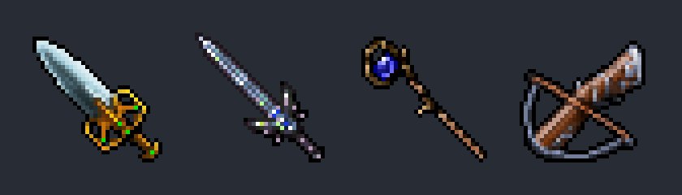

# Traer ítems de otras versiones de Tibia (ej. armas de 8.x)

Cómo se agregaron la **Emerald Sword**, la **Avenger**, la **Arcane Staff** y la **Arbalest** (nov 2026), y
cómo agregar más. El sprite sale del cliente de esa versión, píxel por píxel; los stats, de su `items.xml`.



## Ítems agregados

| Server id | Nombre | Tipo | Atk / Def | Prototipo 7.6 | Client id (sacrificado) |
|---:|---|---|---|---|---|
| 20157 | emerald sword | espada, 1 mano | 49 / 33 | 2407 bright sword | 3348 (banana staff) |
| 20158 | avenger | espada, 2 manos | 50 / 38 | 2393 giant sword | 3346 (ripper lance) |
| 20159 | arcane staff | maza, 2 manos | 50 / 30 | 2391 war hammer | 3345 (templar scytheblade) |
| 20160 | arbalest | ballesta, 2 manos, bolts | +2 al bolt | 2455 crossbow | 3575 (cowl) |

- Stats de Tibia 8.60. El peso y el slot son los del prototipo.
- La "the avenger" de 8.x quedó como **avenger** ("You see an avenger").
- **Arbalest:** en 7.6 el daño a distancia salía solo de la munición (los arcos y ballestas tienen
  ataque 0). Ahora `Player::getWeaponDamage()` suma el ataque del lanzador al de la munición, como en las
  versiones nuevas; la Arbalest es la primera con ataque (+2). Necesita el binario compilado.
- **Cómo se consiguen:** por ahora solo con GM (`/i 20157 1`). Para la quest de la Pits of Inferno
  (Avenger, Arcane Staff y Arbalest a elegir) falta armar la quest.
- Los ítems viejos sacrificados (banana staff, ripper lance, templar scytheblade, cowl) no los da nada
  del servidor: no están en el mapa, ni en loot, NPC, acciones o scripts.

## Paso a paso para agregar otro

1. **Cliente de esa versión:** solo `Tibia.dat` y `Tibia.spr` (formato 7.55–8.60; se probó con 8.60). No se
   ejecuta nada del cliente.
2. **Nombres:** el `items.otb` y el `items.xml` de esa versión. RME los publica en GitHub:
   `https://raw.githubusercontent.com/hampusborgos/rme/master/data/860/items.otb` (y `items.xml`).
3. **Sacar el sprite y ver los stats:**

   ```bash
   python3 scripts/client-rme/extract_client_sprites.py --client DIR_860 --otb items.otb --xml items.xml \
       --sheet /tmp/hoja.png --out devtools/zagan-test/custom-sprites "royal axe" "crystal sword"
   ```

   Imprime client id, server id y atributos (ataque, defensa, tipo, slot) y guarda `<nombre>.png` (32×32).
   Solo ítems de 1×1: muchos de 8.x ocupan 2 casillas y se avisan.
4. **Elegir un client id para sacrificar:** `python3.11 scripts/client-rme/add_custom_items.py --candidates`.
   Excluye lo que está en el mapa, loot, NPC, acciones, hechizos o scripts, los destinos de una pudrición,
   suelos, cadáveres, alfombras y cuadros, y los ya usados por ítems custom.
5. **Agregarlo a `NEW_ITEMS`** en `add_custom_items.py`: nombre, server id (el siguiente libre, hoy 20166),
   client id del paso 4, prototipo 7.6 (mismo tipo y manos), PNG, ataque, defensa y descripción (< 128 bytes).
6. **Aplicar** (re-ejecutable; lo que ya está no se toca):

   ```bash
   python3.11 scripts/client-rme/add_custom_items.py --things devtools/rme/rme-client-760
   ```

   Escribe el `.dat`/`.spr` de cada `--things` y `server/YurOTS/ots/data/items/items-zagan-test.otb`.
   Deja respaldos `*.bak-custom-items`: borrarlos antes de commitear.
7. **Comprobar:** `python3 scripts/map/check-map-load.py` (0 errores) y
   `python3 scripts/client-rme/sprite_tool.py verify` (solo debe fallar "ítems idénticos": cambian las entradas
   de los client ids sacrificados; looks y sprites viejos, iguales).
8. **Cliente de jugadores:** tras el deploy, en la ThinkPad `python3 scripts/client-rme/publish_client.py`
   (copia el `.dat`/`.spr` de `devtools/rme/rme-client-760` al cliente y lo publica). Los clientes se
   actualizan solos al abrirse ([CLIENT_UPDATER_RETRO76.md](../CLIENT_UPDATER_RETRO76.md)). Un cliente que
   estaba abierto sigue con los sprites viejos (el ítem se ve como el sacrificado) hasta que se reinicia.

Los PNG van a git con `git add -f` (la carpeta `devtools/zagan-test/` está en `.gitignore`).

## Por qué no con el builder viejo

El mismo importador instala armas dibujadas para Root Colossus: **rootcleaver 20163** (axe 1H, 49/31,
client 3573) y **heartwood maul 20164** (club 2H, 52/28, client 3561). Los PNG los genera
`scripts/client-rme/draw_root_weapons.py`; stats y loot propios, no importados de 8.60. Ver
[`ROOT_COLOSSUS.md`](../gameplay/ROOT_COLOSSUS.md).

`build_zagan_test_assets.py` rehace todos los ítems Zagan desde el pack original (`~/Downloads/Zagan+Square`)
y una base `client-local/`: ninguno de los dos existe ya. `add_custom_items.py` usa sus funciones
(lectura del `.dat`, codificación de sprites, nodos del `.otb`) pero trabaja sobre los archivos actuales y
con ids fijos, así el cliente de RME y el de jugadores quedan iguales.

Errores que ya pasaron:

| Qué pasó | Cómo evitarlo |
|---|---|
| Ids de 8.x tomados de memoria daban muebles y alfombras | En 8.x el client id no es el server id: usar el `items.otb` de esa versión |
| El sprite salía borroso y con puntos de colores | No recortar ni reescalar: el PNG ya es 32×32 y se copia píxel a píxel |
| Wikis y otservlist rechazan descargas automáticas | No disfrazar la consulta. Bajar el cliente desde el navegador |
