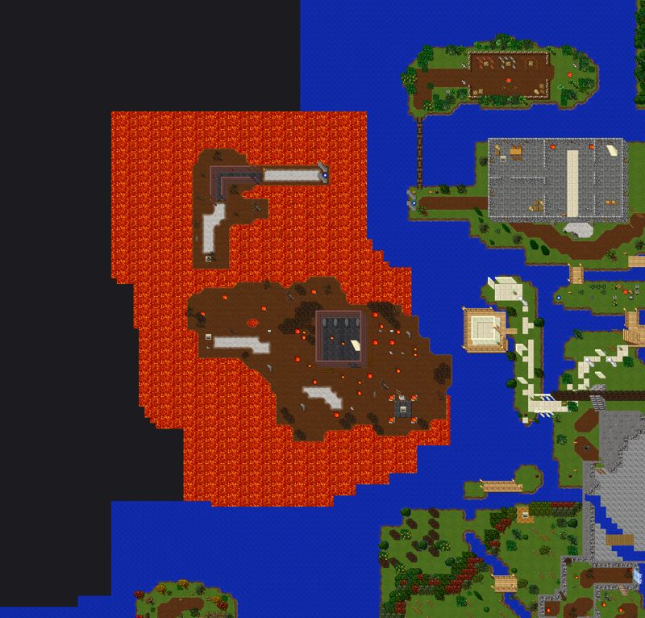
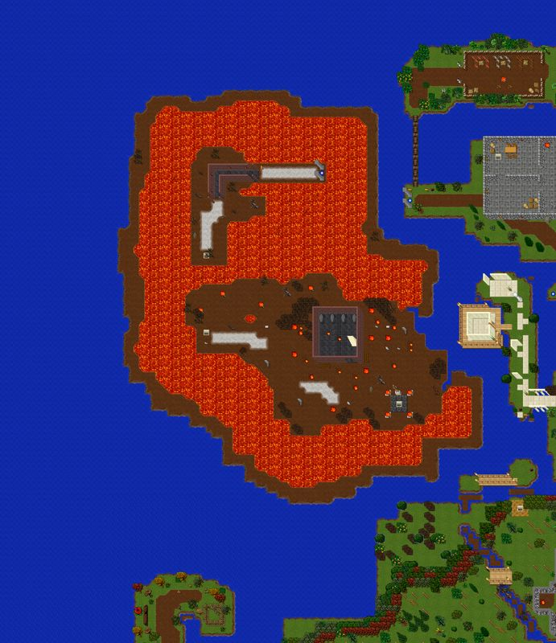

# Isla volcánica del noroeste: orilla de la caldera (24 nov 2026)

La isla de los Demon Skeleton (x 20–82, y 20–96, z7) estaba en un **mar de lava cuadrado**: al oeste
terminaba en vacío negro (el mapa llega hasta x = 0) y al este la lava chocaba contra el agua en escalones,
sin orilla. Ahora la lava es una caldera de forma orgánica:

`lava → franja de tierra de 2–3 casillas → costa de roca → mar hasta el borde del mapa`

| Antes | Después |
|---|---|
|  |  |

- Script: `scripts/map/fix-volcanic-shore.py` (`--dry-run --png`, `--replace`). **Se aplica una sola vez**:
  después la orilla cuenta como tierra volcánica y la caldera volvería a crecer; con el arreglo ya hecho dice
  "ya aplicado".
- Solo cambió lo que era lava, agua sin nada encima o vacío, en la caja `0,0–96,114`: 1047 casillas cambiadas y
  3147 nuevas (el vacío, ahora mar). La lava a 5 o menos de las islas no se tocó (sus bordes quedan iguales) y el
  agua a 3 o menos de otra tierra tampoco (las islas del este y del sur conservan su costa).
- Piezas: bordes de lava `4667–4678` sobre la lava (regla `lava_borders` del Campo de Brasas) y costa
  `4644–4655` sobre la tierra que toca el agua (la misma de la isla natural; sobre tierra `103` se ve como
  una orilla de roca). Unos pocos árboles muertos en la franja.
- Agua: además de `4608` hay `4609` (otra variante de "shallow water", al sudoeste). Todo `4608–4625` sin
  nada encima es agua.
