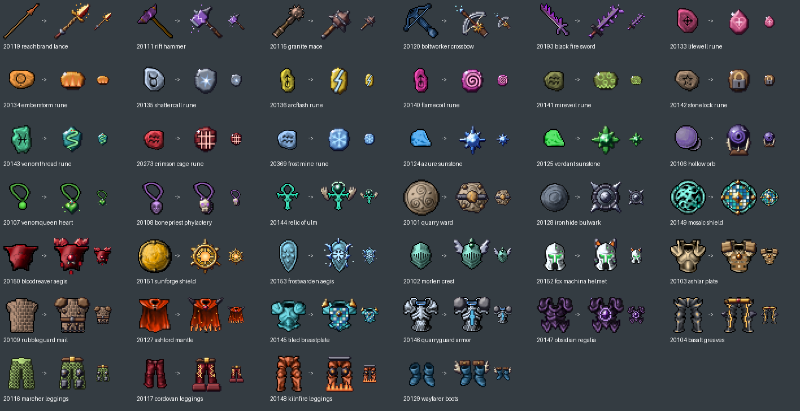

# Rediseño de ítems que eran solo un recolor (24 nov 2026)

> **REVERTIDO ENTERO (25 nov 2026).** Gonzalo: *"quedaron muy feos"*. Los 44 ítems volvieron a su dibujo anterior:
> sus sprites se copiaron del `Tibia.spr` de antes de `93e90ebd` (mismo lugar, mismos ids; 35 sprites el 25 nov más
> las armas y los 4 de antes), y `crimson_cage_rune.png` / `frost_mine_rune.png` / `black_fire_sword.png` también.
> `redesign_items.py` quedó retirado (sale con error salvo `--force`) y `recolor_zagan_items.py --apply` vuelve a
> escribir el recolor (comprobado: los 38 coinciden píxel por píxel con el cliente). Lo de abajo queda como historia.

Gonzalo: *"Hay muchos items que solo les cambiaste el color, y quedaron cambios mínimos como la nueva dragon
lance. Modificalos y que se noten más los cambios."*

44 ítems tenían exactamente la silueta y el sombreado de un ítem vanilla, solo con otro tono. Ahora 35
tienen forma propia: puntas, alas, gemas, hombreras, llamas, grabados o un dibujo nuevo desde cero. Los ids no
cambian (server id, client id, OTB, `.dat`): solo se reemplazan en el lugar los sprites del `Tibia.spr`.



## Cómo se encontraron

`scripts/client-rme/find_recolor_items.py` compara el sprite de cada ítem custom (server id ≥ 20100) contra
todos los vanilla del cliente canónico: IoU de la silueta y correlación del brillo dentro de la silueta común.
Silueta ≥ 0.90 y brillo ≥ 0.80 = recolor. Antes del cambio marcaba a los 44 con silueta 1.00 (idéntica).

Quedaron afuera a propósito (también los marca, pero no son ítems de inventario o el recolor es buscado):

- **Memory Gem (20664):** se pidió el mismo corte que las gemas grandes, en cian, para que combine con ellas.
- **Soft boots (20670):** es el estado "en uso" de las soft boots, tiene que verse igual.
- Cadáveres, paredes, ventanas, barandas, piso, trofeos, candelabros, tapices, lava, árboles, regalos de nivel:
  decoración o terreno, no ítems de equipo.

> **Aurora shield (20165), Starbinder hood (20118), Imperial crown armor (20161) y Sapphire crown armor (20162):**
> también se rediseñaron, pero Gonzalo pidió dejarlos como estaban. Volvieron al dibujo anterior (sprites 11741,
> 11711, 11496 y 11497; los PNG de custom-sprites también) y `redesign_items.py` ya no los toca.
>
> **Las 5 armas** (reachbrand lance 20119, rift hammer 20111, granite mace 20115, boltworker crossbow 20120 y
> black fire sword 20193) también volvieron a su dibujo anterior (25 nov 2026, Gonzalo: *"quedaron muy feos"*):
> sprites 11732, 11730, 11731, 10789 y 13985–13986 copiados del `Tibia.spr` de antes de `93e90ebd`, y
> `black_fire_sword.png`. `redesign_items.py` ya no las toca (sus funciones se borraron; el dibujo está en git).

## Lista (server id, nombre, base vanilla, qué cambió)

Todos tenían silueta 1.00 y brillo 0.82–1.00 contra la base antes del cambio.

| id | ítem | base 7.6 | qué cambió |
|---|---|---|---|
| 20133 | lifewell rune | adura vita | Piedra en gota, corazón brillante con cruz |
| 20134 | emberstorm rune | gran flam | Piedra ancha ámbar, tres llamas |
| 20135 | shattercall rune | explosion | Piedra astillada gris acero, estallido de seis puntas |
| 20136 | arcflash rune | energy wall | Piedra alta amarilla, rayo |
| 20140 | flamecoil rune | fire wall | Piedra redonda magenta, espiral |
| 20141 | mireveil rune | poison field | Piedra ancha oliva, burbujas y ola |
| 20142 | stonelock rune | paralyze | Piedra parda, candado de hierro |
| 20143 | venomthread rune | envenom | Piedra en rombo verde agua, víbora |
| 20273 | crimson cage rune | magic wall rune | Piedra astillada carmesí, rejas |
| 20369 | frost mine rune | magic wall rune | Piedra redonda helada, copo de nieve |
| 20124 | azure sunstone | yellow gem | Gema octogonal con ocho rayos de sol en zafiro |
| 20125 | verdant sunstone | yellow gem | Gema octogonal con ocho rayos en forma de hoja |
| 20106 | hollow orb | crystal ball | Vidrio oscuro con vórtice vacío, grieta, garras de hueso sobre base de madera |
| 20107 | venomqueen heart | amulet of loss | Colgante en forma de corazón con cabeza de víbora |
| 20108 | bonepriest phylactery | stone skin amulet | Colgante de calavera con ojos violetas y cuernos de amatista |
| 20144 | relic of ulm | ornamented ankh | Alas de marfil, orbe de jade en el lazo, halo |
| 20101 | quarry ward | ancient shield | Silueta facetada, banda de hierro con remaches, umbo de arenisca con grieta ámbar, piedras |
| 20128 | ironhide bulwark | copper shield | Cuatro púas salientes, anillo de remaches, umbo con estrella |
| 20149 | mosaic shield | plasma shield | Campo de azulejos, rombo dorado con zafiro, cuatro puntas de oro |
| 20150 | bloodreaver aegis | vampire shield | Alas de murciélago, rubí, colmillos, gotas de sangre |
| 20151 | sunforge shield | phoenix shield | Sol: disco más chico con doce rayos y núcleo encendido |
| 20153 | frostwarden aegis | battle shield | Esquirlas de hielo a los lados y arriba, copo de nieve |
| 20102 | morlen crest | warrior helmet | Alas plateadas, cresta de jade, gema en la frente |
| 20152 | fox machina helmet | steel helmet | Orejas de zorro, respiraderos con luz verde |
| 20103 | ashlar plate | plate armor | Hombreras de bloque, juntas de sillar en el pecho, gema ámbar |
| 20109 | rubbleguard mail | scale armor | Hombreras de roca, cinturón con piedra, piedras incrustadas, borde en zigzag |
| 20127 | ashlord mantle | blue robe | Ruedo en lenguas de fuego, púas de obsidiana, broche de rubí, brasas |
| 20145 | tiled breastplate | brass armor | Pecho de azulejos, medallón de oro con zafiro, púas de oro |
| 20146 | quarryguard armor | dark armor | Hombreras de granito con punta, runa cian en el pecho |
| 20147 | obsidian regalia | magic plate armor | Cristales de obsidiana en los hombros, núcleo de amatista |
| 20104 | basalt greaves | plate legs | Púas en las rodillas, vetas de lava dorada, cinturón de oro con rubí |
| 20116 | marcher leggings | chain trousers | Rodilleras y canilleras de hierro, cinturón con hebilla |
| 20117 | cordovan leggings | leather trousers | Cinturón con hebilla, cordones cruzados, puños anchos |
| 20148 | kilnfire leggings | brass legs | Llamas que suben desde abajo, rodilleras con brasa, cinturón de hierro |
| 20129 | wayfarer boots | leather boots | Alas de marfil, puños doblados con hebilla |

## Script

`scripts/client-rme/redesign_items.py` (Pillow + numpy; en la Mac mini `python3.11`):

```
python3.11 scripts/client-rme/redesign_items.py --sheets /tmp/hojas        # original / viejo / nuevo, x8
python3.11 scripts/client-rme/redesign_items.py --png-dir /tmp/png
python3.11 scripts/client-rme/redesign_items.py --apply devtools/rme/rme-client-760 [--only 20101]
```

- **Desde cero** (motor de `draw_zagan_items.py`: piezas a 4x con volumen, luz arriba-izquierda, contorno
  selectivo): armas, runas, gemas, orbe.
- **Híbrido** (`Hybrid`): el sprite viejo como cuerpo + piezas detrás (`back`) y delante (`front`), dibujos
  planos sin contorno (`paint`) y recortes que cambian la silueta (`erase`, que repone el contorno).
- Fuente del dibujo viejo: `docs/items-and-map/img/items-redesign/old/<sid>.png` (copia del cliente antes del
  cambio), así se puede repetir sin acumular. `base/` tiene el vanilla y `new/` el resultado.
- `--apply` reemplaza en el lugar los sprites que ya tiene cada client id (los 41 sprites tienen un único
  dueño; si no, aborta). No cambia el `.dat`, la cantidad de sprites (15736), el OTB ni ningún id.
- También escribe los PNG que reinstala `add_custom_items.py` (`black_fire_sword`, `crimson_cage_rune`, `frost_mine_rune`).
- `recolor_zagan_items.py --apply` ahora escribe el dibujo nuevo (no vuelve al recolor).
  `recolor_black_fire_sword.py`, `recolor_crimson_cage.py`, `recolor_item.py` y `build_frost_mine.py` tienen
  una nota: si se corren, pisan el PNG con el recolor viejo.

## Verificación

- `Tibia.dat` sin cambios (md5 `17855f84…`). En `Tibia.spr` cambiaron exactamente los 41 sprites esperados
  (40 ítems; la black fire sword tiene 2 cuadros); los 15736 sprites decodifican; cada sprite escrito es
  idéntico píxel a píxel al dibujo.
- `find_recolor_items.py` después del cambio: ninguno de los 40 sale como recolor (todos con brillo < 0.80 o
  silueta < 0.90 contra su base). Las runas aparecen "parecidas" a ítems vanilla llamados *dirt*: son client ids sacrificados que
  hoy muestran otra runa custom (comparten forma de piedra entre ellas), no un recolor de una runa 7.6.

## Pendiente (con OK de Gonzalo)

- Publicar el cliente (`scripts/client-rme/publish_client.py`) para que los jugadores vean los sprites nuevos.
- El catálogo web (`web/assets/items/items-atlas.png`, `export-items-catalog-web.py`) sigue con los dibujos
  viejos hasta regenerarlo.
