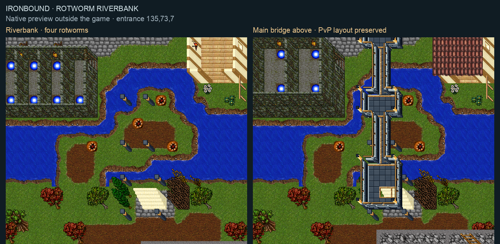

# Puente principal — Ironbound (23 nov 2026)

Puente elevado de la ciudad: **141,65,6**, tablero x140–142, y57–75. Es el puente
principal documentado en [PIEZAS_DE_MAPA.md](PIEZAS_DE_MAPA.md#puente-de-madera-elevado-z6).

La estética cambia de madera a **basalto oscuro, hierro, remates de piedra clara y
bronce**, con balizas ámbar. Los dos segmentos angostos llevan inlays de bronce y
bandas de umbral: se distinguen las plataformas y los lugares de trap sin poner
obstáculos ni decoración encima del paso. Los ocho apoyos de madera pasan a pilares
de basalto con abrazaderas de bronce. Todo el arte se construye con el modelo 3D
nativo del puente, sin cambiar sprites de otros muelles ni puentes.


Es una vista previa fuera del juego, con mapa y assets reales de cada versión.

## PvP conservado

- **41 casillas transitables**, idénticas a la versión anterior.
- Dos pasos de **1 sqm**, x141 en **y62–65** y **y68–71**; las plataformas siguen
  teniendo 3 casillas de ancho. Cada una de las ocho casillas angostas sigue
  cortando la conexión norte-sur al ocuparla un jugador, incluso con diagonales.
- Mismas **50 anclas de baranda**, sin suelo, y mismos flags de bloqueo y proyectiles.
- **Cuatro trampillas 429** y sus llegadas conservadas. No se cubren con decoración:
  así mantienen su dibujo reconocible y el click derecho sobre la trampilla nativa.
- Mismas posiciones y colisión de los **ocho pilares en z7**.
- El suelo base 405 se conserva bajo un pavimento decorativo no bloqueante:
  velocidad, niveles, rutas, colocación de fields y el combate conservan sus bases.

## Scripts y recursos

| Archivo | Función |
|---|---|
| `scripts/client-rme/city_bridge_z6_art.py` | Contorno 3D, anclas originales fijas y reparto de piezas de 64×64; caché de piezas para el instalador. |
| `scripts/client-rme/ironbound_bridge_material.py` | Basalto, mampostería, hierro/bronce y balizas. Carga una copia privada del renderizador de madera: no modifica su paleta global. |
| `scripts/client-rme/ironbound_bridge_deck.py` | 16 pavimentos de 32×32 con bordes y marcas; pilar de 64×64. |
| `scripts/client-rme/add_custom_items.py` | Instala solo los IDs de esta familia sobre los assets actuales. |
| `scripts/map/bridge-trap-steps.py` | Aplica el acabado con guardas de colisión, suelos, casas y atributos protegidos. |
| `scripts/map/render-main-bridge.py` | Render real y comparación con un backup completo. |

Barandas: server **20490–20507**, client **5210–5227** (misma familia exclusiva,
nuevo dibujo). Pavimentos: server **20540–20555**, client **5260–5275**. Pilar:
server **20579**, client **5299**. Los slots nuevos estaban vacíos al integrarlos.
35 apariencias en total; 92 sprites añadidos, **15334–15425**. Outfits, efectos y
proyectiles anteriores permanecen idénticos. Ambos OTB actualizados.

PNG reproducibles en `devtools/zagan-test/custom-sprites/`: `cbz6_00.png` a
`cbz6_17.png`, `ironbound_floor_00.png` a `ironbound_floor_15.png` e
`ironbound_pier.png`. No se sustituyen los suelos/barandas/pilares nativos globales.

```bash
python3.11 scripts/client-rme/city_bridge_z6_art.py
python3.11 scripts/client-rme/add_custom_items.py \
  --things devtools/rme/rme-client-760 \
  --otb server/YurOTS/ots/data/items/items-zagan-test.otb \
  --otb server/YurOTS/ots/data/items/items.otb \
  --only 20490 20491 20492 20493 20494 20495 20496 20497 20498 20499 20500 20501 20502 20503 20504 20505 20506 20507 20540 20541 20542 20543 20544 20545 20546 20547 20548 20549 20550 20551 20552 20553 20554 20555 20579
python3.11 scripts/map/bridge-trap-steps.py --dry-run
python3.11 scripts/map/bridge-trap-steps.py
python3.11 scripts/map/render-main-bridge.py --before-dir backups/map/ironbound-bridge
```

## Validaciones y detalles importantes

Auditoría contra `backups/map/ironbound-bridge/`: **45 casillas cambiadas** (37 de
pavimento y ocho pilares), ninguna fuera del puente. Misma huella del mapa, suelos,
flags de movimiento/proyectiles/cambio de piso, casas y 11 lockers completos.
Conectividad de las 41 casillas y ocho cortes de 1 sqm comprobados estáticamente.
Las cuatro trampillas y las casillas de sus escaleras siguen iguales.

DAT: solo 18 apariencias exclusivas actualizadas y 17 slots antes vacíos ocupados;
todo el resto y su cola son idénticos. SPR: los 15.333 registros anteriores son
idénticos; se añaden 92. En OTB solo cambian nombres/descripciones de las 18 piezas
anteriores, además de los nuevos ítems; su comportamiento no cambia.
`bridge-trap-steps.py --dry-run` repetido: **0 cambios**; `check-map-load.py`:
**0 errores**; `sync-houses-with-map.py --dry-run`: coincide.

No ampliar la base de los pretiles por fuera de su huella: los píxeles a nivel del
suelo pueden necesitar anclas nuevas y cambiar la colisión del puente. El modelo
actual fija las 50 anclas existentes y falla si una pieza no cabe en su 2×2.
El material se carga de forma privada para no recolorear los demás puentes al
importar el instalador general. Las apariencias se generan antes de instalarlas.

Publicado y aplicado en la ThinkPad el 23 nov, junto con la ribera descrita abajo.
No se recompiló C++ ni se hicieron suites, bots o pruebas in-game, respetando la
preferencia del usuario. El respaldo, la publicación y el reinicio ordenado siguieron
el procedimiento de [ThinkPad](../systems/THINKPAD_TEST_SERVER.md).

## Ribera de rotworms bajo el puente — 23 nov 2026

Gonzalo autorizó push/deploy y pidió rotworms en el agua bajo el puente, con entrada
por el lado izquierdo sur. Se añadió una pequeña ribera de tierra en **z7**, con
acceso desde **135,73,7**. Cuatro **Rotworms** normales, respawn **90 s**, radio 2;
sus posiciones son 136,69 / 140,67 / 143,69 / 142,65.



La ribera ocupa 76 casillas, con **36 transitables**, 37 de costa y tres pilares
existentes. Se conservan los ocho pilares y sus posiciones; el paso rodea los
cimientos. Hay manchas de tierra con bordes nativos y agua alrededor. La única
conexión con suelo existente es la boca suroeste: no se une a la ciudad por el
norte ni crea un atajo para evitar los dos segmentos PvP del puente.

`bridge_rotworm_bank.py` valida que todos los suelos libres se alcancen desde la
entrada, que el contacto con otras orillas quede exclusivamente en x133–137,y73,
y que los monstruos estén separados y lejos de la boca. La costa usa 4526 con
4644–4655, como las orillas vecinas. **4526 solo no bloquea**: lo hace el borde
costero; por eso se verifica la colisión completa, no solo el nombre del suelo.
No hay objetos decorativos en el agua ni en las piezas de costa nuevas.

- `scripts/map/bridge_rotworm_bank.py`: terreno y bloque `IRONBOUND_ROTWORMS` de
  `test-spawn.xml`; guarda propiedad/originales en `generated-bridge-rotworms.json`.
- `scripts/map/render-bridge-rotworms.py`: vista a nivel de la ribera y con el puente
  superior, usando el look nativo 26 de los rotworms.
- `test.otbm`: 76 casillas adicionales, solo en la ribera; **ningún tile z6 cambia**.
- `test-spawn.xml`: cuatro spawns nuevos; el texto previo se recupera exactamente
  al quitar el bloque propio. No se cambian monstruos, NPCs, escaleras ni casas.

```bash
python3.11 scripts/map/bridge_rotworm_bank.py --dry-run
python3.11 scripts/map/bridge_rotworm_bank.py
python3.11 scripts/map/render-bridge-rotworms.py
```

Segunda pasada: 0 cambios de mapa/spawns. Auditoría de frontera y conectividad OK;
todos los tiles del puente, sus cuatro trampillas, 50 anclas, casas y 11 lockers
idénticos a la versión Ironbound preparada. La obstrucción de proyectiles de todo
el mapa sigue idéntica. El terreno previamente transitable no se bloquea: solo se
habilita el bolsillo de ribera. No requiere assets adicionales ni recompilar C++.

## Publicación y deploy — 23 nov 2026

Push a `main`: assets `05f181f`, puente `0a0eac0`, ribera y cuatro spawns `710e4b6`.
Cliente publicado con `scripts/client-rme/publish_client.py` y push a `clienteretro`
`main`: **`3a42c7e`**. Los 775 archivos comunes coinciden entre updater, Mac,
Windows y el `data.zip` de ambas descargas. Las APIs y descargas HTTP de 8080/8076
entregan los mismos bytes. CRC32: DAT `9f7f0dbf`, SPR `c303b4f2`, minimapa `8d9f0da3`.

Respaldo en la ThinkPad:
`/home/gonzalo/backups/pre-deploy-20261123-011512-ironbound-rotworms`.
Incluye runtime y assets anteriores, más una copia fresca `before-restart/` después
de `scripts/deploy/server-save.sh --now`. El avance de `c58c190` a `710e4b6` fue
`git merge --ff-only origin/main`, con cero archivos entrantes superpuestos a los
cambios locales de otras sesiones; esos cambios se conservaron.

Activación: `docker restart -t 45 yurots`, cierre ordenado confirmado y arranque
**2026-11-23 04:18:48 UTC**. Contenedor healthy, sin errores ni avisos en el arranque.
`scripts/ot/ot-probe.py 192.168.1.17 7171`: **OK, 10,4 ms**. Hashes del mapa,
spawns, ambos OTB y DAT/SPR coinciden con la versión preparada.

Comparación del runtime antes/después: **1 cuenta, 8 archivos de personajes y
35 casas**, con cuentas, inventarios, depots, propietarios/permisos, houseitems,
sponsors, configuración y binario conservados. `scan-map-depots.py`: **11 lockers,
todos depotid 1**. `sync-houses-with-map.py --dry-run`: coincide. No se verificó
apertura de lockers dentro del juego.
