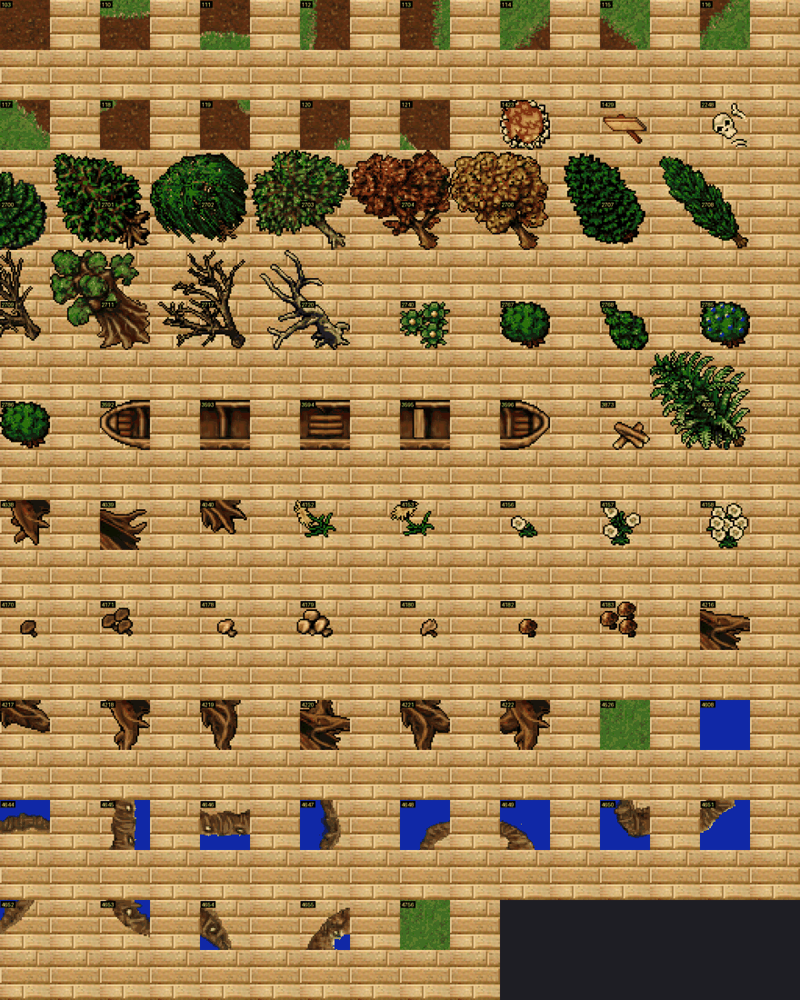
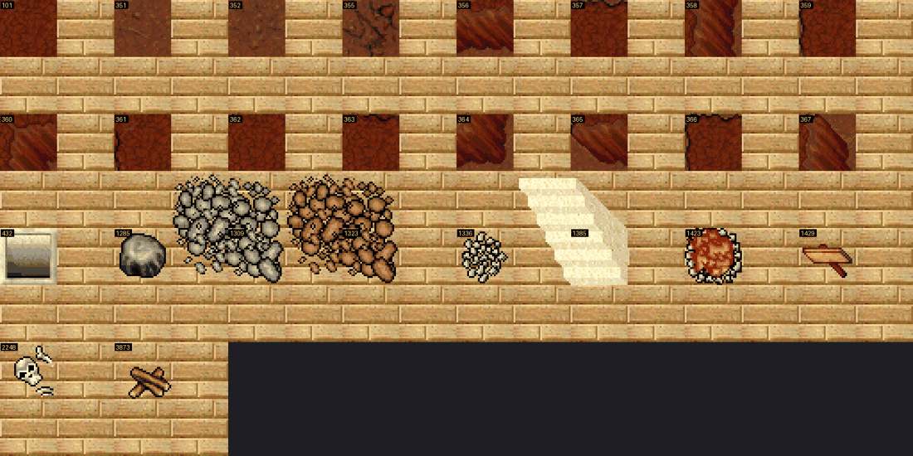
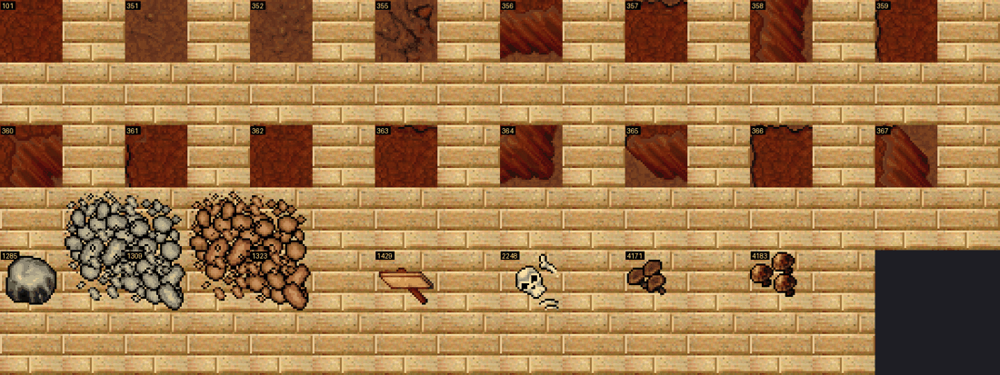
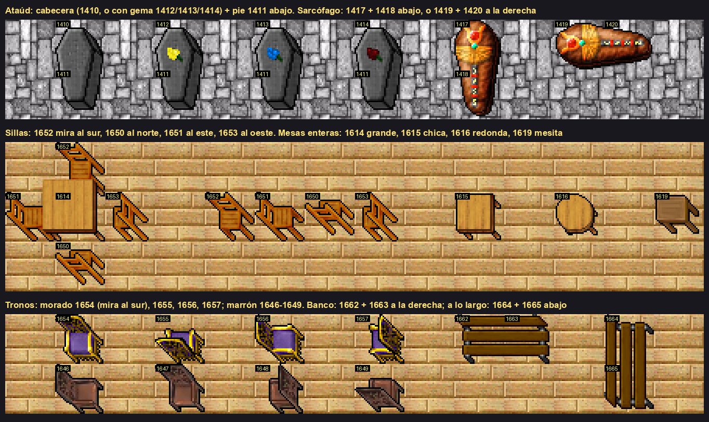
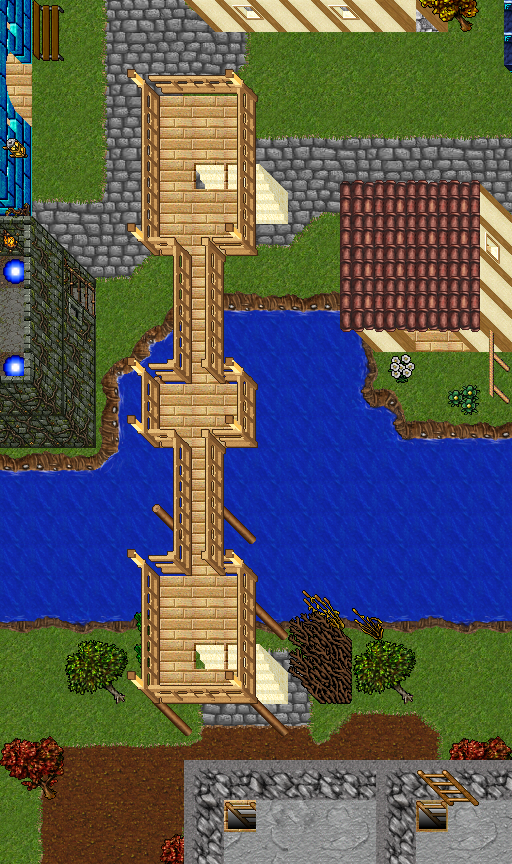

# Mapas: la guía única (nov 2026)

**Todo agente que toque el mapa sigue esta guía.** Junta lo que antes estaba repartido en
`PIEZAS_DE_MAPA.md` (piezas y reglas) y `ZONAS_DE_CAZA.md` (forma y monstruos), y suma el motor nuevo
**mapkit** y el modelo de decisión **jev**. La guía **aprende**: cada error nuevo o cada número que costó
encontrar se anota en [Errores que ya pasaron](#errores-que-ya-pasaron) antes de cerrar la tarea.

Docs de cada zona (`MAPEAR_*.md`, `DARK_CATHEDRAL.md`, ...) siguen existiendo para lo propio de esa zona.
Render de mapas con sharp para mirar y comparar variantes: [docs/map-rendering.md](../map-rendering.md).

## Resumen para agentes con poca atención

1. **Zona nueva o rehecha → mapkit**: una ficha JSON corta en `scripts/map/zones/`, no un generador de 500 líneas.
   Recetas: `island` (isla con sendero y puerto) y `cave` (cueva de un piso con bajada desde arriba). El hueco
   (`box`, `land`, `entrance`) lo da [`find_space.py`](#buscar-hueco): no medir a mano.
2. **No decidas lo que ya está decidido**: usá los [valores por defecto](#valores-por-defecto) y las piezas del
   [catálogo](#catalogo-de-piezas). Si una pieza no está en el catálogo, mirala antes ([regla uno](#regla-número-uno-mirar-la-pieza-antes-de-usarla)) y agregala al tema.
3. **Las decisiones chicas las toma jev** (barato, ~US$0,0005 por zona): qué va en cada claro, qué monstruos por
   etapa, el cartel, retocar la separación, elegir entre las 3 mejores semillas. La geometría, las piezas y la
   validación son de código. Vos (el modelo caro) solo escribís la ficha y mirás el resultado.
4. **El lint manda**: si una semilla tiene errores no se escribe. Nunca "arreglar a mano" lo que marca el lint.
5. **Antes de deployar**: `check-map-load.py` con 0 errores, llegada alcanzable (a pie o en barco/portal) y
   depot del templo in-game si se tocó el templo (`docs/gameplay/DEPOTS.md`).
6. **Al terminar**: anotar lo aprendido en [Errores que ya pasaron](#errores-que-ya-pasaron).

## Flujo con mapkit

```bash
# 0. hueco libre: imprime box/land (y la bajada de la cueva) listos para pegar en la ficha
python3.11 scripts/map/mapkit/find_space.py --kind cave --z 8 --size 60x52 --near 300,60
# 1. ficha (copiar una parecida: claro-de-los-lobos.json o _ejemplo-cueva.json): scripts/map/zones/<zona>.json
# 2. probar: semillas + lint + jev + vista previa (no escribe nada)
python3.11 scripts/map/mapkit/build.py scripts/map/zones/claro-de-los-lobos.json --preview /tmp/zona.png
# 3. escribir (test.otbm + spawns + cartel + NPC + destino de barco, con backup en backups/map/)
python3.11 scripts/map/mapkit/build.py scripts/map/zones/claro-de-los-lobos.json --write
# 4. validar
python3 scripts/map/check-map-load.py
python3.11 scripts/map/check-reachable.py X,Y        # si se llega caminando desde el templo
python3 scripts/map/check-upper-view.py --box X0 Y0 X1 Y1 --z Z   # cuevas: que no se vea el piso de arriba
```

| Archivo | Qué es |
|---|---|
| `scripts/map/mapkit/__init__.py` | Motor: geometría, ruido, bordes (`Border.settle` / `piece_at`), etapas de monstruos, escritura segura con manifiesto de dueño, vista previa con sprites reales |
| `scripts/map/mapkit/themes.json` | Catálogo de temas: qué id usar para cada cosa y la regla de cada categoría |
| `scripts/map/mapkit/island.py` | Receta "isla con sendero, claros, bosque y puerto" |
| `scripts/map/mapkit/cave.py` | Receta "cueva de un piso": pasillo en zigzag cavado en bloques 2x2, salas, paredes de tierra, bajada `432` arriba + `1385` abajo, techo de roca. Recetas nuevas (valle, ciudad) van al lado |
| `scripts/map/mapkit/find_space.py` | Busca [huecos libres](#buscar-hueco) del tamaño pedido cerca de un punto (isla: vacío en z y arriba; cueva: vacío en z + bajada válida en z-1) |
| `scripts/map/mapkit/cave_gruta.py` | Receta `cave-gruta`, la primera versión de cueva (OpenCode, 26 nov), con tema `caverna`. Solo la usa la Gruta de los Gárgolas para regenerarse igual; las cuevas nuevas usan `cave.py` |
| `scripts/map/mapkit/lint.py` | Errores (no escribe) y medidas (puntaje) |
| `scripts/map/mapkit/jev.py` | Cliente de jev (OpenRouter, solo mapas) con caché de decisiones y tope de gasto |
| `scripts/map/mapkit/build.py` | La corrida: decisiones → semillas → lint → elección → vista previa → escritura |
| `scripts/map/mapkit/catalog.py` | Regenera el [catálogo](#catalogo-de-piezas) de esta guía y las hojas de sprites |
| `scripts/map/zones/<zona>.json` | Ficha de la zona |
| `scripts/map/zones/<zona>.decisions.json` | Lo que decidió jev (se commitea: regenerar da el mismo mapa sin volver a preguntar) |

Escritura segura (`write_cells`): solo pisa casillas vacías o que el manifiesto de la zona dice que son suyas y no
cambiaron; nunca casas, flags de casilla ni ítems con atributos (uid, actionid, teleports). Los apilables llevan
byte de cantidad. Lo que era de la zona y ya no se usa vuelve al relleno del tema (`filler`: agua, roca). La única
casilla ajena que se puede tomar es la de la bajada de una cueva (`claims`): solo si sigue como se la vio, y el
manifiesto guarda lo original (`claimed`) para devolverlo si la bajada se mueve. Bloques en XML con dueño:
`<!-- BEGIN <ZONA>_SPAWNS -->`, `_SIGNS`, `_NPC`; el destino del barco es una línea en `boat.lua`.

<a id="ficha"></a>

### La ficha de una zona

```jsonc
{
  "name": "claro-de-los-lobos", "title": "Claro de los Lobos", "game_name": "Wolf Grove",
  "recipe": "island", "theme": "bosque-isla", "z": 7,
  "box": [184, 250, 261, 380],            // caja que la zona es dueña (agua de relleno incluida)
  "land": [194, 258, 251, 372],           // la tierra solo crece acá (caja menos media pantalla)
  "manifest": "generated-wolf-grove.json",
  "levels": "8-25",
  "harbor": {"open": "w", "npc": "Nimral", "travel": {"keys": ["wolf grove"], "name": "Wolf Grove", "price": 20}},
  "route": [[205, 268], [241, 267], [241, 286], [209, 287], ...],   // esqueleto: filas a 16-18
  "trail_width": [2.2, 3.2], "forest": [3, 6],
  "glades": [{"role": "harbor", "center": [202, 268], "r": [5, 4]}, {"at": 0.22, "r": [5, 4]}, ...],
  "monster_pool": ["Wolf", "Badger", "Deer", "Winter Wolf", "War Wolf", "Bear"],
  "stages": [ ... fallback si jev no está ... ],
  "density": [30, 45], "seeds": 8, "sign": "fallback del cartel"
}
```

Lo único que hay que pensar es `route` (el esqueleto) y el `monster_pool`: `box`/`land` salen de
[`find_space.py`](#buscar-hueco) y el resto tiene valor por defecto.

<a id="buscar-hueco"></a>

**Buscar hueco libre** (`find_space.py`, ~2 s, sin modelo): da las 5 mejores cajas del tamaño pedido, de la más
cercana a `--near` (por defecto el templo) a la más lejana, con `box`/`land` listos para pegar. `land` = caja
menos (10, 8): nada de vacío a media pantalla.

```bash
python3.11 scripts/map/mapkit/find_space.py --kind island --size 78x131 --near 220,300      # z7 y arriba vacíos
python3.11 scripts/map/mapkit/find_space.py --kind cave --z 8 --size 60x52 --near 300,60 --radius 40 --ascii
```

- **Cueva**: busca casillas de z-1 a `--radius` del punto que sean solo suelo caminable con la de su norte
  caminable (al subir por la `1385` se llega al norte), y debajo una caja vacía en z con la bajada en la zona de
  boca. Dice cuánto techo ya hay arriba (`techo existente`) y avisa si la bajada pisa una casilla de otra zona
  generada (rehacer esa zona la pisaría: elegir otra opción).
- `--ascii`: mapa chico del piso (1 carácter = 8x8) con las opciones numeradas, para elegir sin imagen.
- Tamaños de referencia: isla de 1.200 caminables ≈ 78x131; cueva de ~600 caminables ≈ 60x52, de ~1.000 ≈ 70x70.

<a id="ficha-cueva"></a>

### La ficha de una cueva

Plantilla: `scripts/map/zones/_ejemplo-cueva.json` (probada, **no** escrita en el mapa).

```json
{
  "name": "...", "title": "...", "game_name": "Dwarven Burrow", "recipe": "cave", "theme": "cueva-tierra",
  "z": 8, "box": [274, 20, 333, 71], "land": [284, 28, 323, 63], "entrance": [291, 53],   // de find_space.py
  "manifest": "generated-<zona>.json", "levels": "15-35",
  "route": [[288, 58], [288, 32], [302, 32], [302, 59], [316, 59], [316, 32]],      // filas/columnas a 14
  "min": 400, "monster_pool": [...], "stages": [...fallback...], "density": [33, 50], "sign": "fallback"
}
```

- `route`: tramos horizontales o verticales, filas (o columnas) a **14** entre ejes, a 4+ del borde de `land`.
  El primer punto va al sur o al costado de la bajada (se llega al sur de la `1385`), en la fila más cercana.
- Las salas salen solas (mitad de cada tramo de 20+ y el final); `"rooms": [{"center": [x, y], "r": 3}]` para
  fijarlas. jev elige qué tiene cada una (`osario`, `derrumbe`, `campamento`, `lodazal`).
- `min`: piso mínimo (~70 % de lo que da la vista previa). Opcionales: `mud`/`alt` (paleta), `stones`, `bones`,
  `band`, `wide`, `clear` (ver [valores por defecto](#valores-por-defecto)).
- Lo escribe todo `--write`: la cueva, la bajada `432` en z-1 (casilla tomada, con lo original en el manifiesto),
  el techo de roca en las casillas vacías de z-1, spawns y cartel.

<a id="valores-por-defecto"></a>

## Valores por defecto (no volver a decidirlos)

| Qué | Valor | Por qué |
|---|---|---|
| Ancho del sendero (`trail_width`) | 2,2–3,2 (sale de 3–5 con los bordes) | Con menos de 2,2 los tramos diagonales quedan de 1 casilla y `settle` los borra: sendero cortado |
| Franja caminable | sendero + 1 de pasto a cada lado + rincones con ruido (radio 2) | Pasillo de 5–8; con radio 3 quedaba una avenida |
| Filas del recorrido | 16–18 casillas entre ejes (cuevas: 14) | Bosque de por medio sin atajos |
| Recorrido lejos del borde de `land` | ≥ `forest[0] + 2` | Si no, el borde recorta el sendero |
| Bosque | franja pegada a lo caminable que bloquea (cerrada en 8 direcciones), 2.ª fila irregular de arbustos, adentro pasto con árboles sueltos (árbol 50 %, arbusto 15 %) | Bosque macizo = pared verde ("muy denso de árboles"); solo el borde hace falta para no tener atajos |
| Profundidad del bosque (`forest`) | 3–6 con ruido | Islas con forma, no rectángulos |
| Claros | radio 4–6, al costado del sendero (no encima) | Encima del sendero no se leen como lugar |
| Árboles de otoño | 3 % | Más se ve manchado |
| Separación de spawns (`gap`) | 11–13 al principio, 10–12 al fondo | Ver [Zonas de caza](#zonas-de-caza) |
| Densidad (`density`) | superficie 30–45 casillas por monstruo; cueva 33–50 | — |
| Sin monstruos cerca de la llegada | 8 casillas (puerto), 6 (escaleras/portales) | — |
| Semillas | 8; jev elige entre las 3 mejores | — |
| Cueva: ancho del pasillo | núcleo de 3 (5 donde el ruido pasa `wide` 0,68), franja `band` 2 → 4–6 al cavar en 2x2 | Con la franja de 5 del valle y `wide` 0,55 salían pasillos de 7–9 rectangulares |
| Cueva: filas | 14 entre ejes; recorrido de ~110 casillas → ~600 caminables, de ~180 → ~1.000 | Menos de 14: atajo entre filas (lint `shortcut`) |
| Cueva: decoración | piedras contra la pared 8 %, piedritas 3 %, calaveras 3 %; 2x2 solo si tapan pared | — |
| Spawntime | 85–110 s fáciles, 120–180 s fuertes | — |

<a id="jev"></a>

## jev: el modelo de decisión barato

OpenRouter `typesafe/jev-router` elige solo el modelo y el esfuerzo de cada pedido (en las pruebas respondió
`deepseek-v4.1-flash` u `openai/gpt-6-luna`). **Una zona entera gasta ~US$0,001** (4–5 decisiones). Solo para
mapas; la clave está en `~/.config/retro76/openrouter.env` y no se imprime ni se commitea.

| Decisión | Qué le da el motor | Qué valida Python |
|---|---|---|
| `stages` | monstruos de la ficha con vida y experiencia, niveles | nombres del pool, 1–2 por spawn, spawntime 80–180, separación 9–13 |
| `glades` | menú `props` del tema | un tipo válido por claro |
| `sign` | nombre del juego, niveles, etapas | 2–4 líneas, ≤38 caracteres, ASCII |
| `tune` | densidad medida vs pedida | separaciones 9–14 (si ninguna semilla da la densidad) |
| `pick` | las 3 mejores semillas en ASCII 2x + medidas | índice válido |

- Respuesta inválida → reintenta una vez → usa el fallback de la ficha. Sin clave o `--no-jev` → fallback.
- Todo se guarda en `zones/<zona>.decisions.json`; `--redecide` vuelve a preguntar.
- Tope por corrida `MAPKIT_JEV_MAX_USD` (0,05). Registro de cada llamada: `~/.cache/retro76/jev-log.jsonl`.
- **No usar visión cara para etiquetar piezas**: en nov 2026 eso gastó ~US$14,8. Lo visual se valida con lint y
  con una vista previa que mira el agente; para mandar imágenes a un modelo, ver [map-rendering.md](../map-rendering.md).

<a id="lint"></a>

## Lint: qué se mide

Errores (la semilla se descarta): `void` (vacío a la vista ±9/±7), `unreachable`, `cut` (más del 2 % de lo
caminable quedó suelto), `leak` (casilla libre pegada a lo caminable: atajo por el bosque), `border` (pieza de
costa o de tierra que no es la única válida), `coast_walk`, `big_cover` (sprite de 2x2 tapando caminable),
`loose` (decoración que se levanta o se empuja), `spawn` (fuera de lo caminable, repetido o cerca de la llegada),
`shortcut` (un punto del recorrido se alcanza en menos del 70 % de su distancia), `roof` (cueva: casilla caminable
sin nada arriba; el techo no se pone pegado a un piso caminable de arriba, ver [Techo](#techo)).

`border` es genérico: toda casilla pegada a la forma de cada borde de la receta (`plan["borders"]`: agua y
sendero en la isla, piso en la cueva) tiene que llevar su única pieza. `big_cover` no marca los ids `big_ok` del
tema (la escalera `1385`, que se dibuja 2x2 sobre el piso de la boca).

Puntaje (100 = ideal): resta % de casillas de 1 de ancho, % de costa en tramos rectos de 7+, densidad fuera del
rango y bosque sin árboles grandes.

<a id="temas"></a>
<a id="catalogo-de-piezas"></a>

## Catálogo de piezas por tema

Generado por `scripts/map/mapkit/catalog.py` desde `themes.json` y los datos reales de cada id (no editar a mano;
para agregar una pieza: mirarla, sumarla al tema con su categoría y volver a correr el script). Las reglas de
piezas sueltas (muebles, paredes, escaleras, botes) están más abajo en [Piezas](#piezas).

<!-- BEGIN CATALOGO (scripts/map/mapkit/catalog.py) -->
### Tema `bosque-isla`

Isla de pasto con bosque cerrado, sendero de tierra y claros. Agua alrededor.

| Categoría | Ids (server) | Dibujo | Bloquea | Regla |
|---|---|---|---|---|
| `filler` | 4608 | 1x1 | sí | Relleno de la caja: lo que queda en las casillas de la zona que no son tierra/piso (agua en islas, roca en cuevas). Lo que era de la zona y ya no se usa vuelve a esto. |
| `water` | 4608 | 1x1 | sí | Suelo de agua. Todo lo que el jugador ve (±9, ±7) tiene que tener tile: el agua de relleno también es de la zona. |
| `grass` | 4756 | 1x1 | no | Suelo de pasto adentro de la isla (caminable o bajo el bosque). |
| `trail` | 103 | 1x1 | no | Suelo del sendero. Mínimo 2,2 de ancho (trail_width): los tramos de 1 se borran al cerrar los bordes y el sendero queda cortado. |
| `coast` | 4526, 4644, 4645, 4646, 4647, 4648, 4649, 4650, 4651, 4652, 4653, 4654, 4655 | 1x1 | mixto | Costa: suelo + pieza de borde en la casilla de TIERRA pegada al agua, elegida por dónde está el agua (Border.piece_at). Bloquea: nunca en caminable ni donde llega un puente o un bote. |
| `trail_edge` | 111, 112, 110, 113, 120, 121, 119, 118, 116, 117, 115, 114 | 1x1 | no | Borde de tierra: es el SUELO de la casilla de pasto pegada al sendero, elegido por dónde está el sendero. Caminable. Una sola pieza válida por casilla (Border.settle). |
| `trees_2x2` | 2700, 2701, 2702, 2707, 2708, 2711, 4009 | 2x2 | sí | Árbol de 2x2: se ancla abajo-derecha y se dibuja hacia arriba-izquierda. Las 4 casillas del dibujo tienen que ser bosque (no caminable): si no, tapa al jugador. |
| `trees_rare` | 2703, 2704, 2706 | 2x2 | sí | Igual que trees_2x2, colores de otoño: pocos (3 %) o se ve manchado. |
| `blockers_1x1` | 2767, 2768, 2786, 2785 | 1x1 | sí | Arbusto o pino chico de 1 casilla, bloquea. Es lo que cierra el borde del bosque (hedge): toda casilla pegada a lo caminable que no sea camino tiene que bloquear. |
| `dead_trees` | 2709, 2717, 2720 | 2x2 | sí | Árbol seco de 2x2 (misma regla que trees_2x2). Para la guarida del oso. |
| `roots` | 4038, 4039, 4040, 4216, 4217, 4218, 4219, 4220, 4221, 4222 | 1x1 | sí | Raíces/tocón de 1 casilla, bloquea. Borde de claros. |
| `flowers` | 4152, 4153, 4156, 4157, 4158, 2740 | 1x1 | no | Decoración que no bloquea ni se levanta, sobre pasto caminable. Nunca sobre la llegada ni donde aparece un monstruo. |
| `mushrooms` | 4170, 4171, 4178, 4179, 4180, 4182, 4183 | 1x1 | no | Hongos fijos (los 4170+; los 2787–2796 se levantan: no usar). |
| `bones` | 2248 | 1x1 | no | Calavera con huesos fija (2248). La 2320 se levanta y es apilable: no usar como decoración. |
| `logs` | 3873 | 1x1 | no | Troncos cruzados, no bloquean. |
| `campfire` | 1423 | 1x1 | no | Fogata (no bloquea sólido): centro del claro de campamento, sin monstruos encima. |
| `sign` | 1429 | 1x1 | sí | Cartel: bloquea; va pegado a la llegada (en la isla en el borde del bosque, en la cueva contra la pared) sin cortar el paso. Su texto va en readables.xml (bloque de la zona). |
| `boat_h` | 3592, 3593, 3594, 3595, 3596 | 1x1 | no | Bote horizontal: SIEMPRE las 5 piezas seguidas de oeste a este, sobre agua, sin tocar la costa. |

Claros (`props`, los elige jev o la ficha):

| Tipo | Qué es | Piso (suelto) | Borde (bloquea) |
|---|---|---|---|
| `wolf-den` | Guarida de lobos: huesos y calaveras, raíces en el borde | bones, logs (7%) | roots, blockers_1x1 (35%) |
| `bear-den` | Cueva del oso: árboles secos y raíces, huesos | bones (5%) | dead_trees, roots (45%) |
| `hunter-camp` | Campamento de cazador: fogata con troncos | logs (3%) | blockers_1x1 (25%) + `campfire` al centro |
| `meadow` | Pradera con flores | flowers (12%) | blockers_1x1 (20%) |
| `mushroom-ring` | Anillo de hongos en un claro húmedo | mushrooms (10%) | roots (30%) |



### Tema `cueva-tierra`

Cueva de tierra: piso de tierra y barro, paredes de tierra, roca lisa alrededor. Bajada 432 desde el piso de arriba.

| Categoría | Ids (server) | Dibujo | Bloquea | Regla |
|---|---|---|---|---|
| `filler` | 101 | 1x1 | sí | Relleno de la caja: lo que queda en las casillas de la zona que no son tierra/piso (agua en islas, roca en cuevas). Lo que era de la zona y ya no se usa vuelve a esto. |
| `rock` | 101 | 1x1 | sí | Roca lisa (bloquea). Nunca pegada a un piso caminable: entre los dos va pared (`wall`). También es el techo en el piso de arriba. |
| `floor` | 351 | 1x1 | no | Piso de cueva (tierra). La paleta sale con ruido: floor / floor_alt / mud. |
| `floor_alt` | 352 | 1x1 | no | Piso de cueva alterno (tierra más clara). |
| `mud` | 355 | 1x1 | no | Barro (caminable). Más barro = cueva más oscura (`mud` en la ficha). La sala `lodazal` lo pinta entero. |
| `wall` | 356, 357, 358, 359, 364, 365, 366, 367, 360, 361, 362, 363 | 1x1 | sí | Pared de tierra: SUELO de la casilla pegada al piso, elegido por dónde está el piso. Se cava en bloques 2x2 para que cada pared tenga una sola pieza válida (una roca de 1 entre pisos no tiene pieza). |
| `stair_down` | 432 | 1x1 | no | Bajada (es suelo): va en el piso de ARRIBA, sobre una casilla de solo suelo caminable con la de su norte caminable. |
| `stair_up` | 1385 | 2x2 | no | Escalera de subida (sube hacia el norte): en la cueva, misma x, y que la bajada. Se aterriza al sur. Dibujo 2x2 sobre piso: permitida (`big_ok`). |
| `stones` | 1285 | 1x1 | sí | Piedra de 1 casilla que bloquea: contra la pared, sin cortar el paso. |
| `rubble_2x2` | 1309, 1323 | 2x2 | sí | Piedras grandes de 2x2 (bloquean): solo donde las 3 casillas de arriba-izquierda son pared (si no, tapan al jugador). |
| `pebbles` | 1336 | 1x1 | no | Piedritas (no bloquean ni se levantan). |
| `bones` | 2248 | 1x1 | no | Calavera con huesos fija (2248). La 2320 se levanta y es apilable: no usar como decoración. |
| `logs` | 3873 | 1x1 | no | Troncos cruzados, no bloquean. |
| `campfire` | 1423 | 1x1 | no | Fogata (no bloquea sólido): centro del claro de campamento, sin monstruos encima. |
| `sign` | 1429 | 1x1 | sí | Cartel: bloquea; va pegado a la llegada (en la isla en el borde del bosque, en la cueva contra la pared) sin cortar el paso. Su texto va en readables.xml (bloque de la zona). |
| `big_ok` | 1385 | 2x2 | no | Ids de 2x2 que pueden dibujarse sobre piso caminable (la escalera). El lint no los marca como big_cover. |

Claros (`props`, los elige jev o la ficha):

| Tipo | Qué es | Piso (suelto) | Borde (bloquea) |
|---|---|---|---|
| `osario` | Osario: calaveras y piedritas, piedras contra la pared | bones, pebbles (8%) | stones (30%) |
| `derrumbe` | Derrumbe: piedras grandes contra la pared | pebbles (6%) | stones, rubble_2x2 (45%) |
| `campamento` | Campamento abandonado: fogata con troncos | logs (4%) | stones (20%) + `campfire` al centro |
| `lodazal` | Lodazal: piso de barro con piedritas | pebbles (3%) | stones (25%) |



### Tema `caverna` (solo Gruta de los Gárgolas, receta `cave-gruta`)

Cueva subterránea: pasillo de tierra en zigzag, paredes de tierra y roca alrededor.

| Categoría | Ids (server) | Dibujo | Bloquea | Regla |
|---|---|---|---|---|
| `filler` | 101 | 1x1 | sí |  |
| `rock` | 101 | 1x1 | sí |  |
| `floor` | 351 | 1x1 | no |  |
| `floor_alt` | 352 | 1x1 | no |  |
| `mud` | 355 | 1x1 | no |  |
| `wall` | 357, 358, 356, 359, 366, 367, 365, 364, 362, 363, 361, 360 | 1x1 | sí | Pared de tierra 356-367 (WALL_SIDE/CORNER/INNER de generate-north-pass.py). La pieza va en la roca pegada al piso; bloqueea. |
| `sign` | 1429 | 1x1 | sí | Cartel: bloquea; va en el borde del bosque pegado a la llegada. Su texto va en readables.xml (bloque de la zona). |
| `bones` | 2248 | 1x1 | no | Calavera con huesos fija (2248). La 2320 se levanta y es apilable: no usar como decoración. |
| `stones` | 1285, 1309, 1323 | 1x1/2x2 | sí |  |
| `mushrooms` | 4171, 4183 | 1x1 | no | Hongos fijos (los 4170+; los 2787–2796 se levantan: no usar). |



<!-- END CATALOGO -->

<a id="piezas"></a>

# Piezas: reglas de uso

Guía para quien escribe un generador de mapa (`scripts/map/generate-*.py`) o coloca ítems a mano. Sale de
rehacer el Castillo Imperial (nov 2026), donde la primera versión tenía ataúdes a medias, tramos de mesa
sueltos y sillas mirando todas para el mismo lado.



## Regla número uno: mirar la pieza antes de usarla

El nombre del `.otb` no alcanza. "stone coffin" son cinco ids y ninguno es un ataúd entero; "table" son
veinte y casi todos son tramos. Antes de poner un id nuevo en un generador:

```bash
# cada id suelto, con su número
python3.11 scripts/map/render-pieces.py --sheet /tmp/hoja.png 1410-1420 1650-1657

# cómo queda una pieza junto a otra: una fila por argumento, casillas separadas con ';'
python3.11 scripts/map/render-pieces.py --scene /tmp/escena.png "431 1410;431 1412" "431 1411;431 1411"

# rehacer la imagen de este doc
python3.11 scripts/map/render-pieces.py --furniture docs/items-and-map/img/piezas-de-mapa.png
```

Después, mirar el piso completo con la vista previa del generador (`--dry-run --preview`).

## Muebles de varias piezas

Nunca va una sola. La segunda pieza va en la casilla indicada.

| Mueble | Primera pieza | Segunda pieza | Dónde va la segunda |
|---|---|---|---|
| Ataúd de piedra | 1410 (cabecera lisa) | 1411 (pie) | abajo (y + 1) |
| Ataúd con gema | 1412 amarilla, 1413 azul, 1414 roja | 1411 (pie) | abajo (y + 1) |
| Sarcófago de pie | 1417 | 1418 | abajo (y + 1) |
| Sarcófago acostado | 1419 | 1420 | a la derecha (x + 1) |
| Banco | 1662 | 1663 | a la derecha (x + 1) |
| Banco a lo largo | 1664 | 1665 | abajo (y + 1) |

- Los ataúdes y sarcófagos bloquean el paso. Van contra una pared, con la cabecera hacia ella.
- Los bancos no bloquean: no poner monstruos encima.

## Botes: cinco piezas, no una punta sola

Caso confirmado en Frozen Isle: `3591` en `397,108,7` dejaba solo la punta sur de un bote.
Corregido localmente el 13 nov 2026 con `3592–3596` en `395–399,108,7`; el generador exige las cinco piezas sobre agua.
No es un sprite entero ni un naufragio. Ver [revisión de hielo](REVISION_ESTETICA_HIELO_2026_11_13.md).

Otro caso, ensenada de la Torre del Barquero (24 nov 2026): en `(171,62–66,7)` la secuencia
vertical estaba mal (`3587, 3590, 3589, 3590, 3591`, con vela `3597` en el medio) y el casco
estaba sobre pasto. Se rearmó `3587 → 3588 → 3589+3597 → 3590 → 3591` sobre agua `4608`,
sin correr el barco (al oeste está el muelle). Ver [arreglos visuales de la city](CITY_VISUAL_FIXES_2026_11_24.md).

| Orientación | Secuencia completa | Dirección de colocación |
|---|---|---|
| Vertical | 3587 → 3588 → 3589 → 3590 → 3591 | misma x, y + 1 por pieza |
| Horizontal | 3592 → 3593 → 3594 → 3595 → 3596 | misma y, x + 1 por pieza |

Comprobar que todas las casillas estén sobre agua y que el casco no corte la costa ni la llegada.
El generador debe validar la secuencia completa, igual que un mueble de varias piezas.

## Sillas y tronos: un id por dirección

La silla tiene que mirar a su mesa.

| Mira al | Silla de madera | Va |
|---|---|---|
| sur | 1652 | al norte de la mesa |
| norte | 1650 | al sur de la mesa |
| este | 1651 | al oeste de la mesa |
| oeste | 1653 | al este de la mesa |

- Trono morado y dorado: 1654 mira al sur (respaldo al norte). 1655, 1656 y 1657 son las otras direcciones:
  comprobarlas con `render-pieces.py` antes de usarlas.
- Trono marrón: 1646 a 1649, igual.
- Sillas y tronos no bloquean el paso.

## Mesas

| Sirve | Ids |
|---|---|
| Mesa entera de una casilla | 1614 (grande), 1615 (chica), 1616 (redonda), 1619 (mesita) |
| Tramos de mesa modular: no usar sueltos | 1610–1613 ("big table"), 1622–1641 ("table") |

Para una mesa larga, varias 1614 seguidas: se ven como una sola.

## Paredes

Las paredes de 7.6 se dibujan en el **borde sur y este** de su casilla. La pieza sale de las vecinas:

| La pared sigue al oeste | La pared sigue al norte | Pieza |
|---|---|---|
| sí | sí | esquina |
| sí | no | horizontal |
| no | sí | vertical |
| no | no | poste |

| Familia | Vertical | Horizontal | Poste | Esquina | Ventana |
|---|---|---|---|---|---|
| Piedra gris (castillo) | 1049 | 1050 | 1051 | 1053 | 1267 horizontal, 1268 vertical |
| Empalizada en punta (campamento de amazonas) | 3520 | 3512 | 3532 | 3531 | — |

**Suelo de las paredes:** la fila norte y la columna oeste (incluidas las esquinas NO, NE y SO)
llevan el **suelo de afuera** en planta baja (pasto/dirt) y **sin ground** en pisos altos. La
esquina **NE** de la Torre del Barquero va **verde** en z7: si se le pone piedra se ve una losa/
escalón sobre el muro. La esquina SE sí lleva el piso del cuarto. Las piezas de muralla no cambian:
siguen 1050 en la fila norte y 1053 en la esquina SE. En la Torre del Barquero: la derecha
**arriba** (NE, `180,61,7`) va **verde**; la derecha **abajo** (SE, `180,67,7`) queda con **piedra**.

- La casilla con pared bloquea el paso. El piso útil de un cuarto es lo que queda adentro del marco.
- **Suelo bajo la pared.** En la fila norte y la columna oeste del edificio la casilla queda afuera de la línea
  de pared: en planta baja lleva el suelo de afuera (pasto) y en pisos altos no lleva suelo. En el resto lleva el
  piso del cuarto.
- No poner dos líneas de pared pegadas ni bloques macizos: la regla de arriba es para paredes de una casilla.
- **Antorchas:** 2059 en pared horizontal y 2061 en vertical, en la misma casilla que la pared. Nunca en un
  poste ni en una esquina.
- **Tapices:** los 1855–1857 quedaron flotando fuera de la pared en la prueba. No usarlos sin mirarlos en una
  escena con pared.

## Escaleras entre pisos

| Piso | Qué va | Id |
|---|---|---|
| El de abajo | escalera, sobre el piso | 1385 |
| El de arriba, misma casilla (x, y) | hueco, como suelo | 432 |

- Al subir se llega a **(x, y − 1)** del piso de arriba. Al bajar, a **(x, y + 1)** del piso de abajo.
- Las dos casillas de llegada tienen que ser piso libre. Sale de `game.cpp` (`floorChange(NORTH)`).
- No poner monstruos a menos de 3 casillas de una llegada.

**Agujero y escalera de mano** (cuevas): agujero `479` arriba y escalera de mano `1386` en la misma
x, y del piso de abajo. Se cae sobre la escalera; usarla deja en **(x, y + 1)** del piso de arriba, que
tiene que ser piso libre. La escalera va **sola** en su casilla (nada de fogatas encima).

<a id="puente-de-madera-elevado-z6"></a>

## Puente principal de la ciudad (z6)

> **Puente de referencia del mapa.** Es el puente principal de la ciudad y el modelo documentado para
> puentes nuevos o rehechos. Hay que copiar su forma (tablero sin casillas de más, barandas 3D continuas y
> faroles) y su proceso (`city_bridge_z6_art.py` + `bridge-trap-steps.py`). No hay que volver a los
> intentos descartados de abajo. Los otros 8 puentes de la ciudad usan las mismas barandas en versión de
> tramos fijos (ver [TRANSICIONES_DEPOT.md](TRANSICIONES_DEPOT.md#los-demás-puentes-20-nov-2026)).

**Acabado actual aplicado (23 nov): [Ironbound — basalto, hierro y bronce](MAIN_BRIDGE.md).**
Conserva exactamente el trazado PvP documentado: 41 casillas, dos segmentos de
1 sqm, cuatro trampillas y 50 anclas de baranda. Bordes claros y umbrales de bronce
marcan los pasos angostos. El renderizador usa un material privado para no cambiar
los demás puentes. Cliente publicado y mapa aplicado en la ThinkPad. La ribera de
rotworms añadida debajo fue retirada a petición del usuario: vuelve el agua original.

### Versión de madera del 22 nov (base de geometría)

El puente sobre el río de la ciudad (x 139–144, y 57–76, z6) se rehízo el 22 nov 2026.

- **Tablero:** solo existen las tablas que se pisan, `405` (y las trampillas `429` que ya estaban). Tiene
  plataformas de 3 de ancho y **dos pasos de 1 sqm** (x 141, en y 62–65 y 68–71) para trapear.
- **Barandas:** 3D, en el mismo estilo que los puentes de la ciudad (`dock_bridge_art.py`): pasamanos y
  travesaño **continuos** por todo el contorno, poste con remate en cada esquina y **faroles encendidos**
  en las cuatro puntas del puente y en la entrada de cada paso angosto.
- **Piezas:** las dibuja `scripts/client-rme/city_bridge_z6_art.py`. Son 18 piezas de 2x2 (server
  `20490`–`20507`, client `5210`–`5227`), ancladas en las casillas de aire que rodean el tablero: sin suelo,
  bloquean y se ve el río de z7. Cada pedacito de baranda va a la casilla más cercana cuyo 2x2 contiene su
  dibujo **proyectado**: lo que tiene altura se corre arriba-izquierda, así que la base puede caer en la
  casilla vecina.
- **Mapa:** lo pone `scripts/map/bridge-trap-steps.py`. Los postes `1277` del río se corrieron bajo los
  bordes nuevos.

Intentos descartados:

1. Angostar con las barandas nativas `1518`: se dibujan en el borde oeste de su casilla y la bloquean, así
   que quedaban cortadas y con muñones.
2. Barandas planas dentro de la tabla (`make_bridge_rails.py`, server `20480`–`20488`, siguen instaladas):
   se veían poco continuas.



Para hacer otro puente con este modelo:

1. Definir `DECK` (y los pasos angostos) en una copia de `city_bridge_z6_art.py`, con `SERVER_BASE` y
   `CLIENT_BASE` libres. Antes, hacer `git fetch` y mirar los ids de las otras sesiones.
2. Ver la vista previa con `--preview` y, después, instalar las piezas con
   `add_custom_items.py --only <ids>`.
3. Ponerlas en el mapa con el equivalente de `bridge-trap-steps.py`: correr primero `--dry-run`, que solo
   debe tocar casillas del puente.
4. Antes de deployar, correr las validaciones de mapa de siempre y cruzarlo con un bot en un server aparte.

## Cuevas

**Cueva nueva → receta `cave` de mapkit** ([ficha](#ficha-cueva), tema `cueva-tierra`): cumple todo lo de abajo
y lo valida el lint. Lo que sigue es la regla, y sirve para revisar cuevas viejas hechas a mano o con generadores.

Paredes de tierra `356–367` (`WALL_SIDE`, `WALL_CORNER`, `WALL_INNER` en `generate-north-pass.py`; `wall` en el
tema `cueva-tierra`) y roca `101` alrededor. La pieza sale de dónde está el piso vecino (`pieces_for`).

- **Cavar en bloques 2x2** (`carve_cave` de `generate-north-pass.py`, `build_floor` de
  `generate-natural-island.py`, `carve` de `generate-city-depths.py`). Con pasillos y paredes de 2 de
  ancho cada pared tiene **una sola** pieza válida. Una roca de 1 casilla entre pisos no tiene pieza:
  queda un bloque de roca pelada sin borde.
- **Nada de vacío a la vista:** desde cualquier piso caminable, media pantalla (8×6 casillas) tiene que
  ser roca o mapa, nunca casillas sin tile (se ven negras).
- **No pisar lo ajeno:** el piso necesita sus 8 vecinas propias (la pared es de la cueva).
- **Nunca piso pegado a la roca lisa `101`.** Entre el piso y el relleno va pared: `356–367` en la cueva,
  ladrillo/piedra en las salas. Si una cueva se viste al lado de una construcción, no le tapa las paredes;
  la entrada es una boca en la pared que da al piso de cueva, no una sala cuadrada de tierra (se ve como un
  recorte sin paredes). Lo valida `audit-dark-cathedral.py` (chequeo 7b).
- **Decoración que no se mueve ni se levanta.** Barriles y cajas se empujan y traban el paso; los huesos
  agarrables se tiran. Las piedras/musgo de 2x2 se dibujan hacia arriba-izquierda: solo donde tapan pared.
- **Huesos enteros, no piezas del esqueleto de dragón.** `2247` (cabeza), `3122`–`3127` (garra, costillas,
  cola, cráneo) son partes de un esqueleto grande de varias casillas: sueltos se ven cortados. Para el
  suelo: `2248` (calavera con huesos), `2320` (calavera), `3121`, `3133` (esqueleto). El `3125`
  (dragon skeleton) **no se usa más**: las 124 que había sueltas en todo el mapa se sacaron el 18 nov 2026
  con `scripts/map/remove-dragon-skeletons.py` y ningún generador la coloca.
- Validar pieza por pieza, vacío a la vista, recorrido y escaleras antes de escribir. Ejemplo completo:
  [MAPEAR_DUNGEON_CITY.md](MAPEAR_DUNGEON_CITY.md).
- **Techo:** encima de toda cueva tiene que haber algo con suelo (roca `101` alcanza). Ver [Techo](#techo).
- **Forma y monstruos de una cueva de caza** (pasillo largo y angosto, cuántos monstruos y dónde):
  [Zonas de caza](#zonas-de-caza).

## Techo

Bajo tierra el cliente (OTClient, `calcFirstVisibleFloor`) dibuja también los **2 pisos de arriba**, salvo
que la casilla justo arriba del jugador (o la de arriba en diagonal, x+1 y+1), o la de alguna de sus 4
vecinas, tenga suelo. Si el piso de arriba está **vacío** (sin tile), se ven encima de la cueva las cuevas,
casas o paredes de los pisos de arriba, corridas en diagonal: "se ve lo de arriba".

- Al generar una cueva en un piso cuyo piso de arriba está vacío, **poner roca arriba** donde no hay nada
  (solo en casillas vacías: no pisar lo ajeno). Ejemplo: `ceiling_tiles()` de `generate-forgotten-pit.py`.
- Comprobar con `scripts/map/check-upper-view.py` (todo el mapa en ~1 s; `--box X0 Y0 X1 Y1 --z ...` para una
  zona). `--fix` pone el techo de roca y repite hasta que no quede nada a la vista; no pone roca pegada a
  un piso caminable de arriba (quedaría roca pelada) y esas las informa.
- **Después de regenerar cualquier zona bajo tierra**, volver a correr `check-upper-view.py`: si el
  generador borra su caja en el piso de arriba, se lleva el techo.

## Que el generador lo compruebe

`generate-imperial-castle.py` valida antes de escribir, y si algo falla no escribe nada:

- `PAIRS`: cada primera pieza tiene su segunda en la casilla que toca, y no hay segundas piezas sueltas.
- Cada silla mira a una mesa.
- Cada escalera tiene su hueco arriba y las dos llegadas son piso libre.
- Todo el piso se alcanza desde la entrada y los cofres tienen acceso.
- Los monstruos solo aparecen en casillas de piso sin nada encima.

Un generador nuevo con muebles tiene que traer las mismas comprobaciones.

<a id="zonas-de-caza"></a>

# Zonas de caza

Receta que se usa en el [Valle de las Bestias](MAPEAR_VALLE_DE_LAS_BESTIAS.md) desde la v4 (nov 2026), y que
sirve para cualquier zona generada nueva. Nació de una queja: "salen todos muy juntos". Las cuevas eran
manchas redondas con grupos de 3–4 monstruos cada 6 casillas (una cueva de 340 casillas tenía 17 grupos
alrededor de la escalera). Ahora:

1. **El lugar es un pasillo largo y angosto**, no una mancha.
2. **Los monstruos salen sueltos al entrar y de a 2 al fondo**, con 10–13 casillas entre grupo y grupo.
3. **La cantidad la decide el espacio**: no se fija un número de spawns. Cada etapa pone todos los que
   entran respetando su separación.

Código de referencia: `scripts/map/generate-beast-valley.py` (constantes `*_PATH*`, `CAVE_STAGES`,
`DEEP_STAGES`, `ABYSS_STAGES`, `SURFACE_STAGES`; funciones `ribbon`, `rooms_along`, `carve_named`,
`place_stages`, `slices_by`). Las cuevas se cavan con `carve_cave` de `generate-north-pass.py` (bloques de
2x2, ver [cuevas](#cuevas)).

### 1. El lugar: un recorrido en zigzag

Una cueva se describe con un **recorrido**: una lista de puntos unidos por tramos rectos, horizontales o
verticales.

```python
CAT_PATH8 = [(50, 34), (84, 34), (84, 20), (16, 20), (16, 48), (40, 48)]
```

- `ribbon()` cava alrededor del recorrido un pasillo de **4 a 6 de ancho** (varía con ruido) que zigzaguea
  ±1 casilla lejos de las esquinas. `carve_cave` solo puede cavar dentro de una franja de 5 casillas a
  cada lado (`RIBBON_BAND`), así que el autómata de cuevas le da bordes naturales sin ensancharlo.
- **Salas**: ensanches de radio 3. `rooms_along(path)` pone una a mitad de cada tramo de 20 casillas o
  más y otra al final. Las salas son donde mejor entran los grupos de a 2.
- **El final del recorrido es donde va la bajada** al piso de abajo: tiene que haber 3x5 de piso (la sala
  del final) y tiene que caer dentro de la caja del piso de abajo (`mouth_zone`). El piso de abajo empieza
  justo debajo (su `mouth` lo pone `build_caves()`), así que su recorrido arranca cerca de ese punto.

#### Reglas de medidas

| Regla | Valor | Qué pasa si no |
|-------|-------|----------------|
| Tramos paralelos de **la misma** cueva | **14 casillas** o más entre ejes | Las franjas se tocan, la cueva hace un atajo y se saltea la progresión |
| Dos cuevas del mismo piso | **3 casillas** de roca como mínimo (`CAVE_SEPARATION`) | Se cavan con esa distancia; si sus recorridos están más cerca, el script falla |
| Recorrido lejos del borde de la caja | 4 casillas dentro de la zona permitida (caja menos 6) | El borde de la cueva queda fuera de la caja o se ve el vacío |
| Núcleo del pasillo (`ribbon_core`) | Recortado a la zona cavable menos 2 | `carve_cave` cava el núcleo sí o sí: si se sale, el piso llega al borde y queda pegado a la roca lisa sin pared (Cripta Imperial v1, nov 2026) |
| Tamaño de un piso | ~1.000–1.250 casillas caminables (~170–200 casillas de recorrido) | — |
| Abismo / último piso | ~1.700 casillas | — |

Para dibujar un recorrido, lo más fácil es pensar **filas** (o columnas) separadas por 14 y unirlas por
los extremos: `y 20 / 34 / 48`, `x 60 / 85`. Mirar el preview antes de escribir:

```bash
python3 scripts/map/generate-beast-valley.py --dry-run --preview /tmp/valle.png
```

### 2. Los monstruos: etapas por distancia

Cada zona tiene una lista de **etapas**, de la más fácil a la más difícil:

```python
# (nombres, monstruos por spawn, spawntime en s, separación mínima entre centros)
"dragon": [(("Dragon Hatchling",), 1, 140, 13),
           (("Dragon Hatchling", "Dragon"), 1, 160, 11),
           (("Dragon", "Wyrm"), 2, 190, 12),
           (("Wyrm", "Dragon Lord", "Black Dragon"), 2, 230, 11)],
```

Cómo se reparten (`slices_by` + `place_stages`):

1. Se mide la distancia **caminando** desde la entrada (escalera o llegada) hasta cada casilla.
2. La zona se parte en tantas **franjas** como etapas, de igual tamaño, por esa distancia: la etapa 1
   ocupa el primer tramo del pasillo, la última el fondo.
3. En su franja, cada etapa pone un spawn en cada lugar que quede a la separación pedida (distancia
   Manhattan entre centros) de **todos** los centros ya puestos, también los de etapas anteriores.
   El lugar necesita `por spawn + 3` casillas libres a 2 de distancia.
4. Los nombres se reparten en ronda: con `("Dragon", "Wyrm")` y 2 por spawn sale un Dragon y un Wyrm.
5. Nada a menos de **6 casillas** de escaleras, portales y llegada (`STAIR_CLEAR`).

#### Números que se usan (valle, nov 2026)

| Dónde | Por spawn | Separación | Resultado |
|-------|-----------|------------|-----------|
| Cuevas, primera mitad de las etapas | 1 | 11–13 | Monstruos sueltos |
| Cuevas, segunda mitad | 2 | 10–12 | De a 2 |
| Pisos de fondo (z9, z10) | 1 → 2 (5–6 etapas) | 10–13 | Igual, con más etapas y monstruos más fuertes |
| Superficie (claros de ~150–300 casillas) | 1, 1, 2 | 6 | Un claro abierto se ve entero: con más separación quedaban 2–3 monstruos |

**Densidad que da**: en las cuevas, **un monstruo cada 33–50 casillas**; en la superficie, uno cada 9–15
(claros chicos). Antes eran uno cada 6–13. El script imprime la tabla al correr y la guarda en el
manifiesto (`density`):

```
  z8 catacumbs   1067 casillas   16 spawns   25 monstruos  1 cada 43 casillas
  z9 quara       1252 casillas   24 spawns   36 monstruos  1 cada 35 casillas
```

#### Para ajustar

| Quiero | Cambiar |
|--------|---------|
| Menos monstruos en una zona | Subir la separación (4.º campo) de sus etapas |
| Más monstruos | Bajarla (no menos de 10 en cuevas: vuelven a verse juntos) |
| Que el fondo sea más duro | Pasar la última etapa a 2 por spawn o poner monstruos más fuertes |
| Que respawneen más lento | Subir el spawntime (3.er campo) |
| Más tramo fácil al principio | Agregar una etapa de 1 por spawn al comienzo (las franjas se achican) |

`spawntime` va de ~100 s (lo fácil) a ~300 s (Demon/Fury). Los jefes (Root Colossus) van aparte, con su
propia función y su sala de 3x3.

### 3. Cada zona con su propio sorteo

Cada cueva y piso sortea sus spawns con su propio generador (`cave_rng(nombre, piso)`). Cambiar una zona
no mueve los spawns de las demás. Lo mismo al cavar: si la franja de una cueva no toca a las otras del
piso, su forma no cambia aunque se agregue otra cueva.

### Cómo hacer una cueva nueva, paso a paso

**Cueva suelta → mapkit** (`find_space.py` + [ficha de cueva](#ficha-cueva)). Lo que sigue es para agregar una
cueva **dentro de un generador viejo** (el valle), que tiene sus propias cajas y no pasa por mapkit.

Ejemplo: agregar una cueva de un piso en z8 del valle. Para un generador nuevo, copiar las funciones
`ribbon`, `rooms_along`, `carve_named`, `mouth_zone`, `stair_down`, `place_stages` y `slices_by` de
`generate-beast-valley.py` (y `carve_cave`, `cave_tiles`, `decorate_cave` de `generate-north-pass.py`).

1. **Elegir el lugar en papel.** Coordenadas locales de la caja (x 0–99, y 0–146 en el valle). Marcar lo que
   ya ocupa ese piso (las otras cuevas y su franja de 5) y dejar 4 casillas de margen dentro de la caja. Lo
   caminable no puede quedar a menos de media pantalla (7×5) del borde de la caja.
2. **La boca.** Es la casilla de la escalera: en el piso de arriba va la bajada `432` y en la cueva, en la
   misma x, y, la escalera de mano `1385` (`STAIRS_UP`). Se llega al sur de la `1385`, así que el recorrido
   arranca hacia el sur o de costado, nunca hacia el norte pegado a la boca.
3. **El recorrido.** Filas (o columnas) a 14 casillas unidas por los extremos. Con 170–200 casillas de
   recorrido sale un piso de ~1.000 casillas. Si tiene piso de abajo, el último punto tiene que caer dentro de
   `mouth_zone` de la caja de abajo, y el recorrido de abajo arranca ahí.
4. **El spec.** Un diccionario como los de `CAVES`:

   ```python
   {"name": "nueva", "box": (x, y, ancho, alto), "mouth": (bx, by), "mud": 0.3, "alt": 0.3,
    "bones": 0.08, "min": 700, "path": NUEVA_PATH, "rooms": rooms_along(NUEVA_PATH),
    "sign": "NOMBRE\nQué hay adentro."}
   ```

   `box` es la caja donde se puede cavar (se le restan 6 de cada lado). `min` es el piso mínimo: poner ~70 %
   de lo que da el preview. `mud`/`alt` son la paleta de piso (barro, piso alterno) y `bones` cuánta
   decoración pone `decorate_cave`.
5. **Las etapas.** En `CAVE_STAGES` (o la tabla del piso): de 3 a 6 etapas, empezando con 1 por spawn y
   pasando a 2 a la mitad, separación 10–13 y spawntime de 100 s (fácil) a 300 s (lo más duro).
6. **Decoración.** `place_props` pone props del tema en los bordes sin cortar el paso (`CAVE_PROPS`). Solo
   piezas de una casilla que se vean enteras (ver [cuevas](#cuevas)):
   nada de cabezas ni garras del esqueleto grande de dragón.
7. **Mirar y medir.** `--dry-run --preview /tmp/x.png`: la forma tiene que verse como un pasillo sin atajos
   entre filas, y la tabla de densidad tiene que dar 33–50 casillas por monstruo. Si falla algo, el script
   dice qué y no escribe.
8. **Techo.** Si el piso de arriba está vacío encima de la cueva, poner roca ahí (si no, desde la cueva se
   ven los pisos de arriba). Comprobar con `scripts/map/check-upper-view.py`
   ([techo](#techo)).
9. **Escribir y probar.** Correr sin `--dry-run`, `check-map-load.py` (0 errores) y, antes de deployar, bajar
   y subir por cada escalera y abrir el depot del templo in-game.

### Checklist para una zona nueva

1. Recorrido con filas a 14, dentro de la caja, terminando en una sala dentro de la caja del piso de abajo.
2. Etapas: empezar con 1 por spawn, pasar a 2 a la mitad, separación 10–13.
3. `--dry-run --preview`: mirar la forma y la tabla de densidad (33–50 casillas por monstruo en cueva).
4. Escribir, `temple-portals.py` si hace falta, `check-map-load.py` y probar escaleras y depot in-game antes
   de deployar (`docs/gameplay/DEPOTS.md`).

# Errores que ya pasaron

Se agrega una fila por cada error nuevo, con fecha. Es la memoria de la guía: antes de mapear, leerla.

| Qué pasó | Cómo evitarlo |
|---|---|
| Ataúdes "cortados": solo la cabecera 1410 | Poner el pie 1411 abajo; validar con `PAIRS` |
| Mesas raras: tramos 1630 sueltos | Usar mesas enteras (1614–1616, 1619) |
| Sillas todas mirando al mismo lado | Un id por dirección; validar que miran a una mesa |
| Tapices flotando sobre la pared | Probar los colgados en una escena con pared antes de usarlos |
| El mapa no cargaba por una calavera 2320 | Los apilables llevan byte de cantidad (`NEEDS_COUNT`); correr `check-map-load.py` |
| El Foso Olvidado y la Cueva del Minotauro (debajo de la vieja Arena PvP): desde z10 se veían las cuevas de z8 encima (16 nov 2026) | El piso de arriba (z9) estaba vacío. Ver [Techo](#techo) |
| Valle de las Bestias: cabezas y garras de dragón cortadas en el suelo (2247, 3125, 3122) (nov 2026) | Son piezas del esqueleto grande; usar huesos enteros (ver [Cuevas](#cuevas)) |
| Dragon skeleton (3125) suelto en TODO el mapa: 124 casillas, de las cuevas del norte a la Yerma (18 nov 2026) | Misma regla: pieza cortada, no hueso entero. Sacadas con `scripts/map/remove-dragon-skeletons.py`; los generadores ya no la colocan (ver [Cuevas](#cuevas)) |
| TP invisible sobre alfombra en la zona de training (18 nov 2026) | El teleport (`1387`) dibuja en capa `on_bottom`; la alfombra común (`4398`) es capa común y el cliente la dibuja ENCIMA, tapándolo. Para una base debajo de un TP usar la pieza gemela con flag `ground_border` (`1798`, mismo sprite): se dibuja a nivel de piso, bajo el teleport |
| Relleno de roca de la Cripta Imperial pavimentó tiles existentes (túnel del dragon spot, lava, corridor) (18 nov 2026) | El "qué ya está" se armó en `(x,y,z)` y se comparaba contra casillas 2D: nunca matcheaba y todo contaba como hueco. Comparar en 2D del mismo piso; si el conteo de huecos se dispara, algo se está pisando |
| Cripta Imperial v1: 40 casillas de piso pegadas a la roca lisa `101` sin pared, en el borde de la caja (19 nov 2026) | El núcleo del pasillo (`ribbon_core`, que `carve_cave` cava sí o sí) se salía de la zona cavable. Recortar el núcleo a la zona menos 2 y validar las paredes **también fuera de la caja** (la roca de afuera no tiene pieza). Chequeo rápido: ningún piso con un vecino (8 direcciones) que sea `101`, lava o vacío |
| Generador que convierte lava en roca y además resta la lava de su zona cavable: la segunda pasada cava otra forma (19 nov 2026) | No restar de la zona lo que el mismo generador cambia. Probar dos pasadas y comparar **casilla por casilla** (el `.otbm` puede cambiar de orden sin cambiar casillas) |
| Techos flotantes: al borrar casas (bambú del Bamboo Camp, una de tejas en 71-79,217-224) quedaron 369 casillas de techo en z6 sin casa debajo (19 nov 2026) | Al sacar una casa, sacar también su techo. `scripts/map/remove-floating-roofs.py` busca grupos de techo sin pared, puerta, ventana, arco ni columna en la misma casilla ni abajo, y los borra con `--apply` |
| Cuevas de Bambú v1: salas rectangulares en una caja chica; desde el piso se veía el vacío negro y la lava (19 nov 2026) | Cueva con `carve_cave` + `ribbon` y relleno de roca en la ventana (±9, ±7) de cada pisable, también fuera de la caja. Si la lava de alrededor es de otro hunt, no se toca: el pozo queda como islote de roca |
| Dungeon de la city: vacío negro al costado, rocas peladas sin borde, salones cuadrados vacíos y fogata encima de la escalera de mano (nov 2026) | Ver [Cuevas](#cuevas) y [MAPEAR_DUNGEON_CITY.md](MAPEAR_DUNGEON_CITY.md#errores-que-ya-pasaron-arreglados-16-nov-2026) |
| Dark Cathedral: piedra aleatoria en mitad del pasillo H2 (`145,328,8`) dejó el ala oeste de la cripta (274 casillas, con la bajada B) colgando de UNA casilla (18 nov 2026) | Los escombros bloqueantes se validan al colocar (patrón `decorate_cave`): nunca en mitad de un paso (vecinos pisables en ambos ejes) ni donde corten el único acceso |
| Spot del Dragón Negro: islas con un lado sin orilla, pasto cortado recto contra el agua (18 nov 2026) | Al elegir la pieza de costa, contar como agua también la de **afuera** de la caja que se escribe (leerla del mapa real), y validar que todo pasto pegado al agua tenga su pieza. Ver [MAPEAR_SPOT_DRAGON.md](MAPEAR_SPOT_DRAGON.md) |
| Dark Cathedral: la antecámara J del -1 era un cuadrado de tierra sin paredes pegado a la roca lisa, y los pasillos de al lado también perdieron la pared (18 nov 2026) | La cueva tapaba con roca las paredes de ladrillo de su caja. J pasó a ser cámara de la cueva; validar que ningún piso toque un `101` solo. Ver [DARK_CATHEDRAL.md](DARK_CATHEDRAL.md#patrón-descartado-sala-cuadrada-de-tierra-pegada-a-la-cueva-18-nov-2026) |
| Dark Cathedral: vacío negro en el MISMO piso de la cripta (200 pisables de z8 lo veían desde el borde de la cueva) y 17 rocas de 1 casilla entre dos pisos (18 nov 2026) | Relleno de roca a `grow(...,9)` (media pantalla 8×6 + colchón) y cavar las rocas de 1 casilla; `check-upper-view.py` no cubre el vacío del mismo piso — validar la ventana de cada pisable |
| Demona Local: no se podía llegar a la entrada (23 nov 2026) | El agujero (`119,129,7`) quedó en una franja de pasto encerrada entre el río y la pared oeste de la Torre del Mago Oscuro. Se le abrió una puerta (`1220`, la misma de la puerta este) en `120,130,7` y ahora se entra cruzando la torre. Antes de deployar una entrada nueva: `python3.11 scripts/map/check-reachable.py <x,y>` |
| Campamento de amazonas v2: el puente no conectaba con la isla (22 nov 2026) | Las piezas de costa 4644–4655 ("shallow water") **bloquean el paso**. La casilla donde llega un puente no puede llevar costa: darle tierra a los dos lados (punta de 3 de ancho) y no contar el puente como agua |
| Camino de los Caídos: ataúdes cortados en el Patio de las Tumbas (1413/1411 sueltos) y 1415/1416 sueltos en el camino (24 nov 2026) | Un ataúd es siempre dos piezas. El patio pone `1413` + `1411` abajo; el camino pone `1415` + `1416` abajo, nunca uno solo. Sacadas con `scripts/map/remove-incomplete-tombs.py`; el generador valida el par antes de escribir |
| Vacío negro dentro de salas cerradas: anillo sin casillas alrededor de un bloque de tierra en `204–211,133–140,8` y fila vacía junto a la sala de quest en `197–205,114,10` (24 nov 2026) | Se rellenaron con `scripts/map/fill-void.py` (tierra `101` / lava `598`, solo casillas vacías) y el bloque de z8 quedó como columna con paredes de arenisca (`1062/1063/1060/1066`). Para buscar más: casillas caminables cuya ventana ±9/±7 tiene casillas sin tile |
| Cueva en cruz de z9 (bajada desde `56,164,8`, hecha a mano): cuadrado de pasto con bordes bajo la escalera de mano, en plena cueva, y esquinas de vacío negro a la vista (24 nov 2026) | `scripts/map/fix-cross-cave.py`: pasto → tierra `103`, vacío a la vista → tierra `101`, y recalcula las paredes "dirt wall" `371–382` (suelo de la casilla de tierra: `371` s, `372` n, `373` e, `374` w, `379` s+e, `380` s+w, `381` n+w, `382` n+e, `375–378` diagonales; medido en todo el mapa) |
| Bosque del norte (`113–214, 0–20`, z7): el pasto cortaba recto contra el agua al sur y al este, sin costa (24 nov 2026) | Se pusieron las piezas de costa `4644–4655` (suelo `4526`) en las 47 casillas de pasto que tocaban agua sin pieza, con la regla `pieces_for` de la isla natural; las que ya tenían costa no se tocaron. La forma sigue recta |
| Torre de piedra con escalera al este de la ciudad (`161–167, 126–132`, z7): su única puerta (`1220` en `167,129`) daba a una franja de pasto encerrada entre el edificio de arriba y la costa, así que ni la torre ni la franja (`168,129`) se alcanzaban caminando (25 nov 2026) | Se abrió una puerta en el muro sur, `1222` (la horizontal de la misma familia `1219/1220`; `1221` cerrada) en `164,132,7`, que da al camino de la fila 133. Comprobar con `python3.11 scripts/map/check-reachable.py 168,129` |
| Sala de portales de la Root Crypt / casa BoH, abajo del depot (`127–136, 61–66`, z7): 4 ventanas de la cripta (`20268`/`20269`) en las paredes oeste, sur y este (25 nov 2026) | Tapadas con la pared de su lado: `127,63` y `136,63` → `20266` (vertical); `128,66` → `20267` y `129,66` → `20265` (la pared sur alterna). `scripts/map/root-crypt.py` ya convierte las ventanas de piedra en pared |
| Cueva de quaras como un pasillo recto de 4 de ancho con la bajada en una esquina (Sin variar el ancho y sin sala al final) | `ribbon()` varía ancho y zigzag; sala al final del recorrido (3x5 de piso) |
| Cambiar una cueva cambiaba los spawns de todas (Un solo sorteo para todo el valle) | `cave_rng(nombre, piso)` por cueva |
| Todos los monstruos juntos al lado de la escalera (Grupos de 3–4 cada 6 casillas en una mancha redonda) | Pasillo + etapas con separación 10–13 |
| Bajada sobre roca, no se podía bajar al fondo (Cada piso tenía una boca fija) | La bajada se elige en `mouth_zone` y el piso de abajo empieza ahí |
| Cabezas y garras de dragón cortadas en el suelo (Piezas sueltas del esqueleto grande) | Huesos enteros (`CUT_DRAGON_PIECES` en el valle) |
| Claro de los Lobos v1 (25 nov 2026, `generate-wolf-grove.py`): la isla no tenía barco ni portal (no se podía llegar), sendero de 2 de ancho en ángulos rectos y bosque macizo en rectángulos | Rehecha desde cero con mapkit (26 nov 2026): ficha + receta `island` con puerto (Nimral + destino en `boat.lua`). Toda zona nueva: probar **cómo se llega** antes de dar por terminado |
| Bosque macizo de punta a punta: "está muy denso de árboles" (26 nov 2026) | Solo bloquea la franja pegada a lo caminable (cerrada en 8 direcciones, lint `leak`); adentro, pasto con árboles sueltos. Ver [valores por defecto](#valores-por-defecto) |
| Sendero cortado en silencio: con `trail_width` 1,6 los tramos diagonales quedaban de 1 casilla, `settle` los borraba y la receta tapaba lo que quedaba suelto (82 casillas caminables de 1.200) (26 nov 2026) | Ancho mínimo 2,2; la receta falla si el sendero no une principio y fin, y el lint da `cut` si se pierde más del 2 % |
| Claro del puerto separado del sendero: el ruido lo achicó y la llegada quedó en una isla de 80 casillas (26 nov 2026) | El sendero arranca en el centro del puerto (la receta lo agrega al recorrido) |
| Recorrido pegado al borde de `land`: el ruido lo empuja afuera y se recorta (26 nov 2026) | Recorrido a `forest[0] + 2` o más del borde |
| Costa recta donde la isla choca con la caja (26 nov 2026) | El límite de `land` lleva ruido (hasta 4 casillas hacia adentro) |
| Cueva de mapkit (26 nov 2026): con la bajada corrida 3 casillas hacia la columna de al lado, la franja del tramo de la boca se comió la roca de 3 entre columnas: atajo en las 8 semillas | La franja cavable sale del recorrido sin el tramo de la boca (`ribbon`); la boca solo aporta su núcleo |
| Cueva de mapkit: pasillos de 7–8 de ancho, rectangulares (26 nov 2026) | El núcleo se cava en bloques 2x2 y redondea hacia afuera: núcleo de 3 (5 solo con ruido > 0,68) y franja de 2 |
| Escalera `1385` fuera de lo caminable: lint `leak` en la boca (26 nov 2026) | Es caminable (no bloquea): queda en `walk` y fuera de los spawns por `reserved` |
| jev no contestaba la elección de semilla: gastó los 1.500 tokens razonando (`finish_reason` length, contenido vacío) y el script se caía (26 nov 2026) | `max_tokens` 4.000 y respuesta vacía = inválida (reintenta y después usa el fallback) |
| Agregar un destino a `boat.lua` rompe la prueba del barquero (`scripts/npc/golden/boat`): el saludo lista los destinos | Mirar el diff y volver a grabar: `python3 scripts/npc/run_npc_tests.py --record boat` |
| La receta `island` solo sabía llegar por **puerto** (Nimral + bote de 5 piezas + destino en `boat.lua`): una zona con portal de templo no tenía cómo llegar (26 nov 2026) | Rol de llegada `portal` en la receta: claro `{"role": "portal", "center": [...]}` + clave `"portal": {"clear": 6}` en la ficha. La llegada es una casilla caminable del claro **fuera del sendero**; `info["return"]` reserva la casilla de vuelta (también fuera del sendero) para que `temple-portals.py` ponga el TP de vuelta. `clear` 6 (portal) vs 8 (puerto). El puerto queda intacto: regenerar el Claro de los Lobos da el mismo mapa |
| La fila `y=47` de la plaza del templo se llenó: 155–168 son portales, 160–162 es el pasillo cian y 169 es el obelisco (26 nov 2026) | El último hueco de basalto libre es `169,47` (espejo de `155`, que ya tenía portal `155,47` + obelisco `155,50`): el obelisco queda en `169,50` y **no se toca**; solo se agrega `spec[169,47]=DAIS+teleport`, `spec[169,46]=sign`, `spec[169,48]=DAIS` |
| La fila `y=47` quedó **llena del todo** (155–159 y 163–169 son portales; 160–162 es el pasillo cian) y no quedaba basalto libre para un portal nuevo (26 nov 2026) | Usar la **fila espejo `y=51`** dentro de la plaza (basalto libre, al sur del pasillo cian `y=49`): cartel `y=50`, portal `y=51`, llegada `y=52`, sin tocar obeliscos (`155,50`/`169,50`), balizas (`157,51`/`168,51`), la torre sureste (x ≥ 165, y=52) ni el pasillo cian. `temple-portals.py` acepta un `y` opcional por portal en `PORTALS` (default `47`); los portales existentes quedan byte a byte iguales. Documentado en `docs/CAMBIAR-MAPA.md` |
| Una zona hecha con `--no-jev` no guarda la decisión `pick-*`: al regenerarla con jev, `ask_pick` vuelve a preguntar y puede elegir otra semilla (regenerar el Bosque de los Cíclopes daba semilla 1 en vez de la 6 commiteada) (26 nov 2026) | El `pick` (índice entre las 3 mejores semillas) es parte de las decisiones y hay que guardarlo. Si falta, correr la zona y copiar la entrada `pick-<semillas>` elegida al `zones/<zona>.decisions.json` (para el Bosque: `"pick-6-1-3": {"choice": 0}` reproduce la semilla 6). Siempre regenerar las zonas vecinas con `--preview` y confirmar que dan la misma semilla |
| Dos zonas con la misma receta y tema se ven iguales: Bosque de los Cíclopes y Pantano de los Kongra (isla alargada + sendero en zigzag + bosque-isla) (26 nov 2026) | Variar la receta, el suelo y las piezas. La Gruta de los Gárgolas usa la receta `cave` y el tema `caverna` (cueva bajo tierra, paredes de tierra `356–367`, sin pasto ni árboles). Con un modelo barato (`maprender ask`) da similitud 1/10 |
| El lint de cuevas marcaba `border` en roca pegada a piedras decorativas (26 nov 2026) | La pared sale del piso final (`plan["floor"]`), no de `walk`: las piedras que bloquean se ponen encima del piso y no cambian la pared. Lint compara contra `plan["floor"]` |
| Cueva en un hueco con el piso de arriba vacío: se veía lo de arriba (26 nov 2026) | La receta `cave` escribe el techo (roca `101`) en el piso de arriba sobre toda la caja; confirmar con `check-upper-view.py --box` |
| `jev._call` se rompía con `NoneType.index` cuando el modelo devolvía contenido vacío (razonamiento que se come los tokens de salida) (26 nov 2026) | Guardar la respuesta vacía en `_call` (`if not text ... return None`) y reintentar con el fallback, en vez de que `AttributeError` tumbe la corrida |
| Dos sesiones hicieron una receta `cave` el mismo día (OpenCode para la Gruta y `cdb3be4d` en main) y chocaron al mergear (26 nov 2026) | Quedó `cave.py` de main como receta oficial; la de la Gruta pasó a `cave_gruta.py` (receta `cave-gruta`, tema `caverna`) y regenera la misma cueva (semilla 1, 99,8). Con el motor de main el Bosque de los Cíclopes ahora elige la semilla 5 en vez de la 6 (cambió `bosque-isla`): el mapa deployado es el de `883ff43b`; no regenerarlo sin mirar el diff |
